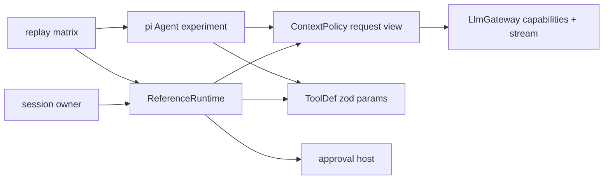

# Agent runtime and M1 context

## Routing

Select for AgentRuntime, turn orchestration, read/write batch ordering, approval-host waits, abort, transcript resume, context budgets, tool-schema conversion and runtime events. Start at core/src/agent/{runtime,context,types,tool}.ts under05_Software; focused tests are runtime.test.ts,context.test.ts,runtime-edge.test.ts,pi-spike.test.ts. [LLM gateway](llm-gateway.md) owns model metadata/transport/replay, [workbench storage](workbench-storage.md) owns durable rows and future session engine owns their integration. Production tool/permissions/write queue implementations have their own planning seams.

## Purpose and boundaries

Core ReferenceRuntime implements AgentRuntime over injected LlmGateway, Clock/IDs and approval host. ContextPolicy creates detached provider request views. The experiment adapter runs actual pi-agent-core but has no production export. [Runtime comparison](../../06_SoftwareDocu/agent-runtime-spike.md) gives event mapping and [ADR0014](../../00_Planning/decisions/ADR-0014-agent-runtime-spike.md) selects reference.

## Public interface

- start accepts systemPrompt,model string,ToolDef[],Message[],ContextPolicy; send runs one turn and returns end/aborted/error/limit; abort propagates the turn signal; onEvent returns unsubscribe; messages returns full detached pi Message[]. Busy start/send return BUSY.
- RuntimeHost owns gateway,now,nextId,approve(validated cloned call,signal). ToolDef owns name,class(read/write/session),description,params(zod),execute(args,signal). Approval host binds decisions to the prepared change.
- ContextPolicy.prepare resolves a counted view from current capabilities. TokenCounter counts a whole system/tools/messages request and labels estimates. toolSpecs converts pure JSON Schema through Type.Unsafe; original zod validates execution arguments.

## Invariants

- Every dispatch resolves current capabilities and reserves effective output plus max(1024,ceil(context*0.05)). Default fallback counts UTF8 JSON bytes plus explicit framing; estimates are labeled. Preflight budget fields retain accumulated provider actual usage separately.
- Completed results shorten oldest-first only in a detached request view, retaining IDs/outcomes/sourceRefs/marker and complete pairs. Mandatory system/user/unfinished context remains; irreducible view emits CONTEXT_LIMIT/context.budget_exceeded then turn.done limit with zero dispatch.
- Contiguous reads overlap; writes/session tools flush reads and run source-order. Every call receives a source-order result, including abort/cap/truncated-output refusal. Tool failures and invalid args return errors to the model.
- One controller per send; approval waits receive it, denied changes never execute. Observer mutation/errors cannot alter transcript or strand state. Full terminal messages remain verbatim; failed streamed text is retained text-only.
- Transient interrupted pair repair preserves persisted history; production durable recovery belongs to session owner. Core imports no Electron,renderer or app module. Replay tests make no real-provider requests.

## Change map

| Change | Start | Focused verification |
|---|---|---|
| Stream/events/abort/resume/order/limits | runtime.ts/types.ts | runtime.test.ts/runtime-edge.test.ts |
| Counting/reduction/tokenizer seam | context.ts | context.test.ts and long-first-turn matrix |
| zod conversion/validation | tool.ts/types.ts | schema and invalid-tool matrix cases |
| Candidate measurement | pi-spike.test-support.ts | pi-spike.test.ts/common matrix |

## Key behaviors

REQ-FUNC-27cc4ac0 streaming; FUNC-fa7348bd ordering; FUNC-1092757e approval; FUNC-3b48cda0 abort; DATA-ec55014b resume; REL-4dd25723 tool errors; NFR-8767cf78 whole-request budget; DATA-e2eba20d transient reduction; REL-20be9104 recoverable limit; FUNC-72e17b0f zod adapter; TEST-0abc4146 measured candidates.

## Architecture

## Files

Under05_Software/packages/core: src/agent/{runtime,context,types,tool}.ts; src/agent/{runtime,context,runtime-edge,pi-spike}.test.ts; runtime-matrix.test-support.ts and pi-spike.test-support.ts; package.json/src/index.ts. Root package-lock pins the experiment. core/src/llm/replay.ts emits argument deltas. Current runtime contract and mapping live in06_SoftwareDocu/agent-runtime-spike.md and ADR0014.
