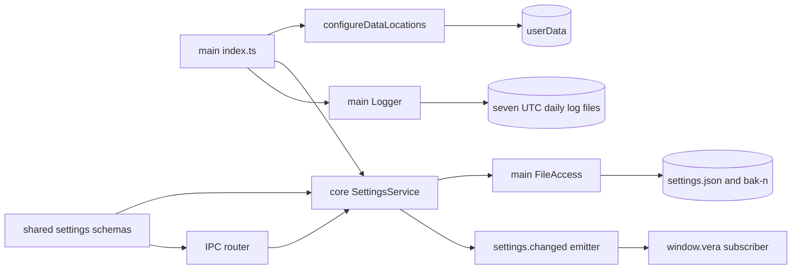

# Application data, settings and logging

## Routing

Select for settings.json, installationId, schemaVersion, app.settings.get/update, portable data,
PathProvider/Clock/FileAccess/Logger, atomic writes and secret redaction. Start with
05_Software/packages/core/src/settings/service.ts and packages/shared/src/settings.ts.
Focused tests sit beside the service and main adapters. Native lifecycle is
[desktop-shell](desktop-shell.md); validated transport is [ipc-boundary](ipc-boundary.md).

## Purpose and boundaries

Core owns versioned settings and serial updates through injected host ports. Desktop main supplies
paths, clock, atomic filesystem and JSON logs, loads settings before creating the renderer,
and drains accepted updates/log writes on quit. Shared owns persisted and patch schemas.

## Public interface

- SettingsService.load/get/update/close; get/update return detached {settings,readOnly}.
- Schema 3 persists a stable installation UUID, language/theme/textScale and current non-secret
  model/provider/update/recent/limit defaults. Exact contract:
  [data spec](../specs/REQ-DATA-4a030001.md).
- app.settings.get({}) and app.settings.update(patch) use validated schemas.
  VeraApi exposes getSettings/updateSettings; mockApi uses the same schemas and event behavior.
- PathProvider supplies userData/settings/logs; Clock supplies now/sleep; FileAccess supplies
  read/writeAtomic/exclusive backup; Logger supplies log/registerSecret/flush.
- A regular executable-adjacent vera.portable selects adjacent data before readiness and the
  instance lock; otherwise explicit user-data-dir precedes installed userData. Selected override
  directories are created recursively before Electron setPath, whose contract requires existence.
- Logs contain ISO UTC timestamp, debug/info/warn/error level, message and optional data in
  userData/logs/vera-YYYY-MM-DD.log. registerSecret returns idempotent unregistration.

Renderer preferences consume this snapshot through Query and i18next; [renderer foundation](renderer-foundation.md) owns a separate versioned localStorage geometry record. Main applies nativeTheme after loading and confirmed updates.

## Invariants

- Selected directories preserve existing contents; creation errors propagate before setPath with
  the previous host path intact. Installed defaults are resolved without eager creation.
- installationId/schemaVersion are immutable through strict nested patches. Persisted top-level,
  update/limit/recent extensions survive migration and updates; providers reject credentials.
- Versions 0, 1 and 2 validate preferences, fill schema3 defaults, preserve UUID and extensions,
  and create an exclusive byte-identical bak-n before atomic migration. [Providers](providers.md) owns strict provider writes, schema3 non-secret configurations and credential persistence.
- Newer schema loads read-only defaults; DENIED updates preserve bytes. Invalid current/old data
  returns INVALID; startup exits with a category log and preserves source bytes.
- Saves use exclusive temporary files, flush/close and same-directory rename. Windows transient
  rename errors receive bounded asynchronous retries; the previous target stays valid on failure.
- Updates serialize, merge against the latest state, and emit after successful changed saves.
  Failed saves preserve memory/events and allow later updates. No-op patches emit nothing.
- Close denies new updates and drains accepted work; logs drain after window close.
- Log content keys/values are scrubbed before serialization and at write time, preserving valid JSON.
  Rotation retains the newest seven daily logs and unrelated files.

## Change map

| Change requested | Start with | Focused verification |
|---|---|---|
| Settings schema/migration/update | shared settings.ts; core settings/service.ts | service.test.ts |
| Atomic filesystem/retry | main file-access.ts | file-access.test.ts |
| Portable locations | main data-locations.ts and index.ts | data-locations.test.ts |
| Levels/rotation/redaction | main logger.ts | logger.test.ts |
| Native persistence/read-only | main index.ts; IPC contracts | e2e/shell.spec.ts |

## Key behaviors

- REQ-DATA-4a030001 — first-run defaults and stable unique identity.
- REQ-DATA-4a030002 — validated version-0/1 migration to3 with backup; REQ-DATA-87619ef8 covers version2.
- REQ-DATA-dfbfac7c — ten typed recents; [workbench](workbench.md) owns lifecycle and missing state.
- REQ-REL-4a030003 — interrupted saves preserve valid settings.
- REQ-DATA-4a030004 — future schemas remain read-only and unchanged.
- REQ-FUNC-4a030005 — strict serial partial updates and post-save events.
- REQ-FUNC-4a030006 — validated settings bridge/API/mock.
- REQ-PLAT-4a030007 — portable data selected before readiness.
- REQ-FUNC-4a030008 — structured levels and seven UTC daily logs.
- REQ-SEC-4a030009 — registered-secret content redaction.

## Architecture

Ports keep core independent of Electron. Main owns platform I/O and supplies the event callback.

## Files

Paths below are relative to 05_Software.

- packages/shared/src/settings.ts — persisted/v0/patch/snapshot schemas, defaults and merge.
- packages/core/src/{index,ports}.ts — exports and host contracts.
- packages/core/src/settings/service.ts and service.test.ts — load/migrate/serial state/lifecycle.
- packages/core/vitest.config.ts — Node test project and shared source resolution.
- fixtures/settings/version-0.json and version-1.json — legacy preferences, UUID and extensions.
- apps/desktop/src/main/{data-locations,file-access,host-ports,logger}.ts — host adapters.
- apps/desktop/src/main/{data-locations,file-access,logger}.test.ts — storage/log regression seams.
- apps/desktop/src/main/index.ts — handlers, initialization and shutdown drains.
- apps/desktop/src/main/app-info.ts — effective portable-mode metadata.
- apps/desktop/src/renderer/api/{client,ipc}.ts and mocks/mockApi.ts — settings API/mock parity.
- e2e/shell.spec.ts — real update/restart and newer-schema protection.
