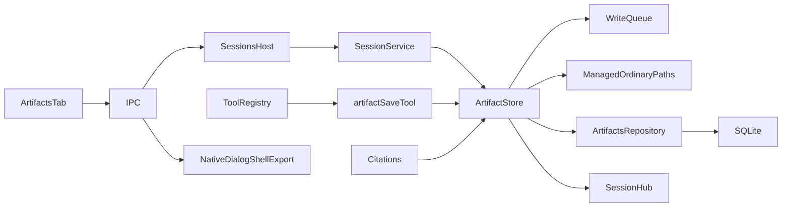

# Session artifacts

## Routing

Select for artifact_save, artifact refs, art_ULID rows, artifact.saved, Artifacts tab and list/open/reveal/export. Start at05_Software/src/libraries/core/src/artifacts/store.ts and tools/artifact-save.ts; real filesystem/SQLite proof is sessions/artifacts.test.ts. [Sessions](sessions.md) owns turns/citations/lifetime; [file tools](file-tools.md) owns workbench content and .vera denial; [IPC](ipc-boundary.md) owns authorization.

## Purpose and boundaries

Core ArtifactStore owns bounded UTF8 files in the application-managed .vera/artifacts/session namespace and the existing artifacts repository. SessionService binds session/ownership/queue/clock/events and validates citations. Main owns native dialogs, reveal and atomic export; React renders shared IPC content through the established inert Markdown renderer.

## Public interface

- artifact_save(name,content,description?,overwrite?) is session class and sequential, returns {ref:"artifact:<name>",bytes}; asks no approval, including read-only session permission mode. Disabled names and explicitly injected host policies remain effective; read-only workbench mutation is denied.
- ArtifactsRepository get/named/list/save uses schema1 session FK and unique(session_id,name); overwrite preserves art_ULID. List sorts UTC creation time/id ascending; rows retain MIME/bytes/SHA256/description/time.
- ArtifactStore save enters the shared WriteQueue, saves exclusive0600 same-folder temp/fsync/rename and commits metadata plus artifact.saved. Synchronous failure compensates filesystem bytes atomically under retained ownership before publication; committed notification failure preserves saved bytes. verified reads bounded ordinary files, compares stable inode/time/size, UTF8 and stored hash; missing returns NOT_FOUND, mismatched bytes CONFLICT. exists validates a session/name for citations. removeSession uses ordinary canonical ancestors and removes only the named session folder.
- Shared formatArtifactRef/parseArtifactRef/validArtifactName and strict ArtifactSummary/Content schemas have no host imports. Portable1..100 ASCII name characters exclude dot/dotdot, trailing dot and device stems;5MiB means5*1024*1024 UTF8 bytes.
- SessionService listArtifacts/openArtifact/verifiedArtifact protect current row/service lifetime; deletion shares write admission and SQLite cascades metadata. Citation validity requires a successful issued tool ref and verified file in the citing session.
- Main exportDestination(root,path) resolves existing ancestors and rejects runtime .vera destinations for both artifact and [session exports](session-export.md).
- IPC artifacts.list {sessionId}->ArtifactSummary[]; open/reveal/export {artifactId}; open adds UTF8 content; reveal returns{}; export returns{exported:boolean}. SessionsHost holds its lifecycle throughout the dialog; native export refreshes source after selection and refuses managed runtime destinations, including canonical aliases. Cancellation writes nothing. Main refuses credential-bearing names and scrubs descriptions/content/export.
- ArtifactsTab lists sizes/times, selects safe Markdown or wrapped plain text and exports/reveals with localized errors. Query keys include workbench/session/event revision/artifact; overwrite revision refreshes content, navigation discards obsolete results and action errors. Browser mock implements corresponding channels and artifact-save scenario.

## Invariants

- Ordinary canonical managed ancestors/files, single-link files, current owned lock, lifetime and AbortSignal are checked before saves; general file tools retain .vera confinement.
- Runtime sequences non-read classes; cross-session saves/deletion share one workbench queue. Session-mode read-only does not change application-managed artifact authority; workbench read-only does.
- Existing schema1/migration hashes remain immutable. Filesystem and SQLite have separate crash boundaries: interrupted mismatches are refused by open/citations; explicit overwrite repairs the stored artifact. Untracked/name-alias files require another name or user reconciliation.
- Core imports no Electron; renderer imports no host/core/Node. Sandboxing, exact vera://app origin, import rules and secret redaction stay authoritative.

## Change map

| Change | Start | Focused proof |
|---|---|---|
| Save/overwrite/limits/rollback/ownership/deletion | ArtifactStore,artifactSaveTool,SessionService | core sessions/artifacts.test.ts |
| Refs/IPC/repository | shared refs/artifacts/ipc,ArtifactsRepository | shared artifacts-ipc.test.ts;core artifacts tests |
| Dialog/reveal/redaction/export | main artifacts.ts/index.ts | main artifacts.test.ts;tests/e2e/artifacts.spec.ts |
| View/live/late results/errors | ArtifactsTab,mock sessions | artifacts-tab.test.ts;tests/e2e/artifacts.spec.ts |
| Headless composition | CLI shared SessionService | tooling/cli.test.ts artifact case |

## Key behaviors

The save-artifact replay fixture matches save prompts about artifacts or summaries. Other replay/auto prompts retain their matching scenarios, including pathological and normal grep.

REQ-FUNC-bf809842 save/bounds;REQ-DATA-e3d4d5ba metadata/events;REQ-FUNC-997412a4 refs;REQ-FUNC-b3d37df6 reads;REQ-SEC-86010eb5 confinement/lifecycle;REQ-FUNC-5ece91b7 reveal;REQ-FUNC-8c00fdea export;REQ-UX-76d958ce viewer;REQ-REL-da260a86 refresh/isolation.

## Architecture

## Files

Under05_Software: core artifacts/store.ts,storage/repos/artifacts.ts,tools/artifact-save.ts,tools/context.ts/registry.ts,sessions/service.ts and agent/citations.ts; shared artifacts.ts/refs.ts/ipc.ts/index.ts; desktop main artifacts.ts/index.ts and renderer components/session/artifacts-tab.tsx,Shell/App,mocks/sessions.ts/mockApi.ts,styles/locales. Tests: core sessions/artifacts.test.ts,shared artifacts-ipc.test.ts,main artifacts.test.ts,renderer artifacts-tab.test.ts,tooling/cli.test.ts,tests/e2e/artifacts.spec.ts and tests/fixtures/llm-scripts/save-artifact.jsonl.
