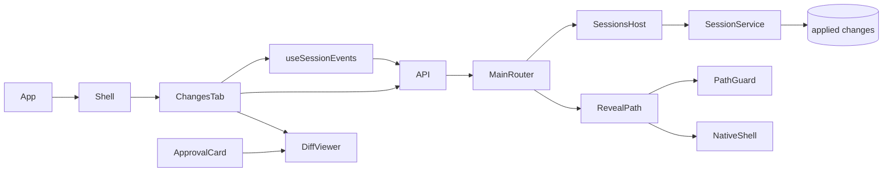

# Completed session changes

## Routing

Select for Changes tab, changes.list/get, recorded patch/counts/time ordering and Reveal in folder.
Start at core sessions/service.ts and renderer components/session/changes-tab.tsx under05_Software.
[File tools](file-tools.md) owns preparation/application/recovery; [sessions](sessions.md) owns
approval/runtime/event projection; [IPC](ipc-boundary.md) owns authorization/transport;
[Chat UI](chat-ui.md) owns session navigation and the shared approval patch viewer.

## Purpose and boundaries

SessionService projects completed SQLite changes for the active workbench. Main serves validated,
scrubbed summaries/details and confines native reveal to that workbench. Renderer presents ordered
session history through the shared API; application/edit approval persistence remains in core tools.

## Public interface

- changes.list({sessionId}) returns applied summaries with changeId,sessionId,path,createdAt,added,removed.
  Order is created_at ascending, then integer id; counts derive from recorded unified patch hunks.
- changes.get({changeId}) returns the same metadata plus stored diff. Identities are positive safe
  integers; missing session/applied row returns NOT_FOUND, malformed identity INVALID, closed service CONFLICT.
- Main SessionsHost supplies recovery/readiness and active workbench lifetime for reads/reveal.
- app.revealPath({path}) returns{} after PathGuard canonical/ignore validation and ordinary existing
  file verification and fresh canonical/ignore revalidation with the same target identity immediately
  before native shell.showItemInFolder. Missing files return NOT_FOUND; escaping,
  ignored and redirected exterior paths return DENIED. Read-only workbenches support these read actions.
- ChangesTab is keyed by workbench/session. It gets snapshot/sequence, subscribes from that sequence
  before listing, and keys list revisions by projected change identities. The first row is initially
  selected; live additions retain valid selection. Detail keys include workbench/session/change.
- DiffViewer supplies immutable coloured patch lines shared with ApprovalCard. Translated
  empty/loading/errors/retry/history/reveal controls use en/ro/de catalogs. MockSessions records
  completed details after approved mock edits, publishes change.recorded and scopes reads/reveal by workbench.

## Invariants

- Only applied rows represent completed changes; pending/conflict rows remain owned by write recovery.
- Stored patch bytes and counts survive later file edits and process restart. No schema migration is needed.
- Core stays Electron-independent; the exact authorized main frame, sandbox, vera://app and preload
  contracts remain the shared boundary. Main scrubs path/diff while preserving identities/dates/counts.
- Snapshot replay covers changes during initial loading. Obsolete list/detail/reveal outcomes and
  subscriptions are isolated when the session/workbench changes or the view unmounts.
- Native reveal never accepts arbitrary host paths. The existing lifecycle queue holds the current
  workbench while the confined native action runs; reveal does not change file bytes.

## Change map

| Change requested | Start with | Focused proof |
|---|---|---|
| Stored list/detail/order/counts | SessionService.listChanges/getChange | core sessions/changes.test.ts |
| Strict read channels | shared changes.ts/ipc.ts | shared changes-ipc.test.ts,preload/bridge.test.ts |
| Reveal confinement | main reveal-path.ts/index.ts | reveal-path.test.ts,path-guard.test.ts |
| Empty/history/diff/live/isolation | ChangesTab,useSessionEvents,DiffViewer | changes-tab.test.ts,workspace.test.ts |
| Mock lifecycle/projections | mocks/sessions.ts,mockApi.ts | sessions.test.ts,mockApi.test.ts |
| Native persistence | e2e/changes.spec.ts | ask approval -> live counts/diff -> restart |

## Key behaviors

REQ-FUNC-18000001 ordered applied history; REQ-FUNC-18000002 recorded detail;
REQ-UX-18000003 selectable presentation; REQ-REL-18000004 replay/live refresh;
REQ-SEC-18000005 confined reveal; REQ-REL-18000006 obsolete-view isolation;
REQ-FUNC-18000007 strict IPC.

## Architecture

Reads project the existing workbench-owned records; file tools own every write transition.

## Files

Under05_Software: packages/shared/src/{changes,ipc,index}.ts and changes-ipc.test.ts;
packages/core/src/sessions/{service,changes.test}.ts; apps/desktop/src/main/{index,reveal-path,reveal-path.test}.ts;
renderer App.tsx,components/shell.tsx,components/session/{changes-tab,diff-viewer,approval-card}.tsx,
changes-tab.test.ts,styles.css,locales/{en,ro,de}.json and mocks/{mockApi,sessions,sessions.test}.ts;
e2e/changes.spec.ts provides actual executable/main/preload-bound native approval/restart evidence
and minimum-size standalone browser acceptance.
