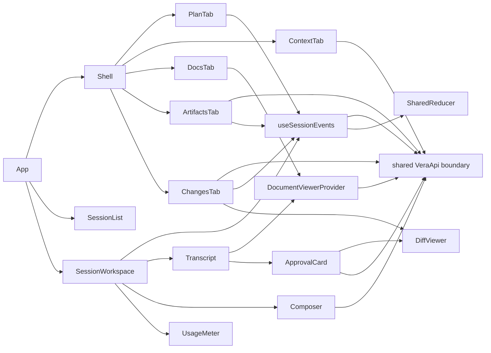

# Chat UI

## Routing

Select for session navigation/CRUD, transcript, Markdown/code/citations, reasoning/tool rows,
composer, @ completion, models, Stop, context usage and renderer resume. Start with
05_Software/apps/desktop/src/renderer/components/session/workspace.tsx and App.tsx.
Focused tests: components/session/workspace.test.ts; e2e/chat-ui.spec.ts and mock.spec.ts.
[Sessions](sessions.md) owns persistence/runtime; [renderer foundation](renderer-foundation.md)
owns geometry/preferences; [workbench](workbench.md) owns folder lifecycle/pinned edits.

## Purpose and boundaries

React presents durable session state through the shared API/reducer. Main/core own persistence,
tools, models, budgets and abort. The browser mock seeds six selectable states and an edit approval scenario through the same API.

## Public interface

- App owns one confirmed workbench snapshot shared with Welcome, Welcome/Settings/session memory routes and per-workbench selected IDs in localStorage.
- SessionList offers New/select/rename/confirmed delete/status; Ctrl+N creates when writable.
- SessionWorkspace composes transcript/composer/meter and Ctrl+F search; Escape confirms Stop.
- useSessionEvents gets snapshot/seq, then subscribes from seq; cancellation detaches obsolete views.
- Composer sends Enter, adds Shift+Enter newline, selects configured catalog models and completes
  caret-local @ paths with arrows/Enter/Tab/Escape. Connected subscription status enables a separate ChatGPT catalog query; sign-out removes those choices. Failed sends retain draft.
- ApprovalCard renders tool/path/bytes and coloured +/- patch lines inline beside the tool. Approve, Deny and Approve-and-switch invoke the exact stored digest. Focused A/D has no modifiers/repeat/composition; pending, decided and read-only cards lock actions and errors remain visible.
- Composer exposes the confirmed session mode during active turns; text/model controls lock while running or awaiting approval. Approval events invalidate sidebar summaries; new sessions inherit workbench defaults.
- ContextTab queries WORKBENCH.md and enabled validated [skills](skills.md) metadata with scoped Skills settings; ChangesTab shows ordered completed files/counts and the selected stored diff with replay/live refresh and confined reveal; ArtifactsTab lists saved sizes/times, opens safe Markdown/plain text and exports/reveals through shared IPC with revision-scoped live/replay queries; PlanTab displays the current ordered todo list through useSessionEvents with localized accessible status icons, empty/loading/retry states and keyed workbench/session isolation; Docs lists live index status/search/Open/Reindex/progress through the [document viewer](document-viewer.md). [Plan](plan.md) routes these contracts. [Artifacts](artifacts.md) routes these contracts. [Changes](changes.md) routes these contracts.
- `?mock=chat` exposes empty/streaming/tools/invalid/provider-error/context-limit fixtures.
- CitationChip uses shared refs.ts parsing/compact labels and per-kind page, range,
  heading, line and artifact icons. Full refs remain in tooltip/accessible labels.
  Unverified and malformed refs render inert warning chips; verified chips open the scoped document viewer through session/message-bound host revalidation.

## Invariants

- Exact renderer origin, sandbox and shared IPC authority apply. Renderer imports no native modules.
- Backend terminal text replaces transient deltas; full transcript remains visible after context limits.
- Late snapshot/event results cannot replace another session. Main replay starts after snapshot seq.
- Workbench readOnly, pending operations and active/approval turns disable relevant mutations;
  active Stop uses the real session.stop channel and leaves a usable composer at completion.
- Markdown skips HTML and renders links/images inert; verified message citations alone enable chips.
- Tool disclosures expose full arguments and preview/update/summary; errors and estimates are labelled.
- Dialog Cancel restores focus; keyboard controls and wrapping rem layout use en/ro/de catalogs.

## Change map

| Change requested | Start with | Focused verification |
|---|---|---|
| Navigation/CRUD/read-only | App, session-list | workspace.test.ts |
| Stream/resume/Stop | use-session-events, workspace | workspace.test.ts; chat-ui.spec.ts |
| Markdown/citations/tools | markdown, transcript, disclosure; shared refs.ts | markdown.test.ts; workspace.test.ts; e2e/citations.spec.ts |
| Composer/models/paths | composer | workspace.test.ts |
| Permission picker/approval cards/keys | composer,approval-card,transcript,use-session-events | workspace.test.ts; e2e/approvals.spec.ts |
| Plan task list | plan-tab;mock sessions | plan-tab.test.ts;e2e/plan.spec.ts |
| Usage/Context | usage-meter, context-tab | workspace.test.ts |

## Key behaviors

- REQ-UX-4bea0001 — keyboard navigation and session mutations.
- REQ-UX-4bea0002 — complete Markdown, tools, reasoning, citations and errors.
- REQ-UX-34535128 — compact per-kind verified/warning citation chips with full-ref accessibility.
- REQ-UX-4bea0003 — keyboard composer, paths and configured models.
- REQ-REL-4bea0004 — runtime/worker Stop and recovery.
- REQ-UX-4bea0005 — usage/estimates/context-limit guidance with complete history.
- REQ-REL-4bea0006 — snapshot/subscription resume and identical terminal text.
- REQ-UX-4bea0007 — pinned context and available skills state.
- REQ-TEST-4bea0008 — browser fixture and translated keyboard acceptance.

## Architecture

Durable state comes from
the backend; reasoning and live tool-update presentation are transient renderer state.

## Files

Paths relative to05_Software.

- apps/desktop/src/renderer/App.tsx — routes and workbench/session selection.
- apps/desktop/src/renderer/hooks/use-session-events.ts — guarded snapshot/subscription.
- apps/desktop/src/renderer/components/session/{workspace,session-list,composer,approval-card,transcript,markdown,disclosure,usage-meter,context-tab,changes-tab,diff-viewer,plan-tab}.tsx — session presentation.
- apps/desktop/src/renderer/components/session/workspace.test.ts — fixtures, keyboard, context, model, Markdown and read-only tests.
- apps/desktop/src/renderer/mocks/{mockApi,sessions,session-fixtures}.ts — bridge lifecycle and fixtures.
- apps/desktop/src/renderer/{styles.css,locales/en.json,locales/ro.json,locales/de.json} — responsive styling and catalogs.
- apps/desktop/src/main/index.ts; packages/shared/src/ipc.ts — config readOnly metadata and instrumented replay delay composition.
- fixtures/llm-scripts/ui-{slow,grep-bad,grep-good}.jsonl — deterministic native acceptance.
- e2e/{approvals,chat-ui,mock}.spec.ts — real native lifecycle/abort and browser matrix.
- components/session/markdown.test.ts and e2e/citations.spec.ts — all reference kinds,
  warning presentation, inert controls and native restart citation projection;
  fixtures/llm-scripts/citations-all.jsonl supplies deterministic tool-issued refs.
- tests/tooling/build-mode.test.ts — release omission of replay delay seam.
- apps/desktop/package.json; package-lock.json — pinned Markdown/component-test dependencies.
