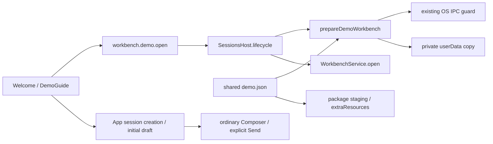

# Demo and onboarding

## Routing

Select for VERA-DEMO-01, first-run Welcome, suggested prompts and sample skills.
Start at main/demo-workbench.ts, renderer/components/demo-guide.tsx and shared/src/demo.json.
Future focused scenarios: main/demo-workbench.test.ts, shared/demo.test.ts,
renderer/components/session/workspace.test.ts and mocks/mockApi.test.ts.
[Workbench](workbench.md) owns folder validation/locks/ingest/recents; [skills](skills.md)
owns discovery/load_skill; [chat UI](chat-ui.md) owns ordinary session state and composer.

## Purpose and boundaries

Main installs and opens a private bundled example through the existing session lifecycle.
Welcome presents the localized learning guide; App creates ordinary sessions and supplies
an ID-bound initial draft consumed when the composer mounts. Provider setup and Send stay
explicit user actions in the ordinary UI.

## Public interface

- `workbench.demo.open {}` returns WorkbenchSnapshot; the host selects source/destination.
- `prepareDemoWorkbench(userData,bundled)` returns the installed/reused ordinary folder.
- `demoWorkbench` exports the shared JSON identity and finite asset list consumed by packaging.
- `DemoGuide` offers datasheet, boot-log and bring-up prompts in en/ro/de, provider navigation,
  citation/index guidance and a route back through the workbench sidebar name.
- `Composer.initialDraft/consumeDraft` seed and consume a draft without sending it automatically.

## Invariants

- Private copy lives in canonical userData/demo-workbenches/VERA-DEMO-01. Existing files and
  runtime state survive reopen. An incomplete/redirected target is refused; no reset is implicit.
- Installation reuses the OS-released workbench IPC guard with its own installation identity,
  copies only allowlisted ordinary single-link files into owned staging and publishes by rename.
  Cleanup checks the parent and removes only that invocation's staging; interrupted leftovers
  remain unreferenced and a future installation can retry without deleting unknown contents.
- Main checks application settings readOnly before installing. Workbench open retains normal
  format/lock/storage/ingest/recents behavior and SessionsHost drains turns on replacement.
- Package staging and development use the same fixture inventory; runtime .vera/credentials
  and unrelated fixture/host files stay outside the shipped demo inventory.
- All board data is fictional. Log-analysis/checklist skills distinguish recorded events from
  expected checks: I2C delay then ready does not establish sensor-ID or LED acceptance.

## Change map

| Change requested | Start with | Future focused proof |
|---|---|---|
| Asset delivery/copy/reopen | demo.json, main/demo-workbench.ts, package.mjs, electron-builder.yml | main/demo-workbench.test.ts |
| Empty host-owned IPC | shared/ipc.ts, main/index.ts | shared/demo.test.ts; router/preload type consumers |
| Prompts/draft/localization | DemoGuide, Workbench, App, Composer, catalogs | workspace.test.ts; mockApi.test.ts; check:i18n |
| Sample procedures/corpus | fixtures/workbenches/demo-board | private copy inventory; fresh-userData realmodel by hand |

## Key behaviors

- REQ-FUNC-66b6fda6 — deliver/reopen the complete private fictional workbench and three skills.
- REQ-UX-194ecc98 — offer the demo and three localized ordinary-session prompt drafts.

## Architecture

## Files

Shared demo.json/demo.ts/ipc.ts; main demo-workbench.ts/index.ts; core index.ts exports the
existing guard. Renderer DemoGuide/Workbench/App/SessionWorkspace/Composer and en/ro/de catalogs;
mockApi carries the strict route. Package staging and builder extraResources deliver the finite
fixture inventory, including unchanged generated PDFs, source Markdown, log, notes and pinout,
GETTING-STARTED.md and skills/{datasheet-reader,log-analyst,bringup-checklist}/SKILL.md.
Future tests are listed in Routing; runtime/manual acceptance status belongs in the task journal.
