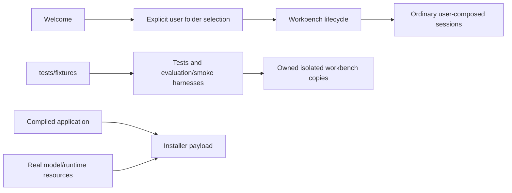

# Fictional verification fixtures

## Routing

Select for the fictional board corpus, PDF regeneration and fixture-only
retrieval/CLI/smoke inputs. Start at `05_Software/tests/fixtures/README.md`,
`scripts/make-demo-pdfs.mjs`, `scripts/retrieval/product-eval.mjs` and `scripts/package.mjs`.
[Workbench](workbench.md) owns explicit user folder creation/opening and the normal lifecycle;
[chat UI](chat-ui.md) owns user-composed sessions; [native packaging](native-packaging.md)
owns application and real model/runtime resource delivery.

## Purpose and boundaries

The fictional VERA-DEMO-01 corpus is verification data under `tests/fixtures/workbenches/`.
Tests and evaluation/smoke harnesses copy it into owned isolated workspaces. The application
starts with ordinary user-selected workbenches and explicit session input.

## Public interface

- Welcome creates or opens a user-selected workbench and displays recents.
- Ordinary workbench and session IPC contracts support those user actions.
- `makeDemoPdfs(destination)` generates the three fixture PDFs from fixture Markdown.
- `demo-board.json` is a test-only identity and finite asset inventory.

## Invariants

- Fictional documents, skills and inventory live in `tests/fixtures/` and remain outside
  the compiled application and installer resources.
- Test consumers use isolated copies; fixture source bytes remain stable.
- Existing user folders/profiles are preserved and remain openable through normal lifecycle.
- Model assets and Windows runtime libraries remain real packaged application resources.
- Board values are fictional evidence; recorded boot events do not prove unmeasured hardware checks.

## Change map

| Change | Source | Proof |
|---|---|---|
| Welcome and normal composition | renderer workbench/App/session components | workspace.test.ts; native workbench acceptance |
| Runtime contract and payload | shared ipc/index; main index; builder and package.mjs | workbench-entry.test.ts; packaging.test.ts; real staging |
| Fixture documents and PDF generation | tests/fixtures/workbenches; make-demo-pdfs.mjs | inventory/hash checks; demo-documents.test.ts |
| Retrieval and CLI inputs | scripts/retrieval; scripts/smoke-runtime; tooling tests | focused retrieval/CLI/PDF consumers |

## Key behaviors

- User-selected workbenches and explicit session composition.
- Fictional verification data is separate from the distributed application.

## Architecture

## Files

`tests/fixtures/workbenches/demo-board/`, `demo-board.json`; renderer App/Workbench/Composer;
shared ipc/index; main index; electron-builder.yml; scripts/package.mjs, make-demo-pdfs.mjs,
retrieval/product-eval.mjs, compare-embeddings.mjs and smoke-runtime.mjs.
