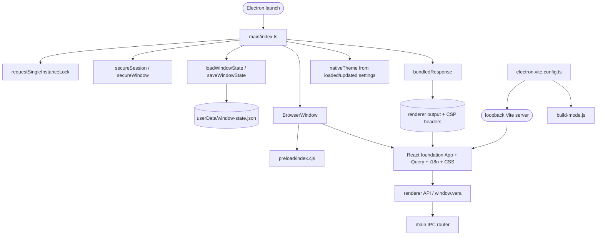

# Desktop shell

## Routing

Select for Electron launch, VERA window, sandbox, CSP, `vera://app`, permissions,
single instance, window geometry, React foundation shell and desktop Vite configuration.
Start at `05_Software/apps/desktop/src/main/index.ts`; focused acceptance is
`05_Software/e2e/shell.spec.ts`. Workspace/compiler commands belong to
[software-tooling](software-tooling.md).

## Purpose and boundaries

Main owns the native window, instance lock, local asset protocol and window-state file.
Main also wires [application data](app-data.md): portable paths, core settings, atomic filesystem and logs.
The sandboxed preload exposes the typed invoke/subscribe bridge; React displays Welcome/App Settings and application metadata
through its API. [IPC boundary](ipc-boundary.md) owns shared contracts, dispatch and event behavior.

## Public interface

`npm run dev` starts the loopback development renderer and Electron. `npm run build`
emits main ESM, preload CommonJS and renderer assets under `apps/desktop/out/`.
`--user-data-dir=<path>` selects the isolated Electron userData directory.
`window-state.json` uses schema version 1 and integer normal bounds; its format is
specified in [REQ-DATA-6c54a48f](../specs/REQ-DATA-6c54a48f.md).

## Invariants

- Identity and userData precede the instance lock; the losing process exits before creating a window.
- Portable/explicit override directories are created before Electron setPath, readiness and the
  instance lock; real creation failures propagate. Settings load before the renderer. Shutdown drains accepted
  settings before window close, then flushes JSON logs after close.
- Window creation keeps context isolation, Chromium sandbox and web security enabled,
  Node integration disabled, and a minimum size of 1024 by 640.
- Navigation, new windows, webviews and permission requests/checks are denied before content loads.
- Production CSP is identical in meta and response headers; protocol assets stay inside the real renderer root.
- Development origin is exactly `http://127.0.0.1:5173`; its inline-script allowances are content hashes.
- Valid visible normal bounds persist atomically; corrupt or off-screen state uses centered defaults.
  A newer schema uses defaults without overwriting its file.

## Change map

| Change requested | Start with | Focused verification |
|---|---|---|
| Launch/instance behavior | `src/main/index.ts` | built shell acceptance |
| Asset/security policy | `src/main/security.ts`, `content-policy.ts` | built security acceptance |
| Geometry/storage format | `src/main/window-state.ts` | `window-state.test.ts`, geometry acceptance |
| Metadata/API/events | [ipc-boundary](ipc-boundary.md) | shell and browser mock acceptance |
| Renderer styles | `src/renderer/styles.css` | shell screenshot and development acceptance |
| Dev/preload/build environment | `electron.vite.config.ts`, `src/preload/index.ts` | development acceptance, build-mode test, typecheck |

## Key behaviors

- `REQ-UX-6ccae258` — one native window and visible VERA identity.
- `REQ-UX-4a040003` — nativeTheme follows initial and confirmed updated settings.
- [Renderer foundation](renderer-foundation.md) owns UI routes, panels, preferences and translations.
- `REQ-SEC-bba4d0dd` — page-world Node primitives are inaccessible.
- `REQ-SEC-11244926` — restrictive production CSP blocks injected inline scripts.
- `REQ-SEC-1aba9c7c` — attempted renderer navigation retains the app.
- `REQ-SEC-d6fdde98` — window.open is denied.
- `REQ-SEC-250c645c` — permission requests and checks are denied.
- `REQ-REL-9e5c0e0e` — a second process reuses the first instance.
- `REQ-DATA-6c54a48f` — safe normal bounds survive restart.
- `REQ-TEST-2308561a` — build-time test identity is fixed in emitted code.

## Architecture

This diagram shows shell ownership and build outputs. The IPC boundary page details the shared
schema, metadata and event call graph. The application-data page details core settings and host adapters; CLI exposes its workspace skeleton.

## Files

Paths below are relative to `05_Software/apps/desktop/` unless qualified.

- `package.json`, `tsconfig*.json`, `vitest.config.ts` — package identity and process-specific compilation/tests.
- `electron.vite.config.ts`, `components.json` — build/dev CSP and shadcn configuration.
- `src/main/index.ts` — lifecycle, lock, window creation and close ordering.
- `src/main/security.ts`, `content-policy.ts` — confined asset responses and denial handlers.
- `src/main/window-state.ts`, `window-state.test.ts` — storage and recovery semantics.
- `src/main/build-mode.ts` — compile-time identity export.
- `src/preload/index.ts`, `bridge.ts` — sandbox assertion and validated page-world bridge.
- `src/renderer/index.html`, `main.tsx`, `App.tsx`, `styles.css` — document, React entry and foundation shell; [renderer foundation](renderer-foundation.md) routes view files.
- `src/renderer/components/ui/card.tsx`, `lib/utils.ts` — adapted Card and class merging.
- `05_Software/e2e/shell.spec.ts`, `network-guard.ts` — real Electron acceptance and egress guard.
- `05_Software/tests/tooling/build-mode.test.ts` — emitted identity execution in both build modes.
