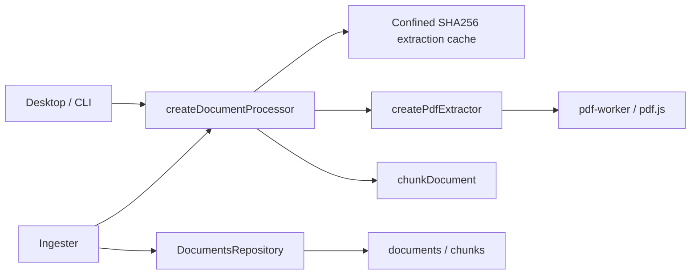

# Document extraction and chunks

## Routing

Select for supported text/PDF extraction, OCR classification, physical line or
heading/page chunk locators, extraction cache and demo PDFs. Start at core
knowledge/processor.ts; pure extraction/chunk tests are extraction.test.ts,
real worker/cache/ingest tests processor.test.ts. Queue/discovery/ownership route
to [knowledge ingest](knowledge-ingest.md); SQLite to
[workbench storage](workbench-storage.md). Model/retrieval comparison routes to [retrieval evaluation](retrieval-evaluation.md). ADR0015 selects the existing BGE tokenizer, with an empty passage prefix; query instructions live in the model descriptor.

## Purpose and boundaries

Core processors return extraction-derived chunks and status to the owned ingest
queue. Desktop and CLI supply independently bundled PDF workers. The ingest
queue owns SQL publication and source invalidation. Demo generation supplies
fictional board documents for document and future retrieval tests.

## Public interface

- createDocumentProcessor(PdfExtractor) accepts DocumentInput with current
  root/path/kind/hash, AbortSignal and ownership callback; returns typed status,
  optional PDF page count and chunks. The processor verifies ordinary input,
  size, identity and hash before using version1 extraction cache.
- createPdfExtractor(entry, deadlineMs=120000) executes one disposable Node
  thread per call; abort, deadline, invalid response, crash and early exit settle
  after termination. The dedicated pdf-worker calls pdf.js getTextContent per
  page, using installed local font/CMap/WASM assets.
- extractMarkdown uses CommonMark headings, ancestor paths, collision-safe
  slugs and original physical lines. extractHtml uses a parsed tree with decoded
  entities, block breaks and h1–h6 headings. extractText retains physical lines.
- chunkDocument packs page/heading paragraphs, splitting oversized text safely;
  text windows contain60 lines/advance50 and CSV repeats the original header.
  locator_json stores page, heading path/slug (Markdown line range), or line range.
- npm run make:demo-pdfs renders three Markdown sources to demo-board/docs:
  datasheet, reference manual excerpt and application note, with deterministic
  metadata and explicit page breaks.

## Invariants

- PDF chunks stay within one page; heading chunks stay within one section.
  Average trimmed PDF text below20 characters/page yields needs_ocr/zero chunks.
- Each chunk is at most1400 UTF16 characters and below512 tokens including
  special tokens, measured with the existing packaged BGE tokenizer snapshot.
  Full heading prefixes and verbatim CSV headers count toward both budgets;
  overflowing prefixes fail processing. The selected BGE descriptor has an empty passage prefix, so this budget
  includes the complete embedding passage input. Any future tokenizer/passage
  prefix change requires corresponding rechunking before embedding intake.
- Sources and cache ancestors refuse links/junctions; cache files also refuse
  hardlinks. Reads are bounded; cache JSON is version/kind/hash/schema validated.
  Malformed/incompatible entries regenerate from verified bytes.
- Cache lives at .vera/cache/extract/<sha256>.json. Exclusive temporary writes
  publish atomically under abort/ownership checks; owned temporary files are
  cleaned on failure. Content-addressed extraction survives document reindex;
  SQLite derived state follows source invalidation.
- PDF processing runs in a dedicated thread with local byte input and installed
  resource paths. Core imports its own dependencies and shared; Electron remains
  host-only. Initial schema and migration checksums stay immutable.

## Change map

| Change | Start | Focused verification |
|---|---|---|
| headings/HTML/UTF8 | extraction.ts | extraction.test.ts |
| chunk budgets/locators/windows | chunk.ts | extraction.test.ts |
| cache/hash/failures/lifecycle | processor.ts | processor.test.ts, ingest.test.ts |
| PDF parsing/worker host | pdf-worker.ts, worker-host.ts | processor.test.ts, document-hosts.test.ts |
| host wiring/build | host document-processor/pdf-worker entries | native ingest.spec.ts |
| demo documents | scripts/make-demo-pdfs.mjs, demo sources | demo-documents.test.ts, processor demo extraction |

## Key behaviors

- REQ-FUNC-e78b18ad — supported extraction and precise chunks/OCR.
- REQ-DATA-3898aa21 — confined extraction cache and current-source atomic publication.
- REQ-TEST-3ded3b59 — reproducible fictional board PDF documents.

## Architecture

The processor returns full extraction/chunks and optional local model vectors;
Ingester checks source identity and ownership then commits metadata, chunks, full
extraction and vectors in one transaction before events. Host composition supplies
[local embeddings](document-search.md); direct processors can supply their own
embedding port. Guarded read-only source verification is shared by read_doc.

## Files

- core/src/knowledge/{extraction,chunk,token-budget,processor,pdf-worker,worker-host}.ts — extraction/cache/worker.
- core/src/knowledge/{extraction,processor,ingest}.test.ts — fixtures and lifecycle.
- src/apps/{cli/src,desktop/src/main}/{document-processor,pdf-worker}.ts — host composition.
- tests/integration/document-hosts.test.ts and tests/tooling/demo-documents.test.ts; tests/e2e/ingest.spec.ts — compiled/native proof.
- scripts/make-demo-pdfs.mjs; tests/fixtures/{documents,workbenches/demo-board} — tests/fixtures/demo assets.

Tokenizer JSON/configuration are a semantic snapshot of the already packaged
Xenova/bge-small-en-v1.5 assets at revision
`ea104dacec62c0de699686887e3f920caeb4f3e3`, MIT license. The original hashes
are recorded in src/models/model-manifest.json. No ONNX/model runtime is used by
chunking.
