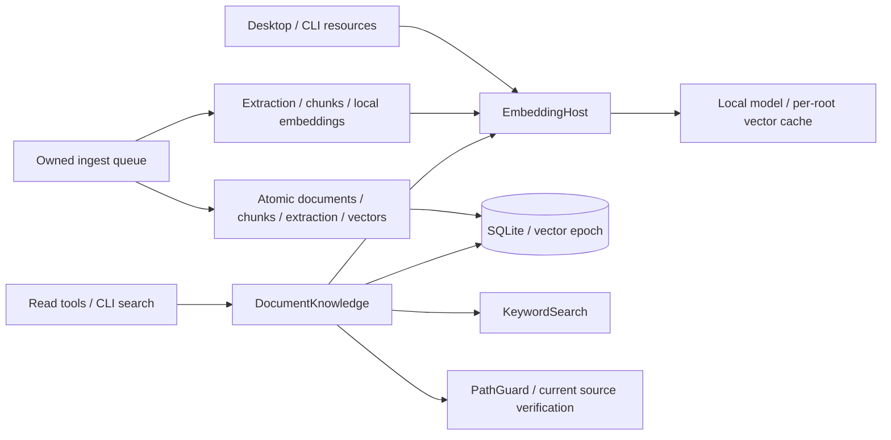

# Local semantic retrieval and document tools

## Routing

Select for persisted embeddings, semantic/hybrid ranking, search_docs/read_doc,
CLI index/search and the production retrieval gate. Start at core knowledge/
{embedding,embedding-worker,search,search-ranking}.ts and storage/schema.ts.
[Ingest](knowledge-ingest.md) owns source admission/publication and locks;
[extraction](document-extraction.md) owns locators/cache/chunks;
[keyword](keyword-search.md) owns lexical candidates;
[sessions](sessions.md) owns tool execution and issued citation projection.

## Purpose and boundaries

Core supplies a local CPU embedding host/worker and read-only DocumentKnowledge
over a workbench database. Desktop and CLI choose resource paths and independently
compiled worker entrypoints. WorkerPool continues to own grep; embedding operations
use their own persistent host because their payloads, lifetimes and caches differ.

## Public interface

- A semantic revision conflict during active publication switches to validated keyword after
  the current semantic attempt spends 150 ms. Cheap conflicts keep their requested-mode retry.
  All retries share the existing three-attempt cap and revision/cancellation checks.

- Agent search_docs/read_doc pass host-only application-data exclusions as the final search/read argument. DocumentKnowledge keeps workbench scope, refuses protected raw/extracted reads and omits protected cached search snippets in keyword/semantic/hybrid results, including canonical aliases. The index and internal default readers are unchanged. knowledge/search.test.ts exercises all four session modes against an already indexed protected document and a replaced alias.

- Core exports the registered IDs, the BGE default and `readEmbeddingModel` from the embedding API.
  A registered descriptor lives at `<models>/<model-id>/model-manifest.json`; the reader checks that
  it belongs to the requested directory. Desktop and CLI route each workbench to its configured model.
  The retrieval evaluator uses the BGE default. During a workbench model rebuild,
  hybrid and semantic searches return keyword hits and explain the temporary ranking mode.
  The keyword revision tracks source-content changes. Search snapshots its candidates
  before path verification so model-only publication preserves in-flight keyword results
  (REQ-FUNC-12403e85).
- EmbeddingHost(entry, models, manifest, deadlineMs=120000) embeds passages in
  batches32 and ranks normalized cosine top50. embed/rank accept root and signal;
  rank accepts vectors or a lazy vector provider evaluated at serialized admission;
  cached checks the current workbench lease and epoch/model/filter key. release(root) removes a
  workbench's lease; dispose releases all leases. The idle time (6th argument) may be a getter read as each
  idle period starts; `createModelDocumentServices(..., limits)` passes the application Embedding worker idle
  time and Document extraction time limit, which the desktop indexer receives with every IndexerHost message
  (`limits`) and the CLI resolves in-process (REQ-FUNC-bfbd70b6, REQ-FUNC-aa35b135).
- The Docs panel search passes `panelK` (its resolved Docs panel results, 10-100, default 20) to
  `DocumentKnowledge.search`; the agent's search_docs k stays 1-20 and KeywordSearch reads max(50, k) per index
  (REQ-FUNC-4b36dede).
- DocumentKnowledge(root,db,embeddingsProvider?,defaults?) supplies search(query,k?,mode?,
  pathGlob?) and read(path,page/pageEnd,heading,lineStart/lineEnd). Omitted k/mode
  take the defaults provider (SessionHost.retrieval from workbench.yaml retrieval),
  else 8/hybrid; explicit arguments win (REQ-FUNC-724d3fcc). Strict schemas
  bound k1..20, query1000 and prevent unknown fields. Results carry ref/path/
  typed locator/snippet<=300/score. Each result envelope records scope coverage
  and actual ranking usage. An absent semantic port, missing current-model vectors,
  indexer interruptions and embedding deadlines use keyword fallback when published
  chunks exist. Empty unsettled indexes suggest grep.
- read verifies confined current source SHA256 and reads full persisted extraction.
  PDF defaults page1; text defaults all lines; headings default first section, and
  `heading: ""` names the untitled text before the first heading. A heading section over
  the budget is returned in consecutive parts (`part`, default 1, with `part`, `parts`,
  `truncated`): each part fits 12000 characters and 28000 JSON characters, ends after its
  last fitting newline unless the next line cannot fit a part by itself (only such an
  over-budget line is cut, at the largest fitting length and never inside a surrogate pair), parts
  concatenate to the section, and every part cites the whole section. A page, slide or line
  over the budget is read in parts the same way: the parts cover the first unit of the
  requested range, cite that unit, and `truncated` stays true while the range continues
  (REQ-FUNC-3b70651a). A part outside 1..parts is an error naming the range
  (REQ-FUNC-91405ce5).
  Presentations read slides through page/pageEnd; documents and spreadsheets read
  by heading slug (a sheet's slug for spreadsheets); line locators are refused for
  office kinds (REQ-FUNC-56b34eec).
  Families and bounds are checked; complete ranges shrink to the actual returned
  ref within12000 characters and JSON budget. Oversized single pages or lines fail actionably.
- Registry offers both as read-class tools and respects disabled names/permissions.
  SessionService binds the workbench knowledge port. validDocumentRef resolves PDF
  pages/ranges, presentation slides/ranges and Markdown/HTML/document/spreadsheet
  heading slugs (shared pagedDocumentKinds/sectionDocumentKinds) through current
  guarded source SHA256, indexed metadata and matching persisted extraction bounds
  independently of output caps. The empty slug `path#h=` is the untitled leading section
  of an HTML, document or spreadsheet source; it is never valid for Markdown, whose
  preamble is cited by line range (REQ-FUNC-2a51bc39, REQ-FUNC-845e3114). validPdfRef retains the page-only compatibility entrypoint. Shared refs.ts
  owns syntax/format/labels; sessions owns successful-tool provenance and current
  text-line/session-artifact validation; transcript chips own presentation.
- Desktop and CLI bind search coverage to the owning live workbench through
  `documentIndexPhase(id, db?)`. Each successful `search_docs` tool item retains
  original coverage and usage in its typed `documentSearch` field
  (REQ-FUNC-b5c2fe1e). Agent and Display masking keep this metadata structural
  while redacting tool content. See the [response contract](../specs/REQ-FUNC-b5c2fe1e.md).
- CLI index reindexes a writable workbench and returns document statuses; search
  reads current owned/protected snapshots in three modes. Both drain workbench/
  worker/settings/temp resources on all exits. eval:retrieval uses production
  storage/worker/search over the frozen ordered corpus and raw questions.

## Invariants

- EmbeddingHost disables native ONNX telemetry (`disableOnnxRuntimeTelemetry`: ORT_DISABLE_TELEMETRY, and
  ORT_RUNNING_UNIT_TESTS on Windows) in the real parent before Worker
  initialization (the CLI's only ONNX host); the desktop main process also sets it in its first
  module, `main/inference-telemetry.ts`, so Whisper dictation and lazy embeddings inherit it.
- Manifest identity includes model/revision/dtype/descriptor/assets. Local assets
  are hash/length verified in the worker; Transformers disables remote loading,
  caches and inference fetch. Pinned q8 CPU ORT runs with one thread and uses manifest-selected pooling and L2-normalized
  float32 dim384. Query and passage prefixes come from the descriptor. Complete inputs, including
  special tokens, must remain below 512 tokens. A missing model manifest or tokenizer fails a processing attempt.
  Unchanged indexed documents keep their keyword chunks when the manifest is unavailable.
  Source-file disappearance and indexer interruption can request a retry.
- In the desktop app the EmbeddingHost lives in the [indexer process](indexer-process.md);
  search reaches it through the IndexerHost EmbeddingPort, which sends vectors only when the
  indexer reports the epoch as not cached (TASK-f09609fd). `embeddingModelId(model)` gives the
  stored model identity on both sides. A ranking error marked `retry` (indexer stopped or
  restarting) makes hybrid and semantic search return keyword results with a message saying so.
- Host admission deadlines include queue time. Abort/deadline/crash/early exit
  settle the caller at once; subsequent calls replace the worker. A worker inside a
  native ONNX call is retired, not terminated: it is terminated after its reply (or the
  deadline), and release/dispose wait for that, because terminating ONNX Runtime mid-call
  ends the whole process with 0xE06D7363 (seen when switching workbenches during indexing).
  Each used model has one serialized worker, started on the first embed or rank call.
  Vector cache keys include a workbench lease and epoch/model/filter. Last-root release and
  60 seconds without queued work both retire the worker. A new operation starts it again on demand.
- The schema (schema_version 1) includes embeddings with FK cascade and full document_extractions.
  DocumentsRepository validates extraction/vector count/finite/dimension/norm and
  atomically replaces chunks, full extraction and vectors in ingest publication.
  SQL triggers advance embedding_epoch for vector/chunk mutations and invalidate
  updated chunk vectors.
- Unchanged indexed sources reprocess when current-model vector coverage differs;
  file change/delete/reindex shares established ownership/abort invalidation.
  Protected read-only snapshots run no ingest; unavailable semantic/extraction data
  has an explicit error.
- Lexical and cosine lists cap50, ties use numeric ids; hybrid uses one-based
  RRF60 and deduplication. Validated path glob filters before candidate limits.
  Search guards lazy vector loading, async ranking and hit validation with the
  applicable revision. It discards conflicting attempts, tries the requested
  ranking twice, then tries keyword when needed. Three conflicting attempts
  return typed unavailability. Files runs its current-source and locator checks
  within the same attempt. Main reads lightweight candidate paths plus ranked
  passages; the worker caches vectors under the epoch, model and filter key.
- Frozen gate: hybrid24/28 overall,14/14 EN,11/14 RO; keyword/semantic reported
  separately. Locator matches use exact path/page/heading with top5 chunks.

## Architecture

## Change map

| Change | Start | Focused proof |
|---|---|---|
| local model registry, descriptor pins and preparation | shared embedding-models.ts, embedding-model-manifest.ts; prepare-model.mjs | workbench.test.ts, packaging.test.ts and actual cache preparation |
| model selection, prefixes, cache and worker lifetime | document-services.ts, embedding.ts, embedding-worker.ts | embedding.test.ts, embedding-models.spec.ts |
| atomic lifecycle/schema | storage/schema.ts, DocumentsRepository, processor/ingest | embedding-schema, embedding-ingest, ingest tests |
| modes/RRF/glob/snippets/read bounds | search.ts, search-ranking.ts, keyword.ts | search.test.ts, keyword.test.ts |
| live scope, retry and Files outcome | search-ranking.ts, workbench/service.ts, shared documents.ts | workbench/service.test.ts, documents-ipc.test.ts, docs-tree.test.ts |
| registry/replay/citations | tools/documents.ts, SessionService | registry/search replay and document-cli tests |
| citation page/heading bounds and current source | search.ts validDocumentRef; shared refs.ts | search.test.ts; agent/citations.test.ts; tests/e2e/citations.spec.ts |
| host/CLI/bundles | document-processor, entrypoints/builds | document-hosts/document-cli, build-mode/packaging and native ingest |

## Key behaviors

REQ-DATA-154fb0af atomic embedding lifecycle; REQ-FUNC-0e93fa45 deterministic
bounded retrieval; REQ-FUNC-cc209d7e guarded document tools and owned CLI.
REQ-FUNC-51165496 verifies issued document bounds against current source/extraction.
REQ-FUNC-7c394cbe and REQ-FUNC-18573c94 bind indexing and semantic search to the configured model.
REQ-NFR-ef69b1ff and REQ-NFR-d8ac1694 govern model worker startup, reuse and retirement.
REQ-FUNC-d3cde7ce and REQ-REL-a85542da govern revision recovery.
REQ-FUNC-b5c2fe1e, REQ-FUNC-9b31930e and REQ-FUNC-edc2e00a cover search metadata and cancellation.

## Files

Under `05_Software`: shared `embedding-models.ts` and `embedding-model-manifest.ts`, core knowledge/{document-services,embedding,embedding-worker,embedding-ingest,
search,search-ranking,processor,ingest}; storage/{schema,repos/documents};
tools/documents; CLI {args,documents,document-processor,embedding-worker}; desktop
{document-processor,document-embedding-worker,index,sessions}; evaluators/eval-retrieval-harness/{eval-retrieval,
product-eval}; 02_Tools/build/build-cli; 02_Tools/release/package; corresponding focused tests and ingest E2E.
