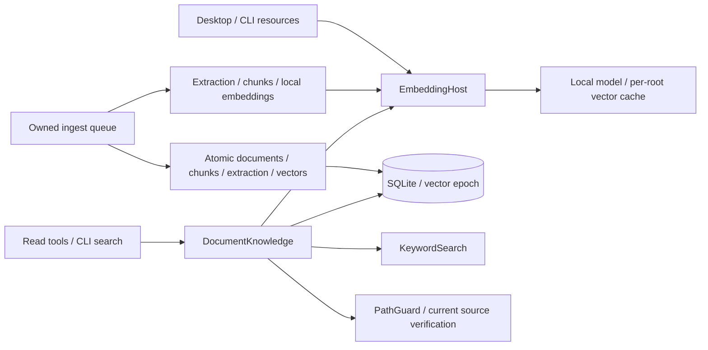

# Local semantic retrieval and document tools

## Routing

Select for persisted embeddings, semantic/hybrid ranking, search_docs/read_doc,
CLI index/search and the production retrieval gate. Start at core knowledge/
{embedding,embedding-worker,search}.ts and storage/schema.ts.
[Ingest](knowledge-ingest.md) owns source admission/publication and locks;
[extraction](document-extraction.md) owns locators/cache/chunks;
[keyword](keyword-search.md) owns lexical candidates;
[sessions](sessions.md) owns tool execution and issued citation projection.

## Purpose and boundaries

Core supplies a local CPU embedding host/worker and read-only DocumentKnowledge
over a workbench database. Desktop and CLI choose resource paths and independently
compiled worker entrypoints. WorkerPool continues to own grep; embedding operations
use their own persistent host because their payloads, lifetimes and caches differ.

## Public interface

- EmbeddingHost(entry, models, manifest, deadlineMs=120000) embeds passages in
  batches32 and ranks normalized cosine top50. embed/rank accept root and signal;
  rank accepts vectors or a lazy vector provider evaluated at serialized admission;
  cached tests an epoch/model/filter key; release(root)/dispose terminate/drain.
- DocumentKnowledge(root,db,embeddingPort?,defaults?) supplies search(query,k?,mode?,
  pathGlob?) and read(path,page/pageEnd,heading,lineStart/lineEnd). Omitted k/mode
  take the defaults provider (SessionHost.retrieval from workbench.yaml retrieval),
  else 8/hybrid; explicit arguments win (REQ-FUNC-724d3fcc). Strict schemas
  bound k1..20, query1000 and prevent unknown fields. Results carry ref/path/
  typed locator/snippet<=300/score. Empty index suggests grep; unavailable model
  vectors suggest reindex or keyword/grep.
- read verifies confined current source SHA256 and reads full persisted extraction.
  PDF defaults page1; text defaults all lines; headings default first section, and
  `heading: ""` names the untitled text before the first heading. A heading section over
  the budget is returned in consecutive parts (`part`, default 1, with `part`, `parts`,
  `truncated`): each part fits 12000 characters and 28000 JSON characters, ends after its
  last fitting newline unless the next line cannot fit a part by itself (only such an
  over-budget line is cut, at the largest fitting length and never inside a surrogate pair), parts
  concatenate to the section, and every part cites the whole section (REQ-FUNC-3b70651a).
  A part outside 1..parts, or with page/line arguments or a non-section source, is an
  error naming the range or the heading locator (REQ-FUNC-91405ce5).
  Presentations read slides through page/pageEnd; documents and spreadsheets read
  by heading slug (a sheet's slug for spreadsheets); line locators are refused for
  office kinds (REQ-FUNC-56b34eec).
  Families and bounds are checked; complete ranges shrink to the actual returned
  ref within12000 characters and JSON budget. Oversized single pages or lines fail actionably.
- Registry offers both as read-class tools and respects disabled names/permissions.
  SessionService binds the workbench knowledge port. validDocumentRef resolves PDF
  pages/ranges, presentation slides/ranges and Markdown/HTML/document/spreadsheet
  heading slugs (shared pagedDocumentKinds/sectionDocumentKinds) through current
  guarded source SHA256, indexed metadata and matching persisted extraction bounds
  independently of output caps. The empty slug `path#h=` is the untitled leading section
  of an HTML, document or spreadsheet source; it is never valid for Markdown, whose
  preamble is cited by line range (REQ-FUNC-2a51bc39, REQ-FUNC-845e3114). validPdfRef retains the page-only compatibility entrypoint. Shared refs.ts
  owns syntax/format/labels; sessions owns successful-tool provenance and current
  text-line/session-artifact validation; transcript chips own presentation.
- CLI index reindexes a writable workbench and returns document statuses; search
  reads current owned/protected snapshots in three modes. Both drain workbench/
  worker/settings/temp resources on all exits. eval:retrieval uses production
  storage/worker/search over the frozen ordered corpus and raw questions.

## Invariants

- EmbeddingHost disables native ONNX telemetry in the real parent before Worker
  initialization, covering desktop and CLI local inference.
- Manifest identity includes model/revision/dtype/descriptor/assets. Local assets
  are hash/length verified in the worker; Transformers disables remote loading,
  caches and inference fetch. Pinned q8 CPU ORT uses one thread, CLS/L2 float32
  dim384. Full prefixed inputs including specials must remain below512 tokens.
- In the desktop app the EmbeddingHost lives in the [indexer process](indexer-process.md);
  search reaches it through the IndexerHost EmbeddingPort, which sends vectors only when the
  indexer reports the epoch as not cached (TASK-f09609fd). `embeddingModelId(model)` gives the
  stored model identity on both sides. A ranking error marked `retry` (indexer stopped or
  restarting) makes hybrid and semantic search return keyword results with a message saying so.
- Host admission deadlines include queue time. Abort/deadline/crash/early exit
  settle the caller at once; subsequent calls replace the worker. A worker inside a
  native ONNX call is retired, not terminated: it is terminated after its reply (or the
  deadline), and release/dispose wait for that, because terminating ONNX Runtime mid-call
  ends the whole process with 0xE06D7363 (seen when switching workbenches during indexing).
  Serialized per-root workers cache vectors by epoch/model/filter. Root disposal
  clears cache and drains queued operations before owned resources disappear.
- The schema (schema_version 1) includes embeddings with FK cascade and full document_extractions.
  DocumentsRepository validates extraction/vector count/finite/dimension/norm and
  atomically replaces chunks, full extraction and vectors in ingest publication.
  SQL triggers advance embedding_epoch for vector/chunk mutations and invalidate
  updated chunk vectors.
- Unchanged indexed sources reprocess when current-model vector coverage differs;
  file change/delete/reindex shares established ownership/abort invalidation.
  Protected read-only snapshots run no ingest; unavailable semantic/extraction data
  has an explicit error.
- Lexical and cosine lists cap50, ties use numeric ids; hybrid uses one-based
  RRF60 and deduplication. Validated path glob filters before candidate limits.
  Search checks epoch across async ranking/path guards and rejects concurrent
  index changes. Main reads only lightweight candidate paths plus selected text;
  worker retains the vector matrix.
- Frozen gate: hybrid24/28 overall,14/14 EN,11/14 RO; keyword/semantic reported
  separately. Locator matches use exact path/page/heading with top5 chunks.

## Architecture

## Change map

| Change | Start | Focused proof |
|---|---|---|
| local descriptor/batches/cache/termination | embedding.ts, embedding-worker.ts | embedding.test.ts; real eval |
| atomic lifecycle/schema | storage/schema.ts, DocumentsRepository, processor/ingest | embedding-schema, embedding-ingest, ingest tests |
| modes/RRF/glob/snippets/read bounds | search.ts, keyword.ts | search.test.ts, keyword.test.ts |
| registry/replay/citations | tools/documents.ts, SessionService | registry/search replay and document-cli tests |
| citation page/heading bounds and current source | search.ts validDocumentRef; shared refs.ts | search.test.ts; agent/citations.test.ts; tests/e2e/citations.spec.ts |
| host/CLI/bundles | document-processor, entrypoints/builds | document-hosts/document-cli, build-mode/packaging and native ingest |

## Key behaviors

REQ-DATA-154fb0af atomic embedding lifecycle; REQ-FUNC-0e93fa45 deterministic
bounded retrieval; REQ-FUNC-cc209d7e guarded document tools and owned CLI.
REQ-FUNC-51165496 verifies issued document bounds against current source/extraction.

## Files

Under05_Software: core knowledge/{embedding,embedding-worker,embedding-ingest,
search,processor,ingest}; storage/{schema,repos/documents};
tools/documents; CLI {args,documents,document-processor,embedding-worker}; desktop
{document-processor,document-embedding-worker,index,sessions}; evaluators/eval-retrieval-harness/{eval-retrieval,
product-eval}; 02_Tools/build/build-cli; 02_Tools/release/package; corresponding focused tests and ingest E2E.
