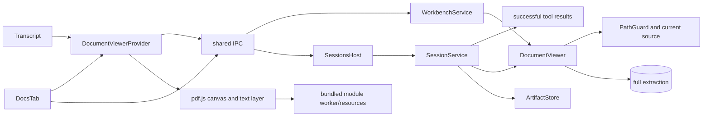

# Document viewer and Docs index panel

## Routing

Select for citation opening, document modal, PDF navigation/zoom/find/snippet,
Markdown/HTML anchors, numbered lines and Docs status/search/reindex/progress.
Start under05_Software at shared/documents.ts, core/knowledge/viewer.ts and
renderer/components/documents. Focused tests are viewer.test.ts, search.test.ts,
documents.test.ts and e2e/{citations,documents}.spec.ts.
[Document search](document-search.md) owns retrieval/extraction validity;
[sessions](sessions.md) owns successful-tool issuance; [ingest](knowledge-ingest.md)
owns the index queue; [artifacts](artifacts.md) owns managed content/actions.

## Purpose and boundaries

Core DocumentViewer resolves verified current content over guarded sources and
persisted full extraction. WorkbenchService serializes reads with its lifecycle;
SessionService resolves issued citation provenance/snippets and session artifacts.
The sandboxed renderer renders typed data through authorized IPC.

## Public interface

- docs.list({workbenchId}) returns scoped document statuses/reasons.
- docs.search({workbenchId,query}) returns at most20 current keyword hits after deduplicated per-source SHA/status/kind/locator verification and index epoch checks.
- docs.open accepts workbenchId with indexed path, document ref, or
  sessionId/messageId/ref. It returns scoped ViewerContent for PDF bytes/pages,
  Markdown/HTML sections and extraction slugs, numbered source lines or artifact.
- docs.reindex({workbenchId?}) checks identity/ownership before ingest admission.
- DocumentViewer.open(ref,snippet?) and openPath(path) check source/locators;
  SessionService.openCitation resolves a completed assistant citation against
  preceding successful tool results and current file/artifact content.
- DocumentViewerProvider opens an isolated modal from Transcript or DocsTab,
  restores opener focus, handles load/error/retry and intercepts PDF Ctrl+F/Escape.
- PDF renders one page via the pinned bundled module worker, supports page/range,
  zoom50..200%, all-page extracted-text find and cross-run snippet/search marks.
- Docs subscribes to index events, displays status/reasons/progress, searches,
  opens sources/results and disables Reindex on read-only snapshots.

## Invariants

- Exact active workbench identity and host ownership are checked around reads.
  Lifecycle serialization keeps storage alive until the read completes.
- Current confined SHA256 and extraction kind/count/bounds are checked. Missing,
  stale, ignored, escaping, binary and invalid targets return structured errors.
- Line refs from file tools can open unindexed ordinary text within20MB; full
  original numbered lines and cited range retain their offsets; the renderer presents250 lines at a time with line navigation, bounding DOM cost for large sources.
- Citation requests require completed valid assistant projection and successful
  preceding structured ref issuance in the same session. Client snippets are absent.
- HTML executes as visible extracted text; Markdown uses inert links/images/raw
  HTML skipping. Artifact content uses the same renderer body as ArtifactsTab.
- Main omits Docs rows/hits whose locator identities contain known secrets, redacts remaining user text and bounds snippets after redaction, while retaining exact binary PDF bytes. Renderer has no Node/fs.
- Worker/resources are pinned local build assets; protocol realpath confinement,
  same-origin connect/worker CSP and local font blobs retain offline operation.
  PDF page canvases are bounded at16million pixels; parse/render errors offer retry.
- Scoped modal selections and disposed requests prevent late content replacing another view while Shell/Welcome drafts stay mounted.
  Controls use rem/theme tokens and en/ro/de; inner page scrolling contains overflow.

## Change map

| Change | Start | Focused proof |
|---|---|---|
| wire/source/locator bounds | documents.ts; viewer.ts | documents-ipc.test.ts; viewer.test.ts |
| provenance/session artifact | SessionService.openCitation | search.test.ts; citations.spec.ts |
| ownership/lifecycle | WorkbenchService.readDocuments | service.test.ts |
| PDF worker/assets/CSP | pdf-viewer;electron.vite.config;security | native citations.spec.ts; documents.spec.ts |
| dialog/index/locales/mock | viewer-context;docs-tab;mockApi | documents.test.ts;documents.spec.ts |

## Key behaviors

- REQ-FUNC-28ad0001 — guarded scoped viewer payload and citation provenance.
- REQ-UX-28ad0002 — accessible offline locator viewer and snippet navigation.
- REQ-UX-28ad0003 — live Docs index, search/open/reindex and progress.

## Architecture

Host services own authority and bytes. Modal scope owns presentation/lifetime;
index progress travels through existing workbench events.

## Files

Under05_Software: shared/{documents,ipc}.ts; core/knowledge/viewer.ts/test,
core/sessions/service.ts, workbench/service.ts/test and knowledge/search.test.ts;
desktop/main/{index,document-viewer,security,content-policy}.ts and
document-viewer.test.ts; renderer/components/documents/{viewer-context,docs-tab,
pdf-viewer}.tsx and documents.test.ts; session/{markdown,transcript,artifacts-tab};
App/Shell/styles/locales/mock documents+mockApi; electron.vite.config.ts/index.html;
fixtures/llm-scripts/document-viewer.jsonl; e2e/{citations,documents}.spec.ts.
