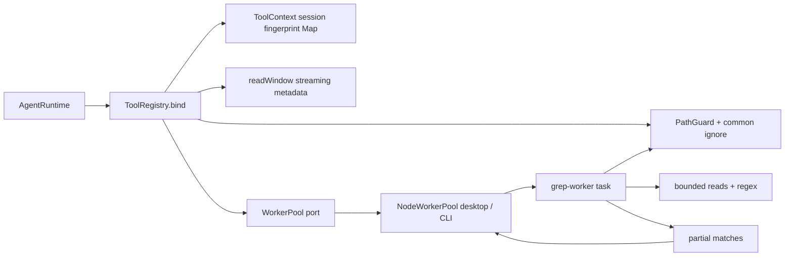

# Confined read-only file tools and worker hosts

## Routing

Select for PathGuard, binary detection, read/list/glob/grep, line refs, ToolRegistry, tools.disabled, last-read fingerprints and WorkerPool deadline/abort/replacement. Start at core/src/tools/registry.ts and workbench/path-guard.ts under05_Software. Focused tests: tools/{read,discovery,grep,registry,binary}.test.ts,workbench/path-guard.test.ts,workers/node-host.test.ts,shared/refs.test.ts. [Agent runtime](agent-runtime.md) owns orchestration/schema projection; [Workbench](workbench.md) owns lifecycle/ignore rules; [sessions](sessions.md) owns active-turn Stop, per-session contexts and read permissions.

## Purpose and boundaries

Core supplies context-bound tool definitions, canonical confinement, ignored discovery and streaming text reads. NodeWorkerPool hosts isolated grep tasks through the WorkerPool port; desktop/CLI adapters choose independently compiled entrypoints. Shared owns pure line reference parsing/formatting. Callers own session contexts and host disposal.

## Public interface

- ToolContext carries absolute root, optional WorkerPool and per-session lastReads Map. Product ToolDefinition execute(ctx,args,signal) returns JSON; ToolRegistry.bind supplies established runtime ToolDef execute(args,signal), propagating error outcomes through runtime's error-result handling.
- Registry.available/specs/bind/execute apply disabled names, validate zod args, use toolSpecs JSON projection and cap valid JSON at32000 characters with truncated. Failures have isError and actionable text; malformed serialized outputs are contained.
- PathGuard.create(root)/resolve(relative) return absolute/canonical relative/key. Root is realpath; Windows keys and ignore-metadata identity fold case. Deepest existing ancestors support new paths. Guard applies common ignore policy to lexical and canonical targets and refuses redirected ignore metadata.
- read accepts offset>=1 and limit<=2000, numbers selected lines, returns totalLines/truncated/ref and records full-file SHA256/mtime only after stable successful read. Source retention is bounded256KiB, preview30000 characters; complete metadata scans in64KiB chunks so large files support offsets past256KiB. PDFs direct to read_doc; binaries fail.
- list defaults root/depth1 with depths1..3 and name/type/bytes entries; glob uses tinyglobby, relative base, newest-mtime order and500-path cap. Discovery omits links and ignored entries.
- grep options follow architecture03§4; discovery/read/JS regex are worker-only, binary/>5MiB skipped. Content partials carry bounded previews (16000 match characters and2000 per emitted context line), marking clipped content truncated while searching subsequent files. Files/count omit unused previews; their truncation reflects search ceilings or timeout. Result ceilings end matching immediately. Timeout returns received partials/truncated/reason timeout; abort returns a tool error.
- NodeWorkerPool defaults capacity2/deadline10000ms; admission deadline includes queue time, one worker/task, dispose aborts pending/active tasks. Termination precedes terminal resolution and capacity replacement. Tests inject shorter host deadlines.

## Invariants

- Model-selected paths cannot leave root, select absolute/drive/UNC/device/reserved/NUL paths or ignored aliases. Windows native case aliases share a canonical fingerprint key.
- Worker sources are host-selected. Host timers and AbortSignal terminate stalled regex; matching has no main-thread fallback. Each terminal path cleans up listeners/timers and releases capacity after termination.
- Worker crashes, premature exits and startup failures return actionable retry errors and release capacity. Compiled desktop/CLI failure fixtures restore the real entry and verify subsequent matching through the same capacity-one pool; constructor rejection is covered independently.
- Source files are data; file tools expose no shell/network/write capability. Desktop sandbox/CSP and vera://app origin remain enforced; instrumented probe is compiled out of release.
- Fingerprints belong to each session Map; read stats and canonical/inode checks reject mutation before retaining a fingerprint. A terminal newline terminates the last line; empty files have0 lines and no locator.

## Change map

| Change | Start | Focused verification |
|---|---|---|
| Confinement/ignore/binary | PathGuard,isBinary | path-guard/binary tests, native Windows aliases |
| Read/fingerprint/line semantics | readTool,readWindow,refs | read/shared refs tests |
| Ignored sorted discovery | discoverFiles,listTool,globTool | discovery tests |
| Regex/options/worker protocol | grepTool,grep-worker.ts | grep/node-host tests |
| Host deadlines/abort/capacity | NodeWorkerPool,app adapters | node-host/worker-hosts/native file-tools acceptance |
| Schema/filter/errors/output cap | ToolRegistry,capToolResult | registry tests and runtime regression |

## Key behaviors

- REQ-SEC-c370e45b — Confine tool paths.
- REQ-FUNC-f558632e — Detect binary samples.
- REQ-FUNC-091ba439 — Read numbered bounded text.
- REQ-DATA-6e0a50db — Remember session read fingerprints.
- REQ-FUNC-86bf3083 — List bounded ignored directories.
- REQ-FUNC-6be2c915 — Glob sorted confined files.
- REQ-FUNC-758d1aee — Search file content in workers.
- REQ-REL-8f53fff6 — Terminate timed out grep tasks.
- REQ-REL-df1e6461 — Abort and replace grep workers.
- REQ-PLAT-2b27ef1d — Keep desktop responsive during grep.
- REQ-FUNC-0300323e — Validate filter and cap tool registry.
- REQ-FUNC-73151724 — Format and parse line references.

## Architecture

The host controls lifetime; the worker owns all grep discovery/read/matching. The registry adapts these tools to the runtime without importing an app.

## Files

Under05_Software: core/src/tools/{context,registry,read,read-window,files,binary,discovery,list,glob,grep,grep-worker}.ts and corresponding tests; core/src/workbench/path-guard.ts/test; core/src/workers/{node-host,worker.test-support}.ts and node-host.test.ts; core/src/{ports,index}.ts. shared/src/refs.ts/test/index.ts. apps/{cli/src,desktop/src/main}/{worker-pool,grep-worker}.ts; desktop/main/file-tool-probe.ts/index.ts and electron.vite.config.ts. tests/tooling/{worker-hosts,build-mode}.test.ts and e2e/file-tools.spec.ts. Dependency pins live in root/core package manifests and lockfile.
