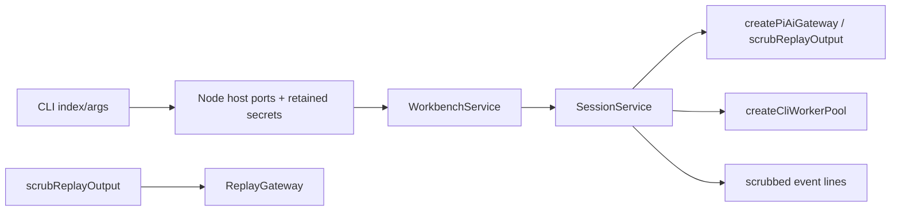

# Headless CLI

## Routing

Select for `vera run`, arguments, event/usage formatting, Node host ports and lifecycle. Start at05_Software/apps/cli/src/{index,args,run,host-ports,replay-output}.ts and scripts/build-cli.mjs. Focused tests are tests/tooling/cli.test.ts and apps/cli/src/host-ports.test.ts. [Sessions](sessions.md) owns durable transcript/events/recovery; [agent runtime](agent-runtime.md) owns context policy; [LLM gateway](llm-gateway.md) owns providers/replay; [file tools](file-tools.md) owns confinement and worker deadlines; [software tooling](software-tooling.md) owns npm/TypeScript/verification.

## Purpose and boundaries

CLI runs one durable SessionService turn over core/shared with Node-only host adapters. WorkbenchService owns locking and SQLite lifetime. Explicit headless ReplayGateway selects an isolated supplied script; desktop composition owns its separate compiled test boundary.

## Public interface

- `npm run vera -- run --workbench <dir> --prompt <text>` with explicit provider options. OpenAI(default) requires model; custom requires base-url/model; replay requires script. Optional session/data/key-file/format follow the [CLI spec](../specs/REQ-FUNC-1ed659ec.md). Unknown/duplicate/missing/incompatible flags return usage and2.
- JSONL(default) writes sessionId/optional seq/shared event in order; pretty writes escaped single-line details. stderr contains scrubbed structured operational errors and console JSON log lines. End/help returns0; operational error/error/aborted/limit returns1.
- Resume subscribes after the stored sequence and uses explicit invocation model; core preserves the historical transcript. New sessions include creation metadata from sequence0.
- PathProvider points to preserved supplied data or an owned temporary folder. Node Clock and atomic FileAccess supply settings/workbench operations. MemoryCredentials serializes mutations, clones values and honors abort. ConsoleLogger retains all registered raw/escaped secrets through exit.

## Invariants

- Credentials load from ambient OPENAI_API_KEY or a single-read UTF8 key-file override; successful key-file reads register before parser diagnostics. Credentials stay in memory; settings store non-secret fields. Known-secret invocation fields are rejected before persistence. Event/tool outputs are scrubbed through the core host, and each serialized output line passes shared scrub again.
- ContextPolicy and SessionService limits use desktop defaults/settings. CLI supplies WorkbenchService.getWriteQueue and awaits SessionService.waitReady before session operations. Grep runs through the existing host-owned worker adapter with10000ms absolute admission/execution deadline, termination and fresh-worker capacity; main thread performs no regex matching.
- SIGINT/SIGTERM request active-turn abort; reverse cleanup drains session before SQLite/workbench close and disposes workers, credentials/settings and owned temporary locations. Provided data survives. Cleanup attempts all owned resources even after a close error.
- CLI bundle uses exact installed esbuild and external dependencies/native addon; shared/core source aliases build without previous library output. Independent grep-worker entry resides beside index. Workspace bin points to dist/index.js.
- Process tests preload the existing Node loopback guard, use fictional keys and copied demo files, and exercise production deadline/context policy. Linux also sends an actual native SIGINT; a harness emits the same registered signal handlers inside real processes on both platforms.

- Repository .npmrc suppresses npm run-script banners to preserve event-only stdout and avoid raw argument reflection. Explicit replay records decode JSON escapes before canonical serialization is scrubbed and staged, preserving comment/blank-line support and core validation. Process receipts bind the actual executed index/worker paths and bytes, including npm-built dist. Process evidence uses a unique suite directory, exclusive writes, original byte streams and copied bundle hashes for each child.

Replay output passes through the CLI scrubReplayOutput adapter after bindings/interpolation: it aggregates the existing in-memory response deltas, scrubs complete text/tool argument values, then scrubs terminal/partial objects before runtime consumption or persistence. Replay emits one safe delta per complete text/tool value, retains original source-delta counts and source order. OpenAI/custom incremental streaming remains the shared gateway contract.

## Change map

| Change | Start | Verification |
|---|---|---|
| Options/exits/event format/resume | index,args,run | tooling/cli.test.ts |
| Node adapters/redaction/cleanup | host-ports,run | host-ports.test.ts;process failures/signals |
| Bundle/bin/command | build-cli,package manifests | typecheck;real npm vera acceptance |
| Budgets/grep | shared core context/session and worker adapter | loopback first turn;real10000ms timeout/replacement;worker-host tests |

## Key behaviors

REQ-FUNC-1ed659ec session; FUNCe0645fcd output; REL88dd69b2 exits; SEC25008e88 redaction; PLAT83f14f47 ports/cleanup; NFR3d884630 policy parity.

## Architecture

## Files

Under05_Software: apps/cli/{package.json,tsconfig.json,vitest.config.ts,src/index.ts,src/args.ts,src/run.ts,src/host-ports.ts,src/replay-output.ts,src/host-ports.test.ts,src/worker-pool.ts,src/grep-worker.ts};scripts/build-cli.mjs;package.json/package-lock.json;tests/tooling/cli.test.ts;fixtures/workbenches/demo-board/board.txt;README.md.
