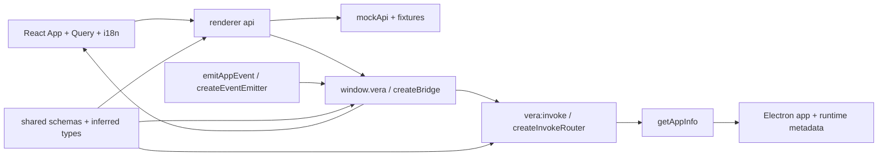

# IPC boundary

## Routing

Select for defineChannel, VeraError, app.info, window.vera, vera:invoke, vera:event,
settings.changed, subscriptions, 50ms coalescing and renderer API/mock behavior.
Start with shared src/ipc.ts and desktop src/main/ipc-router.ts under 05_Software.
Focused tests are ipc-router.test.ts, preload/bridge.test.ts and main/events.test.ts.
Native window/security/state belongs to [desktop-shell](desktop-shell.md);
compiler and acceptance commands belong to [software-tooling](software-tooling.md).

## Purpose and boundaries

Shared owns schemas and inferred request/response/event types. Main authorizes and dispatches
calls, reads native app metadata and emits application events. Preload validates the transport
and exposes invoke/subscribe; renderer api selects ipcApi or in-memory mockApi.
React reads metadata through TanStack Query and translates labels and error keys through i18next.

## Public interface

- Shared defineChannel, channels, Channel, Request, Response, VeraError and VeraBridge.
- app.info accepts a strict empty object and returns name/version/platform/arch/portable/locale.
- vera:invoke returns a validated success/error envelope; window.vera.invoke resolves the value
  or rejects a plain VeraError. Plain error objects retain fields across contextBridge.
- subscribe('app', on) receives AppEvent settings.changed and returns idempotent unsubscribe.
- emitAppEvent sends validated app envelopes on vera:event to the current live window.
- createDeltaCoalescer takes key/merge/emit functions, batches for 50ms, flushes explicitly before
  terminal events and cancels pending values on dispose.
- VeraApi adds getAppInfo to VeraBridge; VITE_API=mock selects mockApi during compilation.

## Invariants

- Only the current live own WebContents main frame at the configured exact renderer URL dispatches.
  Foreign, missing or detached frames return DENIED.
- Unknown/prototype channel names return NOT_FOUND; invalid requests return INVALID before dispatch.
- Invalid responses and unknown handler failures return logged INTERNAL; logs carry channel/category.
- Shared's sole runtime dependency is zod; Vite resolves the source entrypoint and sandbox preload bundles the shared schemas as CommonJS.
- Events validate topic/id/seq/payload and callbacks receive only event data.
- Each subscription owns its listener; unsubscribe removes it once.
- Coalescing preserves first-key insertion order; caller merge policies own text/update semantics.
- App metadata portable reports the executable-adjacent vera.portable marker.

## Change map

| Change requested | Start with | Focused verification |
|---|---|---|
| Channel/schema/type contract | shared src/ipc.ts | bridge.test.ts type assertions and router tests |
| Authorization/errors/dispatch | main/ipc-router.ts | ipc-router.test.ts; foreign renderer acceptance |
| Event lifecycle/batching | shared events.ts; main/events.ts; preload/bridge.ts | events.test.ts; bridge.test.ts; subscription acceptance |
| Metadata and mock parity | main/app-info.ts; renderer api/ and mocks/ | Electron shell and browser mock acceptance |
| UI query/error translations | renderer App.tsx, i18n.ts, locales/en.json | mock.spec.ts |

## Key behaviors

- REQ-FUNC-17dfdd16 — schema-derived channel contracts.
- REQ-SEC-744eb0a2 — own live main-frame authorization.
- REQ-FUNC-f3dfc04e — strict request validation before dispatch.
- REQ-REL-477c1921 — structured and sanitized failures.
- REQ-FUNC-c43658e9 — validated application event lifecycle.
- REQ-NFR-b8df2592 — keyed 50ms delta coalescing and cleanup.
- REQ-UX-6340c035 — metadata home through Query and translation.
- REQ-TEST-799c278d — browser mock boundary parity.

## Architecture

createDeltaCoalescer is a separately tested utility whose callers supply merge policy and flush ordering.

## Files

Paths relative to 05_Software.

- packages/shared/src/{index,ipc,events}.ts — shared public exports, invoke/error schemas and app events.
- apps/desktop/src/main/{ipc-router,events,app-info}.ts — dispatch, event utilities, native metadata.
- apps/desktop/src/main/{ipc-router,events}.test.ts — request/error/frame/batching regression seams.
- apps/desktop/src/main/index.ts — installs the one router and exposes the current-window emitter.
- apps/desktop/src/preload/{index,bridge}.ts and bridge.test.ts — sandbox bridge and transport tests.
- apps/desktop/src/renderer/api/{client,index,ipc}.ts and ipc.test.ts — one boundary and validation.
- apps/desktop/src/renderer/mocks/{fixtures,mockApi}.ts and mockApi.test.ts — in-memory metadata/event fixture.
- apps/desktop/src/renderer/{vera.d.ts,i18n.ts,locales/en.json,App.tsx,main.tsx} — browser types, translation and Query home.
- e2e/{shell,mock}.spec.ts — real Electron and standalone browser acceptance.
- scripts/dev-renderer.mjs — renderer-only Vite entrypoint, configured by desktop electron.vite.config.ts.
