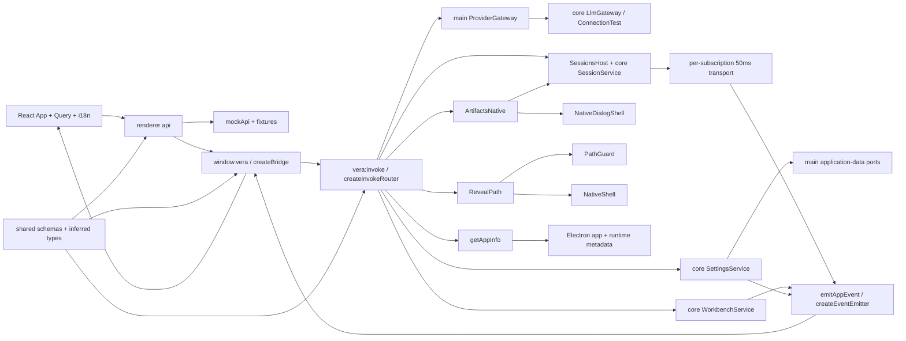

# IPC boundary

## Routing

Select for defineChannel, VeraError, app.info, window.vera, vera:invoke, vera:event,
settings.changed, subscriptions, 50ms coalescing and renderer API/mock behavior.
Start with shared src/ipc.ts and desktop src/main/ipc-router.ts under 05_Software.
Focused tests are ipc-router.test.ts, preload/bridge.test.ts and main/events.test.ts.
Native window/security/state belongs to [desktop-shell](desktop-shell.md);
compiler and acceptance commands belong to [software-tooling](software-tooling.md).

## Purpose and boundaries

Shared owns schemas and inferred request/response/event types. Main authorizes and dispatches
calls, reads native app metadata and emits application events. Preload validates the transport
and exposes invoke/subscribe; renderer api selects ipcApi or in-memory mockApi.
React reads metadata and settings through TanStack Query, applies confirmed preference snapshots, invalidates settings on app events and translates catalog labels and structured errors through i18next.

## Public interface

- Shared defineChannel, channels, Channel, Request, Response, VeraError and VeraBridge.
- providers.list/save/remove/models/test use strict public projections and key-bearing write requests; [Providers](providers.md) owns main-only values, consent, configuration and bounded hints. Main scrubs known-secret error params and event user text before transport.
- app.info accepts a strict empty object and returns name/version/platform/arch/portable/locale.
- vera:invoke returns a validated success/error envelope; window.vera.invoke resolves the value
  or rejects a plain VeraError. Plain error objects retain fields across contextBridge.
- subscribe('app', on) receives AppEvent settings.changed and returns idempotent unsubscribe.
- subscribe('workbench', wbId, on) filters validated opened/closed/config.changed events by id.
- app.chooseFolder and workbench.create/open/close/recent/config.get/config.update/pinned.get/
  pinned.update/files have strict requests/responses; configuration objects retain extensions.
  config.get includes optional folder/readOnly metadata for renderer reload. WORKBENCH_TOO_NEW is explicit. [Workbench](workbench.md) owns lifecycle semantics.
- emitAppEvent sends validated app/workbench/session envelopes on vera:event to the current live window. Schema-aware sanitization preserves protocol fields, identities and enums while scrubbing known-secret user text and arbitrary extension keys/values.
- artifacts.list/open/reveal/export use strict shared metadata/content schemas and current SessionsHost lifetime; [Artifacts](artifacts.md) owns verified files, native save cancellation, reveal/export and scrubbing.
- changes.list/get use strict summary/detail schemas and current SessionsHost recovery/lifetime. Main scrubs path/diff while preserving IDs/dates/counts. app.revealPath accepts a workbench-relative path, validates canonical confinement/ordinary existence and calls native shell; [Changes](changes.md) owns behavior and proof.
- todo.updated and session snapshot todos use shared bounded list validation; current known secrets redact optional todo IDs and text, with presentation text bounded at200 after redaction; Plan consumes the existing snapshot/subscription channels. [Plan](plan.md) owns whole replacement and icons.
- session.list/create/get/rename/delete/send/stop/model.set/mode.set/approval.decide use strict shared contracts. subscribe('session',id,sinceSeq,on) registers its listener before vera:subscription control; control authorizes the same current main frame, validates requests and caps active subscriptions128. Replay/live envelopes bind subscriptionId; unsubscribe and navigation/window/lifecycle cleanup release core listener and transport timers. [Sessions](sessions.md) owns persistence/recovery.
- session.approval.decide validates ses_/apv_ ULIDs, lowercase SHA256, approved/denied and approved-only switchToAutoEdit; main forwards to the live SessionService. session.mode.set stays available during active turns and read-only aborts waits. shared/approval-ipc.test.ts and e2e/approvals.spec.ts cover strict values and real exact decisions.
- Session list/get and mutation summaries redact user fields while preserving schema identities and enums. Titles remain bounded after redaction; known-secret text/title/model requests are refused. Mock sessions bind delayed responses to their originating workbench and drain aborted turns before switches/close.
- createDeltaCoalescer takes key/merge/emit functions, batches for 50ms, flushes explicitly before
  terminal events and cancels pending values on dispose.
- VeraApi adds getAppInfo/getSettings/updateSettings to VeraBridge; VITE_API=mock selects mockApi during compilation.
- app.settings.get({}) and app.settings.update(patch) return {settings,readOnly}.
  [Application data](app-data.md) owns schema defaults, migration and persistence semantics.

## Invariants

- Only the current live own WebContents main frame at the configured exact renderer URL dispatches.
  Foreign, missing or detached frames return DENIED.
- Unknown/prototype channel names return NOT_FOUND; invalid requests return INVALID before dispatch.
- Invalid responses and unknown handler failures return logged INTERNAL; logs carry channel/category.
- Shared's sole runtime dependency is zod; Vite resolves the source entrypoint and sandbox preload bundles the shared schemas as CommonJS.
- Events validate topic/id/seq/payload and callbacks receive only event data.
- Each subscription owns its listener; unsubscribe removes it once.
- Coalescing preserves first-key insertion order; caller merge policies own text/update semantics.
- App metadata portable reports the effective executable-adjacent regular vera.portable marker decision.
- Changed settings saves emit settings.changed after persistence. Future schemas expose read-only
  defaults and reject updates through the validated error envelope.

## Change map

| Change requested | Start with | Focused verification |
|---|---|---|
| Channel/schema/type contract | shared src/ipc.ts | bridge.test.ts type assertions and router tests |
| Authorization/errors/dispatch | main/ipc-router.ts | ipc-router.test.ts; foreign renderer acceptance |
| Event lifecycle/batching | shared events.ts; main/events.ts; preload/bridge.ts | events.test.ts; bridge.test.ts; subscription acceptance |
| Metadata and mock parity | main/app-info.ts; renderer api/ and mocks/ | Electron shell and browser mock acceptance |
| UI query/error translations | renderer hooks/use-preferences.ts, components/error-message.tsx, i18n.ts, locales/ | mock.spec.ts |

## Key behaviors

- REQ-FUNC-17dfdd16 — schema-derived channel contracts.
- REQ-SEC-744eb0a2 — own live main-frame authorization.
- REQ-FUNC-f3dfc04e — strict request validation before dispatch.
- REQ-REL-477c1921 — structured and sanitized failures.
- REQ-FUNC-c43658e9 — validated application event lifecycle.
- REQ-NFR-b8df2592 — keyed 50ms delta coalescing and cleanup.
- REQ-UX-6340c035 — metadata home through Query and translation.
- REQ-TEST-799c278d — browser mock boundary parity.

## Architecture

createDeltaCoalescer is a separately tested utility whose callers supply merge policy and flush ordering.

## Files

Paths relative to 05_Software.

- packages/shared/src/{index,ipc,errors,events,settings,workbench,providers}.ts — shared public exports, invoke/error schemas and app events.
- apps/desktop/src/main/{ipc-router,events,app-info}.ts — dispatch, event utilities, native metadata.
- apps/desktop/src/main/{sessions,session-events}.ts and their tests — session host, authorized subscription control and delta transport.
- apps/desktop/src/main/{ipc-router,events}.test.ts — request/error/frame/batching regression seams.
- apps/desktop/src/main/index.ts — installs the one router and exposes the current-window emitter.
- apps/desktop/src/preload/{index,bridge}.ts and bridge.test.ts — sandbox bridge and transport tests.
- apps/desktop/src/renderer/api/{client,index,ipc,subscriptions}.ts and ipc.test.ts — one boundary and validation.
- apps/desktop/src/renderer/mocks/{fixtures,mockApi}.ts and mockApi.test.ts — in-memory metadata/event fixture.
- apps/desktop/src/renderer/mocks/sessions.ts and sessions.test.ts — session contract and lifecycle fixtures.
- apps/desktop/src/renderer/{vera.d.ts,i18n.ts,locales/en.json,App.tsx,main.tsx} — browser types, translation and foundation Query view. [Renderer foundation](renderer-foundation.md) routes the complete UI file set.
- e2e/{shell,mock,workbench}.spec.ts — real Electron and standalone browser acceptance.
- scripts/dev-renderer.mjs — renderer-only Vite entrypoint, configured by desktop electron.vite.config.ts.
