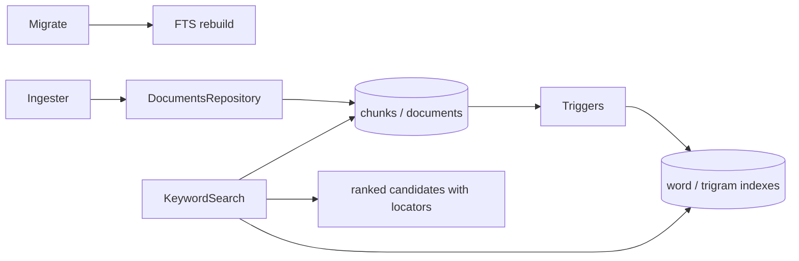

# Persisted keyword retrieval

## Routing

Select for word/identifier fragment indexes, lexical rank and persisted chunk
candidates. Start at core knowledge/keyword.ts and storage/migrations/0002_keyword.ts.
[Storage](workbench-storage.md) owns migration safety; [ingest](knowledge-ingest.md)
owns publication; [extraction](document-extraction.md) owns text/locators.
[Retrieval evaluation](retrieval-evaluation.md) owns the isolated benchmark.

## Purpose and boundaries

Core supplies synchronous persisted lexical candidates for subsequent search
composition. SQLite triggers maintain both indexes in the chunk transaction.
The workbench owns database lifetime; the processor/ingester owns chunk content.

## Public interface

KeywordSearch(db).search(query) returns up to50 KeywordCandidate rows: id, docId,
ordinal, path, typed locator, full text, best available raw bm25 and one-based rank.
Empty/punctuation queries and unupgraded read-only schema1 return [].

## Invariants

- Migration2 adds external-content chunks_fts with unicode61 remove_diacritics2
  and underscore tokens, plus chunks_tri with trigram; rebuild backfills existing
  chunks. Insert/update/delete triggers own all FTS writes, including FK cascades.
- Word queries use quoted literal Unicode letter/number/mark/underscore terms
  joined with OR through bound MATCH parameters. FTS operators are literal terms.
- Trigram terms have3+ Unicode codepoints and an ASCII digit or underscore.
  Each list sorts ascending bm25 then numeric id, capped at50. Fragment results
  invoke RRF60 of word/trigram lists; union sorts descending score then numeric
  id, deduplicated and capped at50. Ordinary words retain bm25 order.
- Search joins current chunks/documents and parses stored locators; no filesystem
  reads or dev-script imports. Calls are synchronous on the owned connection.

## Change map

| Change | Start | Proof |
|---|---|---|
| rank/literal terms/locator output | keyword.ts | keyword.test.ts |
| persistent index and lifecycle | 0002_keyword.ts, DocumentsRepository | keyword-migration.test.ts, ingest.test.ts |

## Key behaviors

- REQ-DATA-6c9447cb — atomic synchronized indexes/backfill and compatibility.
- REQ-FUNC-463b6c91 — deterministic word/fragment candidates and locators.

## Architecture

## Files

- 05_Software/packages/core/src/knowledge/{keyword.ts,keyword.test.ts}
- 05_Software/packages/core/src/storage/{migrate.ts,keyword-migration.test.ts,migrations/0002_keyword.ts}
- 05_Software/packages/core/src/storage/repos/documents.ts
- 05_Software/packages/core/src/knowledge/ingest.test.ts
