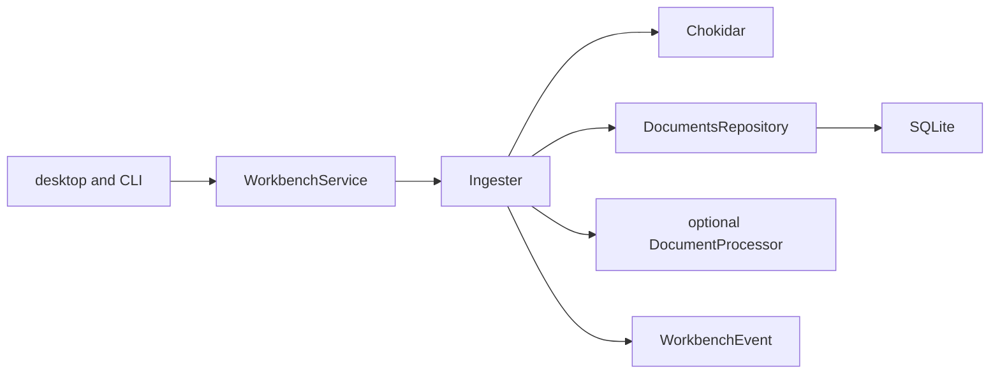

# Background document ingest

## Routing

Select for document discovery, watcher/hash/size states, index events, reindex
and source invalidation. Start at core knowledge/ingest.ts and
storage/repos/documents.ts under05_Software. Focused proof is ingest.test.ts,
shared documents-ipc.test.ts and native e2e/ingest.spec.ts. Workbench lifecycle
and locks route to [Workbench](workbench.md), database compatibility to
[Storage](workbench-storage.md), transport/redaction to [IPC](ipc-boundary.md).

## Purpose and boundaries

WorkbenchService owns one Ingester while storage is writable. Ingester observes
the filesystem, reconciles configured selection and persists document metadata;
DocumentsRepository invalidates derived rows. Desktop and CLI share the core
composition. A supplied DocumentProcessor completes processing; the default
composition retains supported documents pending.

## Public interface

- WorkbenchService.reindexDocuments serializes an owned rebuild. Strict empty
  docs.reindex IPC invokes it through desktop main; the mock enforces ownership.
- Ingester.request coalesces changes with trailing1000ms debounce; reindex clears
  and reconciles in the same queue; close stops/aborts/drains before disposal.
- DocumentProcessor receives root/path/kind/hash/AbortSignal and returns
  indexed/failed/unsupported/needs_ocr with optional pages/stable reason. The
  processor must settle on abort; publication checks file identity and ownership.
- index.document carries path and a typed record, null for removal;
  index.progress carries pending/done/failed counters for the reconciliation
  batch, including skipped paths. Main redacts paths and preserves protocol fields.
- DocumentsRepository list/get/save/remove/clearDerived uses existing schema1.
  Invalidation clears existing external-content chunks_fts/chunks_tri entries,
  associated embeddings and chunks before source deletion or replacement.

## Invariants

- Chokidar5.0.0 and picomatch4.0.7 are exactly pinned. File-event admission uses
  picomatch include/exclude and ignore rules; unrelated writes do not reset debounce.
  Shared normalization expands directory selectors and folds negative includes
  into exclusions before both admission and discovery.
  Tinyglobby resolves include minus exclude;
  PathGuard/shared ignore policies and ordinary ancestor checks confine input.
  Permanent .vera/.git/node_modules segments and symlink/junction aliases are
  excluded. Root .veraignore edits and saved configuration trigger reconciliation.
- Bounded asynchronous SHA-256 reads cap input at100MiB PDF/20MiB text. Exact
  limits are allowed. Unknown extensions, binary text and oversized files carry
  TYPE_UNSUPPORTED/BINARY/SIZE_LIMIT. Raw errors become IO/PROCESSING codes.
- Same hash skips completed/pending/unsupported content; failed content retries.
  Supported input starts pending, and indexedAt is set only for a successful
  supplied processor. A changed source during processing schedules reconciliation.
- Ownership is checked before synchronous SQLite mutations. Read-only workbenches
  keep private snapshots and run no watcher. Close/switch aborts and drains ingest
  before lock release/storage close; failed release restores observation.
- Schema1 migration SQL remains immutable; downstream tables are optional.
- Manual reindex admits work on the lifecycle queue and waits for completion
  outside that queue so close/switch can abort active processing.

## Change map

| Change | Start | Focused verification |
|---|---|---|
| Selection/hash/limits/status/processing | Ingester | ingest.test.ts |
| Invalidation | DocumentsRepository | synthetic FTS/embedding cases |
| Lifecycle | WorkbenchService | ingest and workbench service tests |
| IPC/event shape/redaction | shared contracts, main/events | documents-ipc and main events tests; native ingest |

## Key behaviors

- REQ-FUNC-a93d863d — background selection/hash/status/events with owned lifecycle.
- REQ-DATA-05172f94 — atomic invalidation on delete/change/reindex/deselection.

## Architecture

The workbench controls lifetime; processing extensions share its abort signal and
the serialized ingest queue.

## Files

- packages/core/src/knowledge/{ingest.ts,ingest.test.ts} — queue and integration.
- packages/core/src/storage/repos/documents.ts — metadata and derived cleanup.
- packages/core/src/workbench/service.ts — ownership/lifecycle/reindex.
- packages/shared/src/{documents.ts,documents-ipc.test.ts,events.ts,ipc.ts} — contracts.
- apps/desktop/src/main/{index.ts,events.ts,events.test.ts} — IPC and scrubbed events.
- apps/desktop/src/renderer/mocks/{mockApi.ts,mockApi.test.ts} — mock reindex.
- e2e/ingest.spec.ts — native sandboxed host acceptance.
