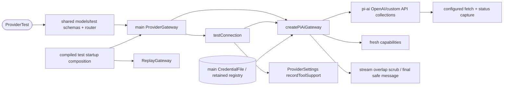

# LLM gateway and provider connection tests

## Routing

Select for LlmGateway, model reference precedence, capabilities/budgets, providers.models/test, pi-ai, ReplayGateway, Test UI and smoke:live. Start at core/src/llm/{gateway,providers,connection}.ts under05_Software; focused tests are gateway.test.ts and replay.test.ts. [Providers](providers.md) owns stored credentials/configuration/consent; [IPC boundary](ipc-boundary.md) owns authorization and transport; [Agent runtime](agent-runtime.md) owns mandatory context reduction; OAuth has its own implementation seam.

## Purpose and boundaries

Core resolves models and wraps exact-pinned pi-ai1.1.0. Desktop main supplies current settings, stored credentials, Clock and process-lifetime scrubbing, owns accepted-operation drain and records observed custom tool support. Shared projects strict non-secret catalogs and four-step results; renderer renders imperative local test state with en/ro/de presentation. The mock exposes a small offline mock-openai fixture catalog and honors explicit model overrides/auth failure semantics.

## Public interface

- resolveModelReference(session,workbench,app), splitModelReference; LlmGateway selectedModel/capabilities/models/stream. Model IDs retain slashes; session wins over workbench over app.
- createPiAiGateway(host) exposes current OpenAI/custom API collections and empty subscription. Host supplies settings, CredentialStore, scrub, now and optional fetch/knownSecrets.
- capabilities expose contextWindow/maxOutputTokens/safetyMargin/inputBudget/supportsTools; custom configured limits are authoritative. OpenAI effective output is capped16384 and context-margin-1.
- providers.models({id}) returns scrubbed catalog metadata. OpenAI default is offline static metadata; connection Test explicitly probes the endpoint. Custom catalogs validate discovered IDs against reference syntax and attach configured capabilities and fall back on404/405/501 only.
- providers.test({id,model?}) returns reachability/authentication/tools/streaming ordered pass/fail/skipped rows. Authentication failure skips downstream probes. Streaming requests a complete multiword sentence and requires multiple nonempty source text chunks; a single-token OK is sufficient for authentication, while one coalesced text chunk fails streaming. Tools requires an offered echo call with exactly the required string text and no extra properties.
- ProviderGateway tracks models/test, denies new calls after close and drains accepted work. ProviderSettings records tool support only for an unchanged writable configuration.
- ReplayGateway is an explicit core/replay test subpath: deterministic JSONL, filename or regex selection, transcript-derived steps, text and tool-argument deltas, artifact bindings and injected Clock.
- smoke:live builds release and manually tests a stored real configuration through main; all required steps must pass, with unsupported listing optionally skipped. [Software README](../../05_Software/README.md) gives usage.

## Invariants

- Main owns stored secrets; OpenAI ignores ambient environment/OAuth keys. Custom requests use conservative compatibility and an optional-key placeholder.
- Per-request provider snapshots prevent concurrent requests crossing endpoints. Redirects are rejected; configured origin is enforced for stream fetches. Timeout30s, retry0, cancellation propagation.
- Provider errors map to OFFLINE or PROVIDER with auth/rate_limit/context/provider reasons, safe messages and optional Retry-After. Retained raw/escaped secrets are scrubbed across stream chunk boundaries and in final messages; actual usage and protocol discriminants are preserved. Complete assistant metadata/signatures are recursively scrubbed, and successful/partial timestamps use host Clock at terminal emission.
- Shared strict projections and the existing authorized sandbox bridge guard catalog/result IPC. Renderer keeps no credential-bearing query mutation cache.
- Test registration and dynamic replay import reside entirely inside compiled __VERA_TEST__; release emission excludes their code. Automated Node and acceptance transports block non-loopback traffic before dispatch.
- Schema4 model defaults migrate0-3 with exact backups and future read-only protection. Live smoke is a distinct mandatory manual acceptance observation.

## Change map

| Change | Start | Focused verification |
|---|---|---|
| Model precedence/capabilities/catalog/auth/streams/errors | core llm gateway/providers/errors/stream-scrub | gateway.test.ts |
| Four-step results and host lifecycle | core llm connection; main provider-gateway/provider-settings | gateway.test.ts; provider-test.spec.ts |
| Replay transcript and release seam | core llm replay; main index; Vite alias | replay.test.ts; tooling/build-mode.test.ts |
| IPC/schema/migration | shared providers/ipc/errors/settings; core settings/service | bridge/router and service tests |
| Localized Test presentation/mock | renderer provider-test/providers/mockApi/locales/styles | mockApi.test.ts; e2e/{provider-test,mock}.spec.ts |
| Guarded automation/manual smoke | tests/network-guard/network-setup; scripts/smoke-live | tooling/network-guard.test.ts; manual real-provider observation |

## Key behaviors

- REQ-FUNC-05ee1ae5/f3e5db81/5f2220ee/762c3864/29854976 — configured collections, selection, fresh budgets, safe catalogs and measured connection steps.
- REQ-SEC-647da472 — scrubbed structured failures and streamed/final output.
- REQ-TEST-38b20a35/771b99be/c986438f — deterministic replay, release seam elimination and automated egress rejection.
- REQ-UX-53628854 — localized accessible per-step results.
- REQ-DATA-f69eaef6 — schema4 model-reference migration.
- REQ-FUNC-103979aa — manual real-provider smoke.

## Architecture

The host accepts generic gateway injection. Replay composition exists in the compiled test branch; ordinary service code contains no replay registrar.

## Files

All paths are under05_Software.

- packages/core/src/llm/{gateway,providers,connection,errors,stream-scrub,replay}.ts and {gateway,replay}.test.ts.
- packages/core/{package.json,src/index.ts}; packages/shared/src/{providers,ipc,errors,settings}.ts — dependency/export and strict contracts.
- apps/desktop/src/main/{provider-gateway,provider-settings,credentials,index}.ts — current-config host, capability persistence, secret registry and test composition.
- apps/desktop/electron.vite.config.ts — explicit replay source alias and compile-time test flag.
- apps/desktop/src/renderer/components/{provider-test,providers,error-message}.tsx; locales/{en,ro,de}.json; styles.css; mocks/mockApi.ts and mockApi.test.ts.
- tests/network-{guard,setup}.ts; tests/tooling/{network-guard,build-mode}.test.ts; e2e/{provider-test,mock}.spec.ts.
- scripts/smoke-live.mjs; package.json/lockfile; core/desktop/root Vitest configs and tooling tsconfig — command, pinned dependency and guarded test wiring.
