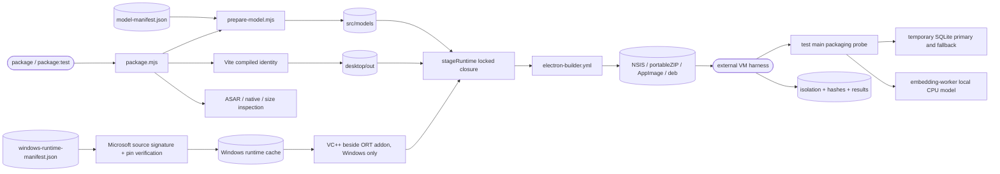

# Native packaging and feasibility probes

## Routing

Select for package/test-package commands, model asset delivery, ASAR native paths, NSIS/portable ZIP/AppImage/deb
budgets and packaged SQLite/embedding probes. Start at `05_Software/scripts/package.mjs`;
focused tests are `tests/packaging/packaging.test.ts and tests/tooling/build-mode.test.ts` and
`src/apps/desktop/src/main/packaging/sqlite-probe.test.ts`. General workspace/compiler behavior belongs
to [software-tooling](software-tooling.md); window/security lifecycle belongs to [desktop-shell](desktop-shell.md).

[Verification fixtures](demo-onboarding.md) routes the fictional corpus used by tests/evaluation/smoke; only real model/runtime resources enter the application payload.

## Purpose and boundaries

The package pipeline emits host Windows/Linux x64 artifacts with the pinned runtime closure,
verified model files and size/hash reports. Compiled instrumented shells exercise temporary
SQLite and real local CPU embeddings; external host evidence binds results to artifact hashes
and records actual connectivity or isolation.
The package delivers the BGE q8 assets selected in [ADR0015](../../00_Planning/decisions/ADR-0015-embedding-model-selection.md). The model descriptor supplies dimensions, token limit, pooling, normalization and query/passage prefixes. [Retrieval evaluation](retrieval-evaluation.md) owns comparative evidence; production indexing consumes the selected descriptor.

## Public interface

Already-built artifact functional/egress acceptance belongs to [release smoke](release-smoke.md).

From `05_Software`: `npm run prepare:model` (`-- --offline` verifies cache only),
`npm run package` (compiled release) and `npm run package:test` (compiled instrumented).
Outputs are `release_tmp/{test,release}/` host-native NSIS/portableZIP or AppImage/deb artifacts and schema2 `package-report.json`. ZIP carries vera.portable; NSIS is per-user without that marker. VERA Test product/appId/executable/staged package name and filenames identify instrumented artifacts.
The instrumented packaged app accepts `--packaging-probe=<absolute JSON path>` and exits 0/1
after writing schema-1 SQLite/embedding results. `probe-windows-offline.ps1` takes ZIP, expected
SHA256 and evidence directory; `probe-linux-offline.sh` takes AppImage, evidence directory and
test user in a dedicated VM. Measurements/status live in `06_SoftwareDocu/wp05-packaging-measurements.md`.

The prepack and final ASAR checks compare every non-license CMap/font/WASM resource against the exact-pinned pdfjs-dist source bytes. Certificate SHA1 and subject selectors are preserved together when both are configured.

VERA_UPDATE_URL configures generic update metadata and the compiled main feed. The staged
runtime closure includes electron-updater and its pinned transitive dependencies.
[Updates](updates.md) owns channels, mode controls, distribution capabilities and safe installation.

## Invariants

- Packaging compiles its own fixed test identity; runtime environment cannot enable release probes.
- Release app code excludes instrumented probe/worker/fixture markers and test hooks;
  production document workers remain bundled. Emissions and final ASAR are inspected.
- Model URLs contain the immutable revision; every cached/downloaded asset must match bytes and SHA256.
  Corruption fails; downloads occur only in explicit preparation/build commands.
- Native CPU libraries and models are real files outside ASAR. Foreign native OS/architecture fails inspection.
- Windows NSIS budget is250000000bytes; overflow persists a FAIL report with contributors before throwing. ZIP size is recorded.
- Prepack rejects secret files/material, relative paths longer than160, and missing native/model/pdf assets, with sanitized diagnostics.
- Microsoft VC++14.44.35211.0 source/catalog signatures and committed SHA256/byte pins materialize five unmodified app-local DLLs; caches and each packaged target are verified. Linux excludes Windows resources.
- Explicit signing credentials/selectors force Windows signing and valid Authenticode verification; missing credentials permit localized unsigned About. app.info exposes immutable test/signing identity.
- Probes require packaged app and absolute output, use temporary SQLite with cleanup, and keep renderer
  sandbox/CSP/origin/IPC contracts. Worker deadline is five minutes with termination/disposal.
- Host evidence is independent of application results. Windows helper enumerates hidden adapters and all IP compartments and checks loopback-only routes without changing
  policies/adapters; dedicated Linux VM harness restores supported route attributes, verifies snapshot equality and rejects unsupported topologies before isolation.

## Change map

| Change requested | Start with | Focused verification |
|---|---|---|
| Model delivery/pins | `src/models/model-manifest.json`, `prepare-model.mjs` | packaging asset integrity tests, actual offline cached verification |
| Native collection/budget | `package.mjs`, `electron-builder.yml` | packaging budget/ASAR tests, native OS artifact inspections |
| SQLite SQL/fallback | `main/packaging/sqlite-probe.ts` | real SQLite test, packaged probe |
| Embedding lifecycle | `embedding-worker.ts`, `probe.ts` | actual packaged offline worker, build-mode exclusion |
| VM evidence | `scripts/probe-*-offline.*`, `probe-windows-sandbox.ps1` | real VM hashes, adapters/routes and process results |

## Key behaviors

- `REQ-PLAT-e5a51348` — pinned local native CPU/model/PDF closure.
- `REQ-PLAT-03f3a066` — distribution targets, portable layout, exact hashes and installer budget.
- `REQ-SEC-c11e9859` — safe complete prepack payload and sanitized failures.
- `REQ-PLAT-a68b2d5b` — conditional signing and immutable localized identity.
- `REQ-TEST-0b2884f2` — complete release hook exclusion and actual hostile-env launch boundary.
- `REQ-PLAT-96cd589b` — immutable verified model delivery.
- `REQ-TEST-d05765be` — WAL/unicode61/trigram/reopen and observed node:sqlite fallback.
- `REQ-TEST-ec62ad71` — real CPU worker model load and three normalized 384-vector timings.
- `REQ-TEST-7fea1dd0` — complete release app-code exclusion of probes.

Native acceptance exercises real SQLite, local CPU indexing/search and PDF through ordinary release IPC. External launch evidence names artifact/executable hashes, processes, vera://app and real native dialog pass-through with hostile test env. Clean/offline Windows and actual VC++ self-containment remain required before final release; static app-local closure/current-host loaded paths supplement that manual criterion.

## Architecture

The external harness owns machine isolation; the probe owns native runtime assertions. Windows retains upstream ORT DirectML/dxcompiler/dxil companions while the worker selects CPU. Release
builds omit the probe branch and worker entry while retaining bundled runtime/model resources.

## Files

- `05_Software/scripts/{package,package-checks,prepare-model,prepare-windows-runtime}.mjs` — collection, source/cache integrity, sanitized prepack, target isolation and reports.
- `05_Software/src/windows_runtime/windows-runtime-manifest.json` — pinned Microsoft x64 app-local runtime provenance.
- `main/app-info.ts`, shared ipc.ts, renderer Metadata/locales — immutable build/signature identity in About.
- `05_Software/src/models/model-manifest.json` — immutable model provenance/pins.
- `05_Software/src/apps/desktop/electron-builder.yml` — targets, unpacking and real resource delivery.
- `05_Software/src/apps/desktop/electron.vite.config.ts`, `src/main/index.ts` — compiled boundary and test hook.
- `05_Software/src/apps/desktop/src/main/packaging/{probe,sqlite-probe,embedding-worker}.ts` — actual packaged checks.
- `05_Software/scripts/{probe-windows-offline,probe-windows-sandbox}.ps1`, `probe-linux-offline.sh` — host evidence.
- `05_Software/tests/packaging/packaging.test.ts and 05_Software/tests/tooling/build-mode.test.ts`, `src/apps/desktop/src/main/packaging/sqlite-probe.test.ts` — focused regressions.
- `06_SoftwareDocu/wp05-packaging-measurements.md`, `evidence/wp05/` — observed outcomes and raw evidence.
