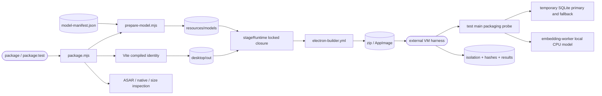

# Native packaging and feasibility probes

## Routing

Select for package/test-package commands, model asset delivery, ASAR native paths, ZIP/AppImage
budgets and packaged SQLite/embedding probes. Start at `05_Software/scripts/package.mjs`;
focused tests are `tests/tooling/{packaging,build-mode}.test.ts` and
`apps/desktop/src/main/packaging/sqlite-probe.test.ts`. General workspace/compiler behavior belongs
to [software-tooling](software-tooling.md); window/security lifecycle belongs to [desktop-shell](desktop-shell.md).

## Purpose and boundaries

The package pipeline emits host Windows/Linux x64 artifacts with the pinned runtime closure,
verified model files and size/hash reports. Compiled instrumented shells exercise temporary
SQLite and real local CPU embeddings; external host evidence binds results to artifact hashes
and records actual connectivity or isolation.
The spike measures packaging feasibility. Production workbench storage, indexing and final model
selection belong to later planned work packages.

## Public interface

From `05_Software`: `npm run prepare:model` (`-- --offline` verifies cache only),
`npm run package` (compiled release) and `npm run package:test` (compiled instrumented).
Outputs are `release/{test,release}/` artifacts and schema-1 `package-report.json`.
The instrumented packaged app accepts `--packaging-probe=<absolute JSON path>` and exits 0/1
after writing schema-1 SQLite/embedding results. `probe-windows-offline.ps1` takes ZIP, expected
SHA256 and evidence directory; `probe-linux-offline.sh` takes AppImage, evidence directory and
test user in a dedicated VM. Measurements/status live in `06_SoftwareDocu/wp05-packaging-measurements.md`.

## Invariants

- Packaging compiles its own fixed test identity; runtime environment cannot enable release probes.
- Release application code excludes all probe/worker/fixture markers; emitted output and ASAR are inspected.
- Model URLs contain the immutable revision; every cached/downloaded asset must match bytes and SHA256.
  Corruption fails; downloads occur only in explicit preparation/build commands.
- Native CPU libraries and models are real files outside ASAR. Foreign native OS/architecture fails inspection.
- Windows artifact budget is 250,000,000 bytes; overflow lists largest contributors and fails.
- Probes require packaged app and absolute output, use temporary SQLite with cleanup, and keep renderer
  sandbox/CSP/origin/IPC contracts. Worker deadline is five minutes with termination/disposal.
- Host evidence is independent of application results. Windows helper enumerates hidden adapters and all IP compartments and checks loopback-only routes without changing
  policies/adapters; dedicated Linux VM harness restores supported route attributes, verifies snapshot equality and rejects unsupported topologies before isolation.

## Change map

| Change requested | Start with | Focused verification |
|---|---|---|
| Model delivery/pins | `resources/model-manifest.json`, `prepare-model.mjs` | packaging asset integrity tests, actual offline cached verification |
| Native collection/budget | `package.mjs`, `electron-builder.yml` | packaging budget/ASAR tests, native OS artifact inspections |
| SQLite SQL/fallback | `main/packaging/sqlite-probe.ts` | real SQLite test, packaged probe |
| Embedding lifecycle | `embedding-worker.ts`, `probe.ts` | actual packaged offline worker, build-mode exclusion |
| VM evidence | `scripts/probe-*-offline.*`, `probe-windows-sandbox.ps1` | real VM hashes, adapters/routes and process results |

## Key behaviors

- `REQ-PLAT-e5a51348` — native host packages, sizes and artifact hashes; current connected Windows and offline Linux runtime acceptance.
- `REQ-PLAT-96cd589b` — immutable verified model delivery.
- `REQ-TEST-d05765be` — WAL/unicode61/trigram/reopen and observed node:sqlite fallback.
- `REQ-TEST-ec62ad71` — real CPU worker model load and three normalized 384-vector timings.
- `REQ-TEST-7fea1dd0` — complete release app-code exclusion of probes.

The five requirements are active after real packaged acceptance on current connected Windows
and offline Linux. Clean/offline Windows and VC++ runtime independence remain required before
final release WP-30/WP-33; current-host execution cannot prove them.

## Architecture

The external harness owns machine isolation; the probe owns native runtime assertions. Windows retains upstream ORT DirectML/dxcompiler/dxil companions while the worker selects CPU. Release
builds omit the probe branch and worker entry while retaining bundled runtime/model resources.

## Files

- `05_Software/scripts/{package,prepare-model}.mjs` — collection, verification, inspection and reports.
- `05_Software/resources/model-manifest.json` — immutable model provenance/pins.
- `05_Software/apps/desktop/electron-builder.yml` — targets, unpacking and real resource delivery.
- `05_Software/apps/desktop/electron.vite.config.ts`, `src/main/index.ts` — compiled boundary and test hook.
- `05_Software/apps/desktop/src/main/packaging/{probe,sqlite-probe,embedding-worker}.ts` — actual packaged checks.
- `05_Software/scripts/{probe-windows-offline,probe-windows-sandbox}.ps1`, `probe-linux-offline.sh` — host evidence.
- `05_Software/tests/tooling/{packaging,build-mode}.test.ts`, `apps/desktop/src/main/packaging/sqlite-probe.test.ts` — focused regressions.
- `06_SoftwareDocu/wp05-packaging-measurements.md`, `evidence/wp05/` — observed outcomes and raw evidence.
