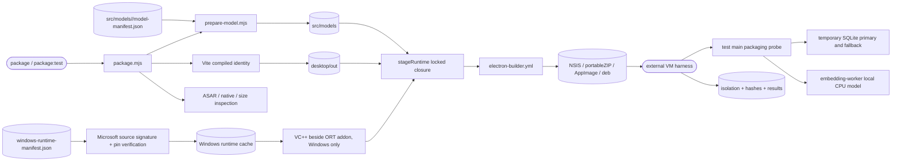

# Native packaging and feasibility probes

## Routing

Select for package/test-package commands, model asset delivery, ASAR native paths, NSIS/portable ZIP/AppImage/deb
budgets and packaged SQLite/embedding probes. Start at `02_Tools/release/package.mjs`;
focused tests are `tests/packaging/packaging.test.ts and tests/tooling/build-mode.test.ts` and
`src/apps/desktop/src/main/packaging/sqlite-probe.test.ts`. General workspace/compiler behavior belongs
to [software-tooling](software-tooling.md); window/security lifecycle belongs to [desktop-shell](desktop-shell.md).

[Verification fixtures](demo-onboarding.md) routes the fictional corpus used by tests/evaluation/smoke; only real model/runtime resources enter the application payload.

## Purpose and boundaries

The package pipeline emits host Windows/Linux x64 artifacts with the pinned runtime closure,
verified model files and size/hash reports. Compiled instrumented shells exercise temporary
SQLite and real local CPU embeddings; external host evidence binds results to artifact hashes
and records actual connectivity or isolation.
The package stages BGE Small EN and Multilingual E5 Small q8. Each manifest, its listed assets and its
MIT licence notice share `resources/models/<model-id>/`. The descriptor supplies dimensions, token limit,
pooling, normalization and query/passage prefixes. Staging and builder output are checked against the source
pins. `delivery:verify` uses full 7-Zip to check the same pins inside each desktop archive.

The external harness owns machine isolation; the probe owns native runtime assertions. Windows retains upstream ORT DirectML/dxcompiler/dxil companions while the worker selects CPU. Release
builds omit the embedding probe and capture test seam while retaining the shipped runtime.
Both modes include the pinned `playwright-core` Desktop production dependency. The browser
runtime is provisioned into application data on explicit request. Only the instrumented build
contains the controlled browser acceptance fixture.

Both modes include the Whisper worker in app.asar and load downloaded dictation models from
application data. Archive inspection enforces the worker entry and the capture test seam boundary.

## Public interface

User-terminal closure includes node-pty 1.1.0's host N-API binding and Windows ConPTY helpers,
all outside ASAR. Main loads its physical unpacked package. Source Linux npm install builds its
binding with g++/make; Windows uses the pinned upstream x64 prebuild. Both prepack and extracted
target checks follow 11 relative JS/worker modules and verify actual x64 PE/ELF headers and hashes.
`--output-root`, `--bundled-plugins` and `--windows-runtime` select owned packaging destinations;
`--reuse-bundled-plugins` verifies an existing catalog. Runtime overrides retain committed DLL pins
and Microsoft source-signature checks. [User terminals](terminals.md) routes actual extracted-app proof.

Already-built artifact functional/egress acceptance belongs to [release smoke](release-smoke.md).

From `05_Software`: `npm run prepare:model` (`-- --offline` verifies cache only),
`npm run prepare:uv` (pinned uv 0.13.7 from `src/uv/uv-manifest.json`: archive and binary SHA-256 verified, archive cache addressed by its SHA rather than a reused release filename,
binary written to `src/uv/<platform>/`, archive cached in `src/uv/.cache/`; `-- --offline` uses the cache only),
`npm run prepare:plugins` (the official plugins of `plugins/` built with `vera catalog build` into the catalog
release `../07_Delivery/plugins/`, each zip checked against its index),
`npm run package` (compiled release; it prepares the bundled plugins, stages them as `<resources>/plugins/` and checks
them again in the unpacked output) and `npm run package:test` (compiled instrumented).
Outputs are `release_tmp/{test,release}/` host-native NSIS/portableZIP or AppImage/deb artifacts and schema2 `package-report.json`. ZIP carries vera.portable; NSIS is per-user without that marker. VERA Test product/appId/executable/staged package name and filenames identify instrumented artifacts.
The instrumented packaged app accepts `--packaging-probe=<absolute JSON path>` and exits 0/1
after writing schema-1 SQLite/embedding results. `probe-windows-offline.ps1` takes ZIP, expected
SHA256 and evidence directory; `probe-linux-offline.sh` takes AppImage, evidence directory and
test user in a dedicated VM. Measurements/status live in `06_SoftwareDocu/wp05-packaging-measurements.md`.

The prepack and final ASAR checks compare every non-license CMap/font/WASM resource against the exact-pinned pdfjs-dist source bytes. Certificate SHA1 and subject selectors are preserved together when both are configured.

VERA_UPDATE_URL configures generic update metadata and the compiled main feed. The staged
runtime closure includes electron-updater and its pinned transitive dependencies. The main bundle externalizes sharp, and staging explicitly collects its pinned x64 native runtime alongside its JavaScript loader.
[Updates](updates.md) owns channels, mode controls, distribution capabilities and safe installation.

## Invariants

- Packaging compiles its own fixed test identity; runtime environment cannot enable release probes.
- Release app code excludes instrumented probe/worker/fixture markers and test hooks;
  production document workers remain bundled. Emissions and final ASAR are inspected.
- Model URLs contain the immutable revision; every cached/downloaded asset must match bytes and SHA256.
  Corruption fails; downloads occur only in explicit preparation/build commands.
- Native CPU libraries and models are real files outside ASAR. Foreign native OS/architecture fails inspection.
- Archive sizes and their largest unpacked contributors are recorded for all desktop targets.
- Prepack rejects secret files/material, relative paths longer than160, and missing native/model/pdf assets, with sanitized diagnostics.
- Microsoft VC++14.51.36247.0 source/catalog signatures and committed SHA256/byte pins materialize five unmodified app-local DLLs; caches and each packaged target are verified. Linux excludes Windows resources.
- Explicit signing credentials/selectors force Windows signing and valid Authenticode verification; missing credentials permit localized unsigned About. app.info exposes immutable test/signing identity.
- Probes require packaged app and absolute output, use temporary SQLite with cleanup, and keep renderer
  sandbox/CSP/origin/IPC contracts. Worker deadline is five minutes with termination/disposal.
- Host evidence is independent of application results. Windows helper enumerates hidden adapters and all IP compartments and checks loopback-only routes without changing
  policies/adapters; dedicated Linux VM harness restores supported route attributes, verifies snapshot equality and rejects unsupported topologies before isolation.

## Change map

| Change requested | Start with | Focused verification |
|---|---|---|
| Model delivery/pins | `src/models/<model-id>/model-manifest.json`, `prepare-model.mjs` | packaging manifest, asset and staging tests; actual online and offline verification |
| uv delivery/pins | `src/uv/uv-manifest.json`, `prepare-uv.mjs`, `stageUv` in `package.mjs` | `tests/packaging/packaging.test.ts` (prepare and stage uv) |
| Native collection/budget | `package.mjs`, `electron-builder.yml` | packaging budget/ASAR tests, native OS artifact inspections |
| SQLite SQL/fallback | `main/packaging/sqlite-probe.ts` | real SQLite test, packaged probe |
| Embedding lifecycle | `embedding-worker.ts`, `probe.ts` | actual packaged offline worker, build-mode exclusion |
| VM evidence | `02_Tools/release/probe-*-offline.*`, `probe-windows-sandbox.ps1` | real VM hashes, adapters/routes and process results |

## Key behaviors

- `REQ-PLAT-e5a51348` — pinned local native CPU/model/PDF closure.
- `REQ-PLAT-03f3a066` — distribution targets, portable layout, exact hashes and installer budget.
- `REQ-SEC-c11e9859` — safe complete prepack payload and sanitized failures.
- `REQ-PLAT-a68b2d5b` — conditional signing and immutable localized identity.
- `REQ-TEST-0b2884f2` — complete release hook exclusion and actual hostile-env launch boundary.
- `REQ-PLAT-96cd589b` — immutable verified model preparation.
- `REQ-PLAT-ac20d6f5` — both pinned models and MIT notices in every offline desktop package.
- `REQ-REL-70db8095` — delivery verification refuses missing or changed model members.
- `REQ-TEST-d05765be` — WAL/unicode61/trigram/reopen and observed node:sqlite fallback.
- `REQ-TEST-ec62ad71` — real CPU worker model load and three normalized 384-vector timings.
- `REQ-TEST-7fea1dd0` — complete release app-code exclusion of probes.

Native acceptance exercises real SQLite, local CPU indexing/search and PDF through ordinary release IPC. External launch evidence names artifact/executable hashes, processes, vera://app and real native dialog pass-through with hostile test env. Clean/offline Windows and actual VC++ self-containment remain required before final release; static app-local closure/current-host loaded paths supplement that manual criterion.

## Files

- `02_Tools/release/{package,package-checks}.mjs`, `02_Tools/environment/{prepare-model,prepare-windows-runtime}.mjs` — collection, source/cache integrity, sanitized prepack, target isolation and reports.
- `05_Software/src/windows_runtime/windows-runtime-manifest.json` — pinned Microsoft x64 app-local runtime provenance.
- `main/app-info.ts`, shared ipc.ts, renderer Metadata/locales — immutable build/signature identity in About.
- `05_Software/src/models/<model-id>/{model-manifest.json,LICENSE.txt}` — per-model pins and MIT notice.
- `02_Tools/release/embedding-payload.mjs`, `02_Tools/delivery/verify-embedding-archive.mjs` — package member pins and archive verification.
- `05_Software/src/uv/uv-manifest.json`, `02_Tools/environment/prepare-uv.mjs` — pinned uv per platform; `package.mjs`
  prepares it, stages `resources/uv/` (extraResources `uv`) and re-checks the packaged binary hash; the package report
  records `uv {version, platform, bytes, sha256}`.
- `05_Software/src/apps/desktop/electron-builder.yml` — targets, unpacking and real resource delivery.
- `05_Software/src/apps/desktop/electron.vite.config.ts`, `src/main/index.ts` — compiled boundary and test hook.
- `05_Software/src/apps/desktop/src/main/packaging/{probe,sqlite-probe,embedding-worker}.ts` — actual packaged checks.
- `02_Tools/release/{probe-windows-offline,probe-windows-sandbox}.ps1`, `probe-linux-offline.sh` — host evidence.
- `05_Software/tests/packaging/packaging.test.ts and 05_Software/tests/tooling/build-mode.test.ts`, `src/apps/desktop/src/main/packaging/sqlite-probe.test.ts` — focused regressions.
- `06_SoftwareDocu/wp05-packaging-measurements.md`, `evidence/wp05/` — observed outcomes and raw evidence.
