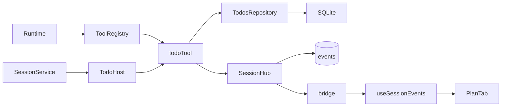

# Session Plan

## Routing

Select for todo whole-list validation, todos repository, todo.updated and the Plan panel. Start at core tools/todo.ts/storage/repos/todos.ts and renderer components/session/plan-tab.tsx under05_Software. [Sessions](sessions.md) owns identity, durability and lifecycle; [workbench storage](workbench-storage.md) owns schema/connection; [Chat UI](chat-ui.md) owns navigation/hook; [IPC](ipc-boundary.md) owns snapshot/event transport.

## Purpose and boundaries

Core owns validated ordered session task lists and atomic database/event updates. Renderer displays current snapshot and replacements through existing session subscriptions. Workbench file tools and approval gates have their own authority.

## Public interface

- Shared todoItemSchema/todoItemsSchema require text<=200 UTF16 code units, count<=50 and pending/in_progress/done; optional string IDs, duplicate rows, empty text and empty lists are preserved.
- Registered todo is session class with strict {items}; returns {items:stored list}, replacing the whole list. ToolRegistry/runtime failures return actionable errors to the model.
- TodosRepository.get(sessionId) reads its row; replace(sessionId,items,updatedAt) independently validates and parameterizes the existing schema1 upsert. SQLite session deletion cascades todos.
- SessionService binds TodoHost database/repository/session/Clock/ownership/scrub/hub callbacks; todo validates scrubbed fields, checks abort/authority and upserts+records one event within a synchronous transaction, publishing after commit.
- PlanTab keys workbench/session identity and consumes useSessionEvents. List text is escaped, order is authoritative; Circle/CircleDot/CircleCheck expose localized status image names and visible status labels. Empty/loading/retry states share application conventions.

## Invariants

- Invalid bounds/status/shape, abort or authority loss cannot mutate the list/event. Failed event persistence rolls back the upsert. Observer errors are contained by SessionHub after persistence.
- Session-class calls run sequentially and remain offered in session read-only mode. Workbench read-only denies sends/mutation. SQLite-only synchronous replacement introduces no asynchronous admission gap or migration.
- Snapshot/event schemas use the same list bounds; shared reducer replaces todos. Replay restores the final committed list after restart; obsolete snapshots/subscriptions cannot cross navigation.
- Core is Electron independent; renderer uses shared API and keeps the exact sandbox/origin/import authority. Known-secret text/ID fields are scrubbed before persistence and parsed again. Main snapshot/replay sanitization also redacts optional user IDs against current credentials, bounds expanded presentation text at200 and preserves status/system identities.

## Change map

| Change | Start | Focused proof |
|---|---|---|
| Bounds/registration/order | shared session.ts;tools/todo.ts/registry.ts | shared todos.test.ts;core sessions/todos.test.ts/registry.test.ts |
| Atomic storage/events/authority | TodosRepository;SessionService TodoHost | core sessions/todos.test.ts;native plan.spec.ts |
| Snapshot/live/status/navigation | PlanTab;useSessionEvents;mock sessions | plan-tab.test.ts;native/browser plan.spec.ts |
| CLI composition | same SessionService/registry | tooling/cli.test.ts Plan process case |

## Key behaviors

REQ-FUNC-2e8a54c7 bounded whole replacement;REQ-DATA-d968385c atomic durable list/event;REQ-UX-8d3039aa accessible live/restarted Plan. The plan-updates fixture has three distinct replacements in separate model steps; its anchored Update the plan matcher preserves existing automatic replay scenarios.

## Architecture

## Files

Under05_Software: shared session.ts/events.ts/session-state.ts/todos.test.ts;core tools/todo.ts/context.ts/registry.ts/registry.test.ts,storage/repos/todos.ts,sessions/service.ts/todos.test.ts,index.ts;renderer components/session/plan-tab.tsx/plan-tab.test.ts,App.tsx,components/shell.tsx,mocks/sessions.ts,styles.css,locales;tests/fixtures/llm-scripts/plan-updates.jsonl;tests/integration/cli.test.ts;tests/e2e/plan.spec.ts.
