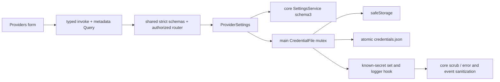

# Credentials and provider settings

## Routing

Select for credentials.json, CredentialStore, safeStorage, weak-storage consent, known-secret scrub,
providers.list/save/remove and Settings Providers. Start with main credentials.ts and
provider-settings.ts under05_Software/apps/desktop/src. Configuration schemas live in shared providers.ts.
[Application data](app-data.md) owns settings migration/atomic ports; [IPC boundary](ipc-boundary.md)
owns sender/schema transport; [renderer foundation](renderer-foundation.md) owns shell/accessibility.
Gateway, model requests and OAuth orchestration have their own later implementation seams.

## Purpose and boundaries

Desktop main owns all stored credential values, safeStorage and provider operations. Core exposes
the structural pi-ai1.1.0 port and pure scrub(text,secrets). Shared owns non-secret configurations and
strict public projections. Renderer holds a password draft until save/cancel and reads metadata through Query.

## Public interface

- CredentialStore read/list/modify/delete accepts optional AbortSignal. modify callback undefined
  preserves the credential and callback rejection propagates unchanged; mutations and delete share a global store mutex.
- CredentialFile load/read/list/modify/delete/checkpoint/close supplies schema1 encrypted base64 records and
  registered logging/scrub. storage returns encrypted/unprotected/memory/null; secureStorage identifies
  an available non-basic_text backend. Explicit storageConsent controls weak writes. Main-only checkpoint returns an undo operation that restores the exact encoded entry, value and location without crypto or new consent.
- ProviderSettings list/save/remove/close serializes provider edits and supplies configured/hint metadata.
- providers.list({}) returns OpenAI/custom configurations, secureStorage and readOnly. Public schemas
  select known non-secret fields. providers.save returns saved or consent-required; remove returns{}.
- OpenAI model omission retains it, empty string clears it; credential omission retains, empty clears.
  OpenAI remove clears the key while keeping model configuration; custom remove clears configuration/key.
- Exact formats, defaults, limits and recovery: [credentials spec](../specs/REQ-SEC-fe4d5c4c.md).

## Invariants

- Electron remains44.7.0 with sandbox/CSP/vera://app/preload/import boundaries. Core imports no Electron.
- Each persisted credential is encrypted JSON then base64 when safeStorage is available. Unavailable
  or Linux basic_text requires a fresh explicit choice. Refusal keeps the new key in memory and removes
  any prior disk value for that slot. Unavailable encryption plus accepted disk storage is explicitly
  marked unprotected base64; encoding supplies no confidentiality.
- Invalid/future files and failed atomic saves retain source bytes. Accepted queues drain before logs.
- Every loaded/submitted/replaced/deleted secret remains registered through process exit. Logger scrubs
  content at capture/write; IPC error params and event user text are scrubbed before transport.
- Public metadata contains no credential value. Keys up to7 Unicode characters have null hints;
  longer keys disclose first3/last4 with at least one hidden character; hints reconstructing a complete current or registered secret are null. Known-secret configuration
  text is rejected; low-entropy known keys match whole text values for this guard.
- Strict provider writes validate unique names/slugs, HTTP(S)/v1 URLs without credentials/query/fragment,
  positive safe integer budgets with max(1024,ceil(context*0.05)) safety margin, and secret-free fields.
- Settings schema3 migrations preserve identity/extensions with original-byte backups. Future settings
  are read-only. Settings failure restores the exact encoded entry and prior credential/location, retaining the previous disk/memory decision across crypto availability changes. Two-file crash atomicity is not claimed.
- UI saves avoid Query mutation caches for key-bearing requests and clear password drafts on success/cancel.
  Native modal consent offers memory, weak disk or cancel; controls use en/ro/de and WP04 layouts/focus.

## Change map

| Change | Start | Focused tests |
|---|---|---|
| Crypto/mutex/consent | main credentials.ts | credentials.test.ts |
| CRUD/rollback/hints | main provider-settings.ts | provider-settings.test.ts |
| Configuration/IPC shape | shared providers.ts/ipc.ts | provider-settings and bridge/router tests |
| Settings format | shared settings.ts; core settings/service.ts | service.test.ts |
| Error/event redaction | core llm/scrub.ts; main store/router/events | scrub/credentials/provider/events tests |
| Masked/localized forms | renderer components/providers.tsx | e2e/providers.spec.ts and mock.spec.ts |

## Key behaviors

- REQ-SEC-fe4d5c4c — atomic encrypted persistence and pi-ai structural contract.
- REQ-SEC-47e726a7 — explicit weak-storage decision and memory-only refusal.
- REQ-SEC-cf3aa5a4 — retained known-secret log/scrub registration.
- REQ-FUNC-f19cac5e — validated configuration CRUD/defaults and rollback.
- REQ-DATA-87619ef8 — schema2 provider migration to3.
- REQ-SEC-0b898261 — public metadata and bounded/short hints.
- REQ-FUNC-6c666347 — validated provider IPC boundary.
- REQ-UX-fb4b9424 — masked localized and accessible provider editor.

## Architecture

## Files

Paths relative to05_Software.

- packages/core/src/ports.ts and llm/scrub.ts — structural store contract and pure redaction.
- packages/shared/src/{providers,settings,ipc,index}.ts — config formats, migration shapes and transport.
- apps/desktop/src/main/{credentials,provider-settings}.ts — crypto persistence and coordinated operations.
- apps/desktop/src/main/{index,ipc-router,events}.ts — startup/drain, handlers, known-secret response guards.
- apps/desktop/src/renderer/components/{providers,settings}.tsx — masked forms and consent modal.
- apps/desktop/src/renderer/mocks/mockApi.ts — metadata-only provider fixtures.
- apps/desktop/src/renderer/locales/{en,ro,de}.json and styles.css — translations and rem/layout.
- Main credentials/provider-settings tests, core scrub/settings tests, bridge/router/mock regressions,
  e2e/{providers,mock,shell}.spec.ts — deterministic fictional secrets and native/browser regressions.
