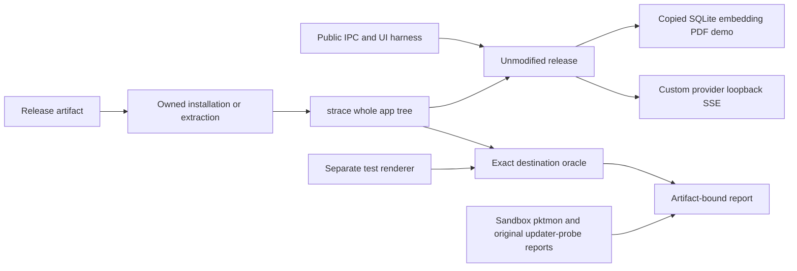

# Release artifact smoke

## Routing

Select for smoke:package, artifact functional acceptance, external egress,
renderer calibration and manual Windows capture. Start at
`05_Software/scripts/smoke-package.mjs`; focused tests: tooling/package-smoke.test.ts.
Package construction/pins belong to [native packaging](native-packaging.md),
installed updates to [updates](updates.md).

## Purpose and boundaries

External public IPC/UI observes unmodified release artifacts. A normal custom
provider SSE fixture drives read/write/citation/approval/restart. Process-tree
strace owns Ubuntu destination evidence; Sandbox/pktmon owns manual Windows
egress. Separately identified instrumented renderer calibration proves detection.
Original WP31 updater-probe reports (probe-upgrade.mjs) remain supplementary.

## Public interface

`smoke:package -- --artifact <path> [--scratch <new root>]` accepts NSIS/ZIP or
AppImage/deb, never builds/downloads. Optional repeatable --upgrade-proof binds
original updater-probe reports; --windows-evidence binds manual capture. --resume reuses an
exact matching failed owned extraction after exits, preserving original logs.
Exit0 completePASS,1FAIL,2functionalPASS/manual pending. Separate Linux
`smoke-calibration.mjs <built test app dir> <new root>` uses pinned development
Electron and expects oracleFAIL. See [manual procedure](../../06_SoftwareDocu/release-package-smoke.md).

## Invariants

- Production session-created policy sets a local dictionary URL and disables spellchecking;
  observed production configuration disables remote dictionary downloads and
  native ONNX telemetry before inference; the harness supplies no opt-out.
- Immutable artifact; release identity/Electron44.7.0/sandbox/vera://app and actual
  owned userData asserted before app mutations and every restart.
- Off updates and copied demo provide real SQLite/local CPU embedding/PDF canvas.
- Existing Windows install identity is protected before NSIS; extraction fallback
  retains installer acceptance pending.
- Streamed tool arguments, ordinary approval, verified citation and complete
  SQLite snapshot persistence are required through the normal custom provider.
- Each scripted request checks full serialized input bytes/output reserve and
  the application's observed complete context budget.
- strace-f sees whole tree; offline no inet/inet6, scripted exact AF_INET127.0.0.1
  port, Unix ignored, failed/incomplete/unknown destinations fail closed.
- Calibration fixture renderer is sandboxed; product vera://app window/CSP unchanged.
- Missing manual Windows or release upgrade evidence remains pending; source-report
  SHA and exact instrumented upgrade-proof artifacts retain their limitations.

## Key behaviors

REQ-TEST-8928f10f exact release scenarios; REQ-TEST-f84d343e external destination
oracle/calibration; REQ-TEST-b111844b artifact/manual/upgrade-proof bindings.

## Architecture

## Files

`scripts/smoke-{package,runtime,egress,server,report,calibration}.mjs` own scenarios,
native execution, oracle, SSE fixture, proof projection and separate calibration.
`scripts/sandbox/VERA.wsb`, manual procedure and package-smoke tests route acceptance.
