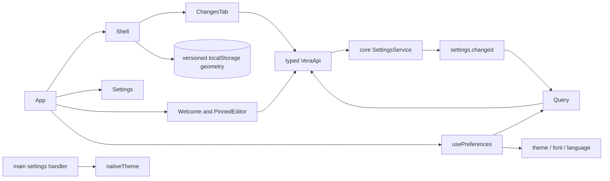

# Renderer foundation

## Routing

Select for Welcome/App Settings, memory routes, panels, theme, text scale, UI language,
keyboard/contrast and catalog auditing. Start at 05_Software/apps/desktop/src/renderer/App.tsx;
focused acceptance is e2e/mock.spec.ts and the foundation test in e2e/shell.spec.ts.
[Application data](app-data.md) owns the settings schema/service;
[desktop shell](desktop-shell.md) owns native window/security;
[software tooling](software-tooling.md) owns verification commands.

## Purpose and boundaries

React supplies the responsive shell, Welcome workbench management and Settings seams. Appearance and Language
edit the existing typed settings API through TanStack Query. Main sets nativeTheme from confirmed
settings. Renderer owns separate UI geometry storage and i18next presentation.

## Public interface

- App switches Welcome, Settings and session memory routes; Ctrl+, opens Settings while the exact renderer URL stays intact.
- Welcome remains mounted in Settings, retaining the active workbench. Create/open, recents,
  read-only/warnings and the keyboard pinned dialog are owned by [workbench](workbench.md).
- Shell supplies resizable/collapsible sidebar and right panel; session Context shows pinned context/skills, Changes presents completed session edits/counts/diffs and reveal through the [Changes](changes.md) component; Docs presents the live document index and viewer; Artifacts opens/reveals/exports session content; Plan displays current session todos.
  Below1280px the right panel overlays the centre.
- Settings edits Providers, Light/Dark/System, five scales and System/en/ro/de; Updates/Data retain placeholders. [Providers](providers.md) owns masked credentials, endpoint forms and consent.
- About and Welcome metadata localize release/instrumented build identity and Windows signed/unsigned
  status from strict app.info, with English/Romanian/German catalogs. [Native packaging](native-packaging.md)
  owns compiled identity and actual signature verification; Metadata tests cover all three languages.
- usePreferences loads {settings,readOnly}, applies mutation responses, invalidates on settings.changed
  and cleans up its app subscription. Failure displays localized structured errors and retry.
- System theme follows prefers-color-scheme; root data-theme is light/dark. Main nativeTheme.themeSource
  follows the persisted setting. Root font is14px times scale; geometry and code use rem.
- System language resolves app.info.locale to en/ro/de, otherwise en. All labels/accessibility/error
  text comes from English-source and Romanian/German catalogs.
- lib/layout.ts validates version1 renderer-local geometry. Exact contract:
  [foundation spec](../specs/REQ-UX-4a040001.md).
- check:i18n uses TypeScript AST translation references and finite registered key collections;
  it rejects missing/unused/translation-only keys and arbitrary dynamic calls.

## Invariants

- API authorization, Chromium sandbox and confined vera://app production CSP remain authoritative.
- Application schema/UUID/migration/no-op semantics belong to core/shared. Preferences apply only
  from confirmed snapshots; failed saves retain the preceding state. Read-only snapshots disable editors.
- Local geometry uses a strict separate versioned record; future data retains bytes, failed storage
  stays transient, and application readOnly suppresses geometry writes.
- Resizers support pointer drag, arrow keys and Home/End with accessible separator values.
- Keyboard controls have visible focus rings and semantic labels; colors meet AA text contrast.
  Reduced-motion styles disable animation/transition. Minimum viewport uses wrapping and vertical scroll.
- [Chat UI](chat-ui.md) owns session navigation, transcript, composer, usage and session Context.

## Change map

| Change requested | Start with | Focused verification |
|---|---|---|
| Routes/placeholder sections | App.tsx, components/settings.tsx | browser acceptance |
| Panels/geometry | components/shell.tsx, lib/layout.ts | preferences.test.ts and native foundation acceptance |
| Appearance/theme/scale | hooks/use-preferences.ts, styles/ | native restart plus browser minimum-size matrix |
| Languages/errors | i18n.ts, locales/, lib/language.ts, components/error-message.tsx | catalog fixture and browser translated failure |
| Query invalidation/readOnly | hooks/use-preferences.ts | native external update/future-schema and browser save failure |

## Key behaviors

- REQ-UX-4a040001 — shell and memory routes.
- REQ-UX-4a040002 — saved resize/collapse geometry and responsive overlay.
- REQ-UX-4a040003 — saved/system appearance and native theme.
- REQ-UX-4a040004 — five saved scales and rem components/code.
- REQ-UX-4a040005 — UI language and structured error translations.
- REQ-TEST-4a040006 — English usage and translation catalog completeness.
- REQ-UX-4a040007 — keyboard/focus/contrast/reduced-motion/minimum-size accessibility.
- REQ-UX-4a040008 — confirmed snapshots and read-only behavior.

## Architecture

The view consumes confirmed settings. Native theme and renderer geometry have distinct owners.

## Files

Paths relative to 05_Software/apps/desktop/src/renderer except qualified paths.

- App.tsx — memory routes, metadata/query status and Ctrl+,.
- components/{shell,settings,metadata,error-message,workbench}.tsx — panels, editors, labels and safe error text.
- hooks/use-preferences.ts — Query lifecycle and theme/scale/language application.
- lib/{layout,language}.ts and lib/preferences.test.ts — geometry storage and locale resolution.
- i18n.ts, locales/{en,ro,de}.json — catalog initialization and translated strings.
- styles.css, styles/themes.css — responsive rem geometry, focus and theme token blocks.
- 05_Software/apps/desktop/src/main/index.ts — initial and updated nativeTheme.
- 05_Software/scripts/check-i18n.mjs, tests/tooling/i18n.test.ts — AST catalog auditing/fixtures.
- 05_Software/e2e/{mock,shell}.spec.ts — browser and native UI acceptance.
