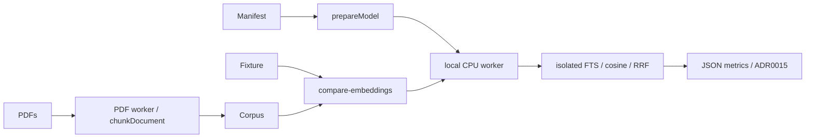

# Retrieval evaluation and local model selection

## Routing

Select for demo retrieval questions, CPU model comparison, isolated ranking
baselines and measured model/threshold choice. Start at
scripts/compare-embeddings.mjs and fixtures/retrieval/demo-board.yaml.
Extraction/chunks route to [document extraction](document-extraction.md);
package asset verification to [native packaging](native-packaging.md).

## Purpose and boundaries

The developer comparison harness extracts the current fictional board corpus,
runs real local CPU embeddings and reports keyword/semantic/hybrid exact-locator
recall. It owns isolated in-memory indexes and measurement reports. Workbench
ingest owns document publication; downstream product index/search work follows
architecture05. Model selection is recorded in ADR0015.

## Public interface

From 05_Software run pinned node scripts/compare-embeddings.mjs with required
--scratch, --models and --output absolute or cwd-relative paths. Scratch belongs
under 02_Tools/cache/wp24-TASK-fd4046b2. --prepare explicitly permits downloads;
the default requires checksum-verified local assets for both candidates.
Both manifests live in fixtures/retrieval; resource model-manifest selects BGE.
The JSON report includes original corpus, fixture, source/asset hashes, host,
timing samples and per-question top5/misses for all modes and EN/RO subsets.

## Invariants

- Frozen schema1 questions number20-30, unique ids, en/ro language and exact
  relative expected path plus one positive PDF page or heading slug. Every
  expected locator must exist in the extracted corpus before inference.
- Candidate files have immutable HF revisions, byte lengths and SHA256.
  Runtime loads only local assets with remote models and caches disabled;
  inference fetch fails. q8 on onnxruntime-node CPU, one ORT thread.
- BGE uses cls/L2, query instruction in its descriptor and empty passage prefix;
  E5 uses mean/L2 and query:/passage: prefixes. All full prefixed inputs are
  checked with the actual runtime tokenizer before the pipeline can truncate.
- Identical ordered chunks enter both models. Top5 counts chunks without page
  deduplication; expected path and page/heading must both match.
- Keyword SQLite is :memory: only; unicode61 underscore/diacritic words OR query
  terms, identifier trigram matches, top50 and deterministic RRF60 union.
  Semantic is normalized dot product top50; hybrid fuses keyword and semantic.
  Ranks start at1 and ties use numeric chunk id.
- Timing separates fresh-worker import/load/first document from three warm
  serial batch1 corpus passes, following one untimed warm-up. CPU usage is a
  process-wide delta; OS disk cache is uncontrolled. Tiny demo recall and host
  timings are a regression reference, not a general-corpus estimate.

## Change map

| Change | Start | Verification |
|---|---|---|
| questions/locator accounting | fixture and evaluation.mjs | retrieval.test.ts, real comparison |
| extraction corpus | corpus.mjs and existing extractor/chunker | extraction tests, native comparison |
| model pins/prefix/pooling/timing | candidate manifests, embedding-worker.mjs | integrity tests, native comparison |
| selected package assets | resources/model-manifest.json | packaging integrity, tokenizer budget proof |

## Key behaviors

- REQ-TEST-91b404ff — reproducible real local CPU comparison and strict recall accounting.
- REQ-NFR-5a0d14ee — measured selected descriptor and hybrid threshold.

## Architecture

## Files

- scripts/compare-embeddings.mjs; scripts/retrieval/{corpus,embedding-worker,evaluation}.mjs
- fixtures/retrieval/demo-board.yaml; {bge,e5}-model-manifest.json
- tests/tooling/retrieval.test.ts; existing packaging/extraction/boundary tests
- 06_SoftwareDocu/wp24-embedding-measurements.md and evidence/wp24/
- 00_Planning/decisions/ADR-0015-embedding-model-selection.md
