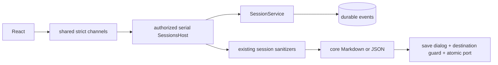

# Session export and search

## Routing

Select for SessionService.search/exportSession, schemaVersion1 archives, buildSessionMarkdown, sidebar search and native session export. [Sessions](sessions.md) owns durability/reducer/lifecycle; [Chat UI](chat-ui.md) owns presentation; [IPC](ipc-boundary.md) owns authorization; [Artifacts](artifacts.md) shares native destination guard.

## Purpose and boundaries

Core searches existing persisted message events and builds deterministic Markdown over full event-backed transcript. Shared owns strict search/format/archive contracts. Main scrubs structured metadata/events/changes and holds the workbench lifecycle while a native save picker selects the atomic destination. React presents scoped search and export controls.

## Public interface

SessionService.search(query) trims1..1000 characters and matches host-scrubbed title or user/queued/assistant text with Unicode lowercase literal includes, retaining existing list order. exportSession(id) validates current session and returns schemaVersion1, session metadata and increasing seq/createdAt/event records. Live-only deltas remain transient. buildSessionMarkdown(data,changes) renders English archival sections, literal fenced text, pending markers, tool summaries, persisted citation validity and applied stored diffs.

session.search {query}->SessionSummary[] and session.export {sessionId,format:md|json}->{exported:boolean} use existing authorization/serial host. Export snapshots after picker confirmation, supports read-only reads, denies managed runtime destinations, cancellation writes nothing. JSON redaction runs on typed fields before serialization. Markdown scrubs diffs before formatting. Default filename uses safe session ID.

App maintains ordinary list for active selection and separate workbench/query search cache. Search filters never change active transcript. SessionWorkspace export actions expose completion/cancel/errors; mock mirrors durable message matching and exported result through strict channels. en/ro/de label all controls.

## Invariants

Full history and queued/delivered identities survive export independently of context compaction. Search excludes tool arguments/derived summaries and other-workbench events. Native paths come only from chosen save dialog; existing canonical .vera guard and atomic file port apply. Core remains Electron-independent and renderer imports shared only. Pins and SQLite migrations remain stable. Fences are longer than content backtick runs; title/tool names escape Markdown, citations use literal code refs.

## Change map

| Change | Start | Verification seam |
|---|---|---|
| Format/archive | core sessions/export, shared session-export | export.test.ts frozen fixture/JSON reducer roundtrip; shared strict schema |
| Search | service, EventsRepository.messageTexts | service.test.ts; e2e/session-search.spec.ts |
| Native disclosure | main session-export/artifacts/events | session-export.test.ts; existing ipc-router authorization |
| Presentation | App/session-list/workspace/mock/locales | native session-search spec; existing browser presentation |

## Key behaviors

REQ-FUNC-70479d66 complete archives; REQ-FUNC-1b882a4b title/message search; REQ-SEC-17075aa1 authorized confined scrubbed native export.

## Architecture

## Files

Under05_Software: shared session-export.ts/test.ts,ipc/index; core sessions/export.ts/test.ts,service.ts/test.ts,storage/repos/events.ts,index; desktop main session-export.ts/test.ts,artifacts/events/index; renderer App,session-list/workspace,mocks/sessions,locales; e2e/session-search.spec.ts.
