# Durable workbench sessions

## Routing

[Chat UI](chat-ui.md) owns renderer transcript/composer/navigation and native UI acceptance.

Select for SessionService, session CRUD/model/mode, persisted snapshots, turn/tool rows, replay/live subscriptions, citations and restart recovery. Start under05_Software at core/src/sessions/{service,hub,timed-gateway}.ts. Focused tests are sessions/service.test.ts, shared/session-state.test.ts, agent/citations.test.ts and desktop main/session-events.test.ts,sessions.test.ts,preload/bridge.test.ts. [Agent runtime](agent-runtime.md) owns model/tool execution and M1 policy; [workbench storage](workbench-storage.md) owns schema/driver; [workbench](workbench.md) owns lifetime/lock; [IPC](ipc-boundary.md) owns validated transport; [file tools](file-tools.md) owns confinement/worker execution.

## Purpose and boundaries

Core SessionService owns one workbench's durable sessions over injected AgentRuntime, gateway, registry, permission port and Clock. SessionHub stores schema-validated events and folds shared snapshots. Main SessionsHost binds current workbench/config/pinned/environment/settings and credentials, owns subscription transport and drains turns before workbench lifecycle changes. The default ApprovalGate executes reads and selects immutable write approvals from current ask/auto-edit/read-only mode and canonical protection. It owns pending requests, transactional rows/events, exact single-use grants and abort. Injected PermissionEngine retains the host policy seam; every write keeps core mode/ownership checks. Desktop and CLI decide through the same core lifecycle.

## Public interface

- SessionService(host) recovers writable state before accepting work. host supplies SQLite/root/gateway/Clock/model/prompt and optional workers/registry/permissions/policy/runtime/limits/scrubbing/ownership check and [skill catalog](skills.md). Desktop refreshes catalog metadata before each turn and binds its owned loader to the tool context. Read-only services expose reads/subscriptions.
- TodoHost binds synchronous validated whole-list upserts and durable todo.updated recording/publication for sequential session tools; [Plan](plan.md) owns bounds and renderer status presentation.
- listArtifacts/openArtifact/verifiedArtifact expose current managed session content; [Artifacts](artifacts.md) owns bounded storage, refs and native actions. Session class tools stay available in all session permission modes; workbench read-only still denies mutation.
- listChanges(sessionId) and getChange(changeId) project applied SQLite rows, ascending creation time/id and stored-patch hunk counts/details. [Changes](changes.md) owns the read protocol and renderer/native reveal.
- create(modelRef?,mode?) returns camelCase metadata with ses_ULID,UTC dates,empty title and idle status. list, get(id)->{snapshot,seq}, rename,delete,setModel,setMode own metadata and errors. Default mode comes from host; model resolution applies session/workbench/app precedence. First user text sets an empty title to60 UTF16 units; explicit nonempty rename survives.
- send returns turnId/messageId promptly, waitIdle is core completion, stop propagates abort, close aborts/drains all turns. Active sends, model/title and deletion mutations return BUSY. setMode remains available during active turns; read-only aborts pending approvals. Many sessions may run together.
- subscribe(id,sinceSeq,listener(seq|undefined,event)) replays persisted rows then live events. Non-live seq starts1 and increases per session; message.delta/reasoning.delta/tool.update have no persisted row or seq. Detached callbacks cannot alter persistence or fail execution.
- Shared SessionEvent/schema, SessionState/schema, emptySessionState and applySessionEvent form the common projection. message.done text/citations replace deltas even when deltas were missed; unfinalized live-only messages disappear at a terminal boundary. Transient reasoning/tool updates have no durable projection; usage preflight fields preserve actual provider token totals.
- validateCitations checks unique extracted references against successful structured tool ref fields. Shared parseRef recognizes pages, explicit page ranges, heading slugs, lines and artifacts. Current confined text line bounds verify line refs; DocumentKnowledge.validDocumentRef verifies indexed current SHA256/extraction page/heading bounds; ArtifactStore verifies current-session artifact content. Malformed, invented, failed-tool-only, stale, removed, ignored, binary, escaping and out-of-range refs are invalid. Resolver errors produce invalid citations without failing the turn.
- openCitation(sessionId,messageId,ref) requires a completed valid assistant citation and revalidates successful issued tool results that precede that message, resolves their exact ref snippet/text, and opens current confined content or that session artifact. [Document viewer](document-viewer.md) owns viewer payloads.
- decideApproval({sessionId,approvalId,requestSha256,decision,switchToAutoEdit?}) accepts one active exact request or returns CONFLICT. The optional switch applies auto-edit atomically with the user decision. Known credential-bearing patches are refused before approval persistence. Default ApprovalGate records requested/decided status and SHA256 over recursively sorted request JSON, waits outside write admission and consumes each grant once. Automatic grants require current auto-edit on queued checks; protected changes require user decisions.
- readPermissions allows read classes for explicitly injected hosts. Session wrapper consults the injected PermissionEngine and scrubs tool output and write-preparation errors through its host. An injected engine receives prepared ChangeRequest before the write is admitted; read-only mode filters write tools and rejects them at approval/execution. Prepared records retain provider call IDs and active turn identity; per-turn sequential runtime execution consumes each prepared closure once.
- waitReady resolves guarded pending-change recovery; desktop/CLI await it before exposing snapshots or starting turns. Core execution also gates gateway/tool dispatch on readiness. host.writeQueue shares admission with all sessions/app saves; standalone SessionService owns one queue. close drains turns/readiness/write admission before storage closes.

## Invariants

- Full pi messages and results persist independently of transient model request reduction. User/assistant completion synchronizes the verbatim transcript; source-order completed tool messages persist before the next provider response, alongside native provider-ID tool_calls rows. Multi-row transitions are transactional; live delivery follows persistence.
- Initial user persistence runs synchronously. Host gateway/tool wrappers wait the ordered persistence/citation queue before provider dispatch or tool execution; failed durability aborts the turn and prevents external work. Tool-start rows and complete assistant messages are durable before execution, and completed results before the next request. Reentrant publication serializes subscriber fanout; replay drains append nested emissions and skip already delivered persisted sequences.
- Each runtime call applies ContextPolicy using fresh gateway capabilities and emits context usage separately from actual usage. Settings supply maxToolCallsPerTurn; default50. Results cap32000 characters. timedGateway bounds each provider-output wait at300000ms, excluding tool/approval waits and containing iterators that ignore cancellation.
- Cancellation after ownership/decision persistence failure removes the in-memory gate and rejects its waiter through the runtime, allowing close to drain; AbortSignal callbacks contain errors. Durable undecided rows remain untouched until writable recovery. Recovery marks undecided approvals aborted/by mode and makes old decisions conflict. It preserves original content_json bytes, inserts missing result messages in valid pair order, restores completed outcomes from tool_calls, closes pending rows and running/awaiting_approval status with interrupted/aborted/idle events. Repetition makes no further changes. Read-only startup preserves rows.
- Session IDs validate before artifact removal; ordinary .vera/artifacts ancestors and target are required. SQLite cascades all child rows. Host checks lock token/pid before mutations; lifecycle drains prevent closed-DB writes.
- Core remains Electron-independent. Main uses existing exact renderer-frame authorization for invokes and subscription control; sandbox/CSP/vera://app baseline remains. Known-secret text/title/model requests are rejected, gateway and tool outputs are scrubbed, event transport and snapshot/summary responses preserve protocol discriminants/IDs while redacting user fields and bounding titles.

## Change map

| Change | Start | Focused proof |
|---|---|---|
| Prepared writes/startup barrier | tools/changes.ts,SessionService,desktop SessionsHost | sessions/write-edit.test.ts,main/sessions.test.ts,e2e/write-edit.spec.ts |
| Modes/digest/decisions/abort | agent/approvals.ts,sessions/service.ts | sessions/approvals.test.ts; e2e/approvals.spec.ts |
| Lifecycle/persistence/recovery/budgets/permission | core sessions/service.ts | service.test.ts |
| Replay/live ordering | sessions/hub.ts | service.test.ts replay/reentrancy |
| Terminal projection | shared session-state.ts/events.ts | session-state.test.ts |
| Citation resolution | agent/citations.ts; knowledge/search.ts | citations.test.ts; search.test.ts; artifacts.test.ts; e2e/citations.spec.ts |
| Model output wait | sessions/timed-gateway.ts | service.test.ts timeout/ignored abort |
| Main host/transport/bridge | desktop main sessions/session-events,index;preload bridge | sessions/session-events/bridge tests; e2e/sessions.spec.ts |

## Key behaviors

REQ-FUNC-5e2438d5 reducer; FUNC-c76b4c8f CRUD; DATA-24394d5f durable transcript/events; REL-384b6464 BUSY/stop; NFR-83ac0a94 limits; FUNC-2e1261c2 citations; FUNC-eca9b9a1 replay/coalescing; REL-2098b145 recovery; FUNC-2b462360 IPC; SEC-5a7ef5e4 permission seam.

## Architecture

```mermaid
flowchart LR
 bridge[createBridge] --> control[vera:subscription authorized control]
 bridge --> invokes[session IPC]
 invokes --> host[SessionsHost]
 control --> host
 host --> service[SessionService]
 service --> hub[SessionHub]
 hub --> events[(SQLite events)]
 service --> messages[(messages/tool_calls)]
 service --> TodoHost --> TodosRepository --> SQLite
 service --> ArtifactStore
 ArtifactStore --> artifacts[(artifacts metadata and managed files)]
 service --> completedChanges[(applied changes read projection)]
 service --> runtime[AgentRuntime]
 runtime --> policy[ContextPolicy]
 policy --> gateway[timedGateway / LlmGateway]
 runtime --> permission[ApprovalGate or injected PermissionEngine]
 permission --> approval[(approvals + requested/decided events)]
 decision[Desktop IPC / CLI] --> permission
 permission --> queue[shared WorkbenchService WriteQueue]
 queue --> changes[changes + SessionHub event transaction]
 service --> registry[ToolRegistry.prepare/bind]
 hub --> transport[createSessionTransport 50ms coalescer]
 transport --> bridge
 host --> prompt[buildSystemPrompt + Clock]
```

## Files

Under05_Software: packages/shared/src/{session,session-state,events,ipc,index}.ts and session-state.test.ts; packages/core/src/sessions/{service,hub,timed-gateway}.ts/service.test.ts; agent/{approvals,permissions,citations,runtime,types}.ts/citations.test.ts; sessions/approvals.test.ts; core exports; workbench/service.ts ownership/snapshot seams; llm/replay.ts session-isolated deterministic IDs. Desktop main/{sessions,session-events,events,ipc-router,index}.ts and related tests; preload/bridge.ts/test; renderer api/subscriptions.ts,ipc.ts and mocks/sessions.ts,mockApi.ts. fixtures/llm-scripts/read-then-answer.jsonl and e2e/sessions.spec.ts provide deterministic acceptance.
