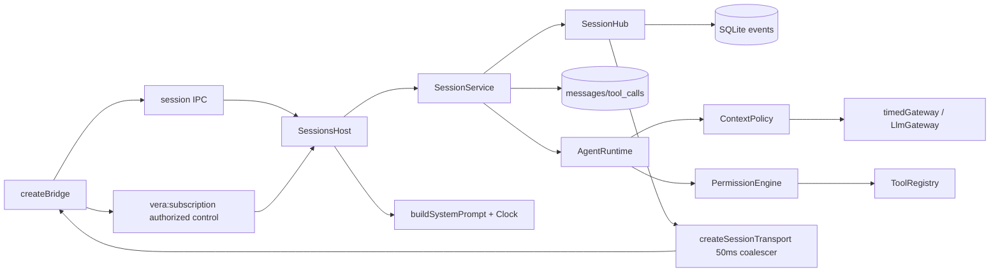

# Durable workbench sessions

## Routing

[Chat UI](chat-ui.md) owns renderer transcript/composer/navigation and native UI acceptance.

Select for SessionService, session CRUD/model/mode, persisted snapshots, turn/tool rows, replay/live subscriptions, citations and restart recovery. Start under05_Software at core/src/sessions/{service,hub,timed-gateway}.ts. Focused tests are sessions/service.test.ts, shared/session-state.test.ts, agent/citations.test.ts and desktop main/session-events.test.ts,sessions.test.ts,preload/bridge.test.ts. [Agent runtime](agent-runtime.md) owns model/tool execution and M1 policy; [workbench storage](workbench-storage.md) owns schema/driver; [workbench](workbench.md) owns lifetime/lock; [IPC](ipc-boundary.md) owns validated transport; [file tools](file-tools.md) owns confinement/worker execution.

## Purpose and boundaries

Core SessionService owns one workbench's durable sessions over injected AgentRuntime, gateway, registry, permission port and Clock. SessionHub stores schema-validated events and folds shared snapshots. Main SessionsHost binds current workbench/config/pinned/environment/settings and credentials, owns subscription transport and drains turns before workbench lifecycle changes. M1 permission policy executes read tools; prepared writes/approvals and changes are supplied by their owning components.

## Public interface

- SessionService(host) recovers writable state before accepting work. host supplies SQLite/root/gateway/Clock/model/prompt and optional workers/registry/permissions/policy/runtime/limits/scrubbing/ownership check. Read-only services expose reads/subscriptions.
- create(modelRef?,mode?) returns camelCase metadata with ses_ULID,UTC dates,empty title and idle status. list, get(id)->{snapshot,seq}, rename,delete,setModel,setMode own metadata and errors. Default mode comes from host; model resolution applies session/workbench/app precedence. First user text sets an empty title to60 UTF16 units; explicit nonempty rename survives.
- send returns turnId/messageId promptly, waitIdle is core completion, stop propagates abort, close aborts/drains all turns. Active sends and metadata/deletion mutations return BUSY. Many sessions may run together.
- subscribe(id,sinceSeq,listener(seq|undefined,event)) replays persisted rows then live events. Non-live seq starts1 and increases per session; message.delta/reasoning.delta/tool.update have no persisted row or seq. Detached callbacks cannot alter persistence or fail execution.
- Shared SessionEvent/schema, SessionState/schema, emptySessionState and applySessionEvent form the common projection. message.done text/citations replace deltas even when deltas were missed; unfinalized live-only messages disappear at a terminal boundary. Transient reasoning/tool updates have no durable projection; usage preflight fields preserve actual provider token totals.
- validateCitations checks unique extracted refs against successful tool ref fields and current confined text line bounds. Unsupported, invented, removed, ignored, binary and escaping refs are invalid.
- permission readPermissions allows read classes. Session wrapper consults the injected PermissionEngine before execution and scrubs tool output through its host; runtime receives enabled read tools only.

## Invariants

- Full pi messages and results persist independently of transient model request reduction. User/assistant completion synchronizes the verbatim transcript; source-order completed tool messages persist before the next provider response, alongside native provider-ID tool_calls rows. Multi-row transitions are transactional; live delivery follows persistence.
- Initial user persistence runs synchronously. Host gateway/tool wrappers wait the ordered persistence/citation queue before provider dispatch or tool execution; failed durability aborts the turn and prevents external work. Tool-start rows and complete assistant messages are durable before execution, and completed results before the next request. Reentrant publication serializes subscriber fanout; replay drains append nested emissions and skip already delivered persisted sequences.
- Each runtime call applies ContextPolicy using fresh gateway capabilities and emits context usage separately from actual usage. Settings supply maxToolCallsPerTurn; default50. Results cap32000 characters. timedGateway bounds each provider-output wait at300000ms, excluding tool/approval waits and containing iterators that ignore cancellation.
- Recovery preserves original content_json bytes, inserts missing result messages in valid pair order, restores completed outcomes from tool_calls, closes pending rows and running/awaiting_approval status with interrupted/aborted/idle events. Repetition makes no further changes. Read-only startup preserves rows.
- Session IDs validate before artifact removal; ordinary .vera/artifacts ancestors and target are required. SQLite cascades all child rows. Host checks lock token/pid before mutations; lifecycle drains prevent closed-DB writes.
- Core remains Electron-independent. Main uses existing exact renderer-frame authorization for invokes and subscription control; sandbox/CSP/vera://app baseline remains. Known-secret text/title/model requests are rejected, gateway and tool outputs are scrubbed, event transport and snapshot/summary responses preserve protocol discriminants/IDs while redacting user fields and bounding titles.

## Change map

| Change | Start | Focused proof |
|---|---|---|
| Lifecycle/persistence/recovery/budgets/permission | core sessions/service.ts | service.test.ts |
| Replay/live ordering | sessions/hub.ts | service.test.ts replay/reentrancy |
| Terminal projection | shared session-state.ts/events.ts | session-state.test.ts |
| Citation resolution | agent/citations.ts | citations.test.ts |
| Model output wait | sessions/timed-gateway.ts | service.test.ts timeout/ignored abort |
| Main host/transport/bridge | desktop main sessions/session-events,index;preload bridge | sessions/session-events/bridge tests; e2e/sessions.spec.ts |

## Key behaviors

REQ-FUNC-5e2438d5 reducer; FUNC-c76b4c8f CRUD; DATA-24394d5f durable transcript/events; REL-384b6464 BUSY/stop; NFR-83ac0a94 limits; FUNC-2e1261c2 citations; FUNC-eca9b9a1 replay/coalescing; REL-2098b145 recovery; FUNC-2b462360 IPC; SEC-5a7ef5e4 permission seam.

## Architecture

## Files

Under05_Software: packages/shared/src/{session,session-state,events,ipc,index}.ts and session-state.test.ts; packages/core/src/sessions/{service,hub,timed-gateway}.ts/service.test.ts; agent/{permissions,citations,runtime,types}.ts/citations.test.ts; core exports; workbench/service.ts ownership/snapshot seams; llm/replay.ts session-isolated deterministic IDs. Desktop main/{sessions,session-events,events,ipc-router,index}.ts and related tests; preload/bridge.ts/test; renderer api/subscriptions.ts,ipc.ts and mocks/sessions.ts,mockApi.ts. fixtures/llm-scripts/read-then-answer.jsonl and e2e/sessions.spec.ts provide deterministic acceptance.
