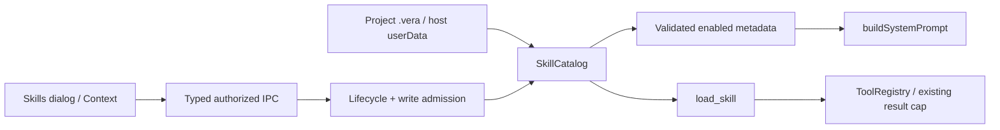

# Skills

## Routing

Select for workbench/user/plugin skills, YAML validation, metadata prompt index, load_skill,
and Skills settings. Start at05_Software/src/libraries/core/src/skills/catalog.ts,
core workbench/service.ts, desktop main/sessions.ts and renderer/components/skills.tsx.
[Workbench](workbench.md) owns lock/lifecycle/write queues; [File tools](file-tools.md)
owns registry/result limits; [Sessions](sessions.md) owns turns and persistence;
[IPC boundary](ipc-boundary.md) owns exact frame authorization and typed channels.

[Verification fixtures](demo-onboarding.md) routes the fictional board corpus and PDF sources under tests/fixtures, used by isolated tests and evaluation/smoke harnesses.

## Purpose and boundaries

SkillCatalog discovers workbench/.vera/skills, separately host-authorized userData/skills and
the skills/ folders of the workbench's enabled, issue-free plugins (source `plugin`, with the
plugin id; WorkbenchService.loadPlugins supplies them). Workbench folders shadow matching user
folders including invalid ones, user folders shadow plugin folders, and between plugins the
lowest plugin id wins. Discovery
returns validated metadata and localized diagnostic codes; bodies reach the agent
through load_skill. Main composes fresh metadata before session operations/turns;
CLI composes the same catalog. Renderer uses strict named/source/scoped IPC only.

## Public interface

- SkillCatalog.list/metadata/load/read/path use current roots and admission callback.
- load_skill {name,file?} is read-class and uses existing32000-character result cap.
- skills.list/open/create/save/toggle carry workbenchId; open/create/save targets use only
  workbench/user source (`skillEditableSourceSchema`; plugin is INVALID) and folder name, never
  an arbitrary root. save requires original SHA256. Summaries carry `plugin` for plugin skills.
- WorkbenchService admits reads on lifecycle queue and writes on shared write queue.
  create writes a template exclusively; save prepares same-folder bytes and rechecks
  ownership/path/hash before rename. User skills respect current workbench admission.
- Skills settings labels plugin skills "Plugin <id>" with an enable toggle and no editor.
- Skills settings provides diagnostics, enable/disable, open/edit, source selection,
  template creation, loading/retry/read-only states and isolated drafts. Context lists
  enabled valid metadata. en/ro/de labels use root-scaled rem/theme styles and modal
  keyboard focus restoration. Workbench access is through Edit → Tools/skills;
  manager changes save independently, and project Save preserves their live choices.
  Nested Escape closes only the top dialog, returning focus to its launcher.
  Repeated Enabled/Open accessible names include each skill name. Browser mock supplies the same routes in memory.

## Invariants

- Name is lowercase letters/digits/hyphens1..64 and equals folder; description1..1024.
  YAML duplicate keys/aliases fail. Markdown has no reference-only body-line restriction.
- Invalid names/content/path appear with diagnostics and are omitted from metadata.
  Disabled names are omitted from metadata and denied by the loader.
- File reads cap256KiB, require ordinary single-link UTF8 text, stable descriptor/path
  identity and reject redirects, escaping/ambiguous/device/absolute paths. Extra paths
  stay under the selected skill folder. Each root caps1024folders/4096entries.
- Agent content applies permanent .git/.vera/node_modules exclusions to both roots
  and workbench .vera/.veraignore rules with negations through the common PathGuard. The dedicated catalog confines reads to project/.vera while
  evaluating logical skills/name paths against the owning project policy; general file tools
  retain the permanent .vera exclusion.
  Ignored primary skills show unavailable diagnostics and stay out of the prompt;
  explicit UI inspection/editing keeps its separate current ownership admission.
- Current ownership and abort checks surround async reads; content/version and source
  are revalidated before disclosure. Workbench ID/folder/ownership guard settings saves.
- Plugin skill reads use the user-root rules (permanent exclusions, no links) under the installed
  plugin folder, whose integrity hash PluginStore checks before the plugin loads.
- Exclusive creation and stale-edit conflicts preserve existing user bytes. Workbench
  and user roots come from host composition; renderer imports no Node filesystem.

## Change map

| Behavior | Source | Focused proof |
|---|---|---|
| Discovery/validation/precedence/disabled/bounds | core skills/catalog.ts | skills/catalog.test.ts |
| Body/extra/runtime limits | core tools/load-skill.ts,registry.ts | sessions/skills.test.ts,tools/registry.test.ts |
| Ownership/create/edit/toggle | workbench/service.ts | workbench/service.test.ts |
| Scoped IPC | shared/skills.ts,ipc.ts; main/index.ts | shared/skills-ipc.test.ts,ipc-router/preload/transport tests |
| Fresh prompt/settings/accessibility | main/sessions.ts,renderer/components/skills.tsx | tests/e2e/skills.spec.ts; mockApi.test.ts; components/skills.test.ts |
| Plugin skill roots | skills/catalog.ts `plugins`, workbench/service.ts `loadPlugins` | skills/catalog.test.ts, workbench/service.test.ts |

## Key behaviors

REQ-FUNC-e728c8bf metadata/discovery; REQ-FUNC-f06e9051 content admission;
REQ-UX-a285bfa2 skills management; REQ-FUNC-6d88d2ec plugin skills; REQ-FUNC-a5eff6c9
plugin shadowing; REQ-UX-11a84a1d plugin skills read-only in settings; REQ-SEC-f7e4f258 plugin
targets refused. Native acceptance captures loopback model requests
before creation and after creation, disabling and editing in the same session.

## Architecture

## Files

Core skills/catalog.ts; tools/load-skill.ts; workbench/service.ts; sessions/service.ts.
Shared skills.ts/ipc.ts. Desktop main/index.ts/sessions.ts; renderer components/skills.tsx,
session/context-tab.tsx,workbench-editor.tsx,mocks/mockApi.ts,locales. CLI run.ts.
Acceptance tests/e2e/skills.spec.ts and focused tests in Change map.
