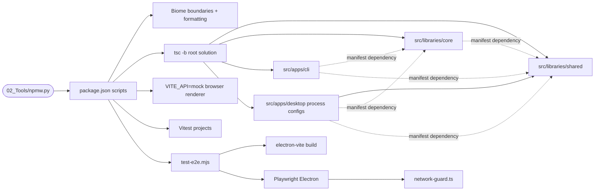

# Software tooling and source workspaces

## Routing

Select for npm workspaces, exact dependency pins, TypeScript references, import boundaries,
verification commands and Electron test launchers, the Node fetch/socket network guard and smoke:live. Start at `05_Software/package.json`
and `tsconfig.json`; configuration/build tests are `tests/tooling/`, cross-component tests are `tests/integration/`, and distribution tests are `tests/packaging/`. Desktop runtime behavior belongs
to [desktop-shell](desktop-shell.md); toolchain installation is owned by `02_Tools/`.

## Purpose and boundaries

The software root supplies four ESM workspaces, strict compilation, Biome boundaries,
Vitest projects and Playwright acceptance launchers. Shared publishes zod IPC/settings/workbench schemas; core
publishes host ports, settings and workbench services; [Headless CLI](headless-cli.md) composes durable sessions and bounded workers through Node ports. Desktop owns the running Electron shell and renderer-only dev mode.

## Public interface

From `05_Software`, use `npm run verify`, `check:i18n`, `lint`, `format`, `typecheck`, `build`, `dev`, `dev:renderer`
and `test:e2e`. The repository-local `python ../02_Tools/npmw.py` wrapper selects pinned Node.
See [software README](../../05_Software/README.md) for setup and command details.
`prepare:model`, `package` and `package:test` route to [native packaging](native-packaging.md),
which owns verified assets, native staging and artifact measurements.

## Invariants

- Direct dependency versions are exact; install from the committed lockfile using npm ci.
  Core pins @earendil-works/pi-ai1.1.0 for the gateway, zod4.6.5/typebox1.3.27 for tool-schema projection and pi-agent-core1.1.0 as an experiment-only dev dependency, yaml2.9.1, ulid3.0.2 and ignore7.0.12 for parsing, identity and ignore rules; tinyglobby0.2.17 for file discovery and diff9.0.0 for structured unified file patches/counts. Tooling pins esbuild0.25.12 for isolated worker bundles.
- Desktop Vite main resolves core/shared from source; preload/renderer resolve shared from source.
  Core/desktop Vitest resolve their library dependencies from source; TypeScript supplies generated output for library consumers.
- The tooling TypeScript project references shared/core before compiling e2e contracts and worker-host test consumers.
- All four workspaces extend the strict base and participate in the root TypeScript solution.
- Core's Electron prohibition and the existing layer/import rules remain enforced by Biome regression tests.
- Core sources never import `node:child_process` or `child_process` (core tests and test-support files may);
  processes start through the ProcessHost port that desktop main and the CLI compose.
- E2e uses temporary userData and explicit Chromium sandboxing; non-loopback Node and Chromium requests are blocked.
- Linux acceptance runs through xvfb-run with platform-specific dependencies separate from Windows.

## Change map

| Change requested | Start with | Focused verification |
|---|---|---|
| Workspace/pin/reference layout | manifests and `tsconfig*.json` | `skeleton.test.ts`, typecheck |
| Layer boundaries | `biome.json` | `boundaries.test.ts` |
| Test-build constant | desktop Vite config and `build-mode.ts` | `build-mode.test.ts` |
| Acceptance execution/isolation | `scripts/`, `tests/e2e/network-guard.ts` | Electron acceptance and guard self-test |

Catalog audit scans renderer TypeScript AST for literal and finite registered translation keys, excluding tests; English defines required catalog keys.

## Key behaviors

- `REQ-TEST-4a040006` — check:i18n rejects missing, unused and translation-only catalog keys.
- `REQ-PLAT-6f3e3500` — four strict ESM workspace skeletons respect established boundaries.
- `REQ-TEST-21b726d6` — development, build and isolated acceptance commands are reproducible.
- `REQ-TEST-2308561a` — actual builds emit the configured test identity, unaffected by runtime overrides.

## Architecture

Dashed arrows describe npm dependency declarations, while solid arrows describe command
execution and compilation ownership. Core exports ports/settings/workbench/LLM gateway and confined file tools; shared publishes IPC/settings/workbench types/schemas;
CLI supplies the vera bin and run command over the same core services.

## Files

All paths are under `05_Software/`.

- `package.json`, `package-lock.json`, `.npmrc`, `README.md` — installation and commands.
- `biome.json`, `tsconfig.base.json`, `tsconfig.json`, `tsconfig.tools.json` — checks and compilation.
- `vitest.config.ts`, `playwright.config.ts` — test projects and acceptance settings.
- `tests/tooling/{boundaries,skeleton,build-mode}.test.ts` — boundary, layout and emitted-build regression tests, with compiled shared entry hidden during builds.
- `src/libraries/{shared,core}/{package.json,tsconfig.json,src/index.ts}` — library definitions and public exports.
- src/libraries/core/vitest.config.ts — core Node tests with shared source resolution.
- `src/apps/cli/{package.json,tsconfig.json,src/index.ts}` — headless CLI.
- `scripts/test-e2e.mjs`, `dev-test-server.mjs` — build/acceptance and isolated Vite launchers.
- `tests/network-{guard,setup}.ts`, `tests/tooling/network-guard.test.ts` — unit-test transport interception and guard regression.
- `tests/e2e/network-guard.ts`, `shell.spec.ts` — connection interception and real-process acceptance.

- scripts/check-i18n.mjs, tests/tooling/i18n.test.ts and tests/fixtures/i18n/missing-key.json — source-catalog usage/completeness audit and actual negative CLI regression.
