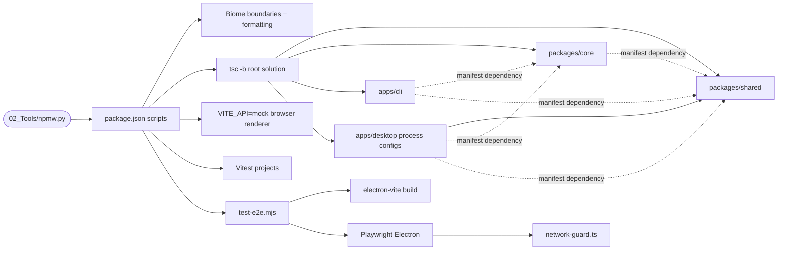

# Software tooling and source workspaces

## Routing

Select for npm workspaces, exact dependency pins, TypeScript references, import boundaries,
verification commands and Electron test launchers. Start at `05_Software/package.json`
and `tsconfig.json`; focused tests are `tests/tooling/`. Desktop runtime behavior belongs
to [desktop-shell](desktop-shell.md); toolchain installation is owned by `02_Tools/`.

## Purpose and boundaries

The software root supplies four ESM workspaces, strict compilation, Biome boundaries,
Vitest projects and Playwright acceptance launchers. Shared publishes zod IPC schemas; core/CLI
expose skeleton entrypoints. Desktop owns the running Electron shell and renderer-only dev mode.

## Public interface

From `05_Software`, use `npm run verify`, `lint`, `format`, `typecheck`, `build`, `dev`, `dev:renderer`
and `test:e2e`. The repository-local `python ../02_Tools/npmw.py` wrapper selects pinned Node.
See [software README](../../05_Software/README.md) for setup and command details.

## Invariants

- Direct dependency versions are exact; install from the committed lockfile using npm ci.
- Desktop Vite and Vitest resolve shared contracts from source; generated library output is supplied by TypeScript for library consumers.
- The tooling TypeScript project references shared before compiling e2e contract consumers.
- All four workspaces extend the strict base and participate in the root TypeScript solution.
- Core's Electron prohibition and the existing layer/import rules remain enforced by Biome regression tests.
- E2e uses temporary userData and explicit Chromium sandboxing; non-loopback Node and Chromium requests are blocked.
- Linux acceptance runs through xvfb-run with platform-specific dependencies separate from Windows.

## Change map

| Change requested | Start with | Focused verification |
|---|---|---|
| Workspace/pin/reference layout | manifests and `tsconfig*.json` | `skeleton.test.ts`, typecheck |
| Layer boundaries | `biome.json` | `boundaries.test.ts` |
| Test-build constant | desktop Vite config and `build-mode.ts` | `build-mode.test.ts` |
| Acceptance execution/isolation | `scripts/`, `e2e/network-guard.ts` | Electron acceptance and guard self-test |

## Key behaviors

- `REQ-PLAT-6f3e3500` — four strict ESM workspace skeletons respect established boundaries.
- `REQ-TEST-21b726d6` — development, build and isolated acceptance commands are reproducible.
- `REQ-TEST-2308561a` — actual builds emit the configured test identity, unaffected by runtime overrides.

## Architecture

Dashed arrows describe npm dependency declarations, while solid arrows describe command
execution and compilation ownership. Core/CLI entrypoints are empty exports; shared publishes IPC types/schemas.

## Files

All paths are under `05_Software/`.

- `package.json`, `package-lock.json`, `.npmrc`, `README.md` — installation and commands.
- `biome.json`, `tsconfig.base.json`, `tsconfig.json`, `tsconfig.tools.json` — checks and compilation.
- `vitest.config.ts`, `playwright.config.ts` — test projects and acceptance settings.
- `tests/tooling/{boundaries,skeleton,build-mode}.test.ts` — boundary, layout and emitted-build regression tests, with compiled shared entry hidden during builds.
- `packages/{shared,core}/{package.json,tsconfig.json,src/index.ts}` — library skeletons.
- `apps/cli/{package.json,tsconfig.json,src/index.ts}` — CLI skeleton.
- `scripts/test-e2e.mjs`, `dev-test-server.mjs` — build/acceptance and isolated Vite launchers.
- `e2e/network-guard.ts`, `shell.spec.ts` — connection interception and real-process acceptance.
