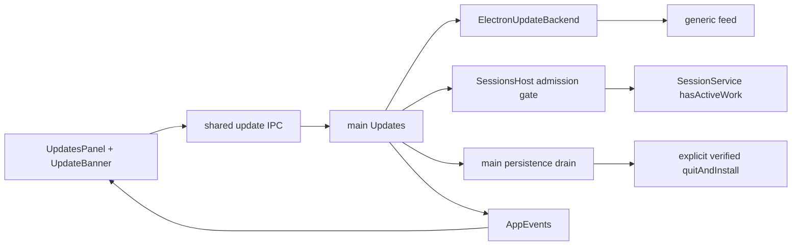

# Desktop updates

## Routing

Select for update modes/channels, fixed generic feed, update events, restart banner and
turn/approval installation barriers. Start at main/updates.ts and main/update-backend.ts.
[Native packaging](native-packaging.md) owns assets/identity, [app data](app-data.md)
owns preferences and [sessions](sessions.md) owns actual session work.

## Purpose and boundaries

Main owns scheduling/capabilities and payload lifecycle. ElectronUpdateBackend delegates
metadata, downloads, SHA512/publisher verification and installation to electron-updater.
SessionsHost closes admission atomically at core quiescence. Main drains persistence before
installation. Renderer presents strict snapshots, plain text notes and portable confirmation. The native confirmation closes on disposal and restores its connected opener.
The update mode also gates the plugin catalog's 24 h checks ([Plugins](plugins.md)): mode Off stops them.

## Public interface

update.get/check/restart use empty strict requests. update.download requires confirmed:true.
update.openRelease requires confirmed:true and the current offer version. Shared updates.ts
defines snapshots; AppEvents update.available/update.changed deliver state.
VERA_UPDATE_URL fixes generic feed at compilation and builder metadata; empty is unconfigured.

## Invariants

- Release feeds require HTTPS without credentials/query/fragment. Instrumented builds also
  permit compile-time loopback HTTP. Runtime settings/environment cannot replace the feed.
- Off disables scheduling; Check now works. Enabled checks run at startup and every6hours.
  Unchanged update preferences preserve the scheduled deadline through other settings writes.
- Latest excludes prereleases; beta chooses the greatest compatible newer stable/beta.
  Downgrade, implicit download and implicit on-quit installation are disabled.
- Notify/Off download after consent; automatic mode downloads installable offers.
- electron-updater verifies SHA512 and the configured Windows publisher; signed Windows
  requires nonempty publisher configuration before download. Candidate metadata requires
  canonical SHA512; SHA256-only feeds are refused.
- Portable/managed reject download/install; portable confirms a current feed-derived link;
  managed Linux checks DebUpdater metadata without APPIMAGE and directs to its package manager.
- Downloaded metadata/backend stay pinned. Deferred requests keep windows and turns alive.
  Core activity includes active promises and pending approvals, independently of UI subscriptions.
- SessionsHost synchronously checks queued operations/core activity and locks new admission.
  Main drains session/workbench/settings/log persistence before explicit quitAndInstall.
- Errors/logs expose bounded categories. Notes are bounded React text and scrubbed at transport.

## Change map

| Change | Start | Focused proof |
|---|---|---|
| modes/safety | main/updates.ts | updates.test.ts |
| channels/integrity | main/update-backend.ts | update-backend.test.ts, tests/packaging/probe-upgrade.mjs |
| admission | core sessions/service.ts, main/sessions.ts/index.ts | approvals.test.ts, sessions.test.ts |
| UI/IPC | shared updates/ipc/events, renderer updates.tsx | shared/UI tests, tests/e2e/updates.spec.ts |
| build/feed | update-config.mjs, package.mjs, update-feed.mjs | tooling/updates.test.ts, packaging.test.ts |

## Key behaviors

REQ-FUNC-a16121c6 discovery; REQ-FUNC-d11a1f5c downloads; REQ-REL-61e5471c safe install;
REQ-PLAT-f905ba1a distribution limits; REQ-UX-a809496e controls/events.
[Exact contract](../specs/REQ-FUNC-a16121c6.md).

## Architecture

The backend owns download bytes; main owns installation timing.

## Files

Paths relative to05_Software:

- src/libraries/shared/src/{updates,settings,ipc,events}.ts — state/actions/preferences.
- src/apps/desktop/src/main/{updates,update-backend,index,sessions}.ts — lifecycle/adapters.
- src/libraries/core/src/sessions/service.ts — actual activity.
- renderer components/updates.tsx/settings.tsx, App.tsx, mocks/mockApi.ts/locales — presentation.
- 02_Tools/release/{update-config,package,update-feed}.mjs — build/feed.
- tests/packaging/probe-upgrade.mjs — actual artifact updater probe: a managed (deb) build gets metadata only,
  SHA-512 is required and a corrupt hash is refused, install waits for a pending approval and then
  really installs, and a portable build gets a release link. It does not check data migration;
  upgrade data safety is deferred until the first public release.
- shared updates.test.ts, main updates/update-backend.test.ts, core approvals.test.ts,
  renderer updates.test.ts, tooling updates.test.ts and tests/e2e/updates.spec.ts — proof seams.
