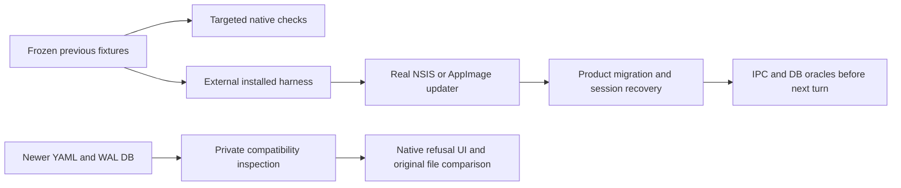

# Upgrade and migration safety

## Routing

Select for frozen previous-version fixtures, migration inventory, installed upgrade
acceptance and newer-data preservation. [Application data](app-data.md),
[Providers](providers.md), [Workbench](workbench.md), [Workbench storage](workbench-storage.md)
and [Sessions](sessions.md) own the product contracts. [Updates](updates.md) owns installation.

## Purpose and boundaries

The acceptance fixtures exercise the existing persisted formats and recovery contracts.
The external installed harness builds separately identified test packages and observes
real updater installation, durable state and recovery before the next turn.

## Public interface

- `scripts/probe-upgrade.mjs <owned-scratch> --migration-safety` uses NSIS on Windows
  and AppImage on Linux, a fixed local feed and explicit owned userData on all launches.
- `scripts/upgrade-fixture.mjs` seeds interrupted rows only after the installed app
  closes its workbench, and checks recovered IPC snapshots plus underlying rows.
- Original `upgrade-report.json`, stdout/stderr and external execution receipts bind
  candidate inputs, executable/asar/version, artifact SHA256/SHA512 and observed userData.

## Invariants

| Persisted data | Supported version and migrations | Previous fixture oracle |
|---|---|---|
| settings.json | 0/1/2/3 directly to4 | exact exclusive bak-n before write; UUID/preferences/extensions retained; failure preserves source |
| credentials.json | schema1; no migration | synthetic encrypted API/OAuth values, extensions, redaction and read without rewrite; newer refusal before crypto/write |
| vera.db | 1 initial, 2 keyword, 3 embeddings | frozen empty0/schema1/schema2 SQL; each pre-step committed backup, integrity/FK checks and verbatim rows |
| workbench.yaml | format1; no migration | unchanged supported YAML; format2 refusal before runtime/recents writes |

- Interrupted running/awaiting_approval sessions become idle, old approvals aborted
  and unusable, unanswered calls receive interrupted results and terminal events.
- Hash recovery marks after as applied, removes before rows and marks other as conflict;
  original workbench file hashes/metadata remain unchanged. Repeated recovery is idempotent.
- Newer settings expose read-only defaults/banner. Newer YAML/DB shows the localized
  created-by-newer-VERA refusal; private DB/WAL inspection preserves source DB/WAL/SHM,
  locks, backups and file inventory/metadata, excluding access time.
- Connected instrumented installed upgrade acceptance has its own scope. Release signing,
  clean/offline Windows, CRT self-containment and separate Linux-kernel proof retain their
  final release acceptance routes in [Native packaging](native-packaging.md).

## Change map

| Change | Start | Focused proof |
|---|---|---|
| migration inventory | fixtures/settings and fixtures/upgrade | settings/service, credentials, storage/upgrade-safety tests |
| interrupted recovery | frozen interrupted.json | storage/upgrade-safety.test.ts plus sessions/service.test.ts |
| installed persistence | probe-upgrade/upgrade-fixture.mjs | actual NSIS/AppImage reports |
| future-data UI | e2e/upgrade-safety.spec.ts | native Electron and recursive original-file comparison |

## Key behaviors

REQ-TEST-449732e2 fixture migration/recovery; REQ-TEST-becfe766 actual installed
upgrade; REQ-TEST-357ad9d7 future refusal UI/preservation.
[Exact acceptance contract](../specs/REQ-TEST-449732e2.md).

## Architecture

## Files

Paths relative to05_Software: fixtures/settings/version-{0,1,2,3}.json;
fixtures/upgrade/{database-v0,database-v1,database-v2}.sql, interrupted.json,
credentials-{v1,newer}.json, workbench-{v1,newer}.yaml; core storage/upgrade-safety.test.ts,
settings/service.test.ts, workbench/service.test.ts; desktop main/credentials.test.ts;
e2e/upgrade-safety.spec.ts; scripts/{probe-upgrade,upgrade-fixture}.mjs.
