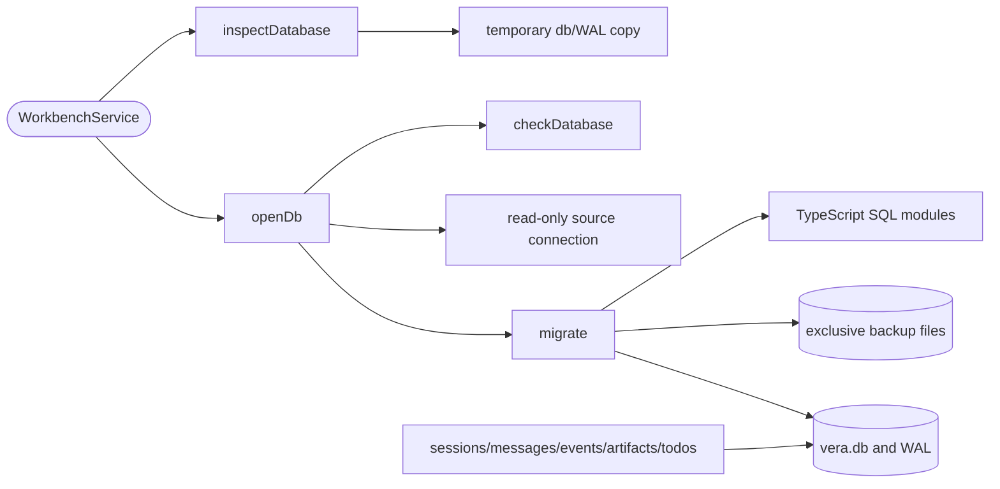

# Workbench SQLite storage

## Routing

Select for vera.db, schema_version, checksummed SQL migrations, backup files and sessions/messages/events row repositories. Start with core/src/storage/db.ts and migrate.ts; focused real-driver tests are db.test.ts and repositories.test.ts. [Workbench](workbench.md) owns folder/lock/handle lifetime; [native packaging](native-packaging.md) owns addon delivery and probes.

## Purpose and boundaries

Core owns the better-sqlite3 connection, initial schema, migration catalogue and session/message/event/artifact/todo storage repositories. [Changes](changes.md) owns the applied-row read projection and recorded patch/count presentation. Prepared file tools own changes-table transitions, with applied status/change-event recording in one transaction and guarded hash recovery; [file tools](file-tools.md) routes that behavior. WorkbenchService owns active connection lifetime, ownership and recents. Row repositories preserve stored JSON and caller-assigned sequence; [session behavior](sessions.md) owns runtime integration, native provider-ID tool rows, recovery and event projection.

## Public interface

- DocumentsRepository projects typed metadata from schema1 documents and clears
  document-derived chunks plus associated existing FTS/embedding rows before
  source removal. [Knowledge ingest](knowledge-ingest.md) owns queue and states.

- openDb(path, StorageOptions) returns WorkbenchDatabase with db and idempotent close(preserveSource?). Options supply workbenchId/appVersion, readOnly and an optional ordered migration catalogue for fixture upgrades.
- inspectDatabase checks metadata on a temporary db/WAL copy before writable opening or lock acquisition. Missing source is permitted; an absent live-owner source stays absent.
- checkDatabase verifies schema_version, applied SHA256 and workbench_id. Newer versions return WORKBENCH_TOO_NEW; invalid version/catalogue/checksum returns INVALID with reason; identity mismatch and occupied backup path return CONFLICT.
- TodosRepository reads and validates whole ordered replacements in existing schema1; [Plan](plan.md) owns atomic event integration and list presentation.
- ArtifactsRepository owns existing schema1 artifact metadata with session/name uniqueness, stable overwrite identity and time/id ordering; [Artifacts](artifacts.md) owns managed files and saved events.
- SessionsRepository creates/gets/lists/deletes raw rows. List order is created_at DESC,id DESC; deletion cascades session child rows.
- MessagesRepository and EventsRepository create/get/list/delete by (session_id,seq). JSON strings remain verbatim. Lists order seq ascending; event afterSeq defaults to -1. Missing get is undefined, delete returns boolean; SQLite rejects duplicate/FK violations.

## Invariants

- better-sqlite3 13.0.3 is exactly pinned. Writable connections use WAL, foreign_keys ON, busy_timeout5000 and synchronous NORMAL. Core imports its own dependencies and shared.
- Compatibility inspection preserves source db/WAL/SHM bytes. Read-only handles retain private snapshots and reject SQL writes; close removes their temporary directories. Concurrent source changes during capture produce BUSY.
- Catalogue versions are contiguous from1; SHA256 covers exact UTF8 SQL and meta uses migration_0001_sha256 keys. Each pending step has an exclusive vera.db.v<previous-version>.bak backup of the committed SQLite view before SQL/version/checksum commit atomically. Existing recovery files are preserved and block retries.
- Managed db/sidecars/backups paths reject symlinks or nonordinary types. A failed transaction retains the previous schema and pre-step backup.
- Writable handles activate an auxiliary read-only source connection while owned. The service checkpoints
  under its token guard before lock unlink while retaining the open handle if unlink fails. Disposal after
  release/token loss closes writer first and read-only last, preserving DB/WAL/SHM bytes. Ordinary standalone
  close reverses that order for normal SQLite checkpoint/sidecar cleanup. Message/event seq is a nonnegative
  safe integer, checked by repositories and SQL constraints.
- Initial schema contains meta plus sessions/messages/events/tool_calls/approvals/changes/artifacts/todos/documents/chunks. Session foreign keys cascade; document chunks cascade with their document. Requested session, seq, document/status indexes exist.

## Change map

| Change | Start with | Focused proof |
|---|---|---|
| Connection/protected reads | db.ts | db.test.ts readonly/newer/WAL/links |
| Migration/schema/backup | migrate.ts, migrations/0001_initial.ts | db.test.ts ordered upgrades/rollback/checksum/schema |
| Row repository | repos/{sessions,messages,events}.ts | repositories.test.ts CRUD/order/persistence/cascades |
| Handle lifetime/lock | workbench/service.ts | service.test.ts database/live-owner/failed-switch plus WP06 |

## Key behaviors

- REQ-PLAT-f0d13546 — pinned SQLite pragmas.
- REQ-DATA-9dbda56e — ordered atomic migration application.
- REQ-DATA-d137ab0e — changed/missing applied checksum refusal.
- REQ-DATA-ac2dc07a — complete pre-step exclusive backup.
- REQ-DATA-73e0309d — newer database source preservation.
- REQ-DATA-bc498301 — session storage/cascades.
- REQ-DATA-40c94e08 — message JSON/seq storage.
- REQ-DATA-ee009054 — event JSON/seq storage.
- REQ-REL-b7f1889b — lifecycle ownership and storage cleanup.

## Architecture

SQLite backup reads the committed WAL view. SQL and meta updates commit together per step; workbench ownership serializes application operations.

## Files

- 05_Software/packages/core/src/storage/db.ts and db.test.ts — connections/snapshots/compatibility.
- 05_Software/packages/core/src/storage/migrate.ts and migrations/0001_initial.ts — runner/schema.
- 05_Software/packages/core/src/storage/repos/{sessions,messages,events}.ts and repositories.test.ts — rows.
- 05_Software/packages/core/src/workbench/{service,service.test}.ts — handle lifetime/ownership.
- 05_Software/packages/core/{src/index.ts,package.json} and 05_Software/package-lock.json — exports/pinned dependency.
