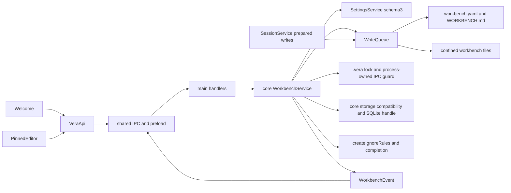

# Workbench lifecycle

## Routing

Select for workbench.yaml, WORKBENCH.md, wb_ identity, create/open/close, runtime lock,
recent folders, config/pinned saves, ignore rules and path completion. Start with
05_Software/packages/core/src/workbench/service.ts and packages/shared/src/workbench.ts.
Focused tests: core workbench/service.test.ts and shared workbench.test.ts. Native/UI tests:
e2e/workbench.spec.ts and mock.spec.ts. [Application data](app-data.md) owns settings migration;
[IPC boundary](ipc-boundary.md) owns authorization/transport; [renderer foundation](renderer-foundation.md)
owns the shell, appearance, language and layout.
Tool path confinement, read/list/glob/grep and worker deadlines route to [File tools](file-tools.md).
Database migrations, compatibility, backups and row repositories route to [Workbench storage](workbench-storage.md).

## Purpose and boundaries

Core owns the folder lifecycle, identity, YAML validation, runtime lock, pinned context and common
ignore/completion policy. Main supplies process liveness, version, clock, token, settings and atomic
file/event ports. Renderer displays Welcome, pinned editor and session workbench switching through validated IPC; config.get adds optional folder/readOnly metadata for reload. Mock
mode offers empty, missing, read-only and warning fixtures.

## Public interface

- WorkbenchService owns one writable background Ingester and reindexDocuments;
  close/replacement stops and drains ingest before lock/storage release. Read-only
  snapshots run no ingest. [Knowledge ingest](knowledge-ingest.md) owns selection,
  hashing, metadata/status events and derived invalidation.

- WorkbenchService.create(existingAbsoluteFolder,name), open(folder), close(). Snapshots contain
  canonical folder/config/readOnly/warnings; invalid YAML reports line/column, invalid configuration
  reports path/line, newer format returns WORKBENCH_TOO_NEW before runtime writes.
- Core-only getSnapshot supplies a detached current snapshot and assertSessionWritable immediately checks ordinary lock paths plus the owned pid/token before session database changes. Main session lifecycle drains active turns before switches/close.
- Core-only getWriteQueue supplies the shared queue for application config/pinned saves and every session write. File saves validate ownership/current state inside their queue callback; close and replacement drain admitted writes before storage disposal.
- Core-only getDatabase supplies owned writable SQLite or a live-owner read-only snapshot. Open checks
  database compatibility before lock/recents writes; failed replacement preparation closes its handle
  and releases the new token while retaining the previous workbench. Close/successful switches dispose handles.
  Owned release checkpoints under the token guard before unlink; failed unlink retains usable storage.
  Disposal after release or ownership loss preserves source bytes through writer-first/read-only-last close.
- Config get/update deep-merges known mutable fields with current disk data, retains unknown keys,
  and fixes id/format. Pinned get/update saves full UTF8 text; oversized counts bytes above16384.
- Recent retrieval/removal uses up to ten settings entries; folder existence derives missing state.
  Reopen retains entry extensions while refreshing known metadata.
  Future read-only settings permit opening while preserving settings bytes and suppressing recent saves.
- files(query) returns up to50 slash-separated relative ordinary-file paths, case-insensitive substring
  matches. createIgnoreRules applies case-insensitive permanent .vera/.git/node_modules segments before root .veraignore.
- Shared workbenchSchema/configWarnings/mergeWorkbench/workbenchTemplate supply format1 defaults,
  passthrough extensions, unresolved disabled-name warnings and the specified English pinned template.
- Native app.chooseFolder uses Electron dialog; instrumented compilation accepts VERA_TEST_DIALOG_PATH.
  Release emission eliminates the override. All lifecycle/config/pinned/recent/files channels are strict.
- WorkbenchEvent opened/closed/config.changed envelopes filter by wb_ id and clean up independently.

- readDocuments/listDocuments/searchDocuments/openDocument serialize scoped reads against close/switch, check exact active identity and current writable ownership, and expose protected read-only snapshots. Docs keyword hits verify current source/extraction bounds once per path and reject changed index epochs. Optional reindexDocuments(workbenchId) rejects foreign identity before admitting ingest. [Document viewer](document-viewer.md) owns content resolution.

- readDocuments/listDocuments/searchDocuments/openDocument serialize scoped reads against close/switch, check exact active identity and current writable ownership, and expose protected read-only snapshots. Docs keyword hits verify current source/extraction bounds once per path and reject changed index epochs. Optional reindexDocuments(workbenchId) rejects foreign identity before ingest admission. [Document viewer](document-viewer.md) owns content resolution.

## Invariants

- Core remains Electron-agnostic; renderer uses shared IPC only. Management paths and traversed
  directories reject symlinks/junction redirection. Completion skips links and permanently ignored roots.
- Create publishes configuration exclusively, retains existing user content and adds missing scaffolding.
- YAML format1 supports JSON-compatible extension values. Non-finite numbers/circular aliases are
  refused without rewriting source. Newer format/changed identity blocks user saves.
- One service serializes operations; a short exclusive process-owned local IPC guard coordinates stale takeover.
  A live pid yields read-only without changing its runtime files; a dead pid permits takeover.
  Windows named pipes/Linux abstract Unix sockets auto-release on crash; EADDRINUSE contention
  yields read-only with a warning. Every reopen reassesses ownership; matching owned tokens survive.
- Locks hold pid/app/since and unique ownership token. Writes recheck ownership; close releases only
  its matching lock. A failed replacement/recent save retains the preceding workbench and cleans
  newly acquired ownership. Confirmed config saves publish events; observer errors cannot undo saves.
- UNC paths warn that network shares are unsupported. WORKBENCH.md text is user data; the editor
  saves full content explicitly and restores focus after Cancel/Escape/save. Each dialog loads fresh
  content before enabling input; drafts stay isolated from focus/reconnect refresh.

## Change map

| Change requested | Start with | Focused verification |
|---|---|---|
| Format/extensions/validation | shared workbench.ts, core parseConfig | shared/core workbench tests |
| Lifecycle/ownership/failure | core WorkbenchService | service.test.ts, native live lock acceptance |
| Recents/migration | WorkbenchService, SettingsService | service/settings tests, deleted-recent E2E |
| Ignore/completion | createIgnoreRules, WorkbenchService.files | confined completion tests |
| Welcome/editor/locales | components/workbench.tsx, App.tsx, locales | native/browser keyboard acceptance |
| Dialog instrumentation | main/index.ts | actual build-mode.test.ts, instrumented native picker |

## Key behaviors

- REQ-DATA-85139c56 — format, JSON-compatible extensions, location errors and newer refusal.
- REQ-FUNC-adf92ecb — non-destructive creation and shared template.
- REQ-REL-bcb6fb23 — live/stale ownership and token-aware close.
- REQ-DATA-d7ced6a1 — confirmed atomic config/pinned saves and extension retention.
- REQ-FUNC-bfd14725 — confined bounded ignored-path completion.
- REQ-DATA-dfbfac7c — persisted recent lifecycle and derived missing state.
- REQ-UX-8622cdbe — Welcome lifecycle and translated warnings/errors.
- REQ-UX-1d6c940b — pinned dialog, size warning, read-only and focus.
- REQ-UX-9e7529d5 — missing recent display and removal.
- REQ-TEST-6a6c266d — compiled instrumented picker and release exclusion.

## Architecture

The service owns state and serial ordering; main supplies native host capabilities. Settings and
workbench formats have separate versioning and compatibility rules.

## Files

All paths below are relative to05_Software.

- packages/shared/src/workbench.ts and workbench.test.ts — format/warnings/template/merge.
- packages/shared/src/{ipc,events,settings}.ts — channels/events/recent metadata.
- packages/core/src/workbench/{service,ignore,guard}.ts and service.test.ts/guard.test.ts — lifecycle/ownership/saves/completion.
- packages/core/src/{ports,index}.ts — WorkbenchHost and public exports.
- packages/core/package.json and package-lock.json — exact yaml/ulid/ignore pins.
- apps/desktop/src/main/index.ts — service wiring, native picker, handlers and shutdown.
- apps/desktop/src/preload/bridge.ts and bridge.test.ts — scoped subscriptions.
- apps/desktop/src/renderer/api/{ipc,subscriptions}.ts — validated API subscriptions.
- apps/desktop/src/renderer/{App.tsx,components/workbench.tsx,components/error-message.tsx,styles.css,locales/} — Welcome/editor and translated states.
- apps/desktop/src/renderer/mocks/mockApi.ts and mockApi.test.ts — contract fixtures.
- fixtures/workbenches/demo-board/ — fictional board, notes, pinout and boot capture.
- e2e/workbench.spec.ts, e2e/mock.spec.ts, tests/tooling/build-mode.test.ts — acceptance and release hook regression.
