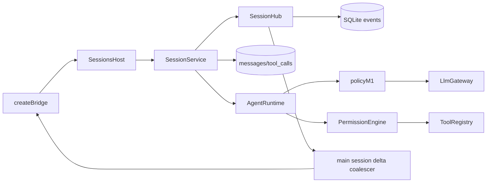

<!--
Copyright (c) 2026 DDP Engineering
This software is licensed under the PolyForm Noncommercial License 1.0.0.
Commercial use requires a separate commercial license.
See the LICENSE.txt in the .agentic folder for full license details.
SPDX-License-Identifier: LicenseRef-PolyForm-Noncommercial-1.0.0
-->

# TASK-01bfaca7 - WP-13 Session engine

stage: done
type: feature
path: full
interaction: autopilot
requirements: REQ-FUNC-5e2438d5, REQ-FUNC-c76b4c8f, REQ-DATA-24394d5f, REQ-REL-384b6464, REQ-NFR-83ac0a94, REQ-FUNC-2e1261c2, REQ-FUNC-eca9b9a1, REQ-REL-2098b145, REQ-FUNC-2b462360, REQ-SEC-5a7ef5e4
parent:
branch: master
base: e5085df9a89fd00f982144204c4277e8d0d729c8
opened: 2026-10-11

## Done checklist (current stage)

- [x] validated candidate confirmed unchanged
- [x] coordinator validation evidence, exact diff, exclusions and local outcome presented
- [x] standing human authority: one validated local coordinator commit per WP on master
- [x] journal and report included in selected59path delivery candidate
- [x] agreed local-only commit prepared by coordinator
- [x] close-out carried by the local delivery commit

## Frame

Problem: STATED WP13 needs durable sessions over the validated WP10 runtime.
Desired outcome: STATED all eight acceptance scenarios in issue13.json, plus exact03 sections1/2/7/8/9.
Actors: user through sandboxed IPC, main host, core service/runtime, gateway, workbench SQLite.
Primary scenario: send -> persist user/start -> budget preflight -> two read tools -> cited answer -> idle/end.
Examples: read-then-answer fixture; restart and continue same session.
Counterexamples: second concurrent send returns BUSY; oversized mandatory context calls no provider; live deltas never enter events.
In scope: event schemas/reducer; CRUD/metadata/artifact removal; runtime persistence/limits; read permission seam; citations; replay/live subscriptions; idempotent recovery; IPC; fixture; affected knowledge/context/architecture.
Out of scope: WP14 UI, WP16 writes/changes, WP17 approval workflow/cleanup, WP29 skills/catalog, epics39-44, publication/commit by implementer.
Constraints: master shared checkout; full base e5085df9a89fd00f982144204c4277e8d0d729c8; no staging; preserve optional-companions.md SHA2562a69f5b335a53e498b1f8e30fa5adb8096e870e7a12bbc05b0727a03cee72c6b; both native OS gates and original receipts; serial E2E5173; review enabled/maxfix5; credential/boundary/security invariants.
Success signals: eight issue acceptance cases, focused/strict/E2E on both OS, same-candidate independent verdicts and handoff packet.
Evidence: STATED delegation/issue; OBSERVED runtime.ts mandatory preflight and full cloned transcript, repositories storage-only CRUD, shared events has app/workbench only, main bridge has no session route.
Assumptions: INFERRED service composes existing prompt/runtime/tools with injected host policy; migration unnecessary for existing columns/tables.
Unknowns: exact host lifecycle seams to confirm during design; no decision-blocking product unknown.
Decision-blocking questions: none.
Proposed behaviors: exactly scope and acceptance in issue13.json and03/02/01 cited sections.
Path and reason: full: new observable behavior=yes; new interfaces=yes; dependency=no; existing requirement fully covers=no; data handling changes=yes. Tightly coupled session integration stays in one task; independent reviewers only.

## Requirement coverage

| Frame outcome | Atomic behavior | Requirement | Positive case | Boundary/failure | Verification | Design |
|---|---|---|---|---|---|---|
| WP13 scope | The shared reducer shall construct the same terminal session snapshot from persisted events and a live stream, including metadata, transcript, tool states, turns, usage and the reserved approval/change/artifact/todo events. | REQ-FUNC-5e2438d5 | fixture/current metadata | Fold golden events with/without live deltas and compare detached terminal states; unknown references are tolerated. | packages/shared/src/session-state.test.ts | See Design |
| WP13 scope | The session service shall create, list, get snapshot plus seq, rename and delete workbench sessions with ses_ ULIDs, UTC timestamps, first-user-message titles of at most60 characters, model/mode metadata and removal of child rows and the confined artifacts folder. | REQ-FUNC-c76b4c8f | fixture/current metadata | Create/rename/send/reopen/delete real SQLite sessions; verify metadata, cascades, artifact bytes and missing/BUSY/read-only refusals. | packages/core/src/sessions/service.test.ts | See Design |
| WP13 scope | When a runtime message ends, the session engine shall retain the complete verbatim message and tool results, record tool_calls and sequence every non-live event while sending message.delta, reasoning.delta and tool.update only live. | REQ-DATA-24394d5f | fixture/current metadata | Read-then-answer integration observes two tool pairs, final cited answer/end; compare transcript rows, event sequences and live-only absence. | packages/core/src/sessions/service.test.ts | See Design |
| WP13 scope | While a session turn is active, the service shall reject a second send with BUSY and propagate stop to runtime and tools with one terminal aborted event. | REQ-REL-384b6464 | fixture/current metadata | Hold replay response, issue concurrent send then stop; assert BUSY and one aborted completion; another session remains independent. | packages/core/src/sessions/service.test.ts | See Design |
| WP13 scope | For every model request, the session engine shall apply M1 context policy using fresh model capabilities and preserve complete history while enforcing configured tool-call count,32000 character tool results and a five-minute no-model-output timeout excluding approval waits. | REQ-NFR-83ac0a94 | fixture/current metadata | Exercise reduced long first turn/irreducible limit/no gateway and switched model budgets; configured call cap; stalled gateway with short injected deadline. | packages/core/src/sessions/service.test.ts | See Design |
| WP13 scope | After each assistant message, the citation checker shall mark every extracted line ref valid only when it came from a successful tool result and resolves within the confined current workbench file lines. | REQ-FUNC-2e1261c2 | fixture/current metadata | Test emitted valid citation and invented/out-of-range/missing/escaped/binary refs as invalid. | packages/core/src/agent/citations.test.ts | See Design |
| WP13 scope | When subscribing with sinceSeq, the session service shall deliver persisted events after that sequence before subsequent live events, with main coalescing live text updates at50ms and flushing before persisted events. | REQ-FUNC-eca9b9a1 | fixture/current metadata | Subscribe after partial history, compare ordered replay/live and coalesced text, terminal ordering, cleanup and detached subscribers. | packages/core/src/sessions/service.test.ts | See Design |
| WP13 scope | On startup, the session service shall idempotently close running and awaiting_approval sessions to idle with session.interrupted and aborted turn.done, persist interrupted results for unanswered tool calls before resume and preserve original history. | REQ-REL-2098b145 | fixture/current metadata | Seed both active statuses and completed/partial tool pairs; instantiate twice, compare unchanged original rows and valid next provider context. | packages/core/src/sessions/service.test.ts | See Design |
| WP13 scope | The sandbox bridge shall expose validated session.list/create/get/rename/delete/send/stop/model.set/mode.set and topic session with sinceSeq through the authorized current main frame. | REQ-FUNC-2b462360 | fixture/current metadata | Bridge/router/session native acceptance tests verify malformed/foreign requests, replay/live and CRUD; preserve Electron baseline. | apps/desktop/src/preload/bridge.test.ts | See Design |
| WP13 scope | Before executing a tool, the session engine shall consult its permission-engine interface whose M1 implementation permits only read tools and returns an error result for denied classes. | REQ-SEC-5a7ef5e4 | fixture/current metadata | Inject denied policy and verify no execution; default read succeeds, write/session are denied. | packages/core/src/sessions/service.test.ts | See Design |

## Design

Requirements coverage: reducer/schema (REQ-FUNC-5e2438d5); service CRUD (c76b4c8f), durable integration (DATA-24394d5f), concurrency (REL-384b6464), runtime limits (NFR-83ac0a94), citations (FUNC-2e1261c2), hub/transport (FUNC-eca9b9a1), recovery (REL-2098b145), IPC (FUNC-2b462360), permission port (SEC-5a7ef5e4).
Responsibilities: shared owns strict events/summary/snapshot/reducer; storage owns existing DB; SessionService owns lifecycle/persistence/tool rows/recovery; SessionHub owns replay/durable snapshots/live fanout; runtime owns gateway/preflight/order/abort; main SessionsHost binds current workbench, prompt/Clock/models/workers and transport tokens; preload owns validation/subscription filtering. No UI views.
Interfaces/contracts: linked protocol spec; host injects DB/root/current model, prompt builder, runtime factory, Clock, registry/context/permissions and call limit. Errors are VeraError. Mutation access checks workbench token via public core ownership seam before accepting operation; active DB ownership remains tied to workbench lifecycle.
Data transitions: create event projects empty title/default mode/model; user and assistant rows persist at completion, tool rows record pending/result/end immediately, synchronize full source-order runtime transcript at terminal boundary. Transactions bind row/status/event updates before live delivery. Live events have undefined seq, persisted events contiguous1+. Snapshot folds stored events every get.
Flow: acquire active reservation before async setup; send starts runtime synchronously, captures user/start IDs then returns; waitIdle awaits completion. read permission consult precedes execute. Runtime configured cap and no-output timer bound per-provider next() wait; tool/approval waits have no idle timer. Session host drains before database close/switch.
Recovery: transactional active-status closure and unanswered-call repair; preserve byte-exact original content_json, recover completed results from tool_calls when available, source-order insert with temporary-safe resequencing; emit terminal tool events for open cards then interrupted/aborted/idle. Repeated startup has no new events/results.
Security: session IDs strictly ses_ULID prevent path traversal. Artifact folder deletion checks ordinary ancestors and removes only confined target; read-only denies mutations. Citations parse tool-origin refs and use path guard/read-window against real current file lines. Main sanitizes user text preserving protocol IDs/types; core gateway scrub remains the secret boundary.
Concurrency: one active turn per session, many sessions per service; replay queue prevents reentrant interleaving. Main host serializes setup/lifecycle but releases queue after send accepted. Subscriber callbacks clone data and errors never affect execution.
Compatibility: existing SQLite schema unchanged; pi messages verbatim; optional RuntimeInit limits retain WP10 defaults. New event contracts isolated shared schema exports; all previous channels remain.
Observability: event rows, tool rows and protocol snapshot; original preservation archives before npm; process receipts and source fingerprints for focused/strict/E2E final both native OS.
Tests: real SQLite temporary workbenches and deterministic replay; golden reducer, citation errors, BUSY/stop/cap/stall/context/model/restart/reentrant/live-only, bridge/router and instrumented native sessions acceptance.
Tradeoffs: durable events fold directly avoids divergent cache; runtime internals remain opaque (AgentRuntime interface), tool terminal metadata may carry full result for durable rows; no dependency change.
Expected files: shared {events,session-state,session,ipc,index}; core sessions/{service,hub} and tests; agent/{permissions,citations,runtime,types}; core exports; workbench ownership seam; main/{sessions,session-events,index,events}; preload bridge; mock contract parity; fixture; acceptance tests; knowledge/context and relevant architecture.
Risks: async citation validation ordering, tool parallel source order, observer failure vs storage failure, workbench lifecycle/token loss, timeout cancellation. Resolve by synchronous event persistence and turn-boundary serialization plus focused regressions.
Open decisions: none; WP16/17 cleanup remains deferred as explicitly requested.
### Proposed architecture - TASK-01bfaca7

## Log

- 2026-10-11 frame: scope accepted in autopilot; full path for new session interfaces and durable behavior. Baseline master/base and protected human file confirmed. Optional BMAD installation missing; explicit user AEGIS workflow governs work, with no setup changes.

- 2026-10-11T19:42:42.434445+00:00 specify: 10 atomic draft requirements created with exact WP13 acceptance and shared protocol spec; existing WP07/10/11/12 contracts retained.

- 2026-10-11T19:43:15.826703+00:00 design: integration responsibilities, durable transitions, pair recovery, ownership, subscription ordering and timer seams audited; no new dependency/migration or unresolved product decision.

- 2026-10-11T19:44:17.347803+00:00 build red REQ-FUNC-5e2438d5: command=python ../02_Tools/npmw.py npx vitest run packages/shared/src/session-state.test.ts; exit=1; expected missing reducer function; original reducer-red execution receipt retained.

- 2026-10-11T19:45:54.472018+00:00 build green REQ-FUNC-5e2438d5: reducer-green focused exit0; live/durable golden snapshot equal. build red related service integration requirements: command=python ../02_Tools/npmw.py npx vitest run packages/core/src/sessions/service.test.ts; exit=1; eight missing SessionService behavior failures; original session-red receipt retained.

- 2026-10-11T19:49:14.411624+00:00 build red REQ-FUNC-2b462360/REQ-FUNC-eca9b9a1: command=python ../02_Tools/npmw.py npx vitest run apps/desktop/src/preload/bridge.test.ts; exit=1; session subscribe rejected INVALID before dispatch; bridge-red original receipt retained.

- 2026-10-11T19:55:50.526244+00:00 build green: expanded-focused exit0 (43 tests/8 files), ipc-focused exit0 (68 tests/11 files), typecheck3 exit0. Covers session/reducer/citation/permission/context/cap/abort/recovery and existing runtime/replay/IPC contracts; tool messages persist before next response. Original receipts/logs in cache/wp13. Final proof remains required after review.

- 2026-10-11T19:57:13.025610+00:00 build green: expanded-focused exit0 (43 tests/8 files), ipc-focused exit0 (68 tests/11 files), typecheck3 exit0. Covers session/reducer/citation/permission/context/cap/abort/recovery and existing runtime/replay/IPC contracts; tool messages persist before next response. Original receipts/logs in cache/wp13. Final proof remains required after review.

- 2026-10-11T20:00:45.673928+00:00 build red REQ-FUNC-5e2438d5 boundary: command=python ../02_Tools/npmw.py npx vitest run packages/shared/src/session-state.test.ts; exit=1; unfinished live-only assistant remained after aborted terminal, violating replay equivalence; reducer-boundary-red receipt retained.

- 2026-10-11T20:02:19.802079+00:00 build green: reducer-boundary-green exit0 (15 tests/3 files); unfinished live-only abort projection and event detachment fixed. windows-session-e2e-build and linux-session-e2e-build exit0 (native restart, grounded turn, subscription, CRUD); linux-focused-build exit0 (43 tests/8 files), readiness exit0 on native mirror. Semantic review reconciles docs before independent verdicts and final six gates.

- 2026-10-11T20:04:36.793685+00:00 validate inspection: scheduled mock response must stay bound to its originating workbench; return to build for regression and lifecycle correction. Reserved reducer event coverage extended without contract change.

- 2026-10-11T20:05:22.103062+00:00 build red REQ-FUNC-2b462360: command=python ../02_Tools/npmw.py npx vitest run apps/desktop/src/renderer/mocks/sessions.test.ts; exit=1; scheduled mock response after workbench switch leaves original turn running and rejects NOT_FOUND; mock-lifecycle-red2 original receipt retained.

- 2026-10-11T20:05:45.484051+00:00 build green REQ-FUNC-2b462360/REQ-REL-384b6464: mock turn emissions bind the originating workbench key; lifecycle aborts/drains and clears subscriptions. Reserved event reducer cases cover approval/change/artifact/todo/interruption/error; complete source/test requirement links reconciled.

- 2026-10-11T20:07:02.584290+00:00 build red REQ-FUNC-2b462360: command=python ../02_Tools/npmw.py npx vitest run apps/desktop/src/main/events.test.ts; exit=1; redaction expands session titles past schema bound and snapshot user-field sanitizer missing; session-redaction-red2 receipt retained.

- 2026-10-11T20:08:11.779000+00:00 build green REQ-FUNC-2b462360/REQ-REL-384b6464: mock turn emissions bind the originating workbench key; lifecycle aborts/drains and clears subscriptions. Reserved event reducer cases cover approval/change/artifact/todo/interruption/error; complete source/test requirement links reconciled.

- 2026-10-11T20:08:44.557383+00:00 build green REQ-FUNC-2b462360/REQ-REL-384b6464: mock turn emissions bind the originating workbench key; lifecycle aborts/drains and clears subscriptions. Reserved event reducer cases cover approval/change/artifact/todo/interruption/error; complete source/test requirement links reconciled.

- 2026-10-11T20:08:44.566455+00:00 build green: prereview-focused exit0 (73 tests/12 files), privacy-focused-green exit0 (11 tests/3 files), typecheck-prereview2 exit0. Mock lifecycle and reserved reducer proof pass. Session snapshot/summary/event user fields are schema-aware scrubbed, bounded titles retained, secret model input refused. Source/test requirement links and current component/context facts reconciled; original receipts retained.

- 2026-10-11T20:08:44.622813+00:00 validate semantic review: entire base-to-candidate diff and added files checked against issue13 and architecture03; schema, runtime/source-order persistence, recovery, BUSY/stop, permissions, ownership, citations, transport and mock lifecycle inspected. No Manual/Inspection requirement on this task. Prior WP09 live smoke note and TASK-77e6f562 ruling warning are baseline records outside WP13; WP05 clean/offline Windows/VC++ independence remains deferred. Incremental evolution after each red anchor is retained; complete base-to-candidate manifest supplies full scope inventory.

- 2026-10-11T20:12:22.243744+00:00 validate review round1: independent spec reviewer /root/wp13_spec_review_r1 changes_required P1 persistence may lag provider/tool execution; quality reviewer /root/wp13_quality_review_r1 changes_required P2 reentrant hub broadcasts/drain can reorder/duplicate events. Both bound to candidate20e084b739fc692894e48032e89dbc2e004dc134960267d7b1b14b14236af94d; originals and hashes in review-r1-binding.json. Return to build for these recorded findings only; both verdicts invalidated while editing, round2 follows focused proof.

- 2026-10-11T20:13:26.674480+00:00 build red REQ-DATA-24394d5f/REQ-FUNC-eca9b9a1: command=python ../02_Tools/npmw.py npx vitest run packages/core/src/sessions/service.test.ts; exit=1; inside-dispatch/execution durability failure, dispatch despite rejected initial write, two-subscriber nested fanout [3,2] and replay drain [1,2,3,5,4]; review-findings-red original receipt retained.

- 2026-10-11T20:14:33.374101+00:00 build green review findings: review-findings-green exit0 (16 integration tests); review-fix-focused exit0 (46 tests/7 files), review-fix-typecheck exit0. Inside-dispatch/execution observations prove prior durability; held citation prevents tool execution, initial write failure makes no provider call. Hub multi-subscriber/nested drain/late-registration order and dedup regressions pass. No RuntimeHost/AgentRuntime interface expansion. Barrier and fanout facts reconciled in session spec/knowledge and03; round2 reviews required.

- 2026-10-11T20:15:59.988842+00:00 validate independent review round2: specification compliance approved by /root/wp13_spec_review_r1, implementation quality approved by /root/wp13_quality_review_r1; both unchanged candidate b2b9ed7d2e19709b44f674adfd0126ee43266ecb1d9cd0dd645b63b3f05f42ab, original verdicts/hashes in review-r2-binding.json. Proceed with serial Windows/native Ubuntu focused, configured strict (test+lint) and full baseline E2E gates; no candidate edits permitted.

- 2026-10-11T20:19:27.319642+00:00 validate final proof failed: windows-strict-r2-final exit1; configured test exit0 (338 passed/1 skipped); configured lint exit1 from import spacing and formatter errors in main/sessions.test.ts. Original gate/diagnostic receipts retained; no remaining final gates claimed. Return to build for mechanical formatting correction, invalidate both round2 verdicts, then round3 independent reviews and all six fresh gates. AEGIS stores only child output tails; final operational capture will preserve original temporary stdout bytes for both configured commands without changing commands or verification behavior.

- 2026-10-11T20:20:37.344422+00:00 build green mechanical correction: format-strict-lint-green exit0 (204 files, 0 errors); format-strict-focused-green exit0 (main frame authorization regression). The strict failure was import spacing plus formatting in one new test; no executable behavior changed. Five non-null style warnings concern guaranteed regex capture/known test fixtures; one concatenation style info has no behavioral impact. Operational capture probe verified byte-exact temporary stdout preservation; final strict commands remain unmodified. Proceed to round3 on complete candidate.

- 2026-10-11T20:21:35.093925+00:00 validate independent review round3: specification compliance approved by /root/wp13_spec_review_r1, implementation quality approved by /root/wp13_quality_review_r1; both unchanged candidate b4679fbed291770fe3fc4f4a618f90a2ed1465e03617a5d4c9d8746184d55940, original verdicts/hashes in review-r3-binding.json. Proceed with serial Windows/native Ubuntu focused, configured strict (test+lint) and full baseline E2E gates; no candidate edits permitted.

- 2026-10-11T20:37:00.024590+00:00 validate final proof: all six serial *-r3-attempt2-final gates exit0 after both round3 independent approvals, on unchanged complete semantic candidate b4679fbed291770fe3fc4f4a618f90a2ed1465e03617a5d4c9d8746184d55940. Focused Windows/native Ubuntu:83 tests/13 files each. Strict command=python .agentic/aegis.py check --task TASK-01bfaca7 --strict --run --json (python3 entry on native Linux), exit0 each; both configured full commands python ../02_Tools/npmw.py npm test and python ../02_Tools/npmw.py npm run verify exit0, original full child stdout retained. Windows338 passed/1 POSIX-only skipped and Linux337 passed/2 Windows-only skipped,51 files each for both configured commands; default shared discovery includes its three generated test copies. E2E command=python ../02_Tools/npmw.py npm run test:e2e (native Python3 entry),17/17 passed each including sessions, restart, IPC/security and all baseline cases. Original receipts/raw hashes, argv/cwd/environment/UTC and identical full646-source-byte manifests before/after verified by verify-final-gates.py. Initial Linux round3 strict failure remains original failed evidence: copied incremental TypeScript metadata disagreed with generated declarations; tsc -b --force regenerated ignored outputs exit0, all sources unchanged, then all six gates reran under unique attempt2 names. No proof substituted or candidate correction after approval.

- 2026-10-11T20:37:00.035696+00:00 validate accepted non-material diagnostics: strict has0 errors,1 pre-existing TASK-77e6f562 ruling warning and1 WP09 manual live-smoke note outside WP13; Biome5 style warnings are guaranteed regex capture/known fixtures plus1 template info. E2E emits upstream zod annotation and color-environment notices, with all builds/cases successful. No relevant failure remains, no current-task deviation accepted; WP05 clean/offline Windows and VC++ independence remain deferred. Final evolution report was refreshed before round3 reviews; full base-to-candidate58-path inventory is bound independently and retained.

- 2026-10-11T20:37:00.047657+00:00 validate preservation final: archives before first npm verified byte exactly; Windows2891 members/2255 older evidence/2032 Git object files, old-native717 members/83 evidence/79 objects, new-native662 members/3 objects. All19 original npm diagnostics on each root restored byte exactly after the final npm execution alongside new logs; windows/old-linux/new-linux-preservation-final.json record every live hash=true. Original source/Git/evidence archives and all review/test originals retained. Protected human optional-companions.md remains untracked, excluded and unchanged SHA2562a69f5b335a53e498b1f8e30fa5adb8096e870e7a12bbc05b0727a03cee72c6b. No staging, commits, push, PR, issue, automation or other-chat mutation.

- 2026-10-11T20:37:34.863829+00:00 deliver authorized handoff: full final diff/status and original bound approvals confirmed unchanged. Exact deliverable=28 tracked modifications plus31 new candidate files including this journal (59 paths); human optional-companions.md excluded. Shared/core/main/preload/mock integration, deterministic acceptance and10 requirements/spec/affected knowledge/context/architecture comprise WP13. Per explicit delegation and RULING-001, coordinator independently verifies and alone makes the already authorized local ticket commit; implementer presents this concrete unstaged/uncommitted result without another permission checkpoint. No remote publication requested. Stage remains deliver until coordinator commit/close-out; no claim that local commit or issue closure occurred. Journal-only delivery/report updates are the sole delta after proof, with validated original journal retained separately and final native bytes reconciled administratively. Handoff packet includes full semantic/source inventories, complete tracked+untracked diff, byte-verified source archive and original native execution/review/preservation evidence. Generated report diff counts may include protected human file; packet inventory is the exact deliverable exclusion. Implementation handoff is ready, commit/checklist close-out remains coordinator work.

- 2026-10-11T20:38:18.146531+00:00 deliver report advisory: errors0/warnings2/notes1; additional unticked-deliver warning truthfully reflects the three coordinator commit/close-out checklist items. The baseline ruling warning and WP09 note remain unchanged. Report diff counts60 Git-visible paths; exact candidate59 excludes protected human optional-companions.md. Report is an advisory snapshot only; original completed six-gate validation remains authoritative.

- 2026-10-11T20:54:42.129235+00:00 coordinator validation: Whole journal, ten requirements/spec, AEGIS validate/deliver, affected knowledge/context, architecture03 sections1/2/7/8/9,02 sections9/10 and01 section3, and complete59path candidate including full unstaged/untracked base diff read. All eight WP13 Done criteria satisfied: durable source-order messages/tool rows/events, terminal-authoritative reducer, BUSY/abort, caps and no-output timeout, transient context budgeting with full history retained, tool-origin citations, ordered sinceSeq replay/live and idempotent recovery. Corrected durability/reentrant publication findings verified by regressions. Current owned lock guards, authorized token subscriptions, lifecycle drain, schema-aware secret scrubbing and Electron vera://app baseline verified. No blocking semantic finding; cache/wp13/coordinator-semantic-review.json binds58 semantic paths. Independent read-only coordinator evidence auditor approved58semantic/59candidate/646fullsource, original two distinct round3 verdicts, original six final child executions and four configured-command stdout captures, archive/Git/native parity and preserved diagnostics. No source edits or concurrent implementation during coordinator verification.

- 2026-10-11T20:54:42.139247+00:00 coordinator fresh proof: Six SERIAL actual gates on this exact unchanged candidate all exit0, original *-r3-coordinator-final logs and execution receipts. Windows/Ubuntu focused13files83tests each; strict --run --json executes BOTH configured npm test and npm run verify,51files with Windows338pass1POSIXskip and Ubuntu337pass2Windows-onlyskips in EACH inner command; native Electron E2E17pass each. Four child-command captures contain full actual stdout temporary-file bytes, recorded original command/cwd/UTC/environment/exit/hash; capture hook does not alter execution. Every gate binds same58path semantic candidate and all646 source bytes including pre-delivery journal before/after; no inherited VERA_TEST for strict, only resource VITEST_MAX_WORKERS=1 and capture PYTHONPATH. Proof cache/wp13/coordinator-proof.json. Strict advisory errors0,warnings2,notes1 before close-out: current unticked-deliver warning resolves here; historical WP09 malformed ruling/manual provider note remains unrelated. Biome five test nonnull warnings and one template info, pi-ai annotation/color notices non-failing. No skipped/weakened required verification or new deviation. Thirty current npm logs per OS archived before npm and restored from exact bytes afterward; earlier original nineteen remain retained. Historical WP11 missing auxiliary logs not claimed restored. WP05 clean/offline Windows and CRT independence remains mandatory WP30/WP33/final release.

- 2026-10-11T20:54:42.148992+00:00 coordinator deliver presentation/approval: Explicit user cycle authorization and root AGENTS/RULING001 authorize one validated local coordinator commit on master. Exact selected59paths:28 modified plus31 new, ten requirements/spec, sessions/shared/core/main/preload/mock/fixture/tests and reconciled knowledge/context/architecture; exact staged stat recorded in cache. Protected human00_Planning/optional-companions.md excluded with SHA intact; ignored runtime/cache/cycle administration excluded. Both current round3 approvals remain bound to b4679fbed291770fe3fc4f4a618f90a2ed1465e03617a5d4c9d8746184d55940. Intended outcome one local WP13/#13/TASK-01bfaca7 commit, no push/PR/issue closure/remote publication. Standing authority resolves delivery checkpoint; no new permission needed.

- 2026-10-11T20:54:48.701960+00:00 coordinator report read/close-out: Appended report inspected; advisory snapshot errors0,warnings2,notes1 does not replace actual proof. Git-visible60path report includes excluded human file; authorized delivery remains59. Only append-only journal delivery administration changed after fresh proof; no semantic/source/test/requirements/spec/knowledge change. Per6_deliver step7, local delivery commit is whole outcome, so done/checklist close-out is carried by that same commit. Actual SHA, staged/committed blob/path equality and clean index are verified and atomically recorded in cycle cache after successful Git; a failure keeps delivery open. Remote publication remains outside authorization.

## Rulings

- RULING-001 | date=2026-10-11 | decision=autopilot=true, implement on master; user authorizes one local commit but coordinator alone makes it after independent verification. Implementer hands back unstaged validated candidate. No remote actions or issue changes. | reason=explicit delegation | source=user | supersedes=none

## Handoff

current: done
status: ready
next: Record actual local commit and start next eligible work package
must_read: .agentic/tasks/TASK-01bfaca7.md, .agentic/steps/6_deliver.md
blockers: none

## Stage report

stage: deliver
result: completed
current: done
changed: Durable session engine, shared contracts/reducer, IPC/subscriptions, mocks and acceptance;59paths
evidence: Coordinator focused83eachOS;E2E17each;strict test/lint0each with338Windows/337Ubuntu;round3 approved
issues: Historical WP09 advisory;clean/offline Windows and CRT remain final-release obligations
next: Record actual local commit and start next eligible work package
needs_user: no
spec_compliance: approved
implementation_quality: approved
review_round: 3

## Delivery report (2026-10-11)

- stage: deliver; type: feature; path: full; branch: master
- requirements:
  - REQ-FUNC-5e2438d5 - Fold session events consistently
  - REQ-FUNC-c76b4c8f - Manage workbench sessions
  - REQ-DATA-24394d5f - Persist completed turn messages and events
  - REQ-REL-384b6464 - Serialize and stop session turns
  - REQ-NFR-83ac0a94 - Enforce session turn limits
  - REQ-FUNC-2e1261c2 - Check line citations from tool results
  - REQ-FUNC-eca9b9a1 - Replay session subscriptions before live events
  - REQ-REL-2098b145 - Recover interrupted sessions idempotently
  - REQ-FUNC-2b462360 - Expose typed session IPC
  - REQ-SEC-5a7ef5e4 - Permit read tools through permission seam
- deviations: none recorded
- explicit review: enabled; spec_compliance=approved; implementation_quality=approved; review_round=3
- diff vs task base e5085df: 60 file(s) changed, 3591 line(s) added
- checks: errors=0 warnings=2 notes=1
- checklist: 3/6 done; open: journal and report included in the delivery commit; agreed outcome delivered, normally a PR (coordinator local commit remains); close-out committed after the outcome succeeded, or carried by the delivery commit where nothing could fail after it

## Delivery report (2026-10-11)

- stage: deliver; type: feature; path: full; branch: master
- requirements:
  - REQ-FUNC-5e2438d5 - Fold session events consistently
  - REQ-FUNC-c76b4c8f - Manage workbench sessions
  - REQ-DATA-24394d5f - Persist completed turn messages and events
  - REQ-REL-384b6464 - Serialize and stop session turns
  - REQ-NFR-83ac0a94 - Enforce session turn limits
  - REQ-FUNC-2e1261c2 - Check line citations from tool results
  - REQ-FUNC-eca9b9a1 - Replay session subscriptions before live events
  - REQ-REL-2098b145 - Recover interrupted sessions idempotently
  - REQ-FUNC-2b462360 - Expose typed session IPC
  - REQ-SEC-5a7ef5e4 - Permit read tools through permission seam
- deviations: none recorded
- explicit review: enabled; spec_compliance=approved; implementation_quality=approved; review_round=3
- diff vs task base e5085df: 60 file(s) changed, 3617 line(s) added
- checks: errors=0 warnings=2 notes=1
- checklist: 5/6 done; open: close-out carried by the local delivery commit
