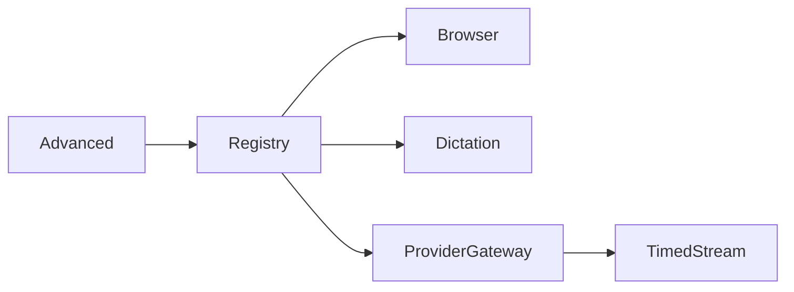
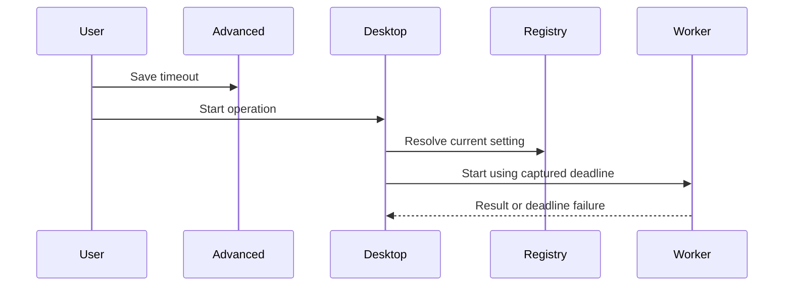
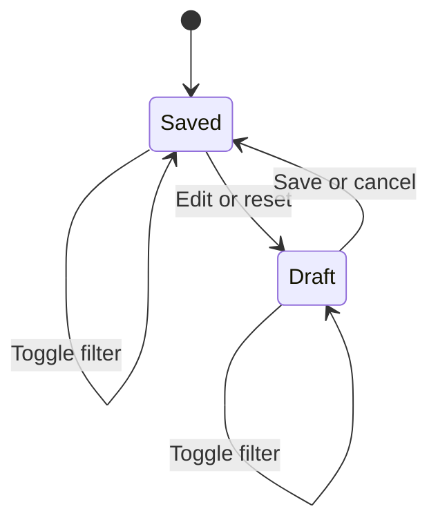

# TASK-11cfd314 - Tune Advanced settings for recent desktop features

stage: done
type: change
interaction: autopilot
requirements: REQ-FUNC-d078ff53, REQ-FUNC-5c15647d, REQ-FUNC-97c0337d, REQ-REL-f2918101, REQ-UX-6c38608e, REQ-UX-634d3ec2, REQ-FUNC-261cdc27, REQ-FUNC-e1d2f670, REQ-REL-d97264a7
parent:
branch: master
base: c5af1f13cbdeb9adb7711f77910f5b3190b9805e
opened: 2026-11-23

Edit Frame, Requirement coverage and Design directly. Write State, Log and
Rulings with `python .agentic/aegis.py` (advance, pause, log, ruling, verdict);
end each session with `advance` or `pause`.

## Done checklist (current stage)

- [x] diff reviewed against scope, requirements, design, error paths,
      portability, security and unrequested work
- [x] knowledge pages of changed components current with the reviewed code
- [x] project and environment context reconciled with the candidate
- [x] requirements re-read: status, prose, verification, paths and links true
- [x] manual or inspection verification recorded where applicable
- [x] explicit review approved, when enabled
- [x] final `check --strict --run` result logged truthfully after the last edit
- [x] remaining warnings and pre-existing failures explained
- [x] `report` appended

## Frame

Problem: OBSERVED — the Advanced app panel is flat, and Interactive Browser navigation, local transcription and explicit model discovery have fixed deadlines in their respective hosts.
Desired outcome: STATED — implement the recommendations in the preceding Advanced audit using AEGIS on the same branch.
Actors: INFERRED — desktop users tuning slow operations and users reviewing their effective Advanced configuration.
Primary scenario: INFERRED — open Advanced, expand the relevant group, change a deadline, save, and start a new operation governed by that value.
Examples: OBSERVED — LM Studio discovery uses 10 seconds and Whisper uses 120 seconds today. STATED — keep the header and actions visible while settings scroll inside the page.
Counterexamples: STATED — dictation duration, browser permissions, model response settings, and deployment packaging have separate controls or contracts.
In scope: STATED — grouped app panel and changed-values filter, browser navigation, dictation transcription, and explicit provider discovery settings, provider test stream deadline reuse, and clearer delegation and program timeout labels.
Out of scope: STATED — the audit made Git pagination and Git/embeddings tuning conditional on demand or measurements, and delegated workbench overrides conditional on a concrete need. No release or network publication is authorized.
Constraints: STATED — remain on the existing default branch master. OBSERVED — the base is c5af1f13cbdeb9adb7711f77910f5b3190b9805e and the tree already contains unrelated edits and generated plugins. Preserve them; AGENTS.md authorizes a local commit for validated ticket-owned changes. All four UI languages and existing settings inheritance apply.
Success signals: INFERRED — the three resolved values reach new operations, provider tests use the existing no-output policy, and grouped settings preserve draft, reset, validation and save behavior at desktop sizes.
Evidence: OBSERVED — advanced-settings.ts, advanced-settings-panel.tsx, browser/agent-browser.ts, browser/proxy.ts, dictation/worker-host.ts, provider-discovery.ts, preset-connection.ts, provider-gateway.ts, timed-gateway.ts and sessions/service.ts.
Assumptions: INFERRED — implement the concrete recommendations immediately and retain existing values and bounds where there is no accepted reason to change them.
Unknowns: UNKNOWN — frequency of real slow-network, cold-model and large-repository timeouts.
Decision-blocking questions: None.
Proposed behaviors: None pending.

## Requirement coverage

| Behavior | Requirement | Design | Verification |
| --- | --- | --- | --- |
| Browser navigation deadline | REQ-FUNC-d078ff53 | Browser admission and navigation | Set a navigation value, exercise open and follow, and observe the configured deadline independently of startup; reset and observe the inherited operation deadlines. |
| Dictation transcription deadline | REQ-FUNC-5c15647d | Worker invocation | Start a stalled transcription after changing the setting and assert that it times out at the captured value, with the 120 second default retained. |
| Explicit model discovery deadline | REQ-FUNC-97c0337d | LM Studio and curated fetch | Change the saved setting and observe the deadline in both discovery flows, including a stalled catalog body and a default operation. |
| Provider test inactivity | REQ-REL-f2918101 | Shared timed stream | Hold an authentication probe and advance to the saved response limit; assert the typed timeout, skipped next steps, and interrupted upstream signal. |
| Grouped Advanced settings | REQ-UX-6c38608e | Localized disclosures and inner scroll | Open the panel at a bounded viewport, expand and collapse a group, and check that the fields scroll while the actions remain visible. |
| Filter Advanced changes | REQ-UX-634d3ec2 | Saved and draft visibility | Filter settings with a stored override, reset it in the draft, and check that it stays visible until saved or canceled; the filter itself does not change the save payload. |
| Delegation scope label and help | REQ-FUNC-261cdc27 | Label and help | Inspect value and localized text against actual per-workbench admission. |
| Fallback program timeout label and help | REQ-FUNC-e1d2f670 | Label and help | Inspect localized text against rule/program/default precedence. |
| Existing browser deadlines and cancellation | REQ-REL-d97264a7 | Existing cancellation | Existing held browser operation coverage and new explicit-deadline coverage. |

## Design

**Approach.** OBSERVED: Advanced already validates scoped numbers and resolves live app settings. Route three app-only keys to Desktop hosts; reuse the conversation inactivity wrapper for diagnostic streams. Group the renderer fields without changing workbench or session layouts.

**Interfaces and data.** Keep schema version 1. Each new operation captures a deadline. Browser inheritance retains 35 s for opening and 12 s for following. An explicit value bounds the navigation itself and open retains a separate startup allowance. Browser policy, proxy ceilings and other operations retain their existing contracts. Discovery uses a shared default for LM Studio and curated catalogs. Transcription includes worker startup. Diagnostic catalog probing retains its own deadline.

**Files and test seams.** Shared registry validates the new keys. Main wires dictation and browser; provider discovery/gateway wires fetch deadlines and stream tests. Browser test stubs page navigation. Worker test uses fake timers; provider tests hold a response or stream. Renderer and E2E tests check grouping, drafts and scroll.

**Risks and open decisions.** Inferred: a larger browser navigation deadline can help aggregate page loading without raising the proxied per-request bound. Reset and invalid drafts must remain discoverable through the filter. A diagnostic timeout gives no evidence about tool support.

**Requirement map.** Browser snapshot at operation admission (REQ-FUNC-d078ff53, REQ-REL-d97264a7). Capture deadline in worker invocation (REQ-FUNC-5c15647d). Shared deadline at catalog fetch (REQ-FUNC-97c0337d). Reuse timed stream (REQ-REL-f2918101). Localized disclosure and bounded scrolling (REQ-UX-6c38608e). Filter saved/draft union (REQ-UX-634d3ec2). Clarify actual label semantics only (REQ-FUNC-261cdc27, REQ-FUNC-e1d2f670).

## Log

- 2026-11-23 frame: journal opened
- 2026-11-23 frame: completed; next specify - Scope recorded from the requested audit; current branch explicitly retained (7 Done checklist item(s) left unticked)
- 2026-11-23 specify: completed; next design
- 2026-11-23 design: completed; next build
- 2026-11-23 build: red: focused Vitest registry, browser, provider discovery, gateway and Advanced panel exit 1 - keys and UI missing, inherited hard deadlines unchanged, stalled diagnostic not cancelled (REQ-FUNC-d078ff53, REQ-FUNC-5c15647d, REQ-FUNC-97c0337d, REQ-REL-f2918101, REQ-UX-6c38608e, REQ-UX-634d3ec2)
- 2026-11-23 build: green: pinned Vitest focused registry, browser, dictation, provider discovery and gateway, and Advanced renderer --testTimeout 15000 exit 0, 75 tests; curated continuation edit rechecked with hosted-provider-presets.test.ts exit 0, 20 tests
- 2026-11-23 build: green: npm run test:e2e -- --browser-only tests/e2e/advanced-settings.spec.ts exit 0; group disclosure, isolated scrolling with Save and Cancel visible, changed-values filter and session inheritance
- 2026-11-23 build: Inspection: reviewed program timeout rule/program/fallback precedence and per-workbench delegated count against labels and four help pages; no admission or timeout-default change for these existing controls
- 2026-11-23 build: Reviewed the anchor evolution: 31 build-owned paths over the existing working tree. AGENTS.md authorizes one local commit after validation. The user explicitly retained master. Remote publication remains unauthorized.
- 2026-11-23 build: Build advisory check exit 0: 0 errors. Legacy records, existing checkout changes and generated ZIPs account for unrelated warnings. Linked tests also match the broad source glob, and required changelog/help/release notes sit outside its configured docs globs.
- 2026-11-23 build: completed; next validate
- 2026-11-23 validate: Review round 1: open timeout must cancel without waiting for tab discard; prove inherited deadlines. Catalog response cleanup must not await unbounded cancel. Open matching groups on filter activation and cover invalid drafts, cancel and save.
- 2026-11-23 validate: returned to build - Address both round-1 reviews: timeout cleanup and filter disclosure coverage
- 2026-11-23 build: red: focused Vitest browser, LM Studio discovery, hosted presets and Advanced editor exit 1; 4 expected failures on stalled disposal or cancellation and a previously collapsed filtered group
- 2026-11-23 build: green: review-focused Vitest browser, LM Studio, curated provider and Advanced UI exit 0, 46 passed; Advanced Playwright spec exit 0, 1 passed; evolution rechecked the 31 owned product paths
- 2026-11-23 build: completed; next validate
- 2026-11-23 validate: Strict proof exit 1; lint, i18n and help passed; typecheck exit 2 because the test used Promise.withResolvers, unsupported by the configured TypeScript library.
- 2026-11-23 validate: returned to build - Replace unsupported test-only Promise.withResolvers with a compatible deferred promise
- 2026-11-23 build: green: hosted-provider-presets.test.ts 21 passed, npm run typecheck exit 0, targeted Biome check exit 0; only the promise setup in that test changed and evolution path inventory is unchanged
- 2026-11-23 build: completed; next validate
- 2026-11-23 validate: DEVIATION validate: repeat affected proof after test-only fix. Per 02_Tools/verification-policy.md retain passing full lint, i18n, help, release-note and boundary evidence where unchanged, and rerun targeted Biome, typecheck, affected Vitest and strict metadata.
- 2026-11-23 validate: final: AEGIS check --strict exit 0 (0 errors, 84 advisory warnings); typecheck, focused Biome and hosted provider Vitest 21 passed after the test-only correction. Earlier full lint, i18n, help, release notes, import boundaries (17 passed), Advanced E2E (1 passed) and other focused Vitest evidence remain applicable. Warnings are existing records and dirty-tree files, or coverage/layout heuristics on the new linked tests and required help/release notes.
- 2026-11-23 validate: completed; next done

## Rulings

## State

status: done
reported: validate - completed
next: implementation guidance complete; commit, push and integration belong to the developer
must_read: .agentic/tasks/TASK-11cfd314.md
changed: Grouped Advanced, three configurable deadlines and provider-test inactivity protection
evidence: Windows focused and browser acceptance tests passed; TypeScript, lint, i18n, help, release notes, boundaries and strict AEGIS passed
issues: Advisory repository layout and traceability warnings only
spec_compliance: approved
implementation_quality: approved
review_round: 3

## Delivery report (2026-11-23)

- stage: validate; type: change; branch: master
- requirements:
  - REQ-FUNC-d078ff53 - Apply the Interactive Browser navigation timeout
  - REQ-FUNC-5c15647d - Apply the dictation transcription timeout
  - REQ-FUNC-97c0337d - Apply the model discovery timeout
  - REQ-REL-f2918101 - Apply the model no-output timeout to provider tests
  - REQ-UX-6c38608e - Group application Advanced settings
  - REQ-UX-634d3ec2 - Filter Advanced settings to edited and overridden values
  - REQ-FUNC-261cdc27 - Limit concurrent delegated sessions by the resolved value
  - REQ-FUNC-e1d2f670 - Cap program timeouts at the resolved default program timeout
  - REQ-REL-d97264a7 - Bound browser operations in time
- deviations: 1 recorded
  - validate: repeat affected proof after test-only fix. Per 02_Tools/verification-policy.md retain passing full lint, i18n, help, release-note and boundary evidence where unchanged, and rerun targeted Biome, typecheck, affected Vitest and strict metadata.
- explicit review: enabled; spec_compliance=approved; implementation_quality=approved; review_round=3
- diff vs task base c5af1f1: 87 file(s) changed, 2886 line(s) added; 9 file(s) not content-scanned
- checks: errors=0 warnings=84 notes=43
- checklist: 0/9 done; open: diff reviewed against scope, requirements, design, error paths, portability, security and unrequested work; knowledge pages of changed components current with the reviewed code; project and environment context reconciled with the candidate; requirements re-read: status, prose, verification, paths and links true; manual or inspection verification recorded where applicable; explicit review approved, when enabled; final `check --strict --run` result logged truthfully after the last edit; remaining warnings and pre-existing failures explained; `report` appended
