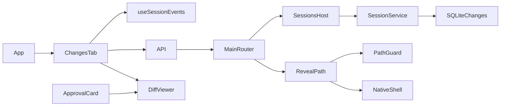

<!--
Copyright (c) 2026 DDP Engineering
This software is licensed under the PolyForm Noncommercial License 1.0.0.
Commercial use requires a separate commercial license.
See the LICENSE.txt in the .agentic folder for full license details.
SPDX-License-Identifier: LicenseRef-PolyForm-Noncommercial-1.0.0
-->

# TASK-2b1ba23f - WP-18 Changes panel

stage: done
type: feature
path: full
interaction: autopilot
requirements: REQ-FUNC-18000001, REQ-FUNC-18000002, REQ-UX-18000003, REQ-REL-18000004, REQ-SEC-18000005, REQ-REL-18000006, REQ-FUNC-18000007
parent:
branch: master
base: 4206d1f8b574e2721bd3325106c0371d5e09d47a
opened: 2026-10-12

## Done checklist (current stage)

- [x] validated candidate confirmed unchanged
- [x] validation commands/results, exact45path diff, exclusions and local outcome presented
- [x] standing human authorization confirms coordinator local master commit
- [x] journal/report included in selected delivery candidate
- [x] authorized local commit prepared by coordinator
- [x] close-out carried by the single local delivery commit

## Frame

Problem: STATED: users need every completed agent file change in the selected session, including its stored diff.
Desired outcome: STATED: ordered Changes tab with counts, selection, reveal and live updates, retained after restart.
Actors: user, renderer, validated main IPC, SessionService and workbench SQLite.
Primary scenario: ask edit -> exact user approval -> applied row/event -> Changes list/counts -> selected immutable diff -> restart -> same list/diff.
Examples: board.txt changes 3.3 V to 5 V, +1/-1, and a second file can be selected independently.
Counterexamples: denied/pending/conflicting edits do not appear as completed changes; another session/workbench cannot leak rows.
In scope: WP18 issue18-original.json; atomic read IPC, confined reveal; panel, mock parity, component/native acceptance, affected knowledge. Include the three already-applied policy files explicitly authorized by user.
Out of scope: WP19/epics39-44, visual retouches, cycle/automation/other chat/Gitea mutations, staging/commit/publication, preview, BMAD installation.
Constraints: master/shared checkout; full AEGIS/autopilot; no DB migration/dependency changes; core independent of Electron; same sandbox/vera://app and exact approval/write queue. Preserve all historical evidence and human optional-companions SHA256 2a69f5b335a53e498b1f8e30fa5adb8096e870e7a12bbc05b0727a03cee72c6b.
Success signals: targeted Windows/native Ubuntu proof of all Done, static/strict checks and two independent approved reviews on identical semantic hashes.
Evidence: OBSERVED: shared session-state.ts/event change.recorded; core tools/changes.ts applied rows/patches; renderer ApprovalCard diff; Shell placeholder. STATED: issue saved original and delegated scope. INFERRED: reuse applied rows and parse persisted patch for counts. UNKNOWN: OS file-manager availability outside supported native hosts.
Assumptions: time order is ascending created_at with id tie-break; only applied edits represent completed changes. Reveal receives a current workbench-relative path and enforces PathGuard before host call.
Unknowns: none decision-blocking.
Decision-blocking questions: none.
Proposed behaviors: list applied changes/time/counts; get stored diff; list empty/several/select; snapshot-before-subscribe live invalidation; confined reveal with error state; no stale cross-session view.
Path and reason: full: new observable UI/interface yes; existing complete requirement no; dependency unchanged yes; security/data boundary touched yes. New behavior/interface requires full path. No implementation children; two review-only subagents during validate.

## Requirement coverage

| Frame outcome | Atomic behavior | Requirement | Positive case | Boundary or failure | Verification | Design decision |
|---|---|---|---|---|---|---|
| Changes | List completed session changes | REQ-FUNC-18000001 | Create real SQLite rows for two sessions, reverse times/equal times and pending/conflict rows |  list each session and observe ordered applied-only counts, empty existing session and NOT_FOUND for missing session. | 05_Software/packages/core/src/sessions/changes.test.ts | See Design |
| Changes | Retrieve recorded change diff | REQ-FUNC-18000002 | Get recorded diff from real SQLite, mutate the file, restart the service, verify the identical patch |  check pending/missing/invalid identities and closed service. | 05_Software/packages/core/src/sessions/changes.test.ts | See Design |
| Changes | Present selectable change history | REQ-UX-18000003 | Mount the actual tab with empty and multiple rows, select through keyboard/click and observe counts and chosen +/- patch lines |  native approved edit and restart retain counts/diff. | 05_Software/apps/desktop/src/renderer/components/session/changes-tab.test.ts | See Design |
| Changes | Refresh recorded changes live | REQ-REL-18000004 | Hold the initial list response while recording a change, replay from snapshot sequence and observe refetched list |  emit a later change and retain existing selection. | 05_Software/apps/desktop/src/renderer/components/session/changes-tab.test.ts | See Design |
| Changes | Reveal confined workbench files | REQ-SEC-18000005 | Use temporary native roots/files and a spy native host |  valid Unicode file reaches host once, missing/outside/ignored/link-to-outside values do not. Check shared request rejects malformed payload and main-frame authorization remains enforced. | 05_Software/apps/desktop/src/main/reveal-path.test.ts | See Design |
| Changes | Isolate asynchronous change views | REQ-REL-18000006 | Defer list/get/reveal responses, switch session and resolve old operations |  current selection/data/errors remain isolated and subscriptions detach. Failure displays localized structured error and retry. | 05_Software/apps/desktop/src/renderer/components/session/changes-tab.test.ts | See Design |
| Changes | Validate change read IPC | REQ-FUNC-18000007 | Shared schemas reject extras, malformed IDs, fractional/unsafe identities and incomplete responses |  router/preload/native IPC accept valid list/detail through sandbox and deny foreign frame. | 05_Software/packages/shared/src/changes-ipc.test.ts | See Design |

## Design

Requirements coverage: FUNC18000001/2 -> SessionService read methods over applied rows, diff.parsePatch counts; FUNC18000007 -> shared strict summaries/detail/channels and existing bridge/router; UX18000003 -> ChangesTab and extracted DiffViewer; REL18000004/6 -> snapshot-before-subscribe, query keys and component identity; SEC18000005 -> main revealPath helper and serialized native call.
Component responsibilities: storage writer/runtime remain unchanged. Core read projection owns rows/counts; shared owns wire shape; main scrubs user strings/dispatches native reveal; renderer only consumes API. MockSessions stores in-memory details tied to workbench/session, records after approved edit and emits common event.
Interfaces/contracts: exact shape/errors in linked spec; no schema/dependency/build change. Core reads validate IDs and closed lifetime; list/get ready through SessionsHost. Main reveal uses current folder while SessionsHost holds lifecycle queue, PathGuard plus ordinary file check.
Data/flow: ask approval -> existing immutable application/event commit -> ChangesTab event -> list invalidation -> get selected stored patch. get/list independent of current file bytes; replay seq catches records during initial loading; newest additions retain selection. Counts parse stored patch hunks, not header heuristics.
Failure/recovery: reads show ErrorMessage/retry. key workbench/session remount clears selection/subscription/reveal state; query keys isolate pending results; details verify session identity. Native missing target/error does not launch host. Existing session recovery remains source of applied records.
Security/concurrency: exact authorized renderer boundary and sanitization retained; Electron sandbox/vera://app unchanged. Core stays Electron-free. Current workbench lifetime serializes reveal; escaping/ignored/redirected targets denied. No new approval/queue behavior.
Compatibility/observability: schema1 and all stored bytes preserved; UTC created_at/id ordering. Review complete uncommitted candidate including policy files from explicit base. Preserve generated output/logs before each command; executable/main/preload/worker byte bindings at actual native launches.
Test seams: new core sessions/changes.test.ts covers list/get counts/order/isolation/persistence/errors; shared changes-ipc.test.ts covers strictness; main reveal-path.test.ts covers canonical confinement/native host refusal; new component changes-tab.test.ts covers empty/multiple/live/select/reveal/failure/stale responses; e2e/changes.spec.ts real approval+restart and minimum-size browser. Regressions include WP16/17 writes/approvals, shared reducer, main host/router/events, preload/API/mocks, workspace, import boundaries/build mode.
Alternatives: changing schema/count columns rejected because recorded patch already determines counts; deriving diff from current file rejected because later edits change bytes; session reducer alone rejected because it lacks timestamps/diffs. Existing hook reused for snapshot/subscription barrier instead of another transport.
Expected files: shared changes.ts/ipc.ts/index.ts/tests; core sessions/service.ts/changes.test.ts; main index.ts/reveal-path.ts/test; renderer App/Shell, session changes-tab/DiffViewer/ApprovalCard/tests/styles/locales, mockApi/MockSessions/tests; e2e/changes.spec.ts; seven requirements/spec/current journal, affected knowledge/context. Authorized policy3 unchanged.
Risks: replay race, stale cross-session query results, path redirection, historical log rotation; focused tests/native proof address each. Open decisions: none.

### Proposed architecture - TASK-2b1ba23f

## Log

- 2026-10-12 frame: <scope agreed, exclusions, chosen path and why>

- 2026-10-12T08:37:02.878296+00:00 frame: scope accepted under delegated standing user authority; full path/autopilot on master at explicit base; no existing WP18 journal; human hash verified; policy files included. Two independent review agents only. BMAD unavailable, AEGIS direct per RULING-003.

- 2026-10-12T08:38:35.938979+00:00 specify: created seven atomic draft requirements and one protocol/view spec; inventory includes positive, failure, isolation, recovery and reveal confinement. Existing requirements preserved; no retirement.

- 2026-10-12T08:39:23.066894+00:00 design: constrained implementation over existing schema/event/readiness; no dependency/migration/approval-policy changes. Design and seven requirement mappings audited; targeted selection to be finalized against complete candidate before independent review.

- 2026-10-12T08:41:56.560090+00:00 build red: REQ-FUNC-18000001/2/7; command=python ../02_Tools/npmw.py npx vitest run packages/core/src/sessions/changes.test.ts packages/shared/src/changes-ipc.test.ts; exit=1; three expected missing-behavior failures: list/get methods and changes channels absent. Original core-ipc-red execution/output retained.

- 2026-10-12T08:44:39.162963+00:00 build green: FUNC18000001/2/7 core-ipc-green exit0 2files/3tests; real ask approval and stable stored patch proved. build red: UX18000003/REL18000004/6 shared view increment command=python ../02_Tools/npmw.py npx vitest run apps/desktop/src/renderer/components/session/changes-tab.test.ts; ui-red-ready-fixture exit1 expected placeholder instead of session empty Changes state. Fixture correction attempts preserved but not counted as red behavior proof.

- 2026-10-12T08:46:25.798558+00:00 build red: REQ-SEC-18000005; command=python ../02_Tools/npmw.py npx vitest run apps/desktop/src/main/reveal-path.test.ts; reveal-red exit1 expected valid file reveal rejected by behaviorless scaffold; ordinary Unicode/escape/junction cases ready. ui-green-1 exit0 2files/15tests including unchanged approval keyboard controls.

- 2026-10-12T09:00:28.284654+00:00 build consolidated proof: Windows build-focused-expanded exit0 6files/28tests; reveal-green exit0, typecheck3 exit0 and changes Electron/browser e2e-build-3 exit0 2tests (real ask approval/native restart). Initial operational fixture/type annotation/UTF8 corrections retained as original attempts, no assertions or deadlines weakened. Native new real Git master checkout at base with platform Node24.21.0/new npm dependencies; setup exit0. Generated opening Log placeholder is template text, not evidence. Final proof remains pending until reconciliation and both independent verdicts.

- 2026-10-12T09:00:28.351732+00:00 validate reconciliation: complete candidate reviewed against scope/design; knowledge diagrams and project/environment reconciled before independent reviews. All seven requirements active with actual paths/tests. Administrative policy3 remains byte-identical to pending manifest; no DB/dependency/build config changes. Full ticket suites not required under user policy: additive read projection/new channels/current canonical reveal can be bounded by selected consumer/security tests; no CLI behavior/channel consumer changes. Static checks are not test-suite proof. Full M2 milestone gate remains coordinator-owned at WP21; WP05 deferred clean/offline Windows/VC++ proof remains due WP30/WP33/final. Historical WP11 ten auxiliary originals remain acknowledged as previously lost.

- 2026-10-12T09:02:37.571384+00:00 validate selection: concrete 26file unit/integration and changes/approvals/chat-ui/shell native/browser E2E commands, per-platform Done/impact coverage and CLI exclusion recorded in targeted-selection.json. Static check --run is lint/typecheck/i18n only; both reviewers assess exact complete candidate/policy3 and selection. Final six gates serial after approval only.

- 2026-10-12T09:11:50.949692+00:00 validate round1: independent spec and quality changes_required on semantic708fc87019b6b464daf97cb96fc66976d6e0903cdabae6e711a12eb7ae3101c9; hash-bound originals spec-review-round1.json/quality-review-round1.json. Q1: canonical target revalidation after async lstat plus deterministic redirect test; SPEC-R1-001/Q2: restore two UTF8 separators. Both endorse bounded26+4 Windows/native Ubuntu selection. DEVIATION validate: relevant security/UI findings require return to build; final proof pending corrections and round2 approvals.

- 2026-10-12T09:12:27.958692+00:00 build red reviewQ1/REQ-SEC-18000005: command=python ../02_Tools/npmw.py npx vitest run apps/desktop/src/main/reveal-path.test.ts; review-race-red2 exit1; expected missing behavior: parent replaced with exterior junction after ordinary lstat still invokes host and resolves instead of DENIED. One original valid-path test passes; deterministic new regression fails.

- 2026-10-12T09:14:34.164946+00:00 build correction green reviewQ1/Q2: review-fix-green command=python ../02_Tools/npmw.py npx vitest run apps/desktop/src/main/reveal-path.test.ts apps/desktop/src/renderer/components/session/workspace.test.ts; exit0 2files16tests. Canonical/ignore resolution rechecked after ordinary-file lstat and identity preserved before synchronous native host; deterministic exterior parent replacement denied. Two original ApprovalCard middle dots restored; requirement/changes knowledge security verification reconciled. review-fix-typecheck exit0; exact3file formatting done. Re-anchor archived original anchor/evolution byte-for-byte before replacement; current evolution3modified matches only recorded corrections, original full25path report retained.

- 2026-10-12T09:14:59.883698+00:00 validate traceability: advisory after re-anchor exposed six already-reviewed test files absent from affected_paths; added existing linked test paths to corresponding requirements without code/test/selection changes. No additional behavior or broadened scope. Frozen round2-candidate.json retained as pre-traceability original; authoritative round2-final-candidate.json follows.

- 2026-10-12T09:18:52.295434+00:00 validate round2: independent spec-review-round2.json and quality-review-round2.json approved current semantic01d971f75ea9da811ba1a6fa04ac827e76fc57941ed124ee8d179712afef62f9; both observed44semantic/45complete/753raw identical hashes and approved unchanged26+4 selection/platforms. No candidate executable/requirement/knowledge edits after review. Final six serial gates now authorized by workflow; strict=lint/typecheck/i18n only. Readiness/pins Windows and native Ubuntu exit0; historical15603/human unchanged/no staged. Ignored evidence hook additionally captures actual Worker constructor file bytes/exit for selected existing native chat-ui worker regression, preserving prior hook original; no runtime policy mutation.

- 2026-10-12T09:36:26.845171+00:00 validate final consolidated: authoritative exact commands/argv/cwd/time/exit/raw before-after in final-proof-audit.json and targeted-selection.json. Windows+native Ubuntu focused vitest concrete26files: each exit0 192passed/2platform-skipped (194); Windows POSIX prefix+mode tests skipped, Ubuntu two native Windows case/ignore tests skipped, counterpart platform proves each. Strict check --task TASK-2b1ba23f --strict --run --json each exit0: lint/typecheck/i18n only, test explicitly not listed; captured strict child originals retained. Lint Windows5warnings/1info and Ubuntu6warnings/1info: five inherited non-null assertions/template info, plus inherited native-only unused immutable diff-key suppression moved from ApprovalCard; confirmed original wp17/coordinator-linux-final-strict-command2.child.log43/122. Eight old journal warnings and unrelated WP09 live-smoke note retained. No WP18 test failure or new accepted runtime limitation. Full suites not claimed/required by approved bounded policy; WP21/M2+later/final full gates and WP05 deferred proof remain due.

- 2026-10-12T09:36:26.854090+00:00 validate final E2E: command=python ../02_Tools/npmw.py npm run test:e2e -- e2e/changes.spec.ts e2e/approvals.spec.ts e2e/chat-ui.spec.ts e2e/shell.spec.ts (native python3); Windows20passed exit0, Ubuntu20passed exit0, zero skips. Real ask exact approval, live list/count/diff/restart, minimum1024x640 empty/multiple/keyboard/reveal, obsolete response cleanup/retries, sandbox/foreign frame/network guard/preferences/Stop worker/HMR covered by selected tests. Supplementary Windows existing chat-ui4 passed exit0 solely to bind emitted grep-worker bytes at real native spawn after identifying missing worker byte snapshot; no candidate edits. Initial successful strict repeated solely for full original child stream and native sixth-warning evidence. All originals retained; no successful proof repeated without named concrete evidence concern. CLI process proof not claimed.

- 2026-10-12T09:36:26.864091+00:00 validate inspection/evidence audit: current native post-restart screenshot and browser tests agree with +1/-1 recorded patch; final Windows screenshot changes-after-4395ef23-6df3-4b1e-8a41-c3b34b5275e1.png visually confirms normal middle dots, restored history and coloured diff. Both approved round2 reviews bind unchanged semantic01d971f75ea9da811ba1a6fa04ac827e76fc57941ed124ee8d179712afef62f9. final-proof-audit verifies63archives, all original final log/receipt hashes,753raw sources/current journal equal before/after every final command on both OS,14 actual loaded main/preload/sandbox/false-injection records and73 native/browser spawn captures. Worker scope is emitted file bytes at actual application spawn + exact main Worker URL + passing actual pathological grep scenario, not a Worker-constructor event. Native setup/pins use new platform checkout/dependencies on /home. Final Windows1040/native661 output/log members separately archived/verified. Original mutable live snapshot65members verified and never restored; historical WP11 prior10aux loss remains acknowledged.

- 2026-10-12T09:36:26.960005+00:00 deliver handback: explicit base4206d1f8b574e2721bd3325106c0371d5e09d47a/master; candidate45files (25modified20new), includes three unchanged pre-applied user-authorized policy files. Human optional-companions excluded and preserved. No implementation children; independent reviewers only. Standing local-commit authority recorded RULING-001; this implementation chat must not stage/commit, so coordinator alone performs final verification/commit/close-out. No push/PR/Gitea/cycle/preview operations. DEVIATION validate previously reported: security/UI review findings required return to build; both repaired and approved round2, no outstanding scope deviation. Preview visual retouches and WP19/later tickets remain excluded.

- 2026-10-12T09:37:23.425889+00:00 deliver report clarification: automatic report counts46changed files because it includes preserved human optional-companions; commit candidate is exactly45files and excludes that human file. Report-time errors0/warnings9/notes1 means eight historical warnings plus expected unticked-deliver (coordinator commit/report-in-commit/close-out still pending), not a failed validation gate. Earlier ignored Worker-constructor observer was intended instrumentation and produced no constructor records in Electron; final audit makes only the observed emitted worker bytes at actual native app spawn/exact main URL/real regression claim. Journal-only delivery metadata is the sole raw-source difference after final proof; approved44semantic bytes unchanged.

- 2026-10-12T10:03:52.555349+00:00 coordinator semantic and original evidence acceptance: Whole journal, seven requirements/spec, complete45path candidate (25modified20new), relevant architecture01 IPC/import boundaries,02 changes/session storage,06 panel, plan WP18 two Done criteria, affected contexts/knowledge and authorized policy3 reviewed. Applied-only parameterized SQLite/history/hunk counts, immutable stored diff, active SessionsHost lifetime, strict scrubbed IPC, fresh canonical reveal identity, keyed replay/live queries and stale-result isolation conform. Shared DiffViewer preserves approval controls. Both bound independent round2 verdicts approve semantic 01d971f75ea9da811ba1a6fa04ac827e76fc57941ed124ee8d179712afef62f9. Round1 reveal race/UI separators repaired and independently re-reviewed; no outstanding findings, scope expansion or verification omission. No implementation child tasks. Baseline sandbox/vera://app, schema/dependencies/import boundaries preserved. Targeted26files/4E2Especs adequate for bounded additive read/UI/reveal; affected security/path/storage/approval/transport/build consumers covered, no CLI source/consumer change. Full M2 gate remains due after WP21.

- 2026-10-12T10:03:52.565636+00:00 coordinator final proof: Six SERIAL exact unchanged-candidate gates exit0 on Windows/native Ubuntu: explicit Vitest26files192passed2platformskips each; strict AEGIS --task TASK-2b1ba23f --strict --run --json with configured lint/typecheck/i18n each0; selected Changes/approvals/chat-ui/shell E2E20passed each. No full-suite or CLI process result claimed. coordinator-final-proof.json audits original separate streams, strict original child TemporaryFile bytes, sandboxed actual native executable/loaded main/preload and emitted worker bytes at application spawn, real pathological grep regression plus browser process captures; no Worker-constructor event claimed. All753raw sources/current journal match before/after each gate and both OS. Original1009WP18 indexed files and15603historical baseline bytes remain unchanged, human excluded file intact. Existing Biome Win5/Ubuntu6warnings1info (Ubuntu inherited unused immutable-diff-key suppression) and AEGIS8oldjournal warnings/current pending-delivery/1WP09note accepted as recorded. WP11 prior10aux loss acknowledged; connected Windows proof does not discharge WP05 clean/offline/VC++ obligations at WP30/WP33/final.

- 2026-10-12T10:03:52.577149+00:00 coordinator delivery presentation and standing authority: Exact45ticketpaths include product code/tests,7requirements/spec, current knowledge/context, task journal and three explicitly approved policy files AGENTS.md/.agentic/aegis.toml/02_Tools/verification-policy.md. Protected human optional-companions, ignored evidence/runtime/generated outputs, cycle state and preview excluded. User AGENTS/cycle/RULING001 explicitly authorizes one validated local master commit WP18/#18/TASK2b1ba23f by coordinator; approval persists, no renewed question required. Local commit is the whole authorized outcome; no push/PR/release/Gitea mutation. Previously reported DEVIATION validate: review security/UI findings returned to build, repaired and round2approved. Visual retouches and WP19/later functionality excluded.

- 2026-10-12T10:04:18.943343+00:00 coordinator report read and local close-out: Fresh report-time advisory and journal delivery records read; generic Git-visible46path report includes protected excluded human file, exact ticket45paths authoritative. Both bound approvals and six acceptance gates unchanged. Only journal delivery/report/Handoff/Stage report metadata differs after proof; original proof journal archived and native final source binding retained. deliver7 permits done/close-out in the single local commit when the commit is the whole outcome. Actual SHA/path/blob/index/human result recorded atomically after success; commit failure leaves deliver open. No remote or final release claim.

## Rulings

- RULING-001 | date=2026-10-12 | decision=Implement directly on master in autopilot; return validated unstaged candidate and leave the single authorized local ticket commit exclusively to coordinator | reason=standing user cycle authority and explicit delegated roles | source=user | supersedes=none
- RULING-002 | date=2026-10-12 | decision=Include unchanged pre-applied AGENTS.md project policy, .agentic/aegis.toml and new verification-policy.md in complete WP18 candidate | reason=user approval "ok, modifica conform propunerii", pending-patch.json; targeted policy now active, managed payload unchanged | source=user | supersedes=none
- RULING-003 | date=2026-10-12 | decision=Use requested AEGIS directly; no BMAD setup | reason=renderer and sibling setup skill absent; explicit AEGIS workflow and product-only scope | source=technical | supersedes=none

## Handoff

current: done
status: ready
next: Record actual local commit and start next eligible planned work package
must_read: .agentic/tasks/TASK-2b1ba23f.md, .agentic/steps/6_deliver.md, 02_Tools/cache/wp18/coordinator-final-proof.json
blockers: none

## Stage report

stage: deliver
result: completed
current: done
changed: Changes history/diff/live/reveal and approved test policy;45ticketpaths
evidence: Six coordinator gates0;targeted192/2platformskips and E2E20each;strict3staticchecks0;round2approved
issues:8historical headers;WP09note;inherited lint warnings;WP11 prior10aux loss;clean/offline Windows/VC++ deferred
next: Record actual local commit and start next eligible planned work package
needs_user: no
spec_compliance: approved
implementation_quality: approved
review_round: 2

## Delivery report (2026-10-12)

- stage: deliver; type: feature; path: full; branch: master
- requirements:
  - REQ-FUNC-18000001 - List completed session changes
  - REQ-FUNC-18000002 - Retrieve recorded change diff
  - REQ-UX-18000003 - Present selectable change history
  - REQ-REL-18000004 - Refresh recorded changes live
  - REQ-SEC-18000005 - Reveal confined workbench files
  - REQ-REL-18000006 - Isolate asynchronous change views
  - REQ-FUNC-18000007 - Validate change read IPC
- deviations: 1 recorded
  - validate: relevant security/UI findings require return to build; final proof pending corrections and round2 approvals.
- explicit review: enabled; spec_compliance=approved; implementation_quality=approved; review_round=2
- diff vs task base 4206d1f: 46 file(s) changed, 1929 line(s) added
- checks: errors=0 warnings=9 notes=1
- checklist: 3/6 done; open: journal and report included in the delivery commit; agreed local commit outcome delivered by coordinator; close-out carried by coordinator delivery commit

## Delivery report (2026-10-12)

- stage: deliver; type: feature; path: full; branch: master
- requirements:
  - REQ-FUNC-18000001 - List completed session changes
  - REQ-FUNC-18000002 - Retrieve recorded change diff
  - REQ-UX-18000003 - Present selectable change history
  - REQ-REL-18000004 - Refresh recorded changes live
  - REQ-SEC-18000005 - Reveal confined workbench files
  - REQ-REL-18000006 - Isolate asynchronous change views
  - REQ-FUNC-18000007 - Validate change read IPC
- deviations: 2 recorded
  - validate: relevant security/UI findings require return to build; final proof pending corrections and round2 approvals.
  - validate: review security/UI findings returned to build, repaired and round2approved. Visual retouches and WP19/later functionality excluded.
- explicit review: enabled; spec_compliance=approved; implementation_quality=approved; review_round=2
- diff vs task base 4206d1f: 46 file(s) changed, 1954 line(s) added
- checks: errors=0 warnings=9 notes=1
- checklist: 5/6 done; open: close-out carried by the single local delivery commit
