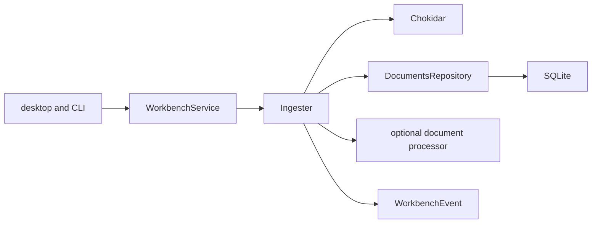

<!--
Copyright (c) 2026 DDP Engineering
This software is licensed under the PolyForm Noncommercial License 1.0.0.
Commercial use requires a separate commercial license.
See the LICENSE.txt in the .agentic folder for full license details.
SPDX-License-Identifier: LicenseRef-PolyForm-Noncommercial-1.0.0
-->

# TASK-2f0a33d5 - WP-22 Ingest pipeline

stage: done
type: feature
path: full
interaction: autopilot
requirements: REQ-FUNC-a93d863d, REQ-DATA-05172f94
parent:
branch: master
base: 857a6df5d8d6a423acd6a5c401c48101c877aa5e
opened: 2026-10-12

## Done checklist (current stage)

- [x] validated candidate confirmed unchanged
- [x] validation evidence, complete diff manifest, exclusions and outcome prepared for handback
- [x] local commit authorized by human; exclusive coordinator authority recorded
- [x] journal and report included in coordinator's delivery commit
- [x] coordinator delivers authorized local commit
- [x] coordinator records close-out in delivery commit

## Frame

Problem: workbench document metadata is not synchronized with filesystem content.
Desired outcome: background ingest records eligible files and follows changes/deletions.
Actors: workbench owner, desktop/CLI hosts, future processor, workbench event subscribers.
Primary scenario: open -> watcher/reconcile -> document rows and progress/document events.
Examples: add docs/board.md, edit content, delete it; same hash skips; oversized PDF is unsupported.
Counterexamples: .vera, excluded/ignored files, redirected links and foreign-owner snapshots never ingest.
In scope: WP-22 debounce/hash/queue/reindex/status/events/limits and lifecycle; derived-row cleanup seam.
Out of scope: extraction/chunking WP-23, FTS creation WP-25, embeddings/search WP-26, UI WP-28; staging/commit/publication; human optional-companions.md.
Constraints: master shared checkout/base as recorded; Electron44.7.0/vera://app/pinned tooling unchanged; native Windows/Ubuntu focused proof plus statics/strict and independent reviews.
Success signals: both WP-22 integration Done oracles; safe lifecycle, ownership and confined paths.
Evidence: STATED delegation/AGENTS.md; OBSERVED plan/M3-knowledge.md WP-22, architecture05 section1/02 sections2,6,9/01 boundaries, core workbench/service.ts and storage/migrations/0001_initial.ts; reference load.ts.
Assumptions: MiB size constants follow existing byte-oriented limits; supported files remain pending until a supplied processor completes (no invented indexed result).
Unknowns: downstream processors/schema supplied by later tickets; represented by explicit processor/cleanup contracts.
Decision-blocking questions: none.
Proposed behaviors: linked spec describes background synchronization and invalidation.
Path and reason: full. New behavior=yes; new interface=yes; dependency=yes; existing requirement covers=no; data handling changes=yes. Therefore quick-path criteria fail. One implementation task; independent review agents only.

## Requirement coverage

| Frame outcome | Atomic behavior | Requirement | Positive case | Boundary/failure | Verification | Design |
|---|---|---|---|---|---|---|
| synchronize | observe/classify/hash/publish files | REQ-FUNC-a93d863d | add/edit/status/event | hash/limits/ignore/ownership/close | ingest integration and shared contracts | Workbench-owned Ingester |
| invalidate | remove derived state and rebuild | REQ-DATA-05172f94 | delete/reindex | absent tables/config exclusions/switch | real SQLite cascade/FTS fixture | DocumentsRepository atomic cleanup |

## Design

REQ-FUNC-a93d863d: WorkbenchService owns Ingester, starts only with writable owned storage; desktop/CLI share that composition. Chokidar5.0.0 exact pin observes root with permanent exclusions/links disabled; tinyglobby handles include/exclude (chokidar5 has no globs). Trailing1s batches and one queue reconcile selected ordinary confined files with bounded async SHA-256 reads. Config/ignore edits reconcile. Process seam is optional and initially leaves supported files pending; returned status/error/pages become observable only for matching current content. Errors use stable reason codes. Close aborts/stops/drains before release; ownership guard precedes each synchronous database transaction.
REQ-DATA-05172f94: existing schema1 remains immutable. DocumentsRepository uses current columns, invalidates chunks plus downstream embeddings/external FTS when those tables exist; no downstream creation. Reindex serialized in ingest queue clears then reconciles. Strict empty docs.reindex IPC wired in main and mock. Progress/document event schema extends existing workbench transport.
Test seams: actual watcher+SQLite, optional deterministic processor for statuses/concurrency/abort, shared channel/event tests, existing workbench and immediate IPC transport/boundary tests on Windows/Ubuntu. Policy02_Tools/verification-policy.md governs smallest sufficient selection; no verify/general E2E/CLI. Full M3 gate belongs to WP-29/coordinator, never this ticket. Reuse proof for unchanged source/tests/config; after corrections rerun affected checks only.
Expected files: core knowledge/ingest, storage/repos/documents, workbench/service, core exports/dependency; shared documents/events/ipc/exports and tests; main handler, mock handler and immediate consumers; active requirements, knowledge and context. No schema migration needed.
Tradeoff: full selection reconciliation per debounced batch favors config/ignore/reopen correctness and hash idempotency; processing is serial. Risks: watcher/filesystem races, owner loss, interrupted processor; guard/recheck/abort/reconciliation tests cover these. No open product decisions.

### Proposed architecture - TASK-2f0a33d5

## Log

- 2026-10-12 frame: accepted delegated WP-22 scope in autopilot; full path and master/base exception established. Existing21 tasks done; no overlapping task. Human file excluded. Bmad bootstrap unavailable (missing render_skill.py); explicit user AEGIS workflow governs without BMAD setup.
- 2026-10-12 specify: created2 atomic requirements with shared detailed contract and positive/boundary/failure coverage.
- 2026-10-12 design: reviewed component/interface/lifecycle/storage seams; constrained implementation in Design; proceed to test-first build.
- 2026-10-12 build red: REQ-FUNC-a93d863d/REQ-DATA-05172f94 command=`python ../02_Tools/npmw.py npx vitest run packages/core/src/knowledge/ingest.test.ts`, exit=1; expected missing behavior=real filesystem add never populates documents (undefined instead of pending), so synchronization scenario cannot proceed.
- 2026-10-12 build focused: Windows ingest integration exit0,11pass/1POSIX-only skip; immediate workbench/shared/transport/mock/boundary selection exit0,75pass/7files. Full suites deferred to M3 gate by RULING-002. Native Electron targeted acceptance added to validate actual main/preload host composition.
- 2026-10-12 validate review round1: specification approved, implementation quality changes_required (manual reindex lifecycle blocking; unrelated watcher writes starvation). Both verdicts invalidated during correction. DEVIATION validate: returning to build for these lifecycle/admission findings and regressions; scope unchanged.
- 2026-10-12 build red corrections: exact focused command `python ../02_Tools/npmw.py npx vitest run packages/core/src/knowledge/ingest.test.ts -t 'close aborts explicit|unselected continuous'`, exit1, both expected failures observed: close cannot reach abort during manual reindex; unrelated continuous writes leave selected document absent. Corrected with completion wait outside lifecycle admission and picomatch selection using the existing tinyglobby matcher version as a direct exact pin.
- 2026-10-12 validate review round2: both changes_required due directory expansion/negative include mismatch between admission/discovery. DEVIATION validate: preserve accepted tinyglobby selector semantics through one shared normalization function and add focused directory/negative-selector regression. Both verdicts cleared for round3.
- 2026-10-12 build red selectors: command=`python ../02_Tools/npmw.py npx vitest run packages/core/src/knowledge/ingest.test.ts -t 'directory selector|directory excludes'`, exit1, three expected failures observed (directory includes miss edits/deletes; directory exclusions/negative includes allow starvation). Shared normalized selection now feeds both picomatch admission and glob discovery with expandDirectories=false.
- 2026-10-12 validate review round3: specification compliance and implementation quality independently approved the selector/lifecycle corrections. Windows final ingest proof exit0,16pass/1POSIX-only skip; affected manual-close regression exit0,1pass; native Electron selector-final acceptance exit0,1pass. Static typecheck exposed six TS2352 casts in the E2E test; corrected with explicit unknown intermediate casts, no product behavior changes. Both verdicts cleared pending round4 on this final test typing edit.
- 2026-10-12 validate review round4: independent spec_review specification compliance=approved and quality_review implementation quality=approved, no actionable findings on complete candidate against recorded base. E2E typing-only change reviewed; final Windows `python ../02_Tools/npmw.py npx playwright test ingest.spec.ts` exit0,1pass, softwareSha256=405bc24333c0bd0d997bbb801657d9696903fe16a0fa6286817b74e3855b6e84 unchanged. Evolution refreshed after final edit,20 software paths; complete base manifest includes initial anchor files and docs separately.
- 2026-10-12 validate consolidated proof: Windows `python ../02_Tools/npmw.py npx vitest run packages/core/src/knowledge/ingest.test.ts` exit0,16pass/1POSIX-only skip; immediate consumer command `python ../02_Tools/npmw.py npx vitest run packages/core/src/workbench/service.test.ts packages/shared/src/documents-ipc.test.ts apps/desktop/src/main/events.test.ts apps/desktop/src/main/ipc-router.test.ts apps/desktop/src/preload/bridge.test.ts apps/desktop/src/renderer/mocks/mockApi.test.ts tests/tooling/boundaries.test.ts` exit0,75pass (unchanged consumer proof reused; workbench/ingest pair rerun after lifecycle corrections,36pass/1skip, followed by final ingest selector and manual-close focused reruns). Unique focused coverage91pass/1POSIX-only skip. Windows rebuilt native acceptance `python ../02_Tools/npmw.py npm run test:e2e -- ingest.spec.ts` exit0,1pass; final test typing edit rerun via Playwright as above. Windows `python .agentic/aegis.py check --task TASK-2f0a33d5 --strict --run` exit0; lint/typecheck/i18n passed, errors0/warnings9/notes2.
- 2026-10-12 validate native Ubuntu: owned checkout /home/dpasare/.cache/v22-2f0a33d5 copied824 candidate/source files with exact raw SHA-256 parity, native `python3 ../02_Tools/npmw.py npm ci` exit0 and `python3 02_Tools/setup.py --check` exit0 ready (Node24.21.0/native libraries/xvfb/lock parity). Focused command is the Windows immediate selection plus ingest.test.ts, prefixed `python3 ../02_Tools/npmw.py npx vitest run`; exit0,8files/92pass, including POSIX symlinks. `python3 ../02_Tools/npmw.py npm run test:e2e -- ingest.spec.ts` exit0,1pass using native Electron44.7.0 and vera://app. `python3 .agentic/aegis.py check --task TASK-2f0a33d5 --strict --run` exit0,lint/typecheck/i18n all passed. Both final platforms' execution receipts record identical softwareSha256=405bc24333c0bd0d997bbb801657d9696903fe16a0fa6286817b74e3855b6e84 and softwareUnchanged=true.
- 2026-10-12 validate inspection/Done: both explicit WP-22 oracles observed through real watcher+SQLite and native IPC acceptance: selected add/edit rows/hash/events converge; delete removes derived chunks/FTS/embeddings. Hash idempotency, limits/types, truthful processor statuses, config/ignore/link confinement, serial processing, abort/drain, reindex and owner/read-only boundaries passed. Reviewed schema1 unchanged and downstream extraction/FTS creation/embedding/search absent; pinned Electron/protocol untouched. `git diff --check` exit0; index empty and HEAD remains recorded base.
- 2026-10-12 validate warnings: nine historical journal warnings and two unrelated manual-verification notes remain out of scope. Ubuntu initial catalog additionally saw owned tmp outputs; cleaned after all tests, then catalog-only `check --task TASK-2f0a33d5 --strict` exit0,errors0/warnings9/notes3, no repeated static run. Third note is absent ignored Windows anchor in source-only mirror; final evolution/base review retained in Windows task. Native build warnings concern bundled dependency annotations/unused dependency import, no failed checks. No full suite run: policy assigns M3 gate to WP-29/coordinator. Original receipts/stdout/stderr/loaded main.js and Electron executable/main hashes retained under02_Tools/cache/wp22-TASK-2f0a33d5/{windows,linux}.
- 2026-10-12 deliver handback: implementation is validated and ready for coordinator's complete candidate review and authorized local commit. No implementer staging/commit/push/PR. Human00_Planning/optional-companions.md untouched/excluded. Both review agents finished read-only. Windows task tmp cleanup was twice rejected by automatic approval review with reason 'blocked by policy', including verified literal owned path; retained in ignored cache without bypass. Native owned scratch cleanup proceeds after original proof copy. No implementation blocker; outstanding commit/close-out belongs to coordinator.
- 2026-10-12 deliver final records: original native proof copied successfully and owned native checkout removed; pinned runtime retained. Report read: advisory10warnings means nine historical warnings plus expected unticked-deliver for coordinator's three pending commit/close-out items. Automatic report's31 paths include protected preexisting human optional-companions.md; actual WP-22 manifest is30 paths (19modified/11added), excludes that file, and is saved with exact commands/results, reviews and SHA-256 at02_Tools/cache/wp22-TASK-2f0a33d5/candidate-manifest.json. No software source/test/config change after final proof.

- 2026-10-12 coordinator delivery: accepted the complete30-file candidate, both round4 independent verdicts, Done and original focused/native/static proof; exact software hash unchanged. No repeated tests. Standing human authorization covers one local master commit for WP-22/TASK-2f0a33d5 with both requirement IDs; protected optional-companions.md excluded. Close-out is carried in this delivery commit, with no remote publication. Acceptance:02_Tools/cache/wp22-TASK-2f0a33d5/coordinator-acceptance.json.

## Rulings

- RULING-001 | date=2026-10-12 | decision=Autopilot implementation directly on master, base857a6df5d8d6a423acd6a5c401c48101c877aa5e; local commit authorized by user and performed exclusively by coordinator after handback; implementer does no staging/commit/push/PR | reason=AGENTS.md and delegation explicit | source=user | supersedes=none
- RULING-002 | date=2026-10-12 | decision=Verification-policy targeted tests on Windows/nativeUbuntu plus Done/static/strict/two independent reviews overrides generic full-suite-per-ticket; full M3 gate atWP29 | reason=explicit project/user policy | source=user | supersedes=none

## Handoff

current: done
status: completed
next: coordinator records Git SHA in cycle state and starts WP-23
must_read: .agentic/tasks/TASK-2f0a33d5.md
blockers: none

## Stage report

stage: deliver
result: completed
current: done
changed: ingest queue/storage/contracts/lifecycle/host and tests
evidence: Windows focused91pass1POSIXskip/native1pass; Ubuntu focused92pass/native1pass; both strict exit0; round4 both approved; unchanged proof reused
issues: nine historical warnings; automatic review blocked owned Windows scratch deletion
next: record commit SHA and start WP-23
needs_user: no
spec_compliance: approved
implementation_quality: approved
review_round: 4

## Delivery report (2026-10-12)

- stage: deliver; type: feature; path: full; branch: master
- requirements:
  - REQ-FUNC-a93d863d - Background document synchronization
  - REQ-DATA-05172f94 - Document invalidation and reindex
- deviations: 2 recorded
  - validate: returning to build for these lifecycle/admission findings and regressions; scope unchanged.
  - validate: preserve accepted tinyglobby selector semantics through one shared normalization function and add focused directory/negative-selector regression. Both verdicts cleared for round3.
- explicit review: enabled; spec_compliance=approved; implementation_quality=approved; review_round=4
- diff vs task base 857a6df: 31 file(s) changed, 1877 line(s) added
- checks: errors=0 warnings=10 notes=2
- checklist: 3/6 done; open: journal and report included in coordinator's delivery commit; coordinator delivers authorized local commit; coordinator records close-out in delivery commit

## Delivery report (2026-10-12)

- stage: done; type: feature; path: full; branch: master
- requirements:
  - REQ-FUNC-a93d863d - Background document synchronization
  - REQ-DATA-05172f94 - Document invalidation and reindex
- deviations: 2 recorded
  - validate: returning to build for these lifecycle/admission findings and regressions; scope unchanged.
  - validate: preserve accepted tinyglobby selector semantics through one shared normalization function and add focused directory/negative-selector regression. Both verdicts cleared for round3.
- explicit review: enabled; spec_compliance=approved; implementation_quality=approved; review_round=4
- diff vs task base 857a6df: 31 file(s) changed, 1892 line(s) added
- checks: errors=0 warnings=10 notes=2
- checklist: 6/6 done
