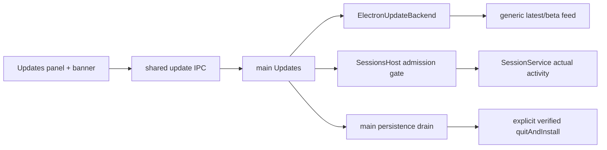

<!--
Copyright (c) 2026 DDP Engineering
This software is licensed under the PolyForm Noncommercial License 1.0.0.
Commercial use requires a separate commercial license.
See the LICENSE.txt in the .agentic folder for full license details.
SPDX-License-Identifier: LicenseRef-PolyForm-Noncommercial-1.0.0
-->

# TASK-4be77adc - WP31 Auto-update

stage: done
type: feature
path: full
interaction: autopilot
requirements: REQ-FUNC-a16121c6, REQ-FUNC-d11a1f5c, REQ-REL-61e5471c, REQ-PLAT-f905ba1a, REQ-UX-a809496e
parent:
branch: master
base: d2544a568d0d2b21128a77e5a43e4674460b1ef0
opened: 2026-10-13

## Done checklist (current stage)

- [x] validated candidate unchanged except journal delivery evidence
- [x] final validation, diff, exclusions and limitations presented
- [x] local commit authority recorded for coordinator exclusively
- [x] validated candidate handed back unstaged; source manifest exact
- [x] coordinator includes journal/report and creates authorized local commit
- [x] coordinator closes task after successful local delivery

## Frame

Problem: STATED WP31 must discover, download and install without interrupting work.
Desired outcome: installed vN upgrades through local feed; deferred work completes; portable announces only.
Actors: user, main updater, session host, feed publisher, package manager.
Primary scenario: startup/check now -> feed -> notes -> consent/automatic download -> safe restart/quit -> newer executable.
Examples: Check now in Off; restart during approval waits for resolution and turn completion.
Counterexamples: portable download/install; deb auto-install; updater quit aborting a turn; runtime feed override.
In scope: fixed build feed, latest/beta including stable, settings/strict IPC/events/UI, installed acceptance and immediate consumers.
Out of scope: WP32 exhaustive migrations, WP33/M4 gate, remote publication/issues, historical cache audit, unrelated refactoring.
Constraints: STATED master/autopilot; unstaged handback; coordinator exclusively commits; pinned runtime/BGE/VC++/vera origin; protect human data/processes and optional-companions SHA.
Success signals: exact-artifact installed/portable receipts; focused tests and statics/strict on Windows/native Ubuntu; two independent reviews.
Evidence: OBSERVED WP31, architecture07 sections3-5, ADR0008, issue31 read-only; settings currently notify/latest; main quit aborts sessions; core owns actual active completion.
Assumptions: INFERRED no deployment URL supplied; empty build setting exposes unconfigured state without requests. Instrumented acceptance permits only compile-time loopback HTTP.
Unknowns: signed-real-upgrade credentials unavailable; clean/offline Windows/CRT and separate Linux kernel remain release criteria.
Decision-blocking questions: none.
Proposed behaviors: main snapshot/actions/safety gate; safe text notes and confirmed link for portable; package-manager instruction for deb.
Path and reason: full; new behavior/interface/dependency/security/concurrency fail all quick criteria. One coupled task; implementation not delegated.

## Requirement coverage

| Frame outcome | Atomic behavior | Requirement | Positive case | Boundary/failure | Verification | Design |
|---|---|---|---|---|---|---|
| discovery | scheduling and channel choice | REQ-FUNC-a16121c6 | startup/six-hour/Check now | Off/offline/beta-stable | service+adapter | per-channel backend |
| safe downloads | consent/mode and integrity | REQ-FUNC-d11a1f5c | verified ready | digest/publisher error | backend+local artifact | electron-updater |
| uninterrupted work | deferred safe install | REQ-REL-61e5471c | idle drain then install | live turn/approval/racing send | core+host+installed | atomic admission gate |
| distribution limits | read-only portable/deb | REQ-PLAT-f905ba1a | metadata notes/link | denied artifact actions | local packaged feed | capability gate |
| user controls | strict IPC/events and localized UI | REQ-UX-a809496e | controls+banner | invalid payload/untrusted notes | shared+UI+native | shared snapshot |

## Design

REQ-FUNC-a16121c6: main Updates owns scheduling/snapshots; ElectronUpdateBackend owns two channel-specific updater instances and semver selection.
REQ-FUNC-d11a1f5c: backend delegates SHA512/publisher verification unchanged; service controls consent and auto mode; raw backend errors become bounded error codes.
REQ-REL-61e5471c: core exposes actual activity (active promises + pending approvals). SessionsHost tracks queued admission and synchronously locks new operations only at idle. Updates polls a deferred shutdown request; no runtime abort before idle. Main drains persistence/logs before explicit install.
REQ-PLAT-f905ba1a: portable/deb retain metadata-only updater behavior; service rejects artifact actions; main validates current offer/version and opens link after confirmed IPC.
REQ-UX-a809496e: shared strict snapshot/actions/events; renderer Query subscriber updates controls/banner, bounded notes are React text, confirm dialog precedes external opening.
Persistence: schema4 accepted enums widen; update preference merge retains extensions. No new migrations.
Concurrency: one check/download at a time; ready payload stays pinned; queued main session operations block admission lock; no async gap between safety check and lock.
Recovery: offline/digest errors expose retryable UI; drain failure prevents installation. Empty fixed feed reports unconfigured; no network default guessed.
Expected files: shared updates/settings/ipc/events, main updates/backend/index/sessions, core sessions activity, renderer panel/banner/mock/locales, build/package configuration, local feed/upgrade harness and focused tests.
Risks: NSIS reboot/relaunch and AppImage replacement require actual artifacts; signed credentials unavailable; main window close needs deferral before destruction.
Open decisions: none; stated release clean/offline/CRT/kernel criteria remain external.

### Proposed architecture - TASK-4be77adc

## Log

- 2026-10-13 frame: full scope accepted in autopilot; base verified, only pre-existing optional-companions untracked; readiness ready.
- 2026-10-13 specify: five atomic requirements created; exact protocol/state/ordering in specs/REQ-FUNC-a16121c6.md; no existing contract retired, unsupported signed upgrade kept unknown.
- 2026-10-13 design: audited main/backend/admission ownership and exact contract; no child implementation tasks; proceed test-first on strict settings/schema and safety service.
- 2026-10-13 build red: REQ-FUNC-a16121c6, REQ-FUNC-d11a1f5c, REQ-PLAT-f905ba1a, REQ-UX-a809496e; command=`python ../02_Tools/npmw.py npx vitest run packages/shared/src/updates.test.ts`; exit=1, two assertions failed: Off/beta patch rejected and update.get absent. Original windows/red-shared.log; anchor656 before implementation.
- 2026-10-13 build red: REQ-REL-61e5471c; command=`python ../02_Tools/npmw.py npx vitest run packages/core/src/sessions/approvals.test.ts -t 'reports actual work'`; exit=1, actual-work host API missing, assertion undefined versus function; original windows/red-activity.log.
- 2026-10-13 build DEVIATION: first Windows installed probe used OS default C:/Users/pasar/AppData/Roaming/VERA Test despite isolated APPDATA env. Explicit preferences updates.mode=off, updates.channel=beta, theme=dark were written; attempted workbench.create failed before successful session/recents evidence. No pre-probe baseline permits safe restore; existing profile was not reset/deleted/restored. Credential contents were not read. Exact affected-file metadata/current known keys in windows/profile-impact.json. Protected wp21/manual-user-data and ui-preview/user-data were not launch targets. Subsequent launches must use explicit user-data-dir and fail-fast observed resolved-path equality before test mutations; isolated relaunch fixture arguments must meet same condition.
- 2026-10-13 build green: Windows focused117 tests/13files exit0 (windows/focused.execution.json), adapter/feed5 exit0, affected host/feed5 exit0 (affected-host.execution.json); native Ubuntu focused122/15files exit0. Browser Updates en/ro/de × light/dark × five text scales1024×640 passed1/OS, exit0. Shared red and actual approval red are resolved; linked requirements current. Build-mode observed exit0/1test in idle console run11:49:05; two contended bound attempts timed out at60s and are not passes; final original bound proof pending.
- 2026-10-13 build acceptance: Windows upgrade-round3 exit0/report PASS binds NSIS0.31.0->0.31.1 and ZIP0.31.0 SHA256/SHA512, actual checksum refusal, real pending approval/turn deferral, exit0 old process, exact isolated updater relaunch and vN+1 idle session/dark setting, portable metadata-only and denied download. Native Ubuntu upgrade-round4 exit0/report PASS binds the original two AppImage bytes, actual checksum refusal/deferral/replacement/relaunch and preserved idle session/dark. Both instrumented, connected-host proof only. NSIS custom launch include and AppImage executable wrapper pass explicit owned user-data-dir + observation ports solely for isolated restart; actual updater/installers perform upgrades. Fixed temp directory and AppImage extract-and-run ownership check corrected external Linux diagnostics without changing/rebuilding artifact bytes. Original failures retained; build proof reused for identical source/artifacts under policy.
- 2026-10-13 build complete: full evolution38 non-agentic paths reviewed; requirements/spec/current knowledge/context reconciled. Advisory strict exit0 errors0/warnings11/notes3 are inherited unrelated journal/ticket warnings. Enter validate for independently bound reviews, then final configured statics/strict; M4 gate remains coordinator/WP33, no full suite or remote mutation.
- 2026-10-13 validate round1: two independent changes_required verdicts bound to complete52 SHA3f113105787a2429b9c8e6633493c0921c349c9bd249eb234f120d596a91c89e; all hashes unchanged before/after. SPEC01/QUALITY01 managed Deb check disabled by AppImageUpdater; SPEC02/QUALITY03 instrumented portable link wrongly uses OAuth-only flag; QUALITY02 unrelated settings reset six-hour deadline; QUALITY04 sha2-only metadata accepted despite SHA512. Exact findings in reviews/{spec,quality}-round1.json. Return build for those four fixes; both current verdict fields cleared while candidate changes. Windows idle bound build-mode exit0/1test now available in build-mode-idle.execution.json; nativeUbuntu build-mode exit0/1test. No generic timeout/config weakening.
- 2026-10-13 build fix red: pinned-wrapper command=`npx vitest run apps/desktop/src/main/updates.test.ts apps/desktop/src/main/update-backend.test.ts`; review-red-corrected exit1/three expected assertions: managed native selector absent, sha2-only accepted, unchanged preferences postpone six-hour deadline. Initial managed fixture error excluded. Native portable confirmation red review-link-red exit1: actual instrumented IPC denied feed link after UI confirmation, system-browser side effect only intercepted.
- 2026-10-13 build fix green: native backend selector uses DebUpdater for managed Linux; canonical SHA512 required before offer; unrelated settings preserve six-hour deadline; confirmed portable links use general external-link validation. Windows review-fixes exit0/13tests/3files; Ubuntu affected updates/backend exit0/12tests/2files. Unchanged open-external proof reused on Ubuntu. Spec/knowledge and five active requirement links reconciled; evolution remains38 paths. Original focused/consumer/browser proof reused for unchanged seams.
- 2026-10-13 build final acceptance: windows/upgrade-final.execution.json and linux/upgrade-final.execution.json exit0, both current upgrade-report.json PASS with exact final artifact SHA256/SHA512. Actual installed0.31.0->0.31.1, real SHA512-only requirement/refusal and corrupt payload refusal, real pending approval/turn deferral, isolated actual updater relaunch, restored idle session/dark preference. Windows portable native confirmation observes zero external calls before consent and one current validated link after consent, system browser intercepted by external driver only; metadata requests only and download denied. Linux managed DebUpdater without APPIMAGE announces offer from actual feed, metadata requests only and download denied. Every initial/relaunch userData matches explicit owned path before mutation. Instrumented connected-host proof only; release criteria unchanged. Original superseded/failure reports retained. Return validate round2 using same two reviewers.
- 2026-10-13 validate build binding: final-source ordinary/instrumented compile flag/runtime-feed-override regression passes1test/OS, Windows build-mode-final-idle.execution.json exit0/33.45s, Ubuntu build-mode-final.execution.json exit0. Windows preceding bound final attempt timed out60s during74.5s compilation; preserved as non-pass, idle serial rerun succeeded without timeout/config change. Complete candidate semantics and five requirements reread; no additional scope or contract drift.
- 2026-10-13 validate round2: specification_compliance=approved and implementation_quality=approved; reviews/spec-round2.json and quality-round2.json independently bind complete52 SHA717b8cf42a8bf841aa0d1d63c4c0b2e2e8911b297fb7f87fa600a1028b33b85a/source2cdac5b72193a359adfb81a561df83db71cb8aca027e34d9b996346a695161f6. All52 hashes unchanged before/after both reviews; all38 software paths match final native receipt inputs, five final artifact SHA256/SHA512 verified. No open findings; protected human hash unchanged. Only journal evidence fields change after this bound review; proceed configured final lint/typecheck/i18n+strict on Windows and native Ubuntu, no full suite.
- 2026-10-13 validate final gate correction: strict-final exit1/OS because build-mode.test.ts formatter error; typecheck/i18n pass on both. Clear verdicts, return build, apply only Biome formatting/trailing commas to two expressions. Before-format bytes match round2; TypeScript AST identical after formatting; focused Biome check passes. Production/tests behavior unchanged, reuse successful runtime/native/build-mode proof; no suite retesting. Return validate round3 for same independent reviewers and fresh configured strict proof.
- 2026-10-13 validate round3: both independent verdicts approved, no findings, reviews/{spec,quality}-round3.json; complete52 SHAad14e2d3d4bd0a8421231061f7393fba6c88ea80bda334913466f37c70e9aa23/source40ae98abbd1f0dfa795d17f32d813af15bc5faa90b22e5f3c6de6e05a9cb5710. All hashes unchanged before/after, protected human unchanged. Only journal and semantically identical test formatting differ from round2; both reviewers explicitly accept reuse of original verified runtime/native/build-mode proof. Fresh final configured strict follows; journal-only verdict metadata updated afterward.
- 2026-10-13 validate final consolidated: `python .agentic/aegis.py check --task TASK-4be77adc --strict --run` exit0 on Windows and native Ubuntu in original strict-final-r3.execution.json, lint/typecheck/i18n all pass, full test explicitly skipped per verification-policy/M4 coordinator. Windows advisory0errors/11 inherited unrelated journal/ticket warnings/3notes; native initial advisory344warnings reflected copied Windows file modes and absent ignored anchor, not candidate byte changes. Mirror core.filemode=false aligned to shared checkout and task anchor/evolution copied; strict-native-scope.execution.json reruns only affected native advisory exit0/0errors/11samewarnings/3notes; static command proof reused unchanged. Baseline warnings do not affect this ticket/runtime and unrelated correction stays out of scope. Final source/spec/requirements/knowledge unchanged after round3 review; diff-check0, master/HEAD still recorded base, index empty, protected human SHA unchanged. No full suite, issue action, publication or commit.
- 2026-10-13 deliver: owned cleanup after app/check processes closed: Windows unique test uninstaller exit0 then7 generated trees removed; Linux10 generated trees removed, including own mirror dependencies/out and extraction temp. Original five package artifacts, reports, stdout/stderr/execution receipts and failure diagnostics retained; mirror sources/pinned runtime retained. Exact cleanup receipts windows/cleanup.json and linux/cleanup.json. Default VERA Test profile untouched after documented deviation; other task roots, user processes, model/VC++ resources and rejected WP30 cleanup untouched. Hand back unstaged candidate with both approved round3 verdicts and final proof; coordinator verifies current diff/original receipts and makes authorized ticket commit, then WP32.
- DEVIATION build: first Windows probe wrote updates.mode=off, updates.channel=beta and theme=dark to C:/Users/pasar/AppData/Roaming/VERA Test; generated logs/window/Chromium caches also changed - no pre-probe baseline permits safe restoration; existing profile preserved, credentials not read, exact effects in windows/profile-impact.json. Later probes require and prove explicit owned userData before mutations/relaunch; no subsequent default-profile restoration/reset/delete attempted.

- 2026-10-13 coordinator delivery: complete52path candidate and full journal/Done/current independent R3 reports/original targeted/native/statics receipts verified; accepted in cache/wp31-TASK-4be77adc/coordinator-acceptance.json. Source40ae98ab unchanged from approved R3; only delivery journal evolved. Original five package digests/logs and isolated actual upgrade/deferral/metadata-only proof verified; no coordinator runtime retesting. Eleven inherited warnings remain unrelated; profile Off/beta/dark deviation and real release obligations remain declared. Standing user authority covers one local coordinator commit only, no remote. Closeout prepared before that single commit under deliver step7; commit receipt/state will record the actual outcome.

## Rulings

- RULING-001 | date=2026-10-13 | decision=master/autopilot; local commit authorized exclusively for coordinator after validation, hand back unstaged | reason=delegated instruction and AGENTS | source=user | supersedes=none
- RULING-002 | date=2026-10-13 | decision=two read-only reviewers authorized for WP30..38 | reason=explicit human answer call_317e1ea62eda4ae6bb9bde5f11bdbf6f question0 preserved in delegation | source=user | supersedes=none
- RULING-003 | date=2026-10-13 | decision=targeted ticket checks, M4 gate coordinator/WP33, reuse M3 | reason=verification-policy and instruction | source=repository | supersedes=none
- RULING-004 | date=2026-10-13 | decision=preserve WP30 rejected cleanup and other task/human data; final clean/offline Windows/CRT and separate Linux kernel remain open | reason=explicit instruction | source=user | supersedes=none

## Handoff

current: done
status: complete
next: coordinator records authorized single local commit outcome, then starts eligible WP32
must_read: .agentic/tasks/TASK-4be77adc.md, 02_Tools/cache/wp31-TASK-4be77adc/coordinator-acceptance.json
blockers: none for local delivery; real release obligations and prior profile deviation remain explicit

## Stage report

stage: deliver
result: completed
current: done
changed: accepted52path WP31 auto-update candidate and journal closeout for one authorized local commit
evidence: both independent R3approved; original Windows/Ubuntu actual upgrade/deferral/integrity/metadata-only proof; focused tests and final lint/typecheck/i18n/strict0; coordinator complete diff/hash/receipt inspection, no runtime retests
issues: prior default VERA Test Off/beta/dark writes without restoration baseline; clean/offline Windows/CRT, separate-kernel Linux and real signed upgrade remain release obligations;11inherited advisory warnings
next: record local commit outcome, then WP32
needs_user: no
spec_compliance: approved
implementation_quality: approved
review_round: 3

## Delivery report (2026-10-13)

- stage: deliver; type: feature; path: full; branch: master
- requirements:
  - REQ-FUNC-a16121c6 - Discover updates from fixed generic feed
  - REQ-FUNC-d11a1f5c - Download verified updates by mode or consent
  - REQ-REL-61e5471c - Install updates after work completes
  - REQ-PLAT-f905ba1a - Announce portable and managed updates
  - REQ-UX-a809496e - Present update controls and restart state
- deviations: none recorded
- explicit review: enabled; evidence=malformed verdict evidence; read journal
- diff vs task base d2544a5: 53 file(s) changed, 2922 line(s) added
- checks: errors=0 warnings=13 notes=3
- checklist: 4/6 done; open: coordinator includes journal/report and creates authorized local commit; coordinator closes task after successful local delivery

## Delivery report (2026-10-13)

- stage: deliver; type: feature; path: full; branch: master
- requirements:
  - REQ-FUNC-a16121c6 - Discover updates from fixed generic feed
  - REQ-FUNC-d11a1f5c - Download verified updates by mode or consent
  - REQ-REL-61e5471c - Install updates after work completes
  - REQ-PLAT-f905ba1a - Announce portable and managed updates
  - REQ-UX-a809496e - Present update controls and restart state
- deviations: none recorded
- explicit review: enabled; evidence=malformed verdict evidence; read journal
- diff vs task base d2544a5: 53 file(s) changed, 2937 line(s) added
- checks: errors=0 warnings=13 notes=3
- checklist: 4/6 done; open: coordinator includes journal/report and creates authorized local commit; coordinator closes task after successful local delivery

## Delivery report (2026-10-13)

- stage: deliver; type: feature; path: full; branch: master
- requirements:
  - REQ-FUNC-a16121c6 - Discover updates from fixed generic feed
  - REQ-FUNC-d11a1f5c - Download verified updates by mode or consent
  - REQ-REL-61e5471c - Install updates after work completes
  - REQ-PLAT-f905ba1a - Announce portable and managed updates
  - REQ-UX-a809496e - Present update controls and restart state
- deviations: 1 recorded
  - build: first Windows probe wrote updates.mode=off, updates.channel=beta and theme=dark to C:/Users/pasar/AppData/Roaming/VERA Test; generated logs/window/Chromium caches also changed - no pre-probe baseline permits safe restoration; existing profile preserved, credentials not read, exact effects in windows/profile-impact.json. Later probes require and prove explicit owned userData before mutations/relaunch; no subsequent default-profile restoration/reset/delete attempted.
- explicit review: enabled; spec_compliance=approved; implementation_quality=approved; review_round=3
- diff vs task base d2544a5: 53 file(s) changed, 2953 line(s) added
- checks: errors=0 warnings=12 notes=3
- checklist: 4/6 done; open: coordinator includes journal/report and creates authorized local commit; coordinator closes task after successful local delivery

## Delivery report (2026-10-13)

- stage: done; type: feature; path: full; branch: master
- requirements:
  - REQ-FUNC-a16121c6 - Discover updates from fixed generic feed
  - REQ-FUNC-d11a1f5c - Download verified updates by mode or consent
  - REQ-REL-61e5471c - Install updates after work completes
  - REQ-PLAT-f905ba1a - Announce portable and managed updates
  - REQ-UX-a809496e - Present update controls and restart state
- deviations: 1 recorded
  - build: first Windows probe wrote updates.mode=off, updates.channel=beta and theme=dark to C:/Users/pasar/AppData/Roaming/VERA Test; generated logs/window/Chromium caches also changed - no pre-probe baseline permits safe restoration; existing profile preserved, credentials not read, exact effects in windows/profile-impact.json. Later probes require and prove explicit owned userData before mutations/relaunch; no subsequent default-profile restoration/reset/delete attempted.
- explicit review: enabled; spec_compliance=approved; implementation_quality=approved; review_round=3
- diff vs task base d2544a5: 53 file(s) changed, 2969 line(s) added
- checks: errors=0 warnings=12 notes=3
- checklist: 6/6 done
