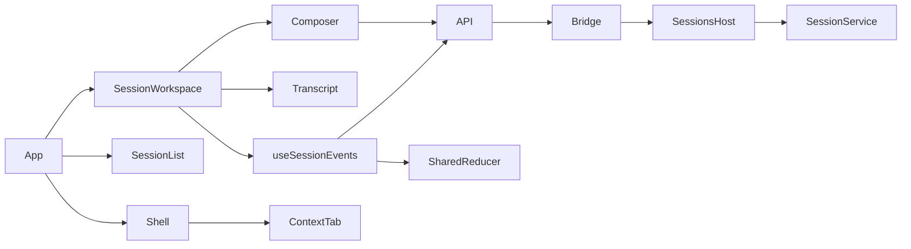

<!--
Copyright (c) 2026 DDP Engineering
This software is licensed under the PolyForm Noncommercial License 1.0.0.
Commercial use requires a separate commercial license.
See the LICENSE.txt in the .agentic folder for full license details.
SPDX-License-Identifier: LicenseRef-PolyForm-Noncommercial-1.0.0
-->

# TASK-4bea93b8 - WP-14 Chat UI

stage: done
type: feature
path: full
interaction: autopilot
requirements: REQ-UX-4bea0001, REQ-UX-4bea0002, REQ-UX-4bea0003, REQ-REL-4bea0004, REQ-UX-4bea0005, REQ-REL-4bea0006, REQ-UX-4bea0007, REQ-TEST-4bea0008
parent:
branch: master
base: d51785ee5ee6b30eb58071b43ad0d0b4dca671cb
opened: 2026-10-11

## Done checklist (current stage)

- [x] validated candidate confirmed unchanged
- [x] coordinator validation evidence, exact diff, exclusions and local outcome presented
- [x] standing human authority: one validated local coordinator commit per WP on master
- [x] journal and report included in selected50path delivery candidate
- [x] agreed local-only commit prepared by coordinator
- [x] close-out carried by the local delivery commit

## Frame

Problem: STATED WP14 needs the session workspace on IPC and browser mocks.
Desired outcome: STATED all scope and seven Done when criteria in plan/M1-read-only-agent.md WP14.
Actors: engineer, renderer/API, main SessionService host, replay provider, worker pool.
Primary scenario: open workbench -> create/select session -> send -> two read tools -> cited Markdown answer -> idle.
Examples: read-then-answer; slowed replay Stop; renderer reload mid-stream; native restart; pathological worker grep.
Counterexamples: invalid citation cannot open viewer; context-limit keeps complete transcript and enables another send.
In scope: workbench switcher; session CRUD/status; transcript/Markdown/reasoning/tools/citations/errors/Retry; keyboard composer/files/models/Stop; usage/context; snapshot-before-subscribe; mocks; en/ro/de; native and component proof; affected knowledge/context.
Out of scope: WP28 viewer; WP16 edits; WP17 approval implementation; remote publication; implementer commit; unrelated setup.
Constraints: STATED master shared checkout, base d51785ee5ee6b30eb58071b43ad0d0b4dca671cb, autopilot; coordinator alone commits after validation; preserve optional-companions.md SHA256 2a69f5b335a53e498b1f8e30fa5adb8096e870e7a12bbc05b0727a03cee72c6b; archive originals before npm; new native Ubuntu mirror with real base; two independent bound reviews/maxfix5 and bothOS strict all configured commands plus E2E.
Success signals: seven plan acceptance criteria, full native stdout/receipts and candidate/source parity.
Evidence: OBSERVED shared/session-state.ts terminal-authoritative reducer; renderer/API bridge supports sessions; main/sessions.ts host owns all native work; renderer Workbench owns active state; reference components read. STATED plan/architecture06 sections1/3/6/7/8,03 sections8/9,01 section3.
Assumptions: INFERRED reasoning is renderer-only transient presentation; available skills empty until WP29; subscription host replays events after the snapshot seq; terminal text is authoritative.
Unknowns: exact renderer/component-test harness dependency choice to confirm in design; no absent indispensable product decision.
Decision-blocking questions: none.
Proposed behaviors: accepted local plan WP14 scope and seven acceptance cases only.
Path and reason: full. Quick criteria: no new observable behavior=no; no new interface=yes (existing IPC); no new dependency=unknown (Markdown/test harness); existing requirement covers=no; no data handling change=yes (renderer only). Tightly coupled implementation stays one task; two independent review agents at validate.

## Requirement coverage

| Frame outcome | Atomic behavior | Requirement | Positive case | Boundary or failure | Verification | Design decision or no impact |
|---|---|---|---|---|---|---|
| WP14 Session navigation | When a workbench is open, the renderer shall offer a workbench switcher and keyboard accessible session creation, selection, rename, confirmed deletion and textual status badges. | REQ-UX-4bea0001 | Create/select/rename/delete with keyboard; cancel deletion preserves session; read-only and active mutations disabled. | Errors/read-only/abort and reload | Automated component/native tests | See Design |
| WP14 Streamed transcript | The renderer shall show the complete ordered session transcript with Markdown and highlighted code, collapsible transient reasoning, expandable tool arguments/previews, verified and warning citation chips, and localized errors with Retry. | REQ-UX-4bea0002 | Render all fixture states; expand tools/reasoning by keyboard; code/citations and provider error Retry; full transcript retained. | Errors/read-only/abort and reload | Automated component/native tests | See Design |
| WP14 Session composer | When a session is usable, the composer shall send with Enter, insert a newline with Shift+Enter, complete @ paths through workbench.files and select models from configured provider catalogs. | REQ-UX-4bea0003 | Keyboard send/newline/arrow completion/Escape; configured custom/OpenAI catalogs and failed model mutation; BUSY/approval disables sends. | Errors/read-only/abort and reload | Automated component/native tests | See Design |
| WP14 Stop active turns | While a session turn runs, the renderer shall provide Stop and confirmed Escape cancellation that aborts the runtime and worker call and restores a usable composer. | REQ-REL-4bea0004 | Native slowed response and real pathological grep: app.info responds, Stop yields aborted terminal event and next grep succeeds. | Errors/read-only/abort and reload | Automated component/native tests | See Design |
| WP14 Context usage meter | When usage.updated or CONTEXT_LIMIT arrives, the renderer shall display provider usage and context input budget/output reserve with labelled estimates and actionable limit guidance while retaining the complete transcript and usable composer. | REQ-UX-4bea0005 | Component fixture checks estimated/context/budget/reserve; limit then new send succeeds and prior long history remains visible. | Errors/read-only/abort and reload | Automated component/native tests | See Design |
| WP14 Resume renderer session streams | When selecting or reloading a session, the renderer shall fetch session.get before subscribing from its seq and project events with the shared reducer so terminal text is identical after reload and native app restart. | REQ-REL-4bea0006 | Native read-then-answer two tools/one citation, restart transcript equality, reload midstream final text exactly once; stale snapshot/subscription cleanup regression. | Errors/read-only/abort and reload | Automated component/native tests | See Design |
| WP14 Workspace context panel | When a workbench is open, the Context tab shall display current WORKBENCH.md and available-skill state, alongside placeholder tabs for Docs, Changes, Artifacts and Plan. | REQ-UX-4bea0007 | Component/mock Context preview and empty skills, remaining tabs show localized placeholder; API failure Retry. | Errors/read-only/abort and reload | Automated component/native tests | See Design |
| WP14 Browser session fixtures | Mock mode shall expose empty, streaming answer, tool rows, invalid citation and provider error session states in English, Romanian and German through the ordinary bridge. | REQ-TEST-4bea0008 | Component tests render every fixture and exercise session list, tool rows and composer with keyboard; catalog audit; native/mocks minimum viewport baseline. | Errors/read-only/abort and reload | Automated component/native tests | See Design |

## Design

Requirements coverage: UX0001 session/sidebar/workbench navigation; UX0002 Transcript/Markdown; UX0003 Composer; REL0004 Stop through existing bridge; UX0005 UsageMeter/context errors; REL0006 snapshot subscription hook; UX0007 ContextTab; TEST0008 seeded mock bridge/component harness.
Responsibilities: App owns active workbench navigation and selected session; Workbench consumes App's confirmed snapshot and reports confirmed open/close/config changes; Shell owns panels; SessionWorkspace composes transcript/composer; useSessionEvents owns guarded snapshot then one subscription; shared reducer projects durable state; main/core keep all native execution/storage. Reasoning/tool-update presentation lives only in renderer.
Interfaces/contracts: existing VeraApi invoke/subscribe only; configured provider metadata -> model catalogs; current workbench config/pinned -> context. Config.get includes optional folder/readOnly metadata so reload restores mutation availability. See linked exact spec.
Data: renderer selected session IDs per workbench, validated against live list; backend owns transcript. Transient reasoning keyed message; final text replaces deltas. Pending mutation never discards failed draft/model. Dialog cancellation preserves session and restores focus.
Flow: active config query detects renderer reload; workbench callback invalidates config/list. Snapshot fetch cancellation guards late results; subscribe immediately after snapshot set; cleanup detaches before another session. Turn/status events invalidate session list; inactive-session statuses use modest list polling.
Failure recovery: API errors localized/retry; read-only suppresses mutations; no duplicate optimistic transcript. CONTEXT_LIMIT is normal terminal usable state with guidance/full history. Model catalog failures retain current model and expose retry.
Security: Markdown AST text citations, skip raw HTML/images, inert links until ordinary confirmed external channel exists; no browser network/native access. Replay delay is added only inside existing compile-time instrumented composition and release omission asserted by baseline build tests. Sandbox/CSP/production origin unchanged.
Concurrency: one active session projection per hook; session selection/storage restoration guarded by workbench key; async files/catalog responses ignore stale identities. Stop is independent of provider/worker waits.
Compatibility: existing SessionService/reducer/storage unchanged. Pinned exact react-markdown10.1.0, remark-gfm4.0.1, rehype-highlight7.0.2; Vitest jsdom27.4.0 component harness with React act and @testing-library/user-event14.6.1 for real keyboard activation. These are build dependencies and pinned package lock.
Observability: test IDs expose transcript/tool/citation/composer/status; native tests observe UI plus real backend terminal events. Original execution receipts, full source manifests, old diagnostic preservation and new real-base mirror under cache/wp14.
Test seams: component tests through MockApi/query provider/i18n/React DOM; SSR red increment for missing chat before implementation, then each mock/keyboard/meter/lifecycle regression; native chat-ui.spec.ts for all five native cases. Existing suite and release build boundary guards retained.
Tradeoffs: localStorage session IDs support reload while core owns history; no optimistic append avoids doubled user messages. Native restart opens recent workbench through UI then saved session selection.
Expected files: renderer/App,components/{shell,workbench,error-message,session/*},hooks/use-session-events,styles,locales,mocks/{sessions,mockApi,fixtures}; desktop package/lock/Vitest; main/index instrumented delay; replay fixtures; e2e/chat-ui; component tests; affected .agentic knowledge/context.
Risks: replay live deltas may be missed during reload; final authoritative text fixes terminal view; snapshot race/cancel regressions required. Minimum-size long tool text must wrap. No open decisions.

### Proposed architecture - TASK-4bea93b8

## Log

- 2026-10-11 frame: <scope agreed, exclusions, chosen path and why>

- 2026-10-11T20:58:26.588479+00:00 frame accepted delegated WP14 scope; full path selected; no blocking product question; base/branch/protected-file confirmed. AEGIS is the explicitly authorized workflow; unavailable BMAD setup is outside ticket scope.

- 2026-10-11T20:59:02.581549+00:00 specify audited eight atomic requirements and one exact UI/lifecycle spec; new8/revised0/reused0/retired0; no scope ambiguity.

- 2026-10-11T20:59:54.120322+00:00 design audited UI/API boundaries, guarded stream lifecycle, transient reasoning, pinned Markdown/component dependencies and native replay test seams; no unresolved decision. See Design and linked spec.

- 2026-10-11T21:02:03.088043+00:00 build red REQ-UX-4bea0001: command=python ../02_Tools/npmw.py npx vitest run apps/desktop/src/renderer/components/session/workspace.test.ts; exit=1; open workbench lacks New session/workspace composer. Original workspace-behavior-red receipt retained. Pinned Markdown and jsdom dependencies installed after verified Windows preservation; no prior evidence overwritten.

- 2026-10-11T21:03:54.445522+00:00 build green REQ-UX-4bea0001 navigation-green exit0; New/session selection and composer mount proven. build red REQ-UX-4bea0002/0005/0007/REQ-TEST-4bea0008: command=python ../02_Tools/npmw.py npx vitest run apps/desktop/src/renderer/components/session/workspace.test.ts; exit1; named fixture sessions absent (fixtures-transcript-red original).

- 2026-10-11T21:05:24.040496+00:00 build red REQ-UX-4bea0003/REQ-REL-4bea0004: command=python ../02_Tools/npmw.py npx vitest run apps/desktop/src/renderer/components/session/workspace.test.ts; exit1; caret path completion list absent (composer-stop-red original). Transcript/mock/meter fixture behavior implemented; one case-sensitive test oracle corrected to existing localized Providers text.

- 2026-10-11T21:09:20.588971+00:00 build green workspace-focused-green exit0 (3 component tests); keyboard @ completion, Shift+Enter, Enter, streaming/reasoning Stop, tools/citations/errors/estimated context/full history all observed. Typecheck component-typecheck-green exit0. build red REQ-REL-4bea0004/0006: command=python ../02_Tools/npmw.py npm run test:e2e -- e2e/chat-ui.spec.ts under VERA_TEST=1; exit1; native read/restart1passes, missing slowed/grep fixture responses3fail. Original native-chat-red log/receipt retained.

- 2026-10-11T21:21:11.903735+00:00 build green native-browser-green3 exit0: four Windows native cases prove read/tools/citation plus identical restart, slowed Stop, reload exact final text, real pathological worker grep responsiveness/Stop/recovery; browser case includes six en/ro/de light/dark minimum-size keyboard fixtures. component-green4 exit0: seven UI component cases, mock/reducer guards; prereview-static-green2 typecheck exit0. build red REQ-UX-4bea0001: command=python ../02_Tools/npmw.py exec vitest run apps/desktop/src/renderer/components/session/workspace.test.ts; exit1; readonly-reload-red2 shows New session remains enabled after reloading read-only workbench. Existing config response omits readOnly, so add optional readOnly metadata to config.get and derive UI state from it; storage/service behavior unchanged.

- 2026-10-11T21:22:57.302489+00:00 DEVIATION build: workbench.config.get gains optional readOnly metadata, required to restore navigation/composer mutation availability after renderer reload; backward-compatible response addition, existing storage/service untouched. readonly-reload-green exit0 eight component cases; readonly-static-green typecheck exit0. Requirement statuses/path/test links activated.

- 2026-10-11T21:25:29.399871+00:00 build focused keyboard-error-focused-green exit0 nine component cases: all six mocks; actual keyboard CRUD/disclosures/reasoning/Shift+Enter/confirmed Escape Stop; Retry; rejected sends retain draft, rejected model changes retain previous value; obsolete snapshots/detached callbacks ignored. Semantic review of every changed/native/test seam and six-language/theme matrix screenshot confirms scope, security, full history, abort and source boundaries. Evolution reviewed eight post-last-anchor paths; complete base candidate tracked/new inventory retained separately. Advisory check errors0, baseline TASK-77e6f562 warning1 and WP09 manual-smoke note1 unchanged/outside ticket.

- 2026-10-11T21:25:39.188848+00:00 validate reconciled chat-ui knowledge, foundation/workbench/IPC/sessions routing, project/environment, software README and architecture06 against built code; task proposal retained and current diagram adds UsageMeter. Requirements/spec re-read active with linked native/component/release tests. No Manual requirement substituted. Round1 independent reviews begin on complete base-to-working candidate; full configured proof remains pending.

- 2026-10-11T21:29:12.385899+00:00 validate independent round1 specification and quality verdicts both changes_required on candidate ed56b6ee90501abe1dae617309aaf70c69a36fb7b6f750e8d6b7fc45137c2433; originals review-r1-{spec,quality}-original.md. Both identify P2: App switched/restored workbench diverges from Welcome local active snapshot, losing or mislabelling Close/Edit controls. Return build for that finding only; both verdicts invalidated. No additional scope.

- 2026-10-11T21:29:49.924906+00:00 build red REQ-UX-4bea0001/REQ-REL-4bea0006 round1 correction: command=python ../02_Tools/npmw.py exec vitest run apps/desktop/src/renderer/components/session/workspace.test.ts; exit1; review1-workbench-red confirms restored Welcome has no active Switch A details/Close. Implement one confirmed snapshot shared by App/Welcome, restored folder metadata and stale closed-callback guard; retain correct editor identity.

- 2026-10-11T21:31:01.810758+00:00 build round1 P2 corrected: one App query snapshot now supplies Welcome, config.get adds compatible optional folder metadata for reload; closed/config callbacks detach safely; editor closes on identity change. review1-workbench-green exit0 ten component tests prove reload Welcome, A-to-B sidebar switch, B pinned content and close; review1-workbench-typecheck exit0, review1-format-clean exit0. Knowledge/spec/design updated to same ownership. Evolution six source/test paths reviewed; advisory only unchanged baseline warning/live note. Both old verdicts remain invalid; advance round2.

- 2026-10-11T21:32:25.221520+00:00 validate independent review round2: specification compliance approved by /root/wp14_spec_review_r1, implementation quality approved by /root/wp14_quality_review_r1; both unchanged candidate 0ed44917112c0e7e381751407209b66f47ca520b4d517aa17f1ea832197ff75e, original verdicts/hashes in review-r2-binding.json. Proceed with serial Windows/native Ubuntu focused, configured strict (test+lint) and full baseline E2E gates; no candidate edits permitted.

- 2026-10-11T21:47:34.036694+00:00 validate final proof after both round2 independent approvals: unchanged candidate 0ed44917112c0e7e381751407209b66f47ca520b4d517aa17f1ea832197ff75e; windows-focused-r2-final exit0 14,93 passed; linux-focused-r2-final exit0 14,93 passed; windows-strict-r2-final exit0 348,348 passed; linux-strict-r2-final exit0 347,347 passed; windows-e2e-r2-final exit0 21 passed; linux-e2e-r2-final exit0 21 passed. Strict command=python .agentic/aegis.py check --task TASK-4bea93b8 --strict --run --json (python3 native entry), both configured commands python ../02_Tools/npmw.py npm test and python ../02_Tools/npmw.py npm run verify executed fully and exit0 on each OS. Full E2E21 cases per OS, focused93 per OS; original child/full stdout hashes, argv/cwd/environment/UTC, both review originals and identical full source before/after verified in verified-proof.json. Windows full348 passed/1 POSIX-only skipped; Linux347 passed/2 Windows-only skipped,52 files for each configured command. All WP14 tests execute on both OS.

- 2026-10-11T21:47:34.046007+00:00 validate preservation: Windows and native baseline source/Git/older evidence/npm archives verified; original npm logs restored byte exactly after final commands alongside new diagnostics. Presync archives retain each affected native source/Git state; unique prior-diagnostics archives preserve later original test outputs. Actual native mirror uses recorded true base and all Windows/native source bytes match. Old WP13 dependency mirror received only read-only copies;645 nonjournal source bytes match its prior handoff, current journal raw bytes retained. Protected optional-companions.md remains untracked/excluded/unchanged SHA2562a69f5b335a53e498b1f8e30fa5adb8096e870e7a12bbc05b0727a03cee72c6b. No staging/commit/publication/issue mutation.

- 2026-10-11T21:47:34.056416+00:00 validate non-material diagnostics: baseline TASK-77e6f562 malformed ruling warning and WP09 manual live-provider smoke note remain unchanged/outside WP14; successful Biome reports baseline style warnings, and builds report upstream zod annotation/color notices. WP05 clean/offline Windows and VC++ independence stay deferred. No required verification skipped/weakened and no relevant failed gate accepted. Recorded deviation remains compatible config.get folder/readOnly metadata for restored navigation.

- 2026-10-11T21:47:34.066202+00:00 validate administrative reporting correction: original strict catalogs report a current-task review-state warning because Stage report result was written as "in progress" instead of the schema enum "in_progress". Both independent original approved verdicts, identities and exact candidate hashes were recorded and verified before proof. Delivery uses the valid completed report; the proof journal remains preserved unchanged. This is a journal-only formatting correction, no candidate source/test/requirement/knowledge change and no replacement of original full strict stdout. Delivery advisory must confirm this warning clears.

- 2026-10-11T21:49:27.056814+00:00 deliver unchanged 49-path semantic candidate confirmed against both approved round2 verdicts and all six proof gates; presented24 tracked modifications +26 new candidate files including journal, all commands/results, exclusions, baseline notices and compatible optional folder/readOnly deviation. RULING-001 supplies the existing human authorization for implementer handback and coordinator-only local commit; no renewed publication permission is sought. Three commit/outcome/close-out items remain for coordinator. No staging/commit/push/issue mutation; protected file unchanged. Final packet binds administrative journal-only delivery delta and preserves validated journal original.

- 2026-10-11T21:49:45.640506+00:00 deliver report appended/read; delivery-advisory check --task TASK-4bea93b8 --strict --json exit0, errors0/warnings2/notes1: current-task review-state warning cleared. Remaining warnings are three coordinator-only uncompleted delivery items and baseline TASK-77e6f562 ruling; WP09 manual note unchanged. This catalog-only advisory runs no runtime commands and does not replace the six recorded full proof gates. Automated report diff51 includes the pre-existing protected untracked user file; authoritative packet candidate is50 paths (24 modified +26 new incl journal), excludes optional-companions.md. Original report preserved. Journal is now frozen for packet; only its administrative bytes differ from proof.

- 2026-10-11T22:06:13.714554+00:00 coordinator validation: Whole journal and eight active requirements/spec, AEGIS validate/deliver, all affected knowledge/context, WP14 plan seven Done criteria, architecture06 and03 sections8/9 plus01 section3, complete tracked hunks/new source/test/fixtures and lock dependency entry inventory reviewed. No blocking finding. Session navigation/CRUD/read-only, guarded snapshot then sinceSeq replay, authoritative terminal Markdown/citations/tools, keyboard composer/models/paths/Stop, context-limit full-history usability and Context agree with contracts. Exact vera://app authorization/sandbox/CSP and native boundaries unchanged. Test-build replay delay is absent from compiled release. Parent semantic verdict binds49paths; independent read-only evidence auditor approved49semantic/50ticket/672source, distinct original round2 reviews, all original receipts/four complete stdout captures, actual Ubuntu Git base/source parity and preservation archives. No concurrent implementation or source edits.

- 2026-10-11T22:06:13.724939+00:00 coordinator fresh proof: Six SERIAL blocking gates all exit0 on unchanged49path semantic/672full source candidate. Focused14files93tests each OS; strict --run --json executes BOTH configured full npm test and npm run verify,52files each with Windows348pass1POSIX-onlyskip and Ubuntu347pass2Windows-onlyskips; all WP14 tests run on both. Full native/browser E2E21each includes restart/reload, slowed Stop and actual worker pathological grep app.info responsiveness/abort/next-call recovery. Four original strict command captures preserve actual temporary stdout bytes and command/cwd/UTC/environment/exit/hash; no execution/results altered. Strict runs without VERA_TEST; only resource VITEST_MAX_WORKERS=1/capture hook. All before/after semantic/source/journal maps verified. Fresh proof cache/wp14/coordinator-proof.json. Baseline WP09 malformed ruling/live-smoke note and unticked-delivery advisory remain non-runtime; final journal-only close clears current task item. Non-failing baseline Biome/style/build notices retained. Prior npm diagnostics and screenshots/report archived before every command; original logs byte-restored alongside new logs. Historical WP11 auxiliary loss not claimed restored. WP05 clean/offline Windows and VC++ independence remains required WP30/WP33/final release.

- 2026-10-11T22:06:13.734401+00:00 coordinator deliver presentation and standing approval: Exact50paths,24 modified and26new including task journal, eight requirements/spec, renderer sessions/mock/styles/locales, pinned Markdown/jsdom keyboard dependencies, compatible IPC metadata/replay test seam and native/browser/component acceptance plus reconciled docs. Protected optional-companions.md excluded/unchanged; ignored cache/runtime/cycle administration excluded. Both round2 approvals still bind 0ed44917112c0e7e381751407209b66f47ca520b4d517aa17f1ea832197ff75e. DEVIATION build repeated: config.get optional folder/readOnly metadata is compatible and necessary for restored canonical Welcome/read-only state; core storage unchanged. Root AGENTS and explicit human cycle instruction/RULING001 authorize coordinator local commit WP14/#14/TASK-4bea93b8. Standing authority resolves delivery checkpoint. Outcome one local master commit, no push/PR/issue closure/publication.

- 2026-10-11T22:06:21.606929+00:00 coordinator report read and local close-out: Appended advisory report read; full runtime proof remains the six original fresh gate receipts. Git-visible51paths includes protected human file; delivery50 excludes it. Only append-only journal/report/Handoff administration changes after proof. Per deliver step7 local commit is whole outcome: done/checklist close-out carried by this same commit, actual SHA/path/blob/index/protected status verified in cycle state afterward. A delivery failure retains open state; no remote outcome authorized.

## Rulings

- RULING-001 | date=2026-10-11 | decision=autopilot=true; master shared checkout; user authorizes one local ticket commit exclusively by coordinator after independent validation; implementation returns unstaged and uncommitted; no remote publication/issue mutation. | reason=explicit delegation | source=user | supersedes=none

## Handoff

current: done
status: ready
next: Record actual commit and start next eligible work package
must_read: .agentic/tasks/TASK-4bea93b8.md, .agentic/steps/6_deliver.md, 02_Tools/cache/wp14/coordinator-proof.json
blockers: none

## Stage report

stage: deliver
result: completed
current: done
changed: Session Chat UI and canonical Welcome snapshot;50paths
evidence: Coordinator focused93/E2E21eachOS;strict full test/lint0each,348Windows/347Ubuntu;round2 approved
issues: Baseline WP09 advisory;clean/offline Windows and CRT remain final-release obligations
next: Record actual commit and start next eligible work package
needs_user: no
spec_compliance: approved
implementation_quality: approved
review_round: 2

## Delivery report (2026-10-12)

- stage: deliver; type: feature; path: full; branch: master
- requirements:
  - REQ-UX-4bea0001 - Session navigation
  - REQ-UX-4bea0002 - Streamed transcript
  - REQ-UX-4bea0003 - Session composer
  - REQ-REL-4bea0004 - Stop active turns
  - REQ-UX-4bea0005 - Context usage meter
  - REQ-REL-4bea0006 - Resume renderer session streams
  - REQ-UX-4bea0007 - Workspace context panel
  - REQ-TEST-4bea0008 - Browser session fixtures
- deviations: 1 recorded
  - build: workbench.config.get gains optional readOnly metadata, required to restore navigation/composer mutation availability after renderer reload; backward-compatible response addition, existing storage/service untouched. readonly-reload-green exit0 eight component cases; readonly-static-green typecheck exit0. Requirement statuses/path/test links activated.
- explicit review: enabled; spec_compliance=approved; implementation_quality=approved; review_round=2
- diff vs task base d51785e: 51 file(s) changed, 5194 line(s) added
- checks: errors=0 warnings=2 notes=1
- checklist: 3/6 done; open: journal and report included in the delivery commit; agreed outcome delivered, normally a PR; close-out committed after the outcome succeeded, or carried by the delivery commit where nothing could fail after it

## Delivery report (2026-10-12)

- stage: deliver; type: feature; path: full; branch: master
- requirements:
  - REQ-UX-4bea0001 - Session navigation
  - REQ-UX-4bea0002 - Streamed transcript
  - REQ-UX-4bea0003 - Session composer
  - REQ-REL-4bea0004 - Stop active turns
  - REQ-UX-4bea0005 - Context usage meter
  - REQ-REL-4bea0006 - Resume renderer session streams
  - REQ-UX-4bea0007 - Workspace context panel
  - REQ-TEST-4bea0008 - Browser session fixtures
- deviations: 1 recorded
  - build: workbench.config.get gains optional readOnly metadata, required to restore navigation/composer mutation availability after renderer reload; backward-compatible response addition, existing storage/service untouched. readonly-reload-green exit0 eight component cases; readonly-static-green typecheck exit0. Requirement statuses/path/test links activated.
- explicit review: enabled; spec_compliance=approved; implementation_quality=approved; review_round=2
- diff vs task base d51785e: 51 file(s) changed, 5219 line(s) added
- checks: errors=0 warnings=2 notes=1
- checklist: 5/6 done; open: close-out carried by the local delivery commit
