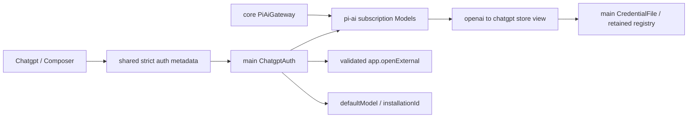

<!--
Copyright (c) 2026 DDP Engineering
This software is licensed under the PolyForm Noncommercial License 1.0.0.
Commercial use requires a separate commercial license.
See the LICENSE.txt in the .agentic folder for full license details.
SPDX-License-Identifier: LicenseRef-PolyForm-Noncommercial-1.0.0
-->

# TASK-5423a330 - WP-21 ChatGPT subscription sign-in

stage: done
type: feature
path: full
interaction: autopilot
requirements: REQ-FUNC-2d36afc2, REQ-FUNC-46e99b33, REQ-FUNC-7da240db, REQ-FUNC-790a052e, REQ-SEC-2361cc1e, REQ-UX-a5037b51, REQ-FUNC-fd4f7d07
parent:
branch: master
base: cb8b88aa4ceed1e9ff4b22c9c031b36e416056fd
opened: 2026-10-12

## Done checklist (current stage)

- [x] validated candidate confirmed unchanged; both independent round6 verdicts approved
- [x] validation evidence, scope, exclusions and coordinator handover recorded
- [x] human authorization for local coordinator commit recorded; no remote publication authorized
- [x] journal and report included in coordinator delivery commit
- [x] agreed local commit delivered by coordinator
- [x] close-out carried by the coordinator delivery commit

## Frame

Problem: STATED WP21 users need ChatGPT subscription sessions from VERA.
Desired outcome: STATED sign in, persist/restart/run and sign out through main-owned OAuth.
Actors: engineer, sandboxed renderer, main credential/auth host, pi-ai subscription Models, system browser.
Primary scenario: Sign in click -> pi-ai auth_url opens system browser -> callback/manual redirect -> encrypted chatgpt credential -> default subscription if defaultModel is null -> usable composer/session.
Examples: success, manual_code completion, timeout, busy1455 Codex hint, cancel, logout while subscription selected.
Counterexamples: fake login does not fulfill real subscription Done; another active provider is retained; secrets never enter public response/event/log.
In scope: exact issue21/planWP21, subscription mapping/streams, four auth IPC names with manual input carried by login, localized provider UI and composer, tests and directly affected knowledge; authorized coordinator AGENTS.md, 02_Tools/verification-policy.md and 02_Tools/README.md edits included.
Out of scope: other WPs, BMAD setup, milestone/release gate administration, commit/staging/push/PR; protected optional-companions.md.
Constraints: STATED master/shared checkout/base cb8b88aa4ceed1e9ff4b22c9c031b36e416056fd; autopilot; coordinator alone commits. Preserve Electron44.7.0/vera://app/pinned runtime/import boundaries/scrubber. Protected SHA256 2a69f5b335a53e498b1f8e30fa5adb8096e870e7a12bbc05b0727a03cee72c6b.
Success signals: all issue Done cases, filtered ticket Windows/native Ubuntu proof, two independent complete-candidate reviews, strict statics, honest manual status.
Evidence: OBSERVED plan M2 WP21, architecture04 sections1/5/6/7,01 laws6/7/network8,ADR0002; WP09 dependency 1b565f974a36642075c65e86f02313f2eaf885da and TASK-77e6f562; installed pi-ai1.1.0 Models.login stores via modify and openai-chatgpt abort closes all callback connections. CredentialFile already registers access/refresh and all credential string metadata. subscription collection currently empty; settings.defaultModel null is the existing no-provider state. Reference oauth/providers/SettingsPage read.
Assumptions: INFERRED use first valid subscription catalog model as default only when defaultModel null; no extra settings format required.
Unknowns: real personal subscription proof requires human login after concrete candidate; native Ubuntu route to inspect before validation.
Decision-blocking questions: none for implementation.
Proposed behaviors: exact WP21 scope; explicit weak-storage choice before login; metadata-only polling for pending/manual/error state, prompt nonce guards stale paste.
Path and reason: full; quick criteria no new behavior=no, no new interface=no, no dependency=yes, existing complete requirement=no, unchanged secret handling=no. One implementation task; two independent review agents at validate only.

## Requirement coverage

| Outcome/trigger | Atomic response | Requirement | Positive / boundary oracle | Decision/test seam |
|---|---|---|---|---|
| Orchestrate ChatGPT login lifecycle | When the user requests ChatGPT sign-in, VERA shall run pi-ai OAuth with agentName VERA and the settings installationId, open the authorization page in the system browser, store success in chatgpt and select a subscription model only if no app model is selected, with cancellable cleanup, a ten-minute timeout and a localized port1455 Codex conflict hint. | REQ-FUNC-2d36afc2 | Fake Models OAuth success and captured options; cancel, timeout, occupied-port and no-active/other-active cases assert status, credential, default and cleanup. | Auth/collection/renderer seams per Design |
| Complete a pending manual redirect prompt | While pi-ai requests manual_code, VERA shall complete that pending prompt from an explicitly submitted redirect URL guarded by the current prompt identity, clearing it on callback, cancel or timeout. | REQ-FUNC-46e99b33 | Scripted manual prompt receives submitted redirect; stale, duplicate and aborted submissions fail and clear the prompt. | Auth/collection/renderer seams per Design |
| Sign out of ChatGPT | When the user signs out of ChatGPT, VERA shall abort pending login, delete chatgpt credentials and clear the app default when it selects chatgpt. | REQ-FUNC-7da240db | Fake flow/logout deletes the credential, prevents late resurrection, clears subscription default and retains other-provider default. | Auth/collection/renderer seams per Design |
| Run models on ChatGPT subscription credentials | When ChatGPT is selected, VERA shall list and run the subscription collection OpenAI models using only the chatgpt OAuth credential and its serialized refresh. | REQ-FUNC-790a052e | Collections tests prove distinct API/chatgpt slots, store-only subscription auth, catalog/reference/budget and scripted OAuth stream with refresh. | Auth/collection/renderer seams per Design |
| Keep OAuth secrets in the main credential host | VERA shall register OAuth access and refresh secrets with retained scrubbing and logging redaction before persistence or error projection, exposing only validated authentication metadata through events and IPC and requiring an explicit weak-storage choice. | REQ-SEC-2361cc1e | Fake credentials plus actual CredentialFile and logger capture assert no secret in status, IPC, events or log; weak storage requires choice and memory/refresh/restart behavior is inspected. | Auth/collection/renderer seams per Design |
| Present ChatGPT authentication and model controls | The Providers screen shall offer localized accessible sign-in, pending/manual input/cancel, status with expiry and sign-out, with connected subscription models available in the composer. | REQ-UX-a5037b51 | Component/native/browser acceptance observes controls, manual prompt, expiry, model picker and errors in en/ro/de; password draft clears after submit/cancel. | Auth/collection/renderer seams per Design |
| Verify real subscription across restart | VERA shall support a real ChatGPT subscription sign-in followed by a short session, application restart, another session and sign-out. | REQ-FUNC-fd4f7d07 | Manual: user signs in with their own subscription in VERA, runs a short session, restarts and runs again, signs out; record observed results, not fake proof. | Auth/collection/renderer seams per Design |

## Design

Requirements coverage: login lifecycle/manual/logout -> main ChatgptAuth (2d36afc2/46e99b33/7da240db); subscription -> core collections (790a052e); retained registry/weak consent -> CredentialFile + mapped store (2361cc1e); UI -> Chatgpt + composer (a5037b51); real acceptance -> ordinary release UI (fd4f7d07).
Responsibilities: core owns mapped openai/chatgpt store view and subscription collection/gateway, Electron-free. Main owns auth state, encrypted store, settings and system browser. Shared defines strict projections; renderer keeps only ephemeral redirect draft, imperative invoke bypasses mutation cache.
Interfaces: four auth channels; login request either start with optional storageConsent or submit manualCode/promptId. Status connected/expiresAt plus state idle/pending/manual/error and optional promptId/error; no URL or raw upstream message response. Auth URL uses the validated app.openExternal host operation; the sign-in click supplies authorization.
State/ordering: one pending attempt; duplicate start BUSY; cancel aborts and waits settlement before new login. Prompt identity increments; callback abort clears prompt. Timeout aborts after600000ms and reports localized PROVIDER error; busy1455 maps Codex hint. Logout waits cancellation before deleting; refresh/login share CredentialFile mutex. Default selection uses a fresh settings read and changes only null defaultModel; logout clears only chatgpt prefix.
Storage/security: explicit weak consent before start, mapped writes pass choice, later refresh retains the same memory/disk location; no generic CredentialFile consent weakening. Register tokens through CredentialFile before persistence. Reject unexpected auth_url origins; avoid forwarding provider notify/prompt messages and raw failures. Submit redirects treated as sensitive drafts and registered for redaction.
Compatibility: no persisted-format change (existing schema4 defaultModel and chatgpt reference support), no dependency/pin/origin changes. API collection retains explicit API-only auth, subscription strips ambient API-key auth.
Failure recovery: finally clears timers/prompt and abort listeners, port cleanup delegated to pinned pi-ai; failed storage keeps registry, failed default selection surfaces error; retries require explicit click.
Test seams: scripted real Models collection with fake OAuth provider; actual CredentialFile/settings/logger with deterministic files; unit controller fake timers; captured OAuth HTTP streams; strict shared schemas; UI component and focused native/browser acceptance, network guard. Native Ubuntu existing mirror reused once inspected.
Alternatives/tradeoffs: polling metadata avoids new event payload/state schema; manual submission reuses login instead of adding a fifth channel. First catalog entry avoids hard-coded model ID.
Expected files: core llm/providers and tests; main auth/store view/external host/provider gateway/index; shared auth/providers/ipc exports; renderer Chatgpt/providers/composer/mock/locales; focused tests/E2E; current docs and task requirements/spec.
Risks: real OAuth availability UNKNOWN until human proof; fake cannot fulfill final manual criterion. No unresolved product decision.

### Proposed architecture - TASK-5423a330

## Log

- 2026-10-12 build red: REQ-UX-a5037b51 command=`python ../02_Tools/npmw.py npx vitest run apps/desktop/src/renderer/components/chatgpt.test.ts`; exit1; expected dedicated controls existence false. Original windows-ui-red log/exit retained.

- 2026-10-12 build red: REQ-FUNC-2d36afc2/46e99b33/7da240db,REQ-SEC-2361cc1e command=`python ../02_Tools/npmw.py npx vitest run apps/desktop/src/main/chatgpt-auth.test.ts`; exit1; expected missing ChatGPT host existence assertion. REQ-FUNC-790a052e command=`python ../02_Tools/npmw.py npx vitest run packages/shared/src/chatgpt.test.ts packages/core/src/llm/subscription.test.ts`; exit1; missing four auth channels/empty subscription and catalog rejects chatgpt. Original windows-auth-red/windows-subscription-red logs+exit under02_Tools/cache/wp21.

- 2026-10-12 design: Main auth state/prompt identity/cleanup, mapped subscription credential port, weak-storage refresh choice and localized polling UI audited; no schema migration or dependency. See Design/spec. Specify check errors0, missing future paths expected until build, legacy unrelated ruling warnings retained.

- 2026-10-12 specify: Seven atomic behaviors, positive/boundary inventory and exact state/IPC spec cover issue21; manual real acceptance remains distinct. Requirements audited with no unresolved implementation decision.

- 2026-10-12 frame: Scope accepted under explicit delegated autopilot; HEAD/base/status confirmed. Full path, master exception authorized. Readiness setup --check exit0. BMAD helper/setup skill absent; AEGIS explicit workflow governs, no unrelated setup.

- 2026-10-12 build complete: main-owned OAuth, guarded manual redirect, consent-preserving refresh store, separate subscription routing and localized renderer controls implemented; requirements except real manual acceptance activated with exact affected paths and linked tests. Settings queue predicates preserve concurrently selected other models. Native fake bridge/restart/redaction proof remains distinct from personal subscription acceptance.
- 2026-10-12 ticket proof: Windows and native Ubuntu selected9 files each returned exit1 with77/78 passing, solely the pre-WP21 empty-subscription assertion; corrected to assert OAuth-only subscription while retaining capability assertions. Focused Windows gateway correction exit0(1); unchanged77 cases reused. Windows UI/immediate consumers exit0(13 selected,39 filtered); both-mode build seam exit0(1) on each platform. Original logs/receipts under02_Tools/cache/wp21; static checks are separate. M2 complete suite belongs coordinator after commit.
- 2026-10-12 independent quality review round1: changes_required for two P2 cancellation races. Late browser rejection guarded by attempt identity; underlying OAuth.login now tracked and drained despite Models.login abort race. Added delayed startup, immediate real callback startup/cancel and late browser rejection regressions. Windows revised auth16 cases exit0. Spec reviewer found no additional defect; final bound reviews pending.
- 2026-10-12 authority: current version3 verification policy and coordination-policy-applied.json replace earlier operational reference; include the three coordinator-owned policy/documentation edits in this candidate without modifying them. Protected optional-companions.md remains excluded and byte-identical. No staging/commit/publication; coordinator retains authorized local commit.

- 2026-10-12 review round2: spec reviewer required correcting the directly linked WP09 active spec still describing an empty/reserved subscription. Updated that inherited requirement/spec to the current separate OAuth collection; no executable change or additional test needed. Round3 both verdicts cleared for rebinding.
- 2026-10-12 ticket native proof: affected-ubuntu exit0(50selected,39filtered), including auth16 and immediate renderer/settings/mock consumers; filter also matched all gateway21 via parent title, recorded exactly. native-ubuntu exit0(2); native-fixed-windows exit0(1) plus unchanged browser case from native-final-windows(1pass). That earlier Windows invocation exit1 compiled ordinary release because caller omitted VERA_TEST=1; fake override was correctly absent. Corrected caller environment and reran only failed native case; original failure preserved. manual-release-build VERA_TEST=0 exit0, ordinary interactive VERA PID1388 started with isolated cache/wp21/manual-user-data. Human real flow requested; no personal credentials read.

- 2026-10-12 final independent reviews round3: spec_compliance=approved by /root/review_contract and implementation_quality=approved by /root/review_quality; same55path candidateSHA256870382db064876d2a9e3ca9835fe283625ba863f1dde8498ce728860fcf22d9e, excluding only journal bookkeeping from binding. Original round3 reports under02_Tools/cache/wp21 retain hashes/authors/findings and pending personal acceptance. Both recorded P2 races and inherited spec drift resolved; no remaining code findings. Final strict checks follow this stable candidate.

- 2026-10-12 strict initial: Windows lint/i18n exit0, typecheck exit2 TS2352 in dynamically generated IPC fixture handler cast; corrected type-only `as unknown as ChannelHandlers`, no runtime behavior change. Focused actual IPC fixture1pass exit0; earlier auth/consumer/native proof reused. Initial Ubuntu strict exit1 because configured `python` name was absent; task-local alias to existing python3 corrects command environment without project/pin change. Both original failed receipts retained; neither is reported green.
- 2026-10-12 final reviews round4: independent spec and quality both approved all55 hashes on candidateSHA25631328de9df4a4f8e5ee5dd99b3f0d6b8c49cf8755b368e5ba1af64ae1091139d (journal bookkeeping excluded), original review-contract-round4.md/review-quality-round4.md. No remaining findings. User selected real manual test now; observation awaits results.

- 2026-10-12 real manual attempt: user observed ChatGPT sign-in failed and browser never opened; no connected credential/session/restart success claimed. Investigation found pi-ai variable OAuth import unresolved in Electron bundle. Added native actual pinned OAuth startup/prompt/cancel regression (red exit1 oauth-native-red-windows); main now registers supported public standalone OAuth loaders, retaining core import boundaries and all dependency pins. New native regression green exit0(1), no browser/model traffic. Both prior approvals cleared; return build for focused bundle proof and retry concrete real acceptance.

- 2026-10-12 corrective build complete: public pi-ai standalone OAuth registration compiled in main; actual native startup/cancel green on Windows(1) and native Ubuntu(1, alongside unchanged fake persistence1); build-mode Windows1passed verifies actual OAuth marker in both ordinary/instrumented builds and fake seam absent ordinary. Original oauth-native-red/green-windows,oauth-native-ubuntu,oauth-buildmode-windows receipts retained. Latest ordinary build restarted for user PID17104, same manual data. All other unchanged proof reused; no full suite.

- 2026-10-12 personal acceptance progress: after bundle correction user confirmed successful real sign-in, ran a short test session and closed VERA. Restart requested with same isolated user data; second session/sign-out still pending. No credentials or OAuth URL read. Native Ubuntu both-mode build1passed, with actual OAuth marker present in both variants.
- 2026-10-12 round5 quality doc finding: corrected introduced UTF-8 em-dash mojibake in providers knowledge with explicit UTF-8 I/O; no executable change. Final round6 rebinding awaits consolidated personal result/traceability.

- 2026-10-12T15:43:11.049495+00:00 manual acceptance REQ-FUNC-fd4f7d07: ordinary compiled release VERA, isolated cache/wp21/manual-user-data retained through restart; user confirmed real subscription sign-in, ran a short session, closed app, requested restart (PID10900, same data), then explicitly confirmed second ChatGPT session worked and Sign out displayed Not signed in. Method=human interaction/result reports, not fake or inferred network proof; no personal token/credential/redirect read. Requirement activated. Earlier failed pre-browser observation retained with corrective red/green native evidence.
- 2026-10-12 native readiness: initial setup --check exit1 only freshness metadata after source mirror copied unchanged lock with new mtime. Windows, prior native dependency source and current native lock hashes all equal37f1da565eeda1bebd160ffe5810c775ad57c433338c53a5ac29030e307d4c74; preserved original installed-lock metadata in this task-owned copy, dependency source untouched. readiness-fixed-ubuntu exit0, Node24.21.0/Electron system libraries/npm ready. Mirror now avoids recopying identical source bytes.

- 2026-10-12 final independent reviews round6: spec_compliance=approved (/root/review_contract) and implementation_quality=approved (/root/review_quality), all55 hashes matched candidateSHA25620949e5280a5220e682e7fb3f6979a43c4b9970e32584e9eb78c2f02b631b0c5; journal bookkeeping excluded only. Original review-contract-round6.md/review-quality-round6.md retained. Personal acceptance complete, no remaining findings. Final evolution refreshed at15:47:19Z:36 paths outside.agentic (10added/26modified/0removed), all in reviewed scope including the three authorized coordinator documents. Final configured strict proof follows.

- 2026-10-12 final validation: `python .agentic/aegis.py check --task TASK-5423a330 --strict --run` Windows exit0 (lint/typecheck/i18n all0); native Ubuntu equivalent `python3 ../.agentic/aegis.py check --task TASK-5423a330 --strict --run` exit0 (same three configured checks all0). Original strict-accepted-windows/ubuntu logs, stderr and execution receipts retained. Both errors0/warnings9/notes2: warnings are pre-existing malformed rulings in unrelated TASK-73205e55/TASK-77e6f562/TASK-f697479d, unchanged and not affecting this task; notes identify manual methods, including the now completed real WP21 criterion. Strict ok on both platforms; full suite intentionally owned once by coordinator at M2 under current project policy. Native final55-bound-file parity verified before teardown; original focused tests/build proof reused unchanged.
- 2026-10-12 validate complete -> deliver:55-path reviewed candidate (33 tracked modifications plus22 new paths), including the three authorized coordinator policy documents; protected optional-companions.md excluded and preserved. No visible child implementation tasks; two review agents complete. Main-owned OAuth, separate subscription routing, localized controls, focused automated proof and real subscription restart/logout criterion complete. Native task scratch removed after process closure; original logs retained on Windows, dependency source and personal manual data preserved. Implementer hands back without staging/commit/publication; coordinator verifies relevant current evidence, makes the already authorized local commit and owns the integrated M2 gate before the next eligible ticket.

- 2026-10-12 delivery report read: advisory errors0/warnings10/notes2 adds only expected unticked-deliver for the three coordinator-owned commit/close-out items. Generic report diff counts56 including protected optional-companions.md; authorized handover manifest is55 and excludes that file. Journal-only handover records leave the bound candidate unchanged; no duplicate tests or static commands required.

- 2026-10-12 coordinator acceptance: entire55-file candidate, full journal/Done, both bound round6 reviews, relevant original Windows/native Ubuntu results and actual human confirmation checked; accepted unchanged non-journal candidate20949e5280a5220e682e7fb3f6979a43c4b9970e32584e9eb78c2f02b631b0c5. No routine retests. Original corrected failures preserved; nine unrelated legacy warnings retained. Explicit user authority covers this one local WP21 commit including the three approved policy documents; protected optional-companions.md excluded. Detail:02_Tools/cache/wp21/coordinator-acceptance.json. M2 full gate remains coordinator-owned after commit.

- 2026-10-12 local-only close-out: this single authorized delivery commit carries the completed journal/report. No push, PR or remote issue mutation; M2 gate remains pending in cycle state and is separate from ticket completion.

## Rulings

- RULING-001 | date=2026-10-12 | decision=Autopilot on master; only coordinator makes authorized validated local commit, implementer hands back without staging/commit/publication | reason=Explicit user delegation and AGENTS cycle | source=user | supersedes=none
- RULING-002 | date=2026-10-12 | decision=Include authorized policy edits; protect and exclude optional-companions.md; ticket smallest sufficient checks, reuse unchanged proof, coordinator owns M2 gate | reason=Explicit user delegation and verification-policy.md | source=user | supersedes=none

## Handoff

current: done
status: ready
next: Coordinator runs the integrated M2 gate before WP22
must_read: 02_Tools/cache/wp21/coordinator-acceptance.json, 02_Tools/verification-policy.md
blockers: none for WP21; M2 gate pending

## Stage report

stage: deliver
result: completed
current: done
changed: ChatGPT OAuth/subscription routing, localized controls and focused tests; three authorized policy documents
evidence: Original Windows/native Ubuntu ticket proof, real sign-in/session/restart/session/logout, both round6 approvals and strict0 reused
issues: Nine inherited journal warnings; M2 gate remains coordinator-owned
next: Integrated M2 gate before WP22
needs_user: no
spec_compliance: approved
implementation_quality: approved
review_round: 6

## Delivery report (2026-10-12)

- stage: deliver; type: feature; path: full; branch: master
- requirements:
  - REQ-FUNC-2d36afc2 - Orchestrate ChatGPT login lifecycle
  - REQ-FUNC-46e99b33 - Complete a pending manual redirect prompt
  - REQ-FUNC-7da240db - Sign out of ChatGPT
  - REQ-FUNC-790a052e - Run models on ChatGPT subscription credentials
  - REQ-SEC-2361cc1e - Keep OAuth secrets in the main credential host
  - REQ-UX-a5037b51 - Present ChatGPT authentication and model controls
  - REQ-FUNC-fd4f7d07 - Verify real subscription across restart
- deviations: none recorded
- explicit review: enabled; spec_compliance=approved; implementation_quality=approved; review_round=6
- diff vs task base cb8b88a: 56 file(s) changed, 2470 line(s) added
- checks: errors=0 warnings=10 notes=2
- checklist: 3/6 done; open: journal and report included in coordinator delivery commit; agreed local commit delivered by coordinator; close-out carried by the coordinator delivery commit

## Delivery report (2026-10-12)

- stage: deliver; type: feature; path: full; branch: master
- requirements:
  - REQ-FUNC-2d36afc2 - Orchestrate ChatGPT login lifecycle
  - REQ-FUNC-46e99b33 - Complete a pending manual redirect prompt
  - REQ-FUNC-7da240db - Sign out of ChatGPT
  - REQ-FUNC-790a052e - Run models on ChatGPT subscription credentials
  - REQ-SEC-2361cc1e - Keep OAuth secrets in the main credential host
  - REQ-UX-a5037b51 - Present ChatGPT authentication and model controls
  - REQ-FUNC-fd4f7d07 - Verify real subscription across restart
- deviations: none recorded
- explicit review: enabled; spec_compliance=approved; implementation_quality=approved; review_round=6
- diff vs task base cb8b88a: 56 file(s) changed, 2491 line(s) added
- checks: errors=0 warnings=10 notes=2
- checklist: 5/6 done; open: close-out carried by the coordinator delivery commit
