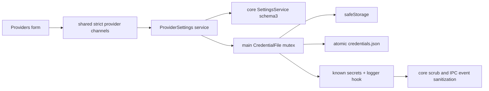

<!--
Copyright (c) 2026 DDP Engineering
This software is licensed under the PolyForm Noncommercial License 1.0.0.
Commercial use requires a separate commercial license.
See the LICENSE.txt in the .agentic folder for full license details.
SPDX-License-Identifier: LicenseRef-PolyForm-Noncommercial-1.0.0
-->

# TASK-62aacce8 - WP-08 Credential store and provider settings

stage: done
type: feature
path: full
interaction: autopilot
requirements: REQ-DATA-4a030001, REQ-DATA-4a030002, REQ-SEC-fe4d5c4c, REQ-SEC-47e726a7, REQ-SEC-cf3aa5a4, REQ-FUNC-f19cac5e, REQ-DATA-87619ef8, REQ-SEC-0b898261, REQ-FUNC-6c666347, REQ-UX-fb4b9424
parent:
branch: master
base: 580ecccf726861f99ff3d7dadb34f825c5fdc195
opened: 2026-10-11

## Done checklist (current stage)

- [x] validated candidate confirmed unchanged; otherwise returned to validate
- [x] validation evidence, diff, exclusions, and outcome presented
- [x] delivery confirmed by the human (explicit delegated uncommitted handoff; coordinator local commit authorized by user)
- [x] journal and report included in the delivery commit (coordinator)
- [x] agreed outcome delivered, normally a PR (coordinator authorized local commit only; publication separate)
- [x] close-out committed after the outcome succeeded, or carried by the delivery commit where nothing could fail after it (coordinator)

## Frame

Problem: STATED WP08 needs safe local provider credentials and provider configuration.
Desired outcome: STATED five issue8 Done-when observations, plus preserved foundation contracts.
Actors: OS-account engineer; sandboxed renderer; main credential host; future pi-ai consumer.
Primary scenario: engineer enters a key -> main saves encrypted credential -> UI clears draft and shows bounded hint. Unsafe encryption asks for explicit product consent; refusal saves only for this run.
Examples: STATED OpenAI key and multiple optional-key custom endpoints. OBSERVED defaults 32768/4096 in04 section2.
Counterexamples: short key must never be revealed in full; unknown/future files must not be overwritten; no connection test or real model request.
In scope: CredentialStore port; main atomic versioned safeStorage store and serialized mutations; consent; registered redaction and scrub; non-secret settings; validated list/save/remove; masked localized UI; Windows and native Ubuntu tests; affected current docs.
Out of scope: WP09 gateway/catalog/network/test, WP10 runtime, WP21 OAuth UI, sessions/tools, after1.0, repository administration, publication and commits by this chat.
Constraints: STATED master/base580ecccf726861f99ff3d7dadb34f825c5fdc195, single implementation chat, complete uncommitted review candidate, Electron44.7.0 sandbox/CSP/preload/import boundaries unchanged, fictitious deterministic secrets, protected optional-companions SHA2562a69f5b335a53e498b1f8e30fa5adb8096e870e7a12bbc05b0727a03cee72c6b.
Success signals: five acceptance criteria mapped to unit/native E2E; two independent reviews and final strict perOS proofs on identical source manifests.
Evidence: OBSERVED M1 WP08 and tea issue8 match; 04 sections1/2/5;01 L7/6/import boundaries;ADR0011. OBSERVED settings schema2, atomic FileAccess and registered logger in current source. OBSERVED upstream pi-ai1.1.0 tarball auth/types.d.ts and credential-store.js, inspected directly before compatibility claim.
Assumptions: INFERRED renderer may hold a user-entered draft only until submitted; stored/read secrets remain main-only. Reference UI and credential adapter are patterns; production preserves existing stronger atomic/error protections.
Unknowns: no blocking product unknowns. Ubuntu mirror is WP06 plus WP07 uncommitted state; preserve a verified snapshot before reconciliation. BMAD auxiliary renderer missing; explicit instruction keeps AEGIS authoritative.
Decision-blocking questions: none.
Proposed behaviors: encrypted roundtrip; explicit weak-storage choice; safe hints; custom CRUD/unique derived slugs/validated budgets; future-file protection; scrub all known secret strings; clear sensitive UI drafts after successful save or cancel (resolved exact spec/design).
Path and reason: full; quick-path criteria: no new observable behavior=no; no new interface/format=no; no new dependency=yes; existing requirement covers all=no; unchanged secret handling=no. No implementation children; tightly coupled trust boundary. Independent review-only agents required by configured review and task instruction.

## Requirement coverage

| Frame outcome / atomic behavior | Requirement | Positive case | Boundary/failure | Verification / design |
|---|---|---|---|---|
| First-run schema3 defaults | REQ-DATA-4a030001 | Stable identity and empty providers | Future data stays read-only | settings/service.test.ts; current data spec |
| Existing0/1 migration | REQ-DATA-4a030002 | Original-byte backup and identity/extensions | Invalid/future bytes retained | settings/service.test.ts; current data spec |
| Encrypted credential persistence | REQ-SEC-fe4d5c4c | Temporary files and injected deterministic crypto prove ciphertext-only roundtrip | See exact spec failure contract | 05_Software/apps/desktop/src/main/credentials.test.ts; spec decisions |
| Explicit weak encryption consent | REQ-SEC-47e726a7 | Injected unavailable/basic_text hosts require consent | See exact spec failure contract | 05_Software/apps/desktop/src/main/credentials.test.ts; spec decisions |
| Known credential redaction | REQ-SEC-cf3aa5a4 | Inject fictitious API/OAuth keys and errors with overlapping/escaped keys | See exact spec failure contract | 05_Software/packages/core/src/llm/scrub.test.ts; spec decisions |
| Safe provider configuration operations | REQ-FUNC-f19cac5e | Main provider tests cover add/edit/remove/keyless/retain or clear key | See exact spec failure contract | 05_Software/apps/desktop/src/main/provider-settings.test.ts; spec decisions |
| Provider settings format migration | REQ-DATA-87619ef8 | Settings tests load schema2 with extensions | See exact spec failure contract | 05_Software/packages/core/src/settings/service.test.ts; spec decisions |
| Provider metadata and bounded hints | REQ-SEC-0b898261 | Main tests compare list/settings/save/remove responses to fake credentials and check every short length | See exact spec failure contract | 05_Software/apps/desktop/src/main/provider-settings.test.ts; spec decisions |
| Provider IPC validation | REQ-FUNC-6c666347 | Router/provider tests submit extra fields | See exact spec failure contract | 05_Software/apps/desktop/src/main/provider-settings.test.ts; spec decisions |
| Localized provider settings editor | REQ-UX-fb4b9424 | Native E2E saves fictitious keys | See exact spec failure contract | 05_Software/e2e/providers.spec.ts; spec decisions |

## Design

Requirements coverage: encrypted store/mutex (REQ-SEC-fe4d5c4c); explicit per-save consent (47e726a7); retained known-secret registry/scrub (cf3aa5a4); main ProviderSettings service and strict schemas (FUNC-f19cac5e/6c666347/SEC-0b898261); schema3 migration (DATA-87619ef8); localized forms (UX-fb4b9424).
Component responsibilities: shared owns schemas/public metadata, core structural CredentialStore and scrub, main crypto/files/service, renderer masked drafts and metadata Query.
Interfaces/state: exact shared spec; queue mutations, detached values, no echo; one main registry retains secrets through process lifetime; drain on shutdown.
Failure/recovery: reject invalid/future files, atomic credential/settings writes, restore prior credential after settings failure; cross-file crash atomicity is an explicit limit.
Security: main-only credential reads, password drafts cleared on success/cancel, no mutation request cache, strict non-secret configs, structured errors/events scrubbed.
Concurrency: global credential mutex and provider-service queue; generic settings still serialized by SettingsService.
Compatibility: schema2->3 migration backs up bytes; schema0/1 retain original protections; credential schema1 new. Port matches inspected pi-ai1.1.0 structurally; no runtime dependency before WP09.
Observability: original verification stdout/argv/cwd/UTC/returncode and complete candidate manifests in ignored02_Tools/cache/wp08.
Test seams: injected crypto and temporary real FileAccess/logger; main service and router; native Electron and browser full acceptance.
Alternatives/tradeoffs: keep schema2 would fail old-reader future protection; plaintext fallback silently is prohibited; encrypt whole credential JSON protects all OAuth extension strings. Two-file transaction uses rollback, not a new WAL scope.
Expected files: spec and requirement affected_paths plus core/shared exports, main startup/drain, IPC router regression fixture, Settings schema/service regressions, mock API, renderer form/locales/styles and native E2E. Knowledge/context and established settings requirements reconcile during validate.
Risks: unavailable crypto cannot decrypt secure prior entries; reject without overwrite. Weak explicit storage is reversible base64 if encryption unavailable, warning names risk. Ciphertext/metadata corruption preserve source. Open decisions: none.

### Proposed architecture - TASK-62aacce8

## Log

- 2026-10-11 frame: accepted full-path WP08 scope from explicit delegated instruction; branch/master HEAD matches recorded base; readiness Windows exit0. Frame audited before specify. BMAD render command exit1 missing _bmad/scripts/render_skill.py; proceed with explicitly requested AEGIS without installation.

- 2026-10-11 specify: eight atomic requirements and shared exact spec audited against frame; behavior inventory includes trigger/positive/boundary/recovery and independent oracles. No unresolved product decision.

- 2026-10-11 design: exact contracts and trust/concurrency/failure/migration boundaries audited; source diagram retained in Design; check has no format errors, expected draft future-path warnings remain until build.

- 2026-10-11 build red credential/redaction increment: REQ-SEC-fe4d5c4c/47e726a7/cf3aa5a4; command python ../02_Tools/npmw.py npx vitest run apps/desktop/src/main/credentials.test.ts packages/core/src/llm/scrub.test.ts from05_Software; actual child exit1; beforeAll behavior assertions confirm absent encrypted store/scrubber, imports never attempted. Original stdout and argv/cwd/UTC/returncode/windows-store-red.execution.json retained; admin printing encoding repaired without changing original child evidence.

- 2026-10-11 build green store/redaction: focused11tests2files Windows actual exit0; ciphertext, mutex/no-op/delete, weak consent/memory reload, corruption/future/atomic failures, detached reads, retained logger/scrub registrations covered. build red provider/settings: REQ-FUNC-f19cac5e/6c666347/SEC-0b898261/DATA-87619ef8 command python ../02_Tools/npmw.py npx vitest run packages/core/src/settings/service.test.ts apps/desktop/src/main/provider-settings.test.ts exit1; expected schema3/default migration absent and provider service absent. Original windows-settings-providers-red.*. Architecture03 margin inspected and exact spec uses max(1024,ceil(context*0.05)).

- 2026-10-11 build green provider/settings increment: focused58tests5files Windows exit0 covers CRUD/hints/short keys/schema3/strict errors/rollback plus store regressions. build red UI REQ-UX-fb4b9424: python ../02_Tools/npmw.py npm run test:e2e -- providers.spec.ts --grep provider UI from05_Software exit1 at09:47:06.703568Z; intended missing masked OpenAI input in Providers placeholder. Original windows-ui-red.*; native shell launched sandboxed and IPC observer installed before assertion.

- 2026-10-11 build short-key regression red/green REQ-SEC-0b898261: selector apps/desktop/src/main/provider-settings.test.ts -t short keys that overlap exit1, expected INVALID from serialized schema-field comparison; switched metadata detection to text values and whole-value matching for low-entropy keys; full provider7tests exit0. UI two native tests Windows exit0 before formatting; metadata-only mock and localized controls built; no model calls. Verified mirror snapshot and reconciliation preserve Git/source state; native readiness exit0.

- 2026-10-11 build red delimiter key REQ-SEC-0b898261: focused hint separator selector exit1, expected null but got full key ellipsis; original windows-delimiter-red.*. DEVIATION build: short-key hint becomes null instead of fixed ellipsis - any fixed marker can equal a complete short credential; configured status and storage preserve meaningful metadata, privacy stronger. Native/browser-focused test failed keyboard uniqueness32vs31 because two Save controls had identical outerHTML; add distinct control identifiers and named forms, retain existing traversal oracle and timeout.

- 2026-10-11 build OpenAI optional-model edge red: provider test clears an optional selector exit1, omission prevented removing model override and remove reset model together with key. Restore normal independent edits; original windows-openai-model-red.*. Short delimiter regression green in focused64tests6files exit0; full privacy remains metadata-only with null short hints.

- 2026-10-11 build green: delimiter/privacy and config edges incorporated; focused64tests6files exit0, native provider E2E2/2 prior iteration passed. Browser keyboard oracle now traverses all controls; artificial failure fixture extended with its existing mock invoke boundary so its original single-alert oracle remains valid. Established schema-default/migration requirements reconciled to3; new migration requirement covers version2 independently; current docs/knowledge/context updated before independent review.

- 2026-10-11 build complete final focused: Windows65tests6files exit0; same-source native Ubuntu65tests6files exit0 using structured WSL exec and own PATH, no LD_LIBRARY_PATH override. Browser matrix+keyboard original oracle exit0, windows-browser-accepted09:58:06.555787Z->09:59:14.245688Z; all en/ro/de five scales and original WP04 regressions retained. Remaining AEGIS heuristic warning flags a fictitious API-key literal in a deterministic test, no real secret; no check suppression or gate weakening. Advance validate for complete candidate review and final proof.

- 2026-10-11 validate review ROUND1: specification changes_required {'agent_task_identity': '/root/wp08_spec_review', 'parent_agent_task_identity': '/root', 'review_turn': 1, 'identity_source': 'Original collaboration NEW_TASK metadata delivered to this reviewer; no substitute reviewer', 'start_utc': '2026-10-11T10:01:20.2574225Z', 'start_definition': 'First recorded full 48-file manifest verification; initial instruction/context reads preceded this timestamp', 'end_utc': '2026-10-11T10:04:12.5149551Z'}; implementation changes_required {'agent_task_identity': '/root/wp08_quality_review', 'parent_agent_task_identity': '/root', 'review_turn': 1, 'identity_source': 'Original collaboration NEW_TASK metadata delivered to this reviewer; original independent reviewer, no substitute', 'start_utc': '2026-10-11T10:01:16.8507993Z', 'start_definition': 'First recorded full 48-file manifest verification; initial instruction, source and status reads preceded this timestamp', 'end_utc': '2026-10-11T10:06:12.381777+00:00'}; originals spec-review-round1.json / quality-review-round1.json, same48file manifest944ea9ec9478164f06ba55e67f20f6ef0620d542ca1a2ace00e823462f678c7e unchanged. Recorded SC-R1-01/02/03 and quality rollback/privacy finding accepted for correction; route build, both verdicts invalidated while editing; bound remains6total rounds.

- 2026-10-11 build red ROUND2 SC-R1-01 REQ-SEC-fe4d5c4c: python ../02_Tools/npmw.py npx vitest run apps/desktop/src/main/credentials.test.ts -t serializes-async; actualexit1 callback Error identity replaced by INTERNAL; original windows-round2-callback-red.*.

- 2026-10-11 build green SC-R1-01 REQ-SEC-fe4d5c4c: credentials10/10 exit0; Error and AbortError identity preserved, unchanged disk and queue recovery. build red SC-R1-02 REQ-SEC-cf3aa5a4: python ../02_Tools/npmw.py npx vitest run apps/desktop/src/main/events.test.ts -t 'short secrets preserve' actualexit1 private user text unredacted at event transport; independent original round1 probe also proves short-key schema rejection. Original windows-round2-event-red.*.

- 2026-10-11 build green event increment REQ-SEC-cf3aa5a4: events4/4 exit0 with real emitter and strict schema, protocol keys/discriminants retained and user text/extensions redacted. build red quality rollback finding REQ-FUNC-f19cac5e/SEC-47e726a7: python ../02_Tools/npmw.py npx vitest run apps/desktop/src/main/provider-settings.test.ts -t 'crypto availability flips' actualexit1 both encrypted->unprotected and memory->encrypted observed; original windows-round2-rollback-red.*.

- 2026-10-11 build green rollback REQ-FUNC-f19cac5e/SEC-47e726a7: provider11/11 actualexit0, custom save/remove exercise both availability flips, byte-identical encrypted entry and memory-only restoration; original windows-round2-rollback-green-corrected.*. Current docs reconciled SC-R1-03; native test now observes vera:event and actual React Query caches, no production instrumentation.

- 2026-10-11 build ROUND2 complete: SC-R1-01/02/03 and quality rollback finding corrected without scope expansion. Relevant71tests7files Windows/Ubuntu exit0; actual native Providers2/2 Windows/Ubuntu exit0 includes all responses/events, DOM/input/React Query state and short type-key external event refresh; originals windows-round2-focused.*, linux-round2-focused.*, windows-round2-provider-e2e.*, linux-round2-provider-e2e.*. Reviewed8path evolution since final anchor; entirebase candidate51files reviewed including3additional event/doc paths. Requirements, current knowledge/context, diagrams and exact specs reconciled; protected user file unchanged. No new deviation.

- 2026-10-11 validate ROUND2: both original independent reviewers changes_required on unchanged51file8df2668ae77f0ed74d7c50558b63c94c375007ba7d4bb35da7e468bc3e842308. SC-R2-01 and quality hint finding: eight-character abc-ellipsis-defg reconstructs complete key. Original verdicts/provenance UTC in spec-review-round2.json and quality-review-round2.json; quality artifact transparently retains retracted premature approved snapshot and deterministic addendum. ROUND1 fixes confirmed; route build, clear both verdicts, nextROUND3 within6round bound.

- 2026-10-11 build red ROUND3 REQ-SEC-0b898261: python ../02_Tools/npmw.py npx vitest run apps/desktop/src/main/provider-settings.test.ts -t 'hides hints that reconstruct'; actualexit1 full eight-character credential appears unchanged as hint; original windows-round3-hint-red.*.

- 2026-10-11 build ROUND3 green REQ-SEC-0b898261: provider12/12 Windows/nativeUbuntu exit0. Null hints suppress complete current/replaced keys, OpenAI/custom and Unicode separator collision; originals windows-round3-hint-green.*, linux-round3-hint-green.*. Reviewed2file evolution,0errors1fictitious-test heuristic warning. Currentspec/knowledge/verification reconciled; no new deviation.

- 2026-10-11 validate ROUND3: specification and implementation independently approved complete51file candidateece5221f48bbbac759295ff9a287558064e529f0f8fa0f1f2f0fbb550b0d6c11; all recorded findings resolved. Original reviewer provenance {'agent_task_identity': '/root/wp08_spec_review', 'parent_agent_task_identity': '/root', 'review_turn': 3, 'identity_source': 'Original collaboration NEW_TASK ROUND3 delivered to same original independent reviewer; no substitute', 'start_utc': '2026-10-11T10:16:39.9854003Z', 'start_definition': 'First recorded full 51-file manifest verification', 'end_utc': '2026-10-11T10:17:47.6634607Z'} and {'agent_task_identity': '/root/wp08_quality_review', 'parent_agent_task_identity': '/root', 'review_turn': 3, 'identity_source': 'Original collaboration NEW_TASK ROUND3 metadata delivered to original round1/round2 reviewer; no substitute reviewer', 'start_utc': '2026-10-11T10:16:45.0778250Z', 'start_definition': 'First tool invocation of round3 records full 51-file manifest verification before source reads', 'end_utc': '2026-10-11T10:18:29.120456+00:00'} in spec-review-round3.json and quality-review-round3.json, full before/after manifests unchanged. Final configured proof follows now, no candidate edits.

- 2026-10-11 validate final configured strict Windows actualexit0 UTC10:18:44.552328Z..10:19:46.758692Z: test27.9s and lint33.4s; nativeUbuntu actualexit0 UTC10:20:13Z..10:21:04Z: test18.5s/lint31.4s. Exactcommand python .agentic/aegis.py check --task TASK-62aacce8 --strict --run, configured npmtest and npmverify(lint,typecheck,i18n,fulltests), no limit/skips. Originalstrictstdout/argv/cwd/UTC/returncodes/hash and51filebeforeafter manifests retained windows-final-strict.* and linux-final-strict.native*. Same approvedcandidateunchanged. RemainingWARN fictitious-testkey, nativeNOTE no localanchor because Git-visible mirror excludes ignored rootfingerprint sidecars; root anchor/evolution and full manifest parity provide that record. FinalE2E pending.

- 2026-10-11 validate finalWindowsE2E14/14 actualexit0 UTC10:21:36.153062Z..10:23:35.328511Z unchangedROUND3source. Final semantic inspection found same full hint collision duplicated in renderer mockApi: apiKey abc-ellipsis-defg is retained ascompletehint aftersave. ROOT-V-R3-01 recorded privacy/parity finding, relatedREQ-SEC-0b898261/UX-fb4b9424/FUNC-6c666347; routebuild, bothROUND3approvals and prior strict/E2E now superseded by pendingcandidatecorrection. Originalproofs retained unchanged; freshbothreviews ROUND4 and finalperOS proof required. No acceptedprivacylimitation.

- 2026-10-11 build red ROOT-V-R3-01 REQ-UX-fb4b9424/FUNC-6c666347: python ../02_Tools/npmw.py npx vitest run apps/desktop/src/renderer/mocks/mockApi.test.ts -t 'formatted hint' actualexit1 full credential abc-ellipsis-defg echoed asmetadatahint; original windows-round4-mock-red.*.

- 2026-10-11 build ROOT-V-R3-01 green: mock5/5 Windows/nativeUbuntu actualexit0, OpenAI/custom full-hint collision suppressed and config status retained; originals windows-round4-mock-green.*, linux-round4-mock-green.*. Reviewed2file evolution; currentknowledge/context/spec remain accurate and requirementlinks already cover bothpaths. AEGIS0errors2warnings: fictitious key fixture and its journaldescription only, no ignore/promotion/gate changes.

- 2026-10-11 validate ROUND4: both original independent reviewers approved full51file candidate 39e38f54cecf0b1a6f19b4b2442c1a31e391a2095a086a91f3d0d6ef97924832; spec {'agent_task_identity': '/root/wp08_spec_review', 'parent_agent_task_identity': '/root', 'review_turn': 4, 'identity_source': 'Original collaboration NEW_TASK ROUND4 delivered to same original independent reviewer; no substitute', 'start_utc': '2026-10-11T10:25:31.3450721Z', 'start_definition': 'First recorded full 51-file ROUND4 manifest verification', 'end_utc': '2026-10-11T10:26:19.7957481Z'}; quality {'agent_task_identity': '/root/wp08_quality_review', 'parent_agent_task_identity': '/root', 'review_turn': 4, 'identity_source': 'Original collaboration NEW_TASK ROUND4 delivered to the same original independent quality reviewer; no substitute reviewer', 'start_utc': '2026-10-11T10:25:48.7574227Z', 'start_definition': 'Initial round4 tool invocation recorded complete manifest and actual file SHA256 before source inspection', 'end_utc': '2026-10-11T10:28:15.469441+00:00'}. Original spec-review-round4.json / quality-review-round4.json retain full before/after manifests unchanged. All findings resolved; final strict/fullE2E follows on this candidate, priorROUND3 proofs remain superseded.

- 2026-10-11 validate final ROUND4 consolidated: both approved original reviews, strict Windows/Ubuntu actualexit0 (each configured test/verify 167tests26files), full nativeE2E14/14 perOS actualexit0; four original receipt UTC/argv/cwd/stdoutSHA and unchanged51file manifests verified. All10requirements/context/knowledge/diagrams/inspection/evolution reconciled; diagnostics and52file delivery inventory recorded below; protectedfile/master/base/staging verified. Advance deliver for explicitly delegated uncommitted coordinator handoff; no publication by this implementation chat.

- 2026-10-11 deliver: explicit user cycle/delegation authorizes this uncommitted handoff and coordinator-only localcommit, already recorded RULING001; no repeat approval or publication action by this implementation chat. Candidate unchanged51files, complete52file inventory and original proof presented; coordinator verification/commit remain before nextticket. Prepare report-time advisory snapshot; no claim of committed/done outcome.

- 2026-10-11 deliver handoff ready, session end: original proof unchanged and staging empty on master/base. Report-time advisory0errors3warnings: two fictitious-secret heuristics plus expected3unticked coordinator commit/close-out items. Automatic report53file/3018-added snapshot includes excluded optional-companions and journal state at report time; actual delivery inventory52files governs. Its2deviation entries are duplicate recording of the single short-hint null decision, repeated for delivery, not two decisions. User-authorized coordinator verification/localcommit remains; no commit/publication/issue/tracker/automation performed here.

- 2026-10-11T10:49:55.325298+00:00 deliver coordinator: full journal/AEGIS contract/validate/deliver, all10 requirements/current specs, relevant architecture and complete52file candidate reviewed. Original independent ROUND4 approvals/provenance verified; evidence auditor confirmed native parity/raw logs and five acceptance oracles. Fresh serial Windows/Ubuntu strict both configured commands actualexit0; full E2E14/14 each actualexit0. All51 nonjournal hashes unchanged before/after; receipts and raw stdout retained in wp08/*-coordinator-final.*. Reviewed52paths only; protected optional-companions unchanged/excluded. Standing explicit user localcommit authorization/RULING001 applies; no repeat decision needed, no remote publication. Two fictitious-secret heuristics and expected unticked-deliver warning accepted without gate changes; native missing-local-anchor NOTE covered by original root anchor/evolution/manifest. Cross-file crash atomicity remains unclaimed; clean/offline Windows/CRT release obligation retained. Single short-hint-null deviation repeated in delivery presentation. Prepare journal-only report and single local delivery commit.

- 2026-10-11T10:50:34.817119+00:00 deliver close-out: report read, fresh advisory0errors3warnings (two fictitious-secret heuristics and one unticked close-out item); automatic53path count includes protected excluded document. Actual52path scope controls the local commit. Per deliver step7, agreed outcome is the single repository-local delivery commit itself: close-out is carried in that same commit, with no push/PR/release/issue action or later outcome. On commit failure return stage deliver and record failure. Source51 manifest unchanged after report; only journal delivery records added.

- 2026-10-11T10:51:01.784088+00:00 deliver final advisory: check --task TASK-62aacce8 --strict --json actualexit0, errors0 warnings2 notes0; only verified fictitious-secret heuristics remain, all6 delivery checklist items ticked. Final local stage verifies exact52paths and validated51source hashes.

## Rulings

- RULING-001 | date=2026-10-11 | decision=Autopilot on master; user authorized local commit, coordinating chat alone verifies and commits; implementation chat hands off uncommitted candidate without staging/publication/issue/tracker/automation edits | reason=Explicit cycle instruction | source=user | supersedes=none
- RULING-002 | date=2026-10-11 | decision=Protect unrelated optional-companions byte-identically and exclude from candidate; keep platform dependencies separate; serial native proof, especially E2E port5173 | reason=Explicit verification and exclusion instruction | source=user | supersedes=none
- RULING-003 | date=2026-10-11 | decision=Clean/offline Windows and VC++ independence remain release obligations WP30/WP33; current connected Windows is accepted | reason=WP05 RULING004 and ADR0013 | source=user | supersedes=none

## Handoff

current: done
status: ready
next: Same local delivery commit carries close-out; coordinator records actual SHA and starts eligible WP09
must_read: .agentic/tasks/TASK-62aacce8.md
blockers: none

## Stage report

stage: deliver
result: completed
current: done
changed: WP08 coordinator-approved candidate and delivery records
evidence: Fresh strict0 and full E2E14/14 perOS; ROUND4 approvals
issues: no blocking findings; release Windows obligation retained
next: Record actual single local commit SHA then WP09
needs_user: no
spec_compliance: approved
implementation_quality: approved
review_round: 4

## Delivery evidence and complete inventory

Validated complete source manifest: **39e38f54cecf0b1a6f19b4b2442c1a31e391a2095a086a91f3d0d6ef97924832**, 51 source/test/spec/requirement/context/knowledge files; task journal is the only excluded administrative candidate file. Delivery includes **52 files: 32 modified, 20 new**, no removals. Tracked diff: 564 insertions / 53 deletions; new files are separately included below. All candidate files were independently reviewed; reviewer artifacts and both platform receipts have identical before/after manifests. Verified root master HEAD `580ecccf726861f99ff3d7dadb34f825c5fdc195`, empty staging area, protected optional-companions SHA256 `2a69f5b335a53e498b1f8e30fa5adb8096e870e7a12bbc05b0727a03cee72c6b` unchanged.

Final original evidence remains in ignored `02_Tools/cache/wp08/`: `spec-review-round4.json`, `quality-review-round4.json`, `round4-candidate.json`, `final-verified-evidence.json`, the four receipt/log pairs below, parsed `*.aegis-result.json`, and `delivery-inventory.json`. Original stdout, actual argv/cwd/UTC/exit and original reviewer provenance/full before-after hashes retained; earlier-round proof is preserved as superseded, not used as final proof. Native source mirror `/home/dpasare/.cache/vera-wp01-linux-TASK-773bec2f` has separate Linux dependencies and matched all 504 Git-visible source files at final reconciliation.

| Native proof | UTC start / end | Actual exit | Original stdout SHA256 |
|---|---|---|---|
| `windows-round4-final-strict` | 2026-10-11T10:29:19.518155+00:00 / 2026-10-11T10:30:17.512754+00:00 | 0 | `aa4bc58f29c4231250a2a92b1bbd8fbfc251ed4bd25b47b3f8965638e38f6900` |
| `linux-round4-final-strict` | 2026-10-11T10:30:32.646748+00:00 / 2026-10-11T10:31:13.868951+00:00 | 0 | `f37e6da8fe09bbe6590359d2a42bdb02c2c00e097844158c118f6adcf4bcf77b` |
| `windows-round4-final-e2e` | 2026-10-11T10:31:20.894107+00:00 / 2026-10-11T10:33:02.393462+00:00 | 0 | `be30b33b9bcab2ea50cb4a55883f46ad809fee5cac0f3ef8ea8c58d368999e11` |
| `linux-round4-final-e2e` | 2026-10-11T10:33:18.122905+00:00 / 2026-10-11T10:35:21.689531+00:00 | 0 | `7cc54b7d6c993bf90322cc9df27aed973a97a7a53c57c6ea67d8e0afdcf9ebfa` |

Exact configured strict command on each native OS: `python .agentic/aegis.py check --task TASK-62aacce8 --strict --run --json`, from repository root. Configured `test`: `python ../02_Tools/npmw.py npm test`; configured `lint`: `python ../02_Tools/npmw.py npm run verify`, from `05_Software` (lint, typecheck, i18n, full tests). Both strict results passed with both child commands actualexit0; each command reports 26 files / 167 tests passed per OS. JSON is only output formatting; no configured check or timeout changed. Complete E2E command on each native OS: `python ../02_Tools/npmw.py npm run test:e2e`, from `05_Software`, test-build `VERA_TEST=1`; **14/14 passed per OS**, worker1, serial Windows then Ubuntu with native xvfb. Linux own PATH, no LD_LIBRARY_PATH override. Full original E2E stdout retained. AEGIS original strict stdout includes the runner's truthful child-output tails, not fabricated full child logs.

Acceptance mapping to the five WP08 Done-when items:

| WP08 criterion | Observation / proof |
|---|---|
| Credential disk secrecy and roundtrip | credentials.test.ts secure crypto fixture verifies encrypted bytes and detached original roundtrip; atomic failures/corrupt/future files preserved. Explicit consent to unprotected storage when crypto is unavailable is the documented scope exception. |
| Provider list never returns full credential, bounded hint | provider-settings.test.ts OpenAI/custom, all short lengths, literal separator and current/replaced complete-hint collisions; mockApi.test.ts same collision regression. |
| Embedded error and logger redaction | scrub.test.ts overlapping/raw/JSON-escaped strings; credentials.test.ts real temporary logger, OAuth/extensions and retained replaced/deleted registry; provider IPC/error and events.test.ts strict schema-preserving event sanitization. |
| Unavailable/basic_text consent and memory-only refusal | credentials.test.ts unavailable/basic_text explicit true/false/omitted decisions, memory reload; provider tests exact prior-entry rollback across crypto flips; native Providers persistence/restart acceptance. |
| No key beyond hint in page or any IPC response | providers.spec.ts observes every vera:invoke result, strict vera:event transport, DOM/body/HTML/input values and actual React Query query/mutation cache, then reload/restart/custom CRUD; outbound network guard, no real keys/model/API calls. |

Root semantic inspection and both full-candidate independent reviews cover scope, all10active requirements, error paths, pi-ai1.1.0 structural contract, portability, shutdown drain, metadata trust boundaries, preserved Electron44.7.0 sandbox/CSP/preload/vera://app and import boundaries. Current four existing knowledge pages plus providers page, component diagrams, project/environment and exact specs reconciled before reviews. Historical proposed diagram retained. Final evolution after the last product edit was recorded at 2026-10-11T10:24:53.395169Z; original root anchor/evolution plus complete candidate manifest retained. No implementation child tasks; the two agents are read-only independent reviewers.

Accepted diagnostics: two AEGIS heuristic secret warnings refer to a deterministic fictitious-key test and its journal description; no real secret, no ignored/promotion rule changed. Native NOTE about no local task anchor reflects excluded ignored fingerprint sidecars; the root anchor/evolution and complete source parity provide the record. Existing Rollup Zod annotation and NO_COLOR diagnostics do not change assertions/results. No pre-existing verification failure remains. Limits: cross-file credential/settings crash atomicity is not claimed; explicit unavailable-crypto consent can choose unprotected reversible base64, or memory only. Clean/offline Windows and VC++ independence remain WP30/WP33 release proof per RULING-003.

Exclusions: unchanged unrelated `00_Planning/optional-companions.md`; ignored cache/logs/review evidence/platform dependencies; no staging, commit, push, PR, publication, Gitea issue, cycle tracker or automation change. Coordinating chat must verify this complete candidate and make the already authorized local commit before the next implementation chat. No extra user approval is requested for this delegated handoff.

DEVIATION build: short-key hint is null instead of fixed ellipsis - any fixed marker can equal a complete short credential; configured/storage metadata remain available and privacy is preserved.

| Status | Path | + / - |
|---|---|---|
| modified | `.agentic/context/environment.md` | 1 / 1 |
| modified | `.agentic/context/project.md` | 3 / 1 |
| modified | `.agentic/knowledge/app-data.md` | 4 / 4 |
| modified | `.agentic/knowledge/ipc-boundary.md` | 2 / 1 |
| new | `.agentic/knowledge/providers.md` | 101 / 0 |
| modified | `.agentic/knowledge/renderer-foundation.md` | 2 / 2 |
| modified | `.agentic/knowledge/workbench.md` | 1 / 1 |
| modified | `.agentic/requirements/data/REQ-DATA-4a030001.toml` | 1 / 1 |
| modified | `.agentic/requirements/data/REQ-DATA-4a030002.toml` | 1 / 1 |
| new | `.agentic/requirements/data/REQ-DATA-87619ef8.toml` | 12 / 0 |
| new | `.agentic/requirements/functional/REQ-FUNC-6c666347.toml` | 12 / 0 |
| new | `.agentic/requirements/functional/REQ-FUNC-f19cac5e.toml` | 12 / 0 |
| new | `.agentic/requirements/security/REQ-SEC-0b898261.toml` | 12 / 0 |
| new | `.agentic/requirements/security/REQ-SEC-47e726a7.toml` | 12 / 0 |
| new | `.agentic/requirements/security/REQ-SEC-cf3aa5a4.toml` | 12 / 0 |
| new | `.agentic/requirements/security/REQ-SEC-fe4d5c4c.toml` | 12 / 0 |
| new | `.agentic/requirements/ux/REQ-UX-fb4b9424.toml` | 12 / 0 |
| modified | `.agentic/specs/REQ-DATA-4a030001.md` | 6 / 6 |
| new | `.agentic/specs/REQ-SEC-fe4d5c4c.md` | 33 / 0 |
| new | `.agentic/tasks/TASK-62aacce8.md` | 289 / 0 |
| modified | `05_Software/README.md` | 5 / 3 |
| new | `05_Software/apps/desktop/src/main/credentials.test.ts` | 206 / 0 |
| new | `05_Software/apps/desktop/src/main/credentials.ts` | 275 / 0 |
| modified | `05_Software/apps/desktop/src/main/events.test.ts` | 39 / 0 |
| modified | `05_Software/apps/desktop/src/main/events.ts` | 65 / 3 |
| modified | `05_Software/apps/desktop/src/main/index.ts` | 38 / 3 |
| modified | `05_Software/apps/desktop/src/main/ipc-router.test.ts` | 3 / 0 |
| modified | `05_Software/apps/desktop/src/main/ipc-router.ts` | 13 / 1 |
| new | `05_Software/apps/desktop/src/main/provider-settings.test.ts` | 314 / 0 |
| new | `05_Software/apps/desktop/src/main/provider-settings.ts` | 169 / 0 |
| modified | `05_Software/apps/desktop/src/preload/bridge.test.ts` | 3 / 0 |
| new | `05_Software/apps/desktop/src/renderer/components/providers.tsx` | 406 / 0 |
| modified | `05_Software/apps/desktop/src/renderer/components/settings.tsx` | 3 / 1 |
| modified | `05_Software/apps/desktop/src/renderer/locales/de.json` | 29 / 0 |
| modified | `05_Software/apps/desktop/src/renderer/locales/en.json` | 29 / 0 |
| modified | `05_Software/apps/desktop/src/renderer/locales/ro.json` | 29 / 0 |
| modified | `05_Software/apps/desktop/src/renderer/mocks/mockApi.test.ts` | 16 / 1 |
| modified | `05_Software/apps/desktop/src/renderer/mocks/mockApi.ts` | 77 / 0 |
| modified | `05_Software/apps/desktop/src/renderer/styles.css` | 44 / 0 |
| modified | `05_Software/e2e/mock.spec.ts` | 45 / 1 |
| new | `05_Software/e2e/providers.spec.ts` | 237 / 0 |
| modified | `05_Software/e2e/shell.spec.ts` | 1 / 1 |
| modified | `05_Software/packages/core/src/index.ts` | 1 / 0 |
| new | `05_Software/packages/core/src/llm/scrub.test.ts` | 15 / 0 |
| new | `05_Software/packages/core/src/llm/scrub.ts` | 10 / 0 |
| modified | `05_Software/packages/core/src/ports.ts` | 26 / 0 |
| modified | `05_Software/packages/core/src/settings/service.test.ts` | 34 / 6 |
| modified | `05_Software/packages/core/src/settings/service.ts` | 15 / 8 |
| modified | `05_Software/packages/shared/src/index.ts` | 1 / 0 |
| modified | `05_Software/packages/shared/src/ipc.ts` | 9 / 0 |
| new | `05_Software/packages/shared/src/providers.ts` | 103 / 0 |
| modified | `05_Software/packages/shared/src/settings.ts` | 18 / 7 |

## Delivery report (2026-10-11)

- stage: deliver; type: feature; path: full; branch: master
- requirements:
  - REQ-DATA-4a030001 - Create versioned application settings
  - REQ-DATA-4a030002 - Migrate settings with a preserved backup
  - REQ-SEC-fe4d5c4c - Encrypted credential persistence
  - REQ-SEC-47e726a7 - Explicit weak encryption consent
  - REQ-SEC-cf3aa5a4 - Known credential redaction
  - REQ-FUNC-f19cac5e - Safe provider configuration operations
  - REQ-DATA-87619ef8 - Provider settings format migration
  - REQ-SEC-0b898261 - Provider metadata and bounded hints
  - REQ-FUNC-6c666347 - Provider IPC validation
  - REQ-UX-fb4b9424 - Localized provider settings editor
- deviations: 2 recorded
  - build: short-key hint becomes null instead of fixed ellipsis - any fixed marker can equal a complete short credential; configured status and storage preserve meaningful metadata, privacy stronger. Native/browser-focused test failed keyboard uniqueness32vs31 because two Save controls had identical outerHTML; add distinct control identifiers and named forms, retain existing traversal oracle and timeout.
  - build: short-key hint is null instead of fixed ellipsis - any fixed marker can equal a complete short credential; configured/storage metadata remain available and privacy is preserved.
- explicit review: enabled; spec_compliance=approved; implementation_quality=approved; review_round=4
- diff vs task base 580eccc: 53 file(s) changed, 3018 line(s) added
- checks: errors=0 warnings=3 notes=0
- checklist: 3/6 done; open: journal and report included in the delivery commit (coordinator); agreed outcome delivered, normally a PR (coordinator authorized local commit only; publication separate); close-out committed after the outcome succeeded, or carried by the delivery commit where nothing could fail after it (coordinator)

## Coordinator final verification

Reviewed unchanged source manifest `39e38f54cecf0b1a6f19b4b2442c1a31e391a2095a086a91f3d0d6ef97924832`; exact source/test/requirement/spec/context/knowledge candidate51 plus task journal. Original reviewers remain approved ROUND4; no implementation children, no substitute reviews. Fresh subprocess commands use configured runtime and native Linux dependencies; no timeout or test-selection changes.

| Run | UTC start/end | Exit | Raw stdout SHA256 |
|---|---|---|---|
| windows-strict | 2026-10-11T10:43:34.533372+00:00 / 2026-10-11T10:44:29.761373+00:00 | 0 | `4fc98d98c29b6eb2e8fa390cd97b1bea9d2079d678699b165252087fcc9de816` |
| linux-strict | 2026-10-11T10:44:41.845111+00:00 / 2026-10-11T10:45:22.837823+00:00 | 0 | `5d893b66993c013b623be90ec913f4042d2ab5c895741732f39deabeaeb2d4c7` |
| windows-e2e | 2026-10-11T10:45:28.623214+00:00 / 2026-10-11T10:47:27.062204+00:00 | 0 | `585a6c3b6565a8631866aa2db22f4bebf3516b0aaf47068f7cd40a38a62eb468` |
| linux-e2e | 2026-10-11T10:47:46.526527+00:00 / 2026-10-11T10:49:14.517434+00:00 | 0 | `4cc7f3e1429136d396d462b532f2806a8e1dee7a85efd96259adad774058f9d3` |

Strict: `python .agentic/aegis.py check --task TASK-62aacce8 --strict --run`, root, executes configured npm test and npm run verify; both0 on each OS. Full E2E: `VERA_TEST=1 python ../02_Tools/npmw.py npm run test:e2e`, software root,14/14 each. Native WSL argv unsets LD_LIBRARY_PATH and uses /home/dpasare/.local/bin. `coordinator-proof.py`, execution JSON/native-before/native-after and raw logs are ignored durable evidence. Only journal/report changed after proof. Windows clean/offline and CRT independence remain deferred release obligations under explicit user decision.

## Delivery report (2026-10-11)

- stage: deliver; type: feature; path: full; branch: master
- requirements:
  - REQ-DATA-4a030001 - Create versioned application settings
  - REQ-DATA-4a030002 - Migrate settings with a preserved backup
  - REQ-SEC-fe4d5c4c - Encrypted credential persistence
  - REQ-SEC-47e726a7 - Explicit weak encryption consent
  - REQ-SEC-cf3aa5a4 - Known credential redaction
  - REQ-FUNC-f19cac5e - Safe provider configuration operations
  - REQ-DATA-87619ef8 - Provider settings format migration
  - REQ-SEC-0b898261 - Provider metadata and bounded hints
  - REQ-FUNC-6c666347 - Provider IPC validation
  - REQ-UX-fb4b9424 - Localized provider settings editor
- deviations: 2 recorded
  - build: short-key hint becomes null instead of fixed ellipsis - any fixed marker can equal a complete short credential; configured status and storage preserve meaningful metadata, privacy stronger. Native/browser-focused test failed keyboard uniqueness32vs31 because two Save controls had identical outerHTML; add distinct control identifiers and named forms, retain existing traversal oracle and timeout.
  - build: short-key hint is null instead of fixed ellipsis - any fixed marker can equal a complete short credential; configured/storage metadata remain available and privacy is preserved.
- explicit review: enabled; spec_compliance=approved; implementation_quality=approved; review_round=4
- diff vs task base 580eccc: 53 file(s) changed, 3057 line(s) added
- checks: errors=0 warnings=3 notes=0
- checklist: 5/6 done; open: close-out committed after the outcome succeeded, or carried by the delivery commit where nothing could fail after it (coordinator)
