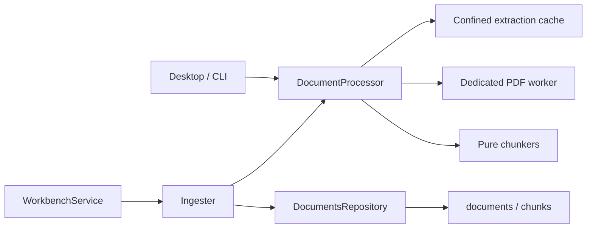

<!--
Copyright (c) 2026 DDP Engineering
This software is licensed under the PolyForm Noncommercial License 1.0.0.
Commercial use requires a separate commercial license.
See the LICENSE.txt in the .agentic folder for full license details.
SPDX-License-Identifier: LicenseRef-PolyForm-Noncommercial-1.0.0
-->

# TASK-69917186 - WP-23 Extraction, chunking, demo documents

stage: done
type: feature
path: full
interaction: autopilot
requirements: REQ-FUNC-e78b18ad, REQ-DATA-3898aa21, REQ-TEST-3ded3b59
parent:
branch: master
base: d41e8ce0c5b921dcf67000ee228d0d7e658bc78c
opened: 2026-10-12

## Done checklist (current stage)

- [x] validated candidate confirmed unchanged
- [x] validation evidence, diff, exclusions, and outcome presented for coordinator handback
- [x] delivery confirmed by human: local ticket commit authorized exclusively to coordinator (RULING-001)
- [x] journal and report included in coordinator's delivery commit
- [x] agreed local commit outcome delivered by coordinator
- [x] close-out carried by coordinator's delivery commit

## Frame

Problem: selected supported documents remain pending without text/chunks.
Desired outcome: all supported kinds extract into precisely located chunks and cached text.
Actors: workbench owner, desktop/CLI worker hosts, ingest subscribers, future search consumers.
Primary scenario: file selected -> owned processor extracts/caches -> atomic chunks/indexed result.
Examples: two PDF pages produce separate page locators; CSV repeats header with10-line overlap.
Counterexamples: scanned PDF becomes needs_ocr; modified/aborted/foreign-owned source cannot publish.
In scope: WP23 extraction/chunking/cache/persistence/host worker composition/demo PDFs and Done fixtures.
Out of scope: WP24 model spike, WP25 FTS creation, WP26 embedding/search, WP27 citations, WP28 viewer; staging/commit/push/PR and human optional-companions.md/profile.
Constraints: STATED master/base as header, autopilot, sole implementer; immutable initial schema; pinned runtime Electron44.7.0/vera://app; verification policy targeted Windows/native Ubuntu plus statics/strict/two independent reviews.
Success signals: each supported extractor/chunker fixture; PDF page confinement, text overlap10, CSV header repeat; scanned-style needs_ocr; real pipeline persist/invalidate/abort/cache proof; three generated demo PDFs.
Evidence: STATED delegation/AGENTS; OBSERVED plan/M3 WP23, architecture05 sections2-3, knowledge-ingest/workbench-storage, DocumentProcessor/WorkbenchService/DocumentsRepository and existing tests.
Assumptions: physical line contract reuses tools/files.ts; empty documents index with zero chunks.
Unknowns: exact embedding tokenizer is selected byWP24; character budget approximates token target until model intake enforces its512 tokens.
Decision-blocking questions: none; downstream tokenizer remains explicit dependency.
Proposed behaviors: linked extraction contract.
Path and reason: full; observable behavior/new interface/dependency/data format yes; existing requirement coverage no. One task, independent review agents only.

## Requirement coverage

| Outcome | Requirement | Design | Verification |
|---|---|---|---|
| extract all supported kinds and precise chunks | REQ-FUNC-e78b18ad | typed extraction/paragraph and line chunkers; PDF worker | fixtures/real PDF and OCR, chunk locators/windows |
| cache and atomically publish owned derived rows | REQ-DATA-3898aa21 | versioned confined atomic cache; processor returns chunks; ingest owns SQL | real FS/SQLite/cache/close/source change/invalidation |
| fictional board PDFs | REQ-TEST-3ded3b59 | pinned dev PDF renderer over Markdown sources | generator fixture extraction/repeatability |

## Design

REQ-FUNC-e78b18ad: core extraction.ts uses exact existing mdast-util-from-markdown2.1.0 and parse5 8.0.1 direct pins; PDF entry imports pdfjs-dist6.4.299 legacy Node build externally. Worker host runs one disposable thread per processing request with deadline/abort termination and no main-thread fallback. Desktop/CLI independently bundle extraction entry beside existing grep entry; host composition supplies processor to WorkbenchService. Pure chunk.ts consumes discriminated extraction objects and returns ordered text/locator/chars data, with1400-char target; arbitrary long lines/paragraphs split with exact physical locators. PDF OCR threshold excludes whitespace. Exact model tokenizer remains downstreamWP24/26 dependency.
REQ-DATA-3898aa21: processor.ts reads confined ordinary input with size/hash/identity check, then validates cache version/kind/hash, extracts on misses, caches under .vera/cache/extract/hash.json via exclusive temp+atomic guarded rename. DocumentInput adds ownership callback; processor never mutates DB. DocumentResult adds chunks. Ingester checks current source then publishes status+chunks in existing mutation transaction; repository clears/replaces derived rows with existing locator_json/chars fields. Cache writes check owner/abort immediately before mutation; no DB schema change. Close abort terminates active worker and drains before ownership release. Cache has no source paths or credentials; obsolete hash entries are content-addressed reusable cache, document invalidation removes SQL derived state.
REQ-TEST-3ded3b59: pdfkit0.20.2 is exact-pinned development-only generation; three repository-owned Markdown sources render into demo docs, deterministic creation dates/IDs. A raster-only scanned-style fixture exercises real getTextContent. Native compiled Electron acceptance extends ingest.spec.ts to confirm worker-derived indexed/OCR/cache/chunks under sandboxed vera://app; focused compiled CLI worker proves same entry without broad CLI suite.
Selection: extractor/chunk fixtures, processor/cache/real SQLite pipeline, existing ingest/workbench/repository and import boundary consumers; compiled worker tests and one native ingest E2E on Windows/native Ubuntu. No verify/full E2E; M3 gate once atWP29. Strict configured statics remain. Risks: redirected cache, processing races, malformed PDF, worker failure; focused failure/abort fixtures. Expected files: core knowledge/{extraction,chunk,processor,pdf-worker,worker-host}, ingest/repository/service type seam, host entries/composition/build/package manifests, fixtures/demo script, targeted tests, knowledge/context and requirements. No independent implementation children.

### Proposed architecture - TASK-69917186

## Log

- 2026-10-12 frame: accepted delegated WP23 scope, full path/autopilot/master/base; sole implementer and human file protection recorded. BMAD renderer missing; explicit user AEGIS governs without administrative bootstrap.
- 2026-10-12 specify: three atomic requirements and shared extraction contract; downstream model-specific token limit explicit dependency rather than guessed tokenizer.
- 2026-10-12 design: inspected processor/lifecycle/SQLite/host/build seams and constrained implementation above; platform-focused selection under verification-policy; proceed build.

- 2026-10-12 build red: REQ-FUNC-e78b18ad/REQ-DATA-3898aa21 command=`python ../02_Tools/npmw.py npx vitest run packages/core/src/knowledge/ingest.test.ts -t "publishes processor chunks"`, exit1; expected missing behavior=processor returns two chunks yet existing ingest publishes zero chunks while indexed.

- 2026-10-12 build red: REQ-TEST-3ded3b59 command=`python ../02_Tools/npmw.py npx vitest run tests/tooling/demo-documents.test.ts`, exit1; expected missing behavior=demo PDF generator absent.

- 2026-10-12 build: focused extraction/demo/persistence increment passed21 tests; real PDF/cache/abort/ownership pipeline passed16; compiled desktop/CLI processors passed2. Native Windows Electron44.7.0 acceptance passed1 and persisted PDF chunks/OCR/cache. Knowledge/context reconciled before independent review; no schema changes. Source-key/cache reads are bounded; line-range counting is linear over split pieces.

- 2026-10-12 validate round1: quality approved; spec changes_required (exact512 budget deferred and heading text path truncated). Both verdicts cleared; DEVIATION validate: return to build for token budget/full heading path and regressions, scope unchanged.

- 2026-10-12 build red round2: command=`python ../02_Tools/npmw.py npx vitest run packages/core/src/knowledge/extraction.test.ts -t "below512|entire long"`, exit1; both expected failures: code chunks exceed actual bundled BGE512 token budget and full long heading prefix omitted. Correction uses existing packaged BGE tokenizer snapshot (no embeddings/model selection), counts special tokens and full heading/header prefix; overflow fails explicitly.

- 2026-10-12 build round2: token-budget correction uses @huggingface/tokenizers0.2.0 (existing locked version) and checksum-verified packaged BGE tokenizer/config snapshots imported locally. Full prefixes preserved and prefix overflow fails; actual special-token-inclusive regression passed; extraction/processor affected proof37pass. No embeddings or model-selection scope. Prior Design tokenizer unknown/truncated text was superseded by this correction; current spec/knowledge reconciled.

- 2026-10-12 validate round2: spec and quality approved unchanged candidate. Native Windows acceptance passed1; native Ubuntu focused94pass. Strict found fixture HTML lacked lang and contained invalid embedded CSS/JS; corrected fixture syntax, preserving ignored hidden text/visible extraction; round3 bound reviews and extraction-only regressions requested. Prior unaffected proof reused under verification-policy.

- 2026-10-12 validate round3: spec_compliance=approved and implementation_quality=approved; independent reviewers confirmed fixture-only correction and affected-check selection, no blocking findings.

- 2026-10-12 validate final: Windows focused90pass/1POSIXskip original + affected57pass/1skip after budget correction + extraction22pass after fixture correction; Ubuntu focused94pass + extraction22pass. Native Electron44.7.0 ingest acceptance1pass each, literal physical execPath/main/exeSHA receipts retained. lint/typecheck/i18n and strict pass on both, zero errors16warnings2notes: 10 historical journal records, DEMO-01 fictional identifier pattern, 5 binary/large-file content scan limits (generated PDFs/local checksum-verified tokenizer), 2 pre-existing manual notes. No accepted candidate failure. SoftwareSHA39f882899c7aa964a3b2ceb4c850d55fa77f21e0f958396eec1a0032cdef8c83; unchanged proof reuse bounded to unaffected files. Full M3 gate remains WP29. Final evolution43 product paths (27added16modified). Ubuntu byte parity335 software files confirmed; own mirror removed after original logs copied. Windows recursive owned tmp removal rejected by automatic approval review (blocked by policy); ignored task scratch retained without bypass; no active task processes. Detailed commands, SHA manifest, reviews and cleanup receipts:02_Tools/cache/wp23-TASK-69917186/.

- 2026-10-12 deliver: candidate unchanged after final proof except journal-only records. Exact candidate53paths (43software10AEGIS;20modified33added); human optional-companions.md excluded, HEAD remains recorded base and index empty. Both bound round3 verdicts approved. Prior validate deviation (budget/full-heading corrections) resolved and re-reviewed; no remaining departure. Handback only; coordinator makes already-authorized local commit and close-out. No remote action.

- 2026-10-12 coordinator delivery: accepted complete53-file candidate, both independent round3 verdicts, explicit Done and original Windows93pass/1POSIXskip, Ubuntu94pass, native1each and static/strict proof; relevant hashes match and unchanged results reused, no tests rerun. Standing human authorization covers one local master commit for WP-23/TASK-69917186 with all three requirement IDs; protected optional-companions.md excluded. Resolved token-budget/heading-path review deviation verified. Journal-only close-out is carried by this delivery commit. Acceptance:02_Tools/cache/wp23-TASK-69917186/coordinator-acceptance.json. No remote publication.

## Rulings

- RULING-001 | date=2026-10-12 | decision=Autopilot on master at recorded base; user authorizes local ticket commit exclusively by coordinator after validated handback; implementer does no staging/commit/push/PR | reason=explicit delegation andAGENTS | source=user | supersedes=none
- RULING-002 | date=2026-10-12 | decision=Focused native Windows/Ubuntu checks plus statics/strict/two independent reviews; fullM3 gate once atWP29 | reason=verification-policy and delegation | source=user | supersedes=none

## Handoff

current: done
status: ready
next: coordinator records delivery SHA in cycle state and starts WP-24
must_read: .agentic/tasks/TASK-69917186.md
blockers: none

## Stage report

stage: deliver
result: completed
current: done
changed: PDF/text extraction, precise chunks/cache, host workers and three demo PDFs
evidence: Windows93pass1POSIXskip/Ubuntu94pass, native1each; original static/strict pass; round3 both approved; no coordinator retesting
issues: 16 advisory warnings2manual notes; automatic review blocked owned Windows tmp cleanup, retained ignored; no implementation blocker
next: coordinator records delivery SHA and starts WP-24
needs_user: no
spec_compliance: approved
implementation_quality: approved
review_round: 3

## Delivery report (2026-10-12)

- stage: deliver; type: feature; path: full; branch: master
- requirements:
  - REQ-FUNC-e78b18ad - Document extraction and precise chunks
  - REQ-DATA-3898aa21 - Owned extraction cache and chunk publication
  - REQ-TEST-3ded3b59 - Fictional board demo PDF generation
- deviations: 1 recorded
  - validate: return to build for token budget/full heading path and regressions, scope unchanged.
- explicit review: enabled; spec_compliance=approved; implementation_quality=approved; review_round=3
- diff vs task base d41e8ce: 54 file(s) changed, 3167 line(s) added; 5 file(s) not content-scanned
- checks: errors=0 warnings=17 notes=2
- checklist: 3/6 done; open: journal and report included in coordinator's delivery commit; agreed local commit outcome delivered by coordinator; close-out carried by coordinator's delivery commit

## Delivery report (2026-10-12)

- stage: deliver; type: feature; path: full; branch: master
- requirements:
  - REQ-FUNC-e78b18ad - Document extraction and precise chunks
  - REQ-DATA-3898aa21 - Owned extraction cache and chunk publication
  - REQ-TEST-3ded3b59 - Fictional board demo PDF generation
- deviations: 1 recorded
  - validate: return to build for token budget/full heading path and regressions, scope unchanged.
- explicit review: enabled; spec_compliance=approved; implementation_quality=approved; review_round=3
- diff vs task base d41e8ce: 54 file(s) changed, 3183 line(s) added; 5 file(s) not content-scanned
- checks: errors=0 warnings=16 notes=2
- checklist: 6/6 done
