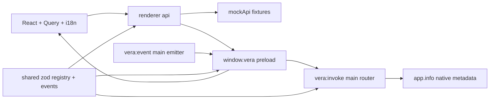

# TASK-6f2bf9df - WP-02 Shared contracts and the typed IPC bridge

stage: done
type: feature
path: full
interaction: autopilot
requirements: REQ-FUNC-17dfdd16, REQ-SEC-744eb0a2, REQ-FUNC-f3dfc04e, REQ-REL-477c1921, REQ-FUNC-c43658e9, REQ-NFR-b8df2592, REQ-UX-6340c035, REQ-TEST-799c278d
parent:
branch: master
base: 7f2a19c8595aa3a1825a063e1071787d6a418cb0
opened: 2026-10-10

## Done checklist (current stage)

- [x] validated candidate confirmed unchanged; otherwise returned to validate
- [x] validation evidence, diff, exclusions, and outcome presented
- [x] delivery confirmed by the human: authorized coordinator local commit
- [x] journal and report included in the delivery commit
- [x] agreed outcome delivered: coordinator verification and local commit carried by this commit
- [x] close-out committed after the outcome succeeded, or carried by the delivery commit where nothing could fail after it

## Frame

Problem: OBSERVED: isolated WP-01 shell exposes no page-world API and shared entrypoint is empty (05_Software/apps/desktop/src/preload/index.ts, packages/shared/src/index.ts).
Desired outcome: STATED: issue #2/M0 WP-02 typed validated renderer/main boundary, browser mock, metadata home.
Actors: desktop user, browser mock user, renderer, preload, main handlers, test harness.
Primary scenario: launch -> renderer query invokes app.info -> main validates sender/request/response -> metadata visible.
Examples: STATED: invalid request INVALID; malformed response INTERNAL plus log; displayed version equals main app.info.
Counterexamples: foreign window/frame and unknown channel cannot dispatch; thrown unknown error cannot leak text or crash.
In scope: zod registry and error/result schemas; AppEvent settings.changed; router/emitter/generic 50ms coalescing; app subscription lifecycle; preload; renderer API/mock, Query, minimal English i18n per L9; tests and affected docs.
Out of scope: WP-03 settings/data/logging services; full locales/UI WP-04; future workbench/session/agent schemas and replay; real models; branch/worktree, issue edits/publication, this chat's commit.
Constraints: STATED: master, autopilot, vera://app CSP, sandboxed .cjs, exact pins, @vera boundaries, recorded base and entire uncommitted candidate including authorized AGENTS.md.
Success signals: unknown/invalid/foreign rejection; INTERNAL logged; typed no-Node bridge; subscription cleanup/coalescing; Windows/Ubuntu verify/e2e; browser mock same home.
Evidence: STATED: delegation, tea issue #2; OBSERVED: HEAD 7f2a19c, no open WP-02 task, AGENTS.md only dirty, WP-01 journal, architecture 01/06/08 and ADR-0010; INFERRED: result envelope preserves VeraError across Electron's Error serialization; UNKNOWN: future settings and session payloads.
Assumptions: settings.changed invalidates without settings data; app-only subscription until future schemas exist; generic coalescer supplies delta batching seam without future services.
Unknowns: future payloads out of scope.
Decision-blocking questions: none.
Proposed behaviors: validated invoke/secure dispatch/safe errors/event lifecycle/batching/metadata and mock parity.
Path and reason: full. Quick-path criteria: no new behavior=no; no new interface=no; no new dependency=no; existing requirement coverage=no; no security changes=no. No children: coupled boundary.

## Requirement coverage

| Frame outcome | Atomic behavior | Requirement | Positive case | Boundary or failure | Verification | Design decision or no impact |
|---|---|---|---|---|---|---|
| Schema contracts | Typed channel metadata | REQ-FUNC-17dfdd16 | app.info {} -> full metadata | unknown channel at compile time; missing fields | bridge.test.ts; ipc-router.test.ts | const registry/zod-derived types |
| Sender trust | Authorize before dispatch | REQ-SEC-744eb0a2 | own live main frame + exact URL | foreign/null/child/destroyed/detached frame | ipc-router.test.ts; shell.spec.ts | live target/frame identity and exact URL |
| Request validation | Parse before dispatch | REQ-FUNC-f3dfc04e | strict empty object | prototype/unknown name NOT_FOUND; malformed payload INVALID | ipc-router.test.ts | hasOwn plus strict schema |
| Safe failures | Structured rejected invoke | REQ-REL-477c1921 | known BUSY passes fields | invalid result/unknown/native exception INTERNAL with safe log | ipc-router/bridge/ipc tests; shell.spec.ts | result envelope and plain VeraError |
| App events | Subscription delivery and cleanup | REQ-FUNC-c43658e9 | settings.changed envelope -> event-only callback | invalid topic/id/seq/event ignored; independent/idempotent unsubscribe | events/bridge/mockApi/ipc tests; shell.spec.ts | validated app envelope and per-registration listener |
| Delta batching | 50ms keyed merge and lifecycle | REQ-NFR-b8df2592 | text concat/latest updates at 50ms in insertion order | 49ms no emit; isolate keys; flush before terminal; cancel dispose | events.test.ts | generic key/merge/emit and single timer |
| Metadata home | Query/API/translated display | REQ-UX-6340c035 | all six app.info fields visible | loading and translated structured failure | shell.spec.ts; mock.spec.ts | API client + Query + English i18next source |
| Mock browser | Same interface and renderer entrypoint | REQ-TEST-799c278d | VITE_API=mock browser metadata fixture | invalid fixture rejected; event cleanup; no Node/Electron globals | mock.spec.ts; mockApi.test.ts | compile-time one API binding and in-memory fixture |

## Design

Requirements coverage: registry/schema decisions REQ-FUNC-17dfdd16; authorization REQ-SEC-744eb0a2; request checks REQ-FUNC-f3dfc04e; structured safe result REQ-REL-477c1921; app envelope/lifecycle REQ-FUNC-c43658e9; generic clock batching REQ-NFR-b8df2592; Query/i18n metadata REQ-UX-6340c035; fixture bridge and dev-only binding REQ-TEST-799c278d. Exact contract is specs/REQ-FUNC-17dfdd16.md.
Responsibilities: shared owns zod/types; main owns trust/dispatch/native metadata/emission; preload owns bounded transport and validated callbacks; renderer api owns real/mock choice; React owns Query and translation. No core service implementation.
Execution: one router installed before window content loads; captures current window and its selected URL. Async handlers produce result envelope. Preload validates request/result, rejects plain VeraError, catches native transport errors safely. Renderer boundary validates bridge results too.
State/lifecycle: subscription-local listener and idempotent cleanup; main target resolved live; generic coalescer timer canceled on dispose. No persisted formats/migrations. app invalidation needs no subscription IPC or replay.
Security: own live WebContents and exact main-frame identity/URL; explicit hasOwn registry lookup avoids prototype channels; no raw failures in logs; renderer receives only metadata/events/safe errors. Bundle zod/shared in sandboxed preload to avoid unsupported require.
Concurrency: async invoke independent; one 50ms timer per coalescer; ordered keys; flush before terminal; no invented session ordering.
Compatibility: existing shell/CSP/cjs and package names retained. Add zod 4.6.5, TanStack Query 5.104.1, i18next 26.4.3/react-i18next 17.0.16 exact pins confirmed by npm registry. Shared runtime dependency remains zod only.
Test seams: router structural fake frame/handler/logger; preload fake IPC; event targets/fake timer; real Electron plain object rejection and lifecycle; standalone browser actual dev:renderer.
Alternatives: throwing Error from ipcMain loses structured fields per Electron docs; choose result envelope. Generic coalescer avoids premature session schemas; only implemented app subscribe overload exposed.
Expected files: shared src/{index,ipc,events}.ts and package.json; main {ipc-router,events,app-info}.ts/tests,index.ts; preload {bridge,index}.ts/test; renderer api/{client,index,ipc}.ts,mocks/{mockApi,fixtures}.ts/test,i18n.ts,locales/en.json,vera.d.ts,App.tsx,main.tsx; desktop renderer config/vite config/tsconfigs/vitest/package; root package/lock/vitest and e2e mock/shell; README and .agentic knowledge/context; authorized AGENTS.md.
Risks: actual contextBridge Error semantics require e2e proof; sandbox preload dependencies must bundle; OS-specific npm/Xvfb use established WSL mirror. Open decisions: none.
Sources: https://www.electronjs.org/docs/latest/api/ipc-main and context-bridge; https://zod.dev/basics; https://tanstack.com/query/latest/docs/framework/react/reference/QueryClientProvider.

### Proposed architecture - TASK-6f2bf9df

## Log

- 2026-10-10 frame: full path; delegated issue #2 scope accepted under authorized autopilot; master exception and base recorded; Windows setup --check exit=0.

- 2026-10-10 specify: eight draft requirements created, zero reused/revised/retired; coverage includes positive/failure/lifecycle observations; wire specification resolves first-channel shapes without future services.

- 2026-10-10 design: audited registry/result/event/metadata boundaries and lifecycle against eight requirements; exact wire contract and expected paths in Design/spec. Official Electron serialization docs support result envelope. No blocker.

- 2026-10-10 build red: REQ-FUNC-17dfdd16, REQ-SEC-744eb0a2, REQ-FUNC-f3dfc04e, REQ-REL-477c1921; command=`python ../02_Tools/npmw.py npx vitest run --project desktop src/main/ipc-router.test.ts` in 05_Software; exit=1; expected missing behavior=validated router absent, existence assertion fails before import; anchor recorded before implementation.

- 2026-10-10 build green: router focused Vitest exit=0, 14 cases; typecheck exit=0; request, frame, result and safe-error coverage complete.
- 2026-10-10 build red: REQ-FUNC-c43658e9, REQ-NFR-b8df2592 and preload part REQ-REL-477c1921; command=`python ../02_Tools/npmw.py npx vitest run --project desktop src/preload/bridge.test.ts src/main/events.test.ts`; exit=1; expected missing behavior=bridge/emitter/coalescer absent, assertions fail before imports.

- 2026-10-10 build green: event/bridge focused Vitest exit=0, seven cases; registry/preload generic typecheck corrected and now exits 0.
- 2026-10-10 build red: REQ-TEST-799c278d; command=`python ../02_Tools/npmw.py npx vitest run --project desktop src/renderer/mocks/mockApi.test.ts`; exit=1; expected missing behavior=in-memory renderer mock boundary absent. Browser runtime prerequisite requires pinned Chromium install before browser acceptance.

- 2026-10-10 build red: REQ-UX-6340c035 and integrated REQ-REL-477c1921; command=`python ../02_Tools/npmw.py npm run build` exit=0 then `npx playwright test e2e/shell.spec.ts -g "built shell"` through npmw; exit=1; expected missing behavior=home.version element absent from the WP-01 identity screen.

- 2026-10-10 build green: metadata/native bridge Windows test:e2e exit=0, initial five cases; final focused browser/error and real subscription/foreign-window acceptance exit=0; renderer API/mock unit tests three cases and typecheck exit=0. Actual contextBridge preserves plain VeraError fields; no Node/Electron page API. Generic delta tests verify 49/50ms, insertion order, concatenation/latest update, terminal flush and cancellation.
- 2026-10-10 build reconciliation: source-only dev renderer reuses electron-vite renderer configuration through scripts/dev-renderer.mjs rather than a duplicated Vite config; expected package paths reconciled. First full-candidate evolution reviewed; only planned boundary/API/test files plus authorized AGENTS.md. Advance to validate for docs, independent verdict axes and final proof.

- 2026-10-10 validate semantic finding: detached native frame can throw during URL inspection; return to build to treat this trust-boundary race as DENIED. Add missing-field response and explicit compile-time invalid-call observations promised by registry verification. Final review verdicts not yet issued.
- 2026-10-10 build red: REQ-SEC-744eb0a2; command=`python ../02_Tools/npmw.py npx vitest run --project desktop src/main/ipc-router.test.ts -t detached`; exit=1; expected missing behavior=disposed-frame URL accessor rejects with native Error instead of DENIED.

- 2026-10-10 build correction green: focused router/preload Vitest exit=0, 20 tests; typecheck exit=0. Detached native frame now resolves DENIED before dispatch; missing response fields map to logged INTERNAL; ts-expect-error assertions prove invalid request/channel calls fail compilation. Return to validate.

- 2026-10-10 validate reconciliation: reviewed all source and tests against base and eight active requirements; knowledge/context/README now describe actual IPC, metadata and browser setup. Proposed and current diagrams agree; session/workbench service exclusions remain explicit. Review will cover the final candidate including authorized AGENTS.md.

- 2026-10-10 validate explicit review round 1: specification compliance=approved after a complete scope/requirement/spec/design pass; implementation quality=approved after a separate correctness/error/security/lifecycle/portability/test pass on the same final candidate. Both axes are agent-authored independent evaluations, not external reviewers. No outstanding findings; final runtime proof pending. All 8 requirements active; original WP-01 contracts retained.
- 2026-10-10 validate inspection: default renderer output contains no mockAppInfo/createMockApi/version fixture identifier; sandbox preload contains only Electron require, with shared/zod bundled. Exact dependency manifests agree with lock; no import-boundary configuration changed.

- 2026-10-10 validate round 1 follow-up: Windows strict --run exit=0 was superseded before handoff by fresh-setup inspection. Hiding generated shared/dist/index.js makes npm run build fail resolving @vera/shared. Return to build for source resolution in all Vite modes and direct Vitest; clear both verdicts and re-review round 2. Ubuntu readiness reports newer copied lock mtime, so npm ci must follow the final sync; no Linux verification claimed yet.
- 2026-10-10 build red: REQ-FUNC-17dfdd16 and REQ-TEST-799c278d readiness; command=`npm run build` via npmw with only generated shared/dist/index.js temporarily renamed and restored in finally; exit=1; missing behavior=build requires previously compiled shared entrypoint. Add the same fresh-entry precondition to emitted-build regression.

- 2026-10-10 build red regression: command=`python ../02_Tools/npmw.py npx vitest run --project tooling tests/tooling/build-mode.test.ts`; exit=1; emitted-build test now hides/restores the generated shared entrypoint and confirms unresolved @vera/shared on the old configuration.

- 2026-10-10 build correction green: emitted-build regression exit=0 with generated shared entry hidden for both VERA_TEST values; mock browser acceptance exit=0 with that entry hidden during dev:renderer startup. Vite main/preload/renderer and desktop Vitest resolve @vera/shared source, while package exports retain compiled library output. Typecheck exits 0. Return to validate for round 2 and fresh final proof.

- 2026-10-10 validate explicit review round 2: specification compliance=approved after re-reading all scope/requirements/wire contract and retained WP-01 behaviors; implementation quality=approved after a separate complete candidate pass including native-frame race, clean-setup source loading, error/event lifecycle, parallel test safety and Windows/Linux paths. Both agent-authored axes apply to the same current candidate; no outstanding findings. Source aliases and fresh-entry regression are documented; final proof must supersede the earlier round-1 proof.

- 2026-10-10 validate round 2 platform finding: Windows strict --run exit=0, but Ubuntu npm verify exit=1 at tsc -b because tsconfig.tools lacks the new shared dependency and reads stale WP-01 VeraBridge declarations before shared rebuild. Return to build for the explicit TypeScript project reference; clear both verdicts. Ubuntu npm ci/readiness/lint pass; no Ubuntu suite/e2e success claimed.
- 2026-10-10 build red: REQ-FUNC-17dfdd16 dependency readiness; command=`python3 ../02_Tools/npmw.py npm run verify` on Ubuntu mirror; exit=1; expected missing behavior=e2e tooling has no exported VeraBridge from preexisting shared output due missing project reference.

- 2026-10-10 build correction green: Windows `npm run typecheck -- --force` via npmw exit=0 with shared/dist/index.d.ts hidden before execution; tools now declares its shared project reference and recreates declarations before compiling e2e consumers. This is a dependency-order correction; no behavior/test weakened. Return to validate and re-review round 3.

- 2026-10-10 validate explicit review round 3: specification compliance=approved on the complete base-relative candidate and all eight active requirements; implementation quality=approved in a separate pass including tools/shared topological compilation and unchanged source/transport/security/lifecycle tests. Both agent-authored current verdicts replace prior rounds; no outstanding findings or accepted weakened verification. Final proof follows.

- 2026-10-10 validate final proof: Windows `python .agentic/aegis.py check --task TASK-6f2bf9df --strict --run` exit=0; configured test and verify pass, 49 unit tests across 9 files; AEGIS errors=0/warnings=0/notes=0. Windows `python ../02_Tools/npmw.py npm run test:e2e` in 05_Software exit=0, 6 passed (20.8s), build included. Ubuntu 24.04.4 LTS under WSL2, existing source mirror `/home/dpasare/.cache/vera-wp01-linux-TASK-773bec2f`, separate pinned Node 24.21 dependencies: `python3 ../02_Tools/setup.py --check`, `python3 ../02_Tools/npmw.py npm run typecheck -- --force`, `python3 ../02_Tools/npmw.py npm run verify`, and `python3 ../02_Tools/npmw.py npm run test:e2e` all exit=0; 49 unit tests/9 files and 6 e2e passed (39.8s). Native system Xvfb with empty LD_LIBRARY_PATH and chromiumSandbox=true; no extracted-library adapter. Exact Windows/Linux non-AEGIS source mirror: 279 files, SHA-256 aggregate `18e116cf35a80714e377cdd3d1e192f227bc1398856585cdd6e0ace6babbee0d`. No candidate source/test/spec/requirement/knowledge edits after this proof.
- 2026-10-10 validate visual/manual inspection: desktop and standalone mock screenshots show the centered metadata card, all six readable label/value pairs and no clipped content. Browser fixture and native metadata differ as intended; production mock exclusion, sandbox preload bundle and real foreign-window rejection already verified. Final evolution reviewed: 37 anchor-relative paths (20 added/17 modified); complete base-relative candidate 53 paths including the preexisting authorized AGENTS.md change. `git diff --check` exit=0; branch master and HEAD unchanged from base. Review round 3: both agent-authored independent evaluation axes approved, no unresolved findings, no accepted deviations or weakened checks. Only harmless upstream zod Rollup annotation and Windows color-environment messages remain; no preexisting test failures.
- 2026-10-10 deliver handback: validated candidate unchanged; only journal delivery records follow proof. User authorization for coordinator local commit remains recorded in RULING-001; delegated instruction explicitly requires this chat to hand back without committing. Complete 53-path candidate inventory below is the intended local commit scope. No children, commit, staging, push, PR, issue change or other publication. Leave stage deliver until the coordinator verifies and records the authorized commit; do not claim completed delivery. Portable data/settings/logging and full locale work remain WP-03/WP-04; Linux packaging is outside WP-02 validation.

- 2026-10-10 deliver report-time advisory: report appended and read; check exit=0 with errors=0/warnings=1/notes=0. Sole warning `unticked-deliver` is expected because the coordinator commit and close-out remain pending under the delegated handback contract. It does not supersede the successful zero-finding strict validation proof. No candidate edits.

- 2026-10-10 coordinator validation: reviewed the entire journal, all eight active requirements, specification, WP-02 Done when, affected knowledge/context, and the complete 53-path staged/unstaged/untracked base-relative candidate. Separate specification-compliance and implementation-quality evaluations confirm both round-3 verdicts approved on the unchanged candidate; scope, import boundaries, safe errors, renderer trust and WP-01 vera://app/sandbox baseline agree. Windows `python .agentic/aegis.py check --task TASK-6f2bf9df --strict --run` exit=0 (configured test 15.4s, verify 20.5s; sole unticked-deliver advisory while coordinator commit pending); `npm run test:e2e` via npmw exit=0, six passed (17.8s). Ubuntu exact 279-file source digest comparison passed; setup --check, forced typecheck and verify exit=0, 49 tests/9 files; native-Xvfb test:e2e exit=0, six passed (12.2s), with empty LD_LIBRARY_PATH. Coordinator inspected both new Windows desktop/browser screenshots: six legible metadata rows, no clipping; inspected production bundle: mock implementation excluded. `git diff --check` exit=0 and all 53 content digests unchanged after proof. Runtime logs: ignored 02_Tools/cache/wp02-coordinator-{windows-strict,windows-e2e,ubuntu,ubuntu-e2e}.log. No unresolved finding, deviation, weakened verification or preexisting failure. Harmless upstream zod annotation and Windows color warnings remain.

- 2026-10-10 deliver close-out: the user-authorized outcome is one repository-local commit only. Coordinator verification is complete; all 53 intended paths, including the journal/report and explicitly authorized AGENTS.md, are included with no exclusions or children. Close-out is recorded before committing to be carried by that same local delivery commit as required by stage 6; no push, PR or Gitea mutation. If the commit command fails, restore stage deliver and record the failure.

- 2026-10-10 delivery deferred before commit: complete staged diff check found an extra trailing blank line in each of the eight new requirement files, which unstaged diff --check had not included. Return to validate, normalize only EOF whitespace, and review both axes on the corrected candidate; runtime source and existing Windows/Ubuntu e2e proof unchanged. No commit was invoked. Coordinator journal Handoff status corrected to the defined ready value.
- 2026-10-10 validate explicit review round 4: specification compliance=approved after checking all eight normalized requirements and unchanged scope/spec/design; implementation quality=approved after a separate complete-candidate pass confirming only EOF whitespace changes and unchanged production/tests/knowledge. No outstanding findings. Fresh strict configured proof follows; prior runtime e2e remains applicable to identical source.

- 2026-10-10 validate refreshed final proof: after the eight requirement-only EOF formatting corrections, Windows `python .agentic/aegis.py check --task TASK-6f2bf9df --strict --run` exit=0; configured test 14.7s and verify 17.4s, errors=0/warnings=0/notes=0. Both current round-4 reviews approved. Production, tests, specs and knowledge unchanged from coordinator Windows/Ubuntu 49-unit/6-e2e proof; no runtime rerun needed for the requirement whitespace-only change. Advance to deliver; authorized one-commit local outcome and complete 53-path scope remain unchanged.

- 2026-10-10 deliver final close-out: coordinator verification and round-4 final strict proof completed; prior whitespace finding corrected. The authorized local commit is the sole delivery outcome. This commit carries all 53 inventoried paths, journal/report and close-out; no exclusions, child tasks or remote actions.

## Rulings

- RULING-001 | date=2026-10-10 | decision=autopilot on master; include authorized AGENTS.md; hand back without commit; coordinating chat makes authorized local commit after verification; no remote or issue changes | reason=delegated user instruction and AGENTS.md cycle | source=user | supersedes=none
- RULING-002 | date=2026-10-10 | decision=use native AEGIS artifacts only | reason=bmad-build renderer and sibling setup skill absent; authorized user requires finishing without duplicate workflow | source=technical | supersedes=none

## Candidate inventory

Base: `7f2a19c8595aa3a1825a063e1071787d6a418cb0`. Complete uncommitted candidate: 53 paths (21 tracked modifications and 32 new files), including the authorized preexisting `AGENTS.md`. No exclusions from the candidate.

- `.agentic/context/environment.md`
- `.agentic/context/project.md`
- `.agentic/knowledge/desktop-shell.md`
- `.agentic/knowledge/ipc-boundary.md`
- `.agentic/knowledge/software-tooling.md`
- `.agentic/requirements/functional/REQ-FUNC-17dfdd16.toml`
- `.agentic/requirements/functional/REQ-FUNC-c43658e9.toml`
- `.agentic/requirements/functional/REQ-FUNC-f3dfc04e.toml`
- `.agentic/requirements/nfr/REQ-NFR-b8df2592.toml`
- `.agentic/requirements/reliability/REQ-REL-477c1921.toml`
- `.agentic/requirements/security/REQ-SEC-744eb0a2.toml`
- `.agentic/requirements/test/REQ-TEST-799c278d.toml`
- `.agentic/requirements/ux/REQ-UX-6340c035.toml`
- `.agentic/specs/REQ-FUNC-17dfdd16.md`
- `.agentic/tasks/TASK-6f2bf9df.md`
- `05_Software/README.md`
- `05_Software/apps/desktop/electron.vite.config.ts`
- `05_Software/apps/desktop/package.json`
- `05_Software/apps/desktop/src/main/app-info.ts`
- `05_Software/apps/desktop/src/main/events.test.ts`
- `05_Software/apps/desktop/src/main/events.ts`
- `05_Software/apps/desktop/src/main/index.ts`
- `05_Software/apps/desktop/src/main/ipc-router.test.ts`
- `05_Software/apps/desktop/src/main/ipc-router.ts`
- `05_Software/apps/desktop/src/preload/bridge.test.ts`
- `05_Software/apps/desktop/src/preload/bridge.ts`
- `05_Software/apps/desktop/src/preload/index.ts`
- `05_Software/apps/desktop/src/renderer/App.tsx`
- `05_Software/apps/desktop/src/renderer/api/client.ts`
- `05_Software/apps/desktop/src/renderer/api/index.ts`
- `05_Software/apps/desktop/src/renderer/api/ipc.test.ts`
- `05_Software/apps/desktop/src/renderer/api/ipc.ts`
- `05_Software/apps/desktop/src/renderer/i18n.ts`
- `05_Software/apps/desktop/src/renderer/locales/en.json`
- `05_Software/apps/desktop/src/renderer/main.tsx`
- `05_Software/apps/desktop/src/renderer/mocks/fixtures.ts`
- `05_Software/apps/desktop/src/renderer/mocks/mockApi.test.ts`
- `05_Software/apps/desktop/src/renderer/mocks/mockApi.ts`
- `05_Software/apps/desktop/src/renderer/vera.d.ts`
- `05_Software/apps/desktop/tsconfig.renderer.json`
- `05_Software/apps/desktop/vitest.config.ts`
- `05_Software/e2e/mock.spec.ts`
- `05_Software/e2e/shell.spec.ts`
- `05_Software/package-lock.json`
- `05_Software/package.json`
- `05_Software/packages/shared/package.json`
- `05_Software/packages/shared/src/events.ts`
- `05_Software/packages/shared/src/index.ts`
- `05_Software/packages/shared/src/ipc.ts`
- `05_Software/scripts/dev-renderer.mjs`
- `05_Software/tests/tooling/build-mode.test.ts`
- `05_Software/tsconfig.tools.json`
- `AGENTS.md`

## Handoff

current: done
status: ready
next: none; coordinator records commit SHA in cycle state and starts WP-03
must_read: .agentic/tasks/TASK-6f2bf9df.md, .agentic/steps/5_validate.md
blockers: none

## Stage report

stage: deliver
result: completed
current: done
changed: Typed IPC, events/coalescing, metadata and browser mock; reviewed 53-path scope
evidence: Coordinator final strict --run exit 0, zero findings; Windows/Ubuntu 49 unit and 6 e2e per OS passed; exact 279-file source match and visual review
issues: No unresolved findings or deviations; harmless upstream zod annotation and Windows color warnings
next: local delivery complete; coordinator records commit and starts WP-03
needs_user: no
spec_compliance: approved
implementation_quality: approved
review_round: 4

## Delivery report (2026-10-10)

- stage: deliver; type: feature; path: full; branch: master
- requirements:
  - REQ-FUNC-17dfdd16 - Typed IPC channel contracts
  - REQ-SEC-744eb0a2 - Authorize the renderer sender frame
  - REQ-FUNC-f3dfc04e - Validate invocation requests
  - REQ-REL-477c1921 - Return safe IPC failures
  - REQ-FUNC-c43658e9 - Typed application event subscriptions
  - REQ-NFR-b8df2592 - Coalesce event deltas every 50ms
  - REQ-UX-6340c035 - Display application metadata through the API boundary
  - REQ-TEST-799c278d - Browser mock renderer parity
- deviations: none recorded
- explicit review: enabled; spec_compliance=approved; implementation_quality=approved; review_round=3
- diff vs task base 7f2a19c: 53 file(s) changed, 1793 line(s) added
- checks: errors=0 warnings=1 notes=0
- checklist: 3/6 done; open: journal and report included in the delivery commit; agreed outcome delivered: coordinator verification and local commit; close-out committed after the outcome succeeded, or carried by the delivery commit where nothing could fail after it

## Delivery report (2026-10-10)

- stage: deliver; type: feature; path: full; branch: master
- requirements:
  - REQ-FUNC-17dfdd16 - Typed IPC channel contracts
  - REQ-SEC-744eb0a2 - Authorize the renderer sender frame
  - REQ-FUNC-f3dfc04e - Validate invocation requests
  - REQ-REL-477c1921 - Return safe IPC failures
  - REQ-FUNC-c43658e9 - Typed application event subscriptions
  - REQ-NFR-b8df2592 - Coalesce event deltas every 50ms
  - REQ-UX-6340c035 - Display application metadata through the API boundary
  - REQ-TEST-799c278d - Browser mock renderer parity
- deviations: none recorded
- explicit review: enabled; spec_compliance=approved; implementation_quality=approved; review_round=3
- diff vs task base 7f2a19c: 53 file(s) changed, 1815 line(s) added
- checks: errors=0 warnings=1 notes=0
- checklist: 5/6 done; open: close-out committed after the outcome succeeded, or carried by the delivery commit where nothing could fail after it

## Delivery report (2026-10-10)

- stage: deliver; type: feature; path: full; branch: master
- requirements:
  - REQ-FUNC-17dfdd16 - Typed IPC channel contracts
  - REQ-SEC-744eb0a2 - Authorize the renderer sender frame
  - REQ-FUNC-f3dfc04e - Validate invocation requests
  - REQ-REL-477c1921 - Return safe IPC failures
  - REQ-FUNC-c43658e9 - Typed application event subscriptions
  - REQ-NFR-b8df2592 - Coalesce event deltas every 50ms
  - REQ-UX-6340c035 - Display application metadata through the API boundary
  - REQ-TEST-799c278d - Browser mock renderer parity
- deviations: none recorded
- explicit review: enabled; spec_compliance=approved; implementation_quality=approved; review_round=4
- diff vs task base 7f2a19c: 53 file(s) changed, 1832 line(s) added
- checks: errors=0 warnings=1 notes=0
- checklist: 5/6 done; open: close-out committed after the outcome succeeded, or carried by the delivery commit where nothing could fail after it
