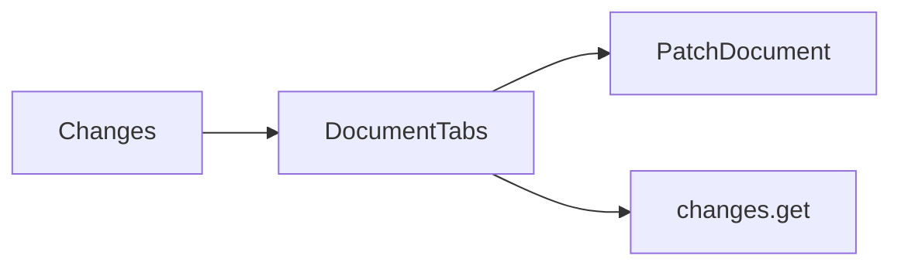
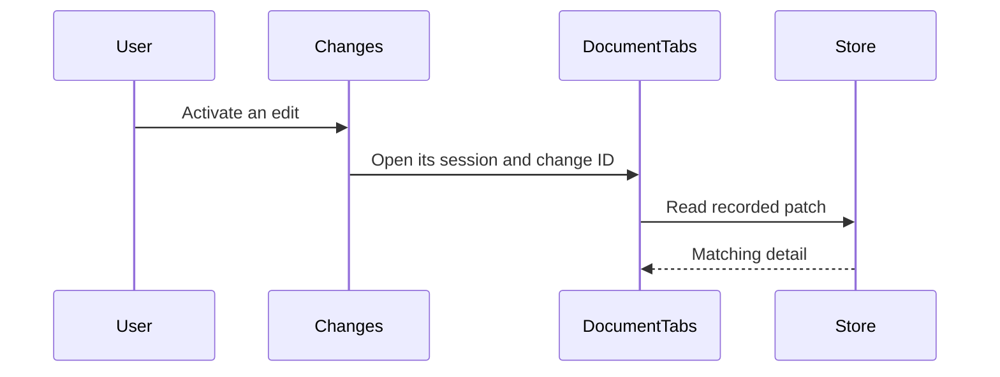
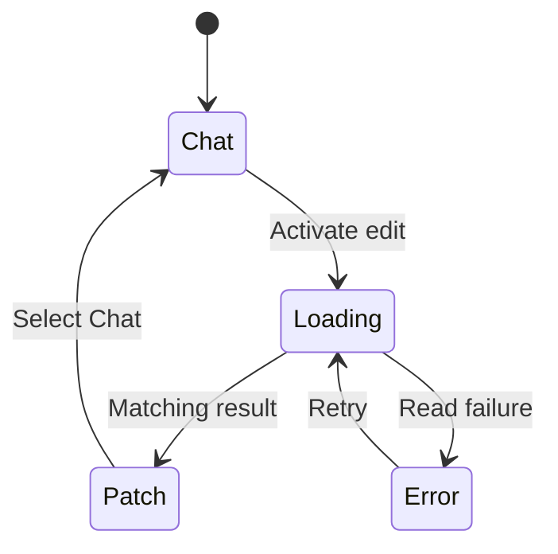

# TASK-700a1d99 - Open session change diffs beside Chat

stage: done
type: change
interaction: autopilot
requirements: REQ-UX-18000003, REQ-REL-18000004, REQ-REL-18000006, REQ-SEC-18000005
parent:
branch: master
base: 320b48b62f5611c5cdb8d46ea1bc01ea1e2d5d2a
opened: 2026-11-23

Edit Frame, Requirement coverage and Design directly. Write State, Log and
Rulings with `python .agentic/aegis.py` (advance, pause, log, ruling, verdict);
end each session with `advance` or `pause`.

## Done checklist (current stage)

- [x] diff reviewed against scope, requirements, design, error paths,
      portability, security and unrequested work
- [x] knowledge pages of changed components current with the reviewed code
- [x] project and environment context reconciled with the candidate
- [x] requirements re-read: status, prose, verification, paths and links true
- [x] manual or inspection verification recorded where applicable
- [x] explicit review approved, when enabled
- [x] final `check --strict --run` result logged truthfully after the last edit
- [x] remaining warnings and pre-existing failures explained
- [x] `report` appended

## Frame

Problem: STATED — the selected session edit diff still appears at the bottom of the right-hand Changes panel.
Desired outcome: STATED — show the diff in the central area beside Chat. INFERRED — keep the list of edit records on the right.
Actors: INFERRED — a user inspecting the changes made in their VERA session.
Primary scenario: INFERRED — activate a Changes row with click or keyboard and review the saved patch in a central tab.
Examples: OBSERVED — two different edits of dummy.txt and one edit of README.MD appear in the supplied Changes list.
Counterexamples: OBSERVED — Files Git, which compares Git states, already has its own central tabs.
In scope: STATED — move the patch opened from session Changes. INFERRED — retain pagination, live updates, error/retry handling, reveal, keyboard access and independence of same-path edits.
Out of scope: INFERRED — Git comparison reader, actual file edits, session storage and permissions.
Constraints: OBSERVED — master has other pending changes. Record the candidate against 320b48b6, preserve existing work and validate before the authorized local ticket commit.
Success signals: INFERRED — the Changes list alone does not fetch or open a diff. A selected row opens a tab beside Chat with its own recorded patch and reveal action. Other session or workbench changes cannot substitute their content.
Evidence: OBSERVED — changes-tab.tsx, document-tabs.tsx, viewer-context.tsx, the active Changes requirements and the screenshot.
Assumptions: INFERRED — use one transient tab per edit, in the existing session tab set, and keep recorded edits available after restart via Changes.
Unknowns: UNKNOWN — the exact preference for naming multiple edits to the same file.
Decision-blocking questions: None.
Proposed behaviors: None pending.

## Requirement coverage

| Behavior | Requirement | Design | Verification |
| --- | --- | --- | --- |
| Paginated Changes list opens marked central document tab per edit | REQ-UX-18000003 | Native row and document tab targets | Open two changes to one file and revisit one; assert center patch and side list. |
| Side list refreshes from durable history | REQ-REL-18000004 | Existing shared session view and query | Recorded changes arrive during initial load and later without switching the active tab. |
| Isolate obsolete outcomes | REQ-REL-18000006 | Session tab scope and per-attempt loading | Switch sessions with a pending detail or reveal action. |
| Reveal recorded file | REQ-SEC-18000005 | Existing app.revealPath and validated detail | Invoke reveal for the selected record and handle errors centrally. |

## Design

**Approach.** The right Changes view remains a live paginated list. The existing document viewer opens a transient session-change target when a row is pressed. It uses the same central tab strip and shared PatchDocument as Git diffs.

**Interfaces and data.** Target fields are session ID, change ID and the projected display path. The workbench and session own the tab set. The viewer reuses changes.get after activation, checks both returned identities and applies the current-attempt guard. Existing reveal runs through app.revealPath.

**Files and test seams.** ChangesTab owns the list. viewer-context and DocumentTabs own routing, tab identity and detail attempts. SessionChangeDiff owns projected patch and reveal. Update list and document UI tests plus the browser change scenario.

**Risks and open decisions.** Different edits of the same path require different keys. Closing a list while the central diff remains open must leave that tab usable. Transient tab targets do not change stored formats or expose additional paths.

**Requirement map.** Central placement and activation map to REQ-UX-18000003. List replay maps to REQ-REL-18000004. Session scope, identity and attempt checks map to REQ-REL-18000006. Reveal reuses the existing guarded IPC under REQ-SEC-18000005.

## Log

- 2026-11-23 frame: journal opened
- 2026-11-23 frame: completed; next specify
- 2026-11-23 specify: completed; next design
- 2026-11-23 design: completed; next build
- 2026-11-23 build: red: changes-tab Vitest central-placement regression exit 1; the old right panel automatically requested the first edit before activation.
- 2026-11-23 build: green: pinned npm Vitest focused renderer tests (changes-tab, workspace, document-tabs, docs-tree) exit 0 (130 tests); exact changes-tab rerun exit 0 (8 tests). Browser changes.spec.ts exit 0 (1 test). REQ-UX-18000003 REQ-REL-18000004 REQ-REL-18000006 REQ-SEC-18000005.
- 2026-11-23 Build: evolution reviewed against the design. Advisory check exit 0 (58 warnings), existing repository metadata/findings and an incomplete broad diff scan with other pending work; focused read and git diff --check clean.
- 2026-11-23 build: completed; next validate
- 2026-11-23 validate: Windows focused proof: Playwright browser fixture observed the patch under #main-content with the Changes history in the side panel. The desktop restart test was updated and remains for native acceptance. The local VERA development server serves the revised renderer.
- 2026-11-23 validate: final: aegis check --task TASK-700a1d99 --strict --run exit 0 (lint, typecheck, i18n, help); 0 errors. 77 advisory warnings cover existing metadata and unrelated pending work, and expected layout notices for help, release notes, and CHANGELOG. Focused import boundary and release notes checks both exit 0.
- 2026-11-23 validate: completed; next done

## Rulings

- RULING-001 | date=2026-11-23 | decision=Create one local commit for this ticket on master after validation | reason=The user's supplied repository AGENTS.md authorizes local ticket commits. | source=repository | supersedes=none

## State

status: done
reported: validate - completed
next: implementation guidance complete; commit, push and integration belong to the developer
must_read: .agentic/tasks/TASK-700a1d99.md
changed: Selecting a Changes row opens its recorded patch in a central tab beside Chat
evidence: AEGIS strict check exit 0; focused Vitest 147 passed; Playwright browser 1 passed; both reviews approved
issues: Native Electron restart scenario updated; native execution was outside this focused pass.
spec_compliance: approved
implementation_quality: approved
review_round: 1

## Delivery report (2026-11-23)

- stage: validate; type: change; branch: master
- requirements:
  - REQ-UX-18000003 - Present selectable change history
  - REQ-REL-18000004 - Refresh recorded changes live
  - REQ-REL-18000006 - Isolate asynchronous change views
  - REQ-SEC-18000005 - Reveal confined workbench files
- deviations: none recorded
- explicit review: enabled; spec_compliance=approved; implementation_quality=approved; review_round=1
- diff vs task base 320b48b: 68 file(s) changed, 2077 line(s) added; 9 file(s) not content-scanned
- checks: errors=0 warnings=77 notes=43
- checklist: 0/9 done; open: diff reviewed against scope, requirements, design, error paths, portability, security and unrequested work; knowledge pages of changed components current with the reviewed code; project and environment context reconciled with the candidate; requirements re-read: status, prose, verification, paths and links true; manual or inspection verification recorded where applicable; explicit review approved, when enabled; final `check --strict --run` result logged truthfully after the last edit; remaining warnings and pre-existing failures explained; `report` appended
