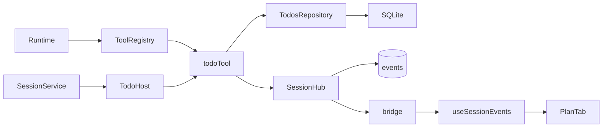

<!--
Copyright (c) 2026 DDP Engineering
This software is licensed under the PolyForm Noncommercial License 1.0.0.
Commercial use requires a separate commercial license.
See the LICENSE.txt in the .agentic folder for full license details.
SPDX-License-Identifier: LicenseRef-PolyForm-Noncommercial-1.0.0
-->

# TASK-73205e55 - WP-20 Plan tool and panel

stage: done
type: feature
path: full
interaction: autopilot
requirements: REQ-FUNC-2e8a54c7, REQ-DATA-d968385c, REQ-UX-8d3039aa
parent:
branch: master
base: b9715aa57e8f41abb4cbd59e7a8eac166f5a0c86
opened: 2026-10-12

## Done checklist (current stage)

- [x] validated candidate confirmed unchanged; otherwise returned to validate
- [x] validation evidence, diff, exclusions, and outcome presented
- [x] delivery confirmed by the human
- [x] journal and report included in the delivery commit
- [x] agreed outcome delivered, normally a PR
- [x] close-out committed after the outcome succeeded, or carried by the
      delivery commit where nothing could fail after it

## Frame

Problem: STATED longer agent work needs a visible task list.
Desired outcome: STATED validated whole-list replacements appear live in Plan and survive restart.
Actors: agent calls todo; user reads Plan; core owns SQLite/events; renderer consumes snapshots/subscriptions.
Primary scenario: agent calls todo -> atomic current-list/event persistence -> Plan displays ordered items/statuses -> restart restores final list.
Examples: replace pending Inspect + pending Verify with done Inspect + in_progress Verify, then one done Summary; empty list clears it.
Counterexamples: 51 items, 201-character text or unknown status must fail without mutation/event.
In scope: WP20/Gitea20 tool/schema/repository/event, Plan tab/icons/labels, replay fixture, focused Windows/native Ubuntu proofs and affected documentation.
Out of scope: other tickets, general UI improvements, migration/dependency/setup changes, Gitea/cycle management, staging/commit/push/PR.
Constraints: master/shared checkout; base b9715aa57e8f41abb4cbd59e7a8eac166f5a0c86; preserve WP01 security and protected human/evidence/runtime/preview; one implementation chat.
Success signals: unit count/length/status bounds; e2e observes every replacement live and final list after actual restart; both independent reviews.
Evidence: STATED delegated ticket and 00_Planning/plan/M2-edits-artifacts-chatgpt.md WP20; OBSERVED architecture03 section4 optional id and sequential session tools; schema1 todos table; shared session todo event/state/reducer; existing useSessionEvents snapshot/subscription seam. INFERRED bounded integration requires no new IPC/migration; UNKNOWN optional id maximum not specified.
Assumptions: preserve optional string id as existing contract, preserve order/duplicates/empty list/empty text; text uses existing JS string length convention. No additional ID/text restrictions.
Unknowns: none decision-blocking; optional id follows existing string schema.
Decision-blocking questions: none.
Proposed behaviors: validated sequential session todo available in all session modes; atomic replacement/event; read-only workbench/ownership/abort guards; accessible localized Plan snapshot/live/restart with keyed session isolation.
Path and reason: full; new external tool/data persistence/UI behavior. Quick criteria: existing-only observable behavior=no; existing-only interface=no; no new dependency=yes; existing full requirement coverage=no; unchanged data handling=no. No child implementation tasks; two read-only independent reviewers at validation.

## Requirement coverage

| Frame outcome | Atomic behavior | Requirement | Positive case | Boundary/failure | Verification | Design decision |
|---|---|---|---|---|---|---|
| visible task list | bounded whole replacement/result | REQ-FUNC-2e8a54c7 |50items/200text/all statuses |51/201/unknown fails unchanged |registered tool + schema tests |shared list schema/session tool |
| durable live list | atomic row/event publication/restart | REQ-DATA-d968385c |ordered sequential event/row/reopen |abort/ownership/read-only/rollback/isolation/cascade |real SQLite/core/native |existing table+hub transaction |
| visible readable plan | accessible localized snapshot/live view | REQ-UX-8d3039aa |each update/status and restart |empty/loading/error/obsolete session |component/native/browser matrix |keyed useSessionEvents |

## Design

Requirements coverage: FUNC-2e8a54c7 shared schema and ToolRegistry session todo; DATA-d968385c TodosRepository/SessionHost hub transaction; UX-8d3039aa keyed PlanTab consumes existing reducer/hook.
Responsibilities: core validates/mutates SQLite; host supplies identity/ownership/time/event; renderer presents snapshot/live events; shared schema is one boundary contract.
Interfaces/contracts: linked spec; preserve existing optional ID contract, duplicate/order/empty semantics and UTF16 units. Tool returns {items}; registration class=session enforces sequential runtime dispatch.
State/execution: durability barrier -> guard -> synchronous upsert+event transaction -> publish -> bounded tool result -> model next step. Existing shared reducer replaces state.todos; native restart replays committed events.
Failure/recovery: SQLite rollback preserves row/event; abort/ownership checked immediately before mutation; subscription callbacks cannot fail commit; existing lifecycle drains deletion/close. Failure never publishes.
Security: use existing host scrub on incoming user fields before storage, consistent with artifacts; no Node/core imports in renderer, no new IPC/security authority. Session read-only allows todo; workbench read-only refuses send/mutations.
Concurrency: runtime sequences session-class tools; synchronous SQLite transaction has no asynchronous gap; current workbench ownership checked. No filesystem work or write queue needed for purely atomic DB mutation.
Compatibility: use existing schema1 table/event/reducer; no migration/dependency/ID format change.
Observability: durable todo.updated seq plus tool.done outcome; separate original proof streams/hash parity/runtime bundles in unique WP20 cache.
Test seams: shared schema; registry-driven core session real replay; repository transaction failure injected via SQL trigger; component hook late snapshots; native restart and translated browser mock.
Alternatives/tradeoffs: list IPC duplicate rejected because session.get/events already supply authoritative list; filesystem/write queue unnecessary for synchronous SQLite-only replacement. Separate keyed panel subscription mirrors existing panel convention.
Expected files: requirement affected_paths plus tests/shared todo tests/core todos tests/renderer Plan tests/e2e plan.spec.ts/fixture/localized mock/docs/context/knowledge.
Risks: fixture match collision mitigated with anchored unique phrase and actual auto consumer regression; shared constraints may reject over-limit stale events but all current producers/fixtures are within bounds. Secret scrubbing may expand text: validate scrubbed items before write.
Open decisions: none; no implementation delegation; two read-only reviewers explicitly authorized.

### Proposed architecture - TASK-73205e55

## Log

- 2026-10-12 frame: accepted delegated WP20 scope; full path, autopilot; clean master/base verified except protected human document with exact expected SHA256. Existing todos table and shared reducer avoid migration/new IPC. Read-only reviews delegated later; no implementation child tasks.

- 2026-10-12T12:10:49.818514+00:00 specify: three draft atomic requirements created; exact list/output/storage/UI contract in linked spec; coverage audited, no old requirement changed and no unresolved product decision.

- 2026-10-12T12:10:50.232141+00:00 design: schema/repository/atomic hub publication and keyed renderer path audited; no migration/new IPC/dependency; exact planned architecture retained above.

- 2026-10-12T12:11:41.357325+00:00 build red: REQ-FUNC-2e8a54c7 shared-red command python ../02_Tools/npmw.py npx vitest run packages/shared/src/todos.test.ts exit1;201-character text incorrectly accepted. Core registered tool/atomic tests run before implementation; original separate streams retained.

- 2026-10-12T12:12:15.661565+00:00 build red: REQ-FUNC-2e8a54c7 and REQ-DATA-d968385c command python ../02_Tools/npmw.py npx vitest run packages/core/src/sessions/todos.test.ts exit1 (2missing-behavior failures): todo unregistered and no replacement/events. Original core-red logs retained; anchor recorded before implementation.

- 2026-10-12T12:15:18.282287+00:00 build green: core-green2 exit0 (6 tests): shared/registry/repository boundaries, whole-list ordering/clear, rollback, commit-before-publication, restart, isolation/cascade, aborted/unowned/read-only denial and secret scrubbing. REQ-FUNC-2e8a54c7 REQ-DATA-d968385c.

- 2026-10-12T12:15:18.296732+00:00 build red: REQ-UX-8d3039aa command python ../02_Tools/npmw.py npx vitest run apps/desktop/src/renderer/components/session/plan-tab.test.ts exit1; selected Plan still renders placeholder instead of actual empty-list state (ui-red2).

- 2026-10-12T12:21:23.977565+00:00 build green: build-focused2 exit0 (15 tests) across four explicit source files; core/session/repository/shared/registry and renderer Plan behavior complete, fixture consumer routing preserved. build-typecheck2 exit0. Native Electron/browser Done criterion moves to final validate proof; no full-suite claim.

- 2026-10-12T12:21:24.205885+00:00 validate semantic reconciliation: reviewed complete source diff/new files against three active requirements/design; updated Plan plus sessions/storage/registry/chat/IPC/context/current architecture/README, preserving established behavior. No migration, new IPC, dependency, external authority or unrelated UI change. Proposal matches current diagram; manual/inspection requirements none. Inherited eight historical journal warnings and WP09 real-provider note remain out of scope. Final tests/reviews pending.

- 2026-10-12T12:21:58.836914+00:00 validate selection before final proof: selection-round1.json selects29 explicit source unit/integration files including full CLI process tests and6 Electron/browser specs, plus configured strict lint/typecheck/i18n. Windows and fresh native Ubuntu pinned runtimes; no full-suite or full-E2E claim. No migration/new IPC/dependency: impact bounded by existing list/reducer/registry/session/SQLite/panel seams. Runtime/order/budget, permission, storage, transport, all affected panels, replay consumer routing and import/build/security/worker consumers selected. Both independent reviewers must assess this selection; M2/WP21 and later full gates remain required. WP05 clean/offline Windows/VC++ and real-provider/finalrelease remain deferred under previous journals.

- 2026-10-12T12:24:32.930391+00:00 validate round1 independent reviews: spec /root/wp20_spec_review approved and quality /root/wp20_quality_review changes_required for bound candidate3a6b52a3b26a5be9f5a061181b447d406227ee80e6f5aa66fd9bda4cf8a6de53/selection6f68b40360dc4e3cf5611719968834cea836c3176b9ed99e3f5c8b53fe720901. QUALITY-1 optional todo IDs lack late-secret output redaction; QUALITY-2 expanding late-secret text breaks new <=200 response/event schemas. Both selected coverage adequate after regression addition. Accept findings, return build cycle1/5, invalidate both approvals; final gates not started.

- 2026-10-12T12:24:32.940416+00:00 DEVIATION validate: existing main output sanitizer does not cover new Plan user IDs/200-text bound; accepted corrective consumer edit and new late-secret snapshot/event regressions preserve input limits and original security contract, requiring both fresh reviews. No skipped/weakened verification or general UI expansion.

- 2026-10-12T12:25:02.592589+00:00 build red QUALITY-1/2: command python ../02_Tools/npmw.py npx vitest run apps/desktop/src/main/events.test.ts;late-secret-red2 exit1(two regressions): optional ID still contains later-known credential and expanding redaction yields2000char>200. Original red streams preserved, input bounds unchanged.

- 2026-10-12T12:26:00.836320+00:00 build fix cycle1/5 green: late-secret-green exit0(15tests) across main events/shared todos/core session todos; both snapshot/replay optionalID redaction and expanded200text schema validity proven with current secrets registered after existing fields, original status/session/seq/discriminants/history preserved. Input bounds unchanged. late-secret-format exit0; original red/failing attempts and round1 reviews preserved.

- 2026-10-12T12:26:00.932771+00:00 validate round2 selection remains29explicit source unit files+6E2E/CLI+strict on both OS, with added main output redaction regressions in selected events.test.ts. Corrected consumer coverage recorded before final proof in selection-round2.json; no full-suite expansion required for bounded correction, subject to both independent reviewers.

- 2026-10-12T12:29:29.351443+00:00 validate round2 independent reviews: both changes_required solely for QUALITY-3/SPEC-2-1,20 original em dashes corrupted in ipc-boundary knowledge; candidate daa9d6181ac76e0a33b56f67289b7a026960c46856795796750be2f07601d552 and selection f415113cf16adbdd86d0d1dd5cf1ff92a0f501f96ae023c86ab9394bdc9a3e29 verified. QUALITY-1/2 resolved; original full review reports retained. Both approvals invalidated; return build cycle2/5 for prose correction only, no final gates started.

- 2026-10-12T12:29:29.362129+00:00 DEVIATION validate: incidental IPC knowledge punctuation encoding corruption is unrequested documentation drift; restore exactly20 original em dashes, preserving authorized semantic addition and all executable behavior; both fresh reviews required.

- 2026-10-12T12:29:29.597789+00:00 build fix cycle2/5: documentation-only correction restored20 original em dashes by byte comparison to base; full candidate text encoding scan clean. Three active requirements and exact spec re-read; executable source/tests/config unchanged. No behavior increment or additional test run; final proof remains pending.

- 2026-10-12T12:30:26.965490+00:00 validate round3 independent specification and quality reviews approved the complete41-file semantic candidate1037b4b9f29cdba91fe44d402d8b3a5843f733473ffa3b9ccc81e7a89b4dd2ae and selectionf415113cf16adbdd86d0d1dd5cf1ff92a0f501f96ae023c86ab9394bdc9a3e29; original full reports with exact bindings retained in wp20/spec-review-round3.txt and quality-review-round3.txt. Both assess selected29unit/integration+6E2E+CLI/strict on Windows/nativeUbuntu adequate; approval contingent on final gates.

- 2026-10-12T12:35:51.656454+00:00 validate final proof failed: final2-windows-unit0(216pass/5POSIX-only skips),final2-linux-unit0(221pass),but final2-windows-strict1 with typecheck child2: new e2e/plan.spec.ts status label array indexed values infer string|undefined under exactOptionalPropertyTypes. Lint0/i18n0 are static-only. Preserve all original receipts/streams; return build cycle3/5, invalidate both reviews and final freeze. No Linux strict/E2E started.

- 2026-10-12T12:36:15.300841+00:00 build fix cycle3/5: e2e status translations explicitly typed as readonly3-tuples, preserving all runtime values/assertions and product behavior. type-fix-check0 exact command python ../02_Tools/npmw.py npm run typecheck; original failed strict/child streams retained. No meaningful behavior increment; static regression resolved.

- 2026-10-12T12:37:34.370959+00:00 validate round4 independent specification and quality reviews approved the complete41-file semantic candidate10ed8c8b2bba7f5e8aa0e101946a420a31a2738357a8f3681fb988dd37e5345d and selectionf415113cf16adbdd86d0d1dd5cf1ff92a0f501f96ae023c86ab9394bdc9a3e29; original full reports with exact bindings retained in wp20/spec-review-round4.txt and quality-review-round4.txt. Both assess selected29unit/integration+6E2E+CLI/strict on Windows/nativeUbuntu adequate; approval contingent on final gates.

- 2026-10-12T12:46:01.097537+00:00 validate final3-linux-e2e1:18pass/1failed; native Plan first-list text passed but subsequent Pending icon assertion missed after100ms replay advanced between separate checks; browser Plan and other18scenarios passed. final3-windows-e2e0(19pass) and strict0 retained. Original Linux stdout/stderr/processes/error-context/trace and emitted archive retained; return build cycle4/5, invalidate both reviews/freeze. Fix only cross-event test oracle, no product change or weakened Done criterion.

- 2026-10-12T12:48:18.290478+00:00 build fix cycle4/5 green: live-oracle-linux-focused0 exact command python3 ../02_Tools/npmw.py npm run test:e2e -- e2e/plan.spec.ts(2pass): every whole-list text/icon replacement and actual native restart plus translated browser geometry. Test helper reads one complete DOM state with25/50/100ms polling; native test replay delay500ms, original production and mock behavior unchanged. live-oracle-format0/typecheck0; failed native original trace retained. No weakened or skipped Done criterion; source parity verified.

- 2026-10-12T12:49:31.869794+00:00 validate round5 independent specification and quality reviews approved the complete41-file semantic candidate27efcf0ae4b33bcffd5cdbea8a684e7a16244946740a097a42138e4f0e7a353f and selectionf415113cf16adbdd86d0d1dd5cf1ff92a0f501f96ae023c86ab9394bdc9a3e29; original full reports with exact bindings retained in wp20/spec-review-round5.txt and quality-review-round5.txt. Both assess selected29unit/integration+6E2E+CLI/strict on Windows/nativeUbuntu adequate; approval contingent on final gates.

- 2026-10-12T13:18:06.979355+00:00 validate final4 proof: bothWindows/nativeUbuntu E2E0(19each) and strict0(lint/typecheck/i18n only); selected units1 on bothOS and Windows retry1 also1, only default5s/artifact/CLI and initialWindows explicit60s build timeout failures. Original failed receipts/streams retained. Native unchanged base b9715aa artifact-only diagnostic1 reproduces5s timeout with same pinned dependencies and original base test/service hashes; not WP20 proof. No missing-file or contract assertion failure; Temp deletion causality unproven.

- 2026-10-12T13:18:06.988994+00:00 DEVIATION validate: selection-round3 adds Vitest command-line default testTimeout15000 instead of5000 based on reproduced base timeout; this extends the harness hang threshold, with unchanged29files/221tests/all assertions and explicit deadlines/product runtime budgets. No product/test/config file edit, full milestone policy unchanged; both review verdicts invalidated for final round6 and renewed unit proof required. Existing final4 E2E/strict remain exact same executable/test/config candidate; only journal metadata changes, with original proof4 journal retained.

- 2026-10-12T13:21:38.305713+00:00 validate round6 independent specification and quality reviews approved unchanged41-file semantic candidate27efcf0ae4b33bcffd5cdbea8a684e7a16244946740a097a42138e4f0e7a353f and revised selectionc7c292bc8251ad5d280927058306d46485b511df36ca200a6a3ea239873ad0d5 with15s implicit harness default; original bound reports spec-review-round6.txt/quality-review-round6.txt retained. Approval contingent on renewed all29file unit proof on bothOS; both accept reuse of final4 strict/E2E exact same nonjournal source/config/test candidate with original proof4 journal. No further fix cycle remains.

- 2026-10-12T13:43:01.389393+00:00 validate protected-cache integrity: initial broad audit found only implementation-cycle.json changed; its active WP20 observation timestamp/progress confirms live coordinator-owned state. Archived observed bytes/hashes separately, never restored or edited that file. Final immutable audit verifies24722 historical proof/helper/runtime files unchanged/no missing, excluding this one explicitly identified mutable coordinator record; original baseline remains unmodified. This unrelated external metadata change does not alter candidate/verification or invalidate reviews.

- 2026-10-12T13:43:01.401736+00:00 validate final consolidated proof: final5-windows-unit0(29files;216passed/5POSIX-only skips) and final5-linux-unit0(29files;221passed/no skips), exact argv in selection-round3.json and original execution receipts: npm-wrapper npx vitest run all29 explicit paths --testTimeout15000. Windows skips are3 Linux PTY cases, nativeSIGINT and native artifact POSIX symlink; all pass natively. final4-windows-e2e0/final4-linux-e2e0(19tests each, six selected specs), exact argv retained in selection-round2.json and receipts. Native Plan asserts every complete ordered text/status/icon list and actual second Electron process using same userData; sandbox true/no permission injection. Browser assertions cover en/ro/de, light/dark, five scales at1024x640, keyboard and no outbound/pageerrors. Native final Plan images additionally visually inspected; browser screenshot itself is not claimed to show Plan.

- 2026-10-12T13:43:01.412409+00:00 validate strict: python .agentic/aegis.py check --task TASK-73205e55 --strict --run --json Windows0 and python3 equivalent nativeUbuntu0. Original root separate streams and each original merged static child stream/code retained: lint0/typecheck0/i18n0; strict does not run or substitute for units. Eight inherited catalog warnings in TASK-77e6f562/TASK-f697479d and WP09 real-provider Manual note remain out of scope. Inherited lint5warnings+1info Windows/6warnings+1info Linux (extra unused diff-viewer suppression); warning hunks unchanged, no WP20 warning accepted. Rollup Zod/FORCE_COLOR notices are inherited build-output noise. Targeted-per-ticket policy remains; full milestone M2/WP21 and later full gates, prior clean/offlineWindows/VC++ and real-provider/finalrelease deferrals remain due.

- 2026-10-12T13:43:01.424841+00:00 validate exact evidence audit 277c6553251f1d7c2658a87b1a407a48dff8b91b8bd0e48c689431c12e8109f1: unchanged semantic41-file candidate27efcf0ae4b33bcffd5cdbea8a684e7a16244946740a097a42138e4f0e7a353f; final unit selectionc7c292bc8251ad5d280927058306d46485b511df36ca200a6a3ea239873ad0d5. Original proof5 unit journal04be746a9230264baaced223a05fc64a8321bb222fa28b977cb9b77657b28225/raw791source9fd5f5e626acf74977afd7b809b516c645fa1bda9090d3c043d9ac81eb771350 retained. Reused strict/E2E bind exact original proof4 journalf4827ba9b1387fa6c4e520b3d6a1f1fb61070e481671c93d682abdd53bce5ad3/raw791source4a30da954481a3c50bcfbbc88f10fbda49181d421dfc3d2122e70ae2ab4d898c and unchanged old argv/selectionf415113cf16adbdd86d0d1dd5cf1ff92a0f501f96ae023c86ab9394bdc9a3e29. Only own journal metadata bridges these proofs; every other source/config/test path identical. Both latest independent round6 verdicts approved with exact original reports/hashes; every actual CLI/Electron/browser stream and emitted executed bundle hash audited, worker proof scope precise. Pinned installed lock matches/no required missing packages; fresh Linux filesystem mirror raw parity verified including journal. 24722 historical protected files unchanged/no missing; human optional-companions SHA unchanged; preview excluded and untouched; all generated-evidence archive member hashes verified. Failed original gates/base timeout diagnostic retained separately, no false green or confirmed Temp causality. Final evolution after last source edit retained; no material candidate change since final independent review.

- 2026-10-12T13:51:30.273856+00:00 deliver presentation: complete unchanged41-file semantic WP20 candidate plus own journal42files; tracked28files223insertions/20deletions and13new semantic files, no staged files. Presented whole-list tool/durable SQLite/event/Plan status/restart/translation behavior, all29file targeted units Windows216+5POSIXskips/nativeUbuntu221, E2E19each and strict lint/typecheck/i18n0each; both independent round6 approvals. Repeated all three recorded deviations: new Plan late-secret sanitizer correction,20 IPC em-dash restoration, implicit harness deadline5s to15s with base diagnostic. Inherited eight catalog warnings/WP09 note and lint/build notices, prior deferred native/real-provider proof and future full milestone gates remain explicit. Excluded unchanged human optional-companions.md, historical caches/helpers/runtime, live coordinator cycle metadata and ui-preview. No implementation child tasks; two read-only reviewers completed. Standing human authority in RULING-001 confirms coordinator-only local commit after its verification; this chat hands back unstaged/uncommitted and does not publish. Deliver outcome remains pending, not done.

- 2026-10-12T13:54:04.898007+00:00 deliver report reviewed: report command actual0, advisory errors0/warnings9/notes1; eight inherited historical warnings plus expected unticked-deliver3 coordinator-owned pending commit/outcome/closeout, and WP09 real-provider note. Report43 Git-visible files includes protected human optional-companions.md; authoritative handoff excludes it and contains42 WP20 files including journal. Report-time added-line total is its dated advisory snapshot, not an exact commit inventory or runtime result. Handoff-inventory.json/candidate-handoff.tar.gz/candidate-handoff.patch and final-delivery-binding.json bind actual final42 raw file bytes and metadata-only journal bridge to original proofs. Only coordinator may commit; stage remains deliver and no new implementation/commit/publication is performed here.

- 2026-10-12T14:23:59.166677+00:00 coordinator deliver: complete journal/diff/Done/requirements/design and both bound round6 reports reviewed; independent audit coordinator-original-audit.json and semantic review coordinator-semantic-review.json approved unchanged41-file semantic candidate27efcf0ae4b33bcffd5cdbea8a684e7a16244946740a097a42138e4f0e7a353f. Coordinator repeated selected29file units Win216passed/5POSIXskip and nativeUbuntu221passed; strict0 on bothOS (lint/typecheck/i18n only). At explicit human instruction, reuse original final4 E2E19passed on eachOS including every Plan replacement and actual restart; no extra Plan rerun or broad regressions. Coordinator Windows E2E repetition cancelled by user (actual4294967295 retained), not a product failure or successful suite; Linux repetition never started. Existing proof and originals remain intact. Preserve eight inherited catalog warnings/WP09 manual note and inherited lint/build notices, all explicit Done and M2/release obligations. Human requests essential ticket checks, general regressions at milestone and release checks at final; approved policy refinement will apply after this commit without altering this reviewed source. Protected human file excluded;42paths only, no remote publication.

- 2026-10-12T14:23:59.166677+00:00 DEVIATION validate: coordinator E2E repetition cancelled at human request; unchanged original passing Windows/nativeUbuntu E2E evidence was already audited and is reused for acceptance, no weakened product assertions or omitted Done proof.

- 2026-10-12T14:24:34.167044+00:00 deliver report: advisory snapshot appended; corrected Stage report result to supported completed value. Bound original independent verdicts remain approved; no candidate change or runtime rerun. Report diff includes excluded human file and is not the staged inventory. Local-only outcome closes in the same authorized commit under deliver step7.

## Rulings

- RULING-001 | date=2026-10-12 | decision=Autopilot implementation on master with unstaged uncommitted candidate handback; coordinator exclusively verifies and makes the authorized one local ticket commit | reason=AGENTS and user delegated cycle/roles; no remote authority | source=user | supersedes=none
- RULING-002 | date=2026-10-12 | decision=Targeted per-ticket Windows/native Ubuntu verification plus strict statics and both independent reviews; full milestone gates unchanged | reason=02_Tools/verification-policy.md approved2026-10-12 | source=user | supersedes=none
- RULING-003 | date=2026-10-12 | decision=Use AEGIS directly without BMAD setup | reason=BMAD renderer and sibling setup skill absent; explicit instruction excludes repository setup expansion | source=technical | supersedes=none

- RULING-004 | date=2026-10-12 | decision=Reuse audited passing exact-candidate proof; eliminate routine handover retesting and historic-cache reaudits; essential ticket checks only, general/release checks at milestones/final | reason=Human explicitly requests faster development and reduced redundant testing/temp accumulation | source=user | supersedes=RULING-002 coordinator-repeat breadth only

## Handoff

current: done
status: ready
next: One authorized local commit carries close-out; policy refinement and WP21 follow
must_read: .agentic/tasks/TASK-73205e55.md, .agentic/steps/6_deliver.md, 02_Tools/cache/wp20/handoff-inventory.json, 02_Tools/cache/wp20/final-proof-audit.json, 02_Tools/cache/wp20/selection-round3.json
blockers: none

## Stage report

stage: done
result: completed
current: done
changed: WP20 durable Plan tool/panel;41semantic files plus journal
evidence: Win216+5POSIXskip;Ubuntu221;E2E19each;strict0each;2reviews approved
issues: 15s harness default disclosed;8inherited warnings/WP09note
next: Authorized local commit, then WP21 under essential verification policy
needs_user: no
spec_compliance: approved
implementation_quality: approved
review_round: 6

## Delivery report (2026-10-12)

- stage: deliver; type: feature; path: full; branch: master
- requirements:
  - REQ-FUNC-2e8a54c7 - Replace the bounded session todo list
  - REQ-DATA-d968385c - Persist todo replacements and events atomically
  - REQ-UX-8d3039aa - Present the live session Plan with accessible statuses
- deviations: 3 recorded
  - validate: existing main output sanitizer does not cover new Plan user IDs/200-text bound; accepted corrective consumer edit and new late-secret snapshot/event regressions preserve input limits and original security contract, requiring both fresh reviews. No skipped/weakened verification or general UI expansion.
  - validate: incidental IPC knowledge punctuation encoding corruption is unrequested documentation drift; restore exactly20 original em dashes, preserving authorized semantic addition and all executable behavior; both fresh reviews required.
  - validate: selection-round3 adds Vitest command-line default testTimeout15000 instead of5000 based on reproduced base timeout; this extends the harness hang threshold, with unchanged29files/221tests/all assertions and explicit deadlines/product runtime budgets. No product/test/config file edit, full milestone policy unchanged; both review verdicts invalidated for final round6 and renewed unit proof required. Existing final4 E2E/strict remain exact same executable/test/config candidate; only journal metadata changes, with original proof4 journal retained.
- explicit review: enabled; spec_compliance=approved; implementation_quality=approved; review_round=6
- diff vs task base b9715aa: 43 file(s) changed, 1612 line(s) added
- checks: errors=0 warnings=9 notes=1
- checklist: 3/6 done; open: journal and report included in the delivery commit; agreed outcome delivered, normally a PR; close-out committed after the outcome succeeded, or carried by the delivery commit where nothing could fail after it

## Delivery report (2026-10-12)

- stage: deliver; type: feature; path: full; branch: master
- requirements:
  - REQ-FUNC-2e8a54c7 - Replace the bounded session todo list
  - REQ-DATA-d968385c - Persist todo replacements and events atomically
  - REQ-UX-8d3039aa - Present the live session Plan with accessible statuses
- deviations: 4 recorded
  - validate: existing main output sanitizer does not cover new Plan user IDs/200-text bound; accepted corrective consumer edit and new late-secret snapshot/event regressions preserve input limits and original security contract, requiring both fresh reviews. No skipped/weakened verification or general UI expansion.
  - validate: incidental IPC knowledge punctuation encoding corruption is unrequested documentation drift; restore exactly20 original em dashes, preserving authorized semantic addition and all executable behavior; both fresh reviews required.
  - validate: selection-round3 adds Vitest command-line default testTimeout15000 instead of5000 based on reproduced base timeout; this extends the harness hang threshold, with unchanged29files/221tests/all assertions and explicit deadlines/product runtime budgets. No product/test/config file edit, full milestone policy unchanged; both review verdicts invalidated for final round6 and renewed unit proof required. Existing final4 E2E/strict remain exact same executable/test/config candidate; only journal metadata changes, with original proof4 journal retained.
  - validate: coordinator E2E repetition cancelled at human request; unchanged original passing Windows/nativeUbuntu E2E evidence was already audited and is reused for acceptance, no weakened product assertions or omitted Done proof.
- explicit review: enabled; evidence=malformed verdict evidence; read journal
- diff vs task base b9715aa: 43 file(s) changed, 1636 line(s) added
- checks: errors=0 warnings=10 notes=1
- checklist: 6/6 done

## Delivery report (2026-10-12)

- stage: done; type: feature; path: full; branch: master
- requirements:
  - REQ-FUNC-2e8a54c7 - Replace the bounded session todo list
  - REQ-DATA-d968385c - Persist todo replacements and events atomically
  - REQ-UX-8d3039aa - Present the live session Plan with accessible statuses
- deviations: 4 recorded
  - validate: existing main output sanitizer does not cover new Plan user IDs/200-text bound; accepted corrective consumer edit and new late-secret snapshot/event regressions preserve input limits and original security contract, requiring both fresh reviews. No skipped/weakened verification or general UI expansion.
  - validate: incidental IPC knowledge punctuation encoding corruption is unrequested documentation drift; restore exactly20 original em dashes, preserving authorized semantic addition and all executable behavior; both fresh reviews required.
  - validate: selection-round3 adds Vitest command-line default testTimeout15000 instead of5000 based on reproduced base timeout; this extends the harness hang threshold, with unchanged29files/221tests/all assertions and explicit deadlines/product runtime budgets. No product/test/config file edit, full milestone policy unchanged; both review verdicts invalidated for final round6 and renewed unit proof required. Existing final4 E2E/strict remain exact same executable/test/config candidate; only journal metadata changes, with original proof4 journal retained.
  - validate: coordinator E2E repetition cancelled at human request; unchanged original passing Windows/nativeUbuntu E2E evidence was already audited and is reused for acceptance, no weakened product assertions or omitted Done proof.
- explicit review: enabled; spec_compliance=approved; implementation_quality=approved; review_round=6
- diff vs task base b9715aa: 43 file(s) changed, 1655 line(s) added
- checks: errors=0 warnings=9 notes=1
- checklist: 6/6 done
