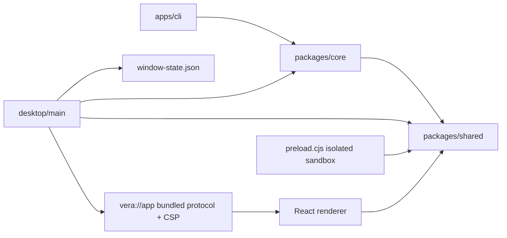

<!--
Copyright (c) 2026 DDP Engineering
This software is licensed under the PolyForm Noncommercial License 1.0.0.
Commercial use requires a separate commercial license.
See the LICENSE.txt in the .agentic folder for full license details.
SPDX-License-Identifier: LicenseRef-PolyForm-Noncommercial-1.0.0
-->

# TASK-773bec2f - WP-01 Electron shell and source skeleton

stage: done
type: feature
path: full
interaction: autopilot
requirements: REQ-PLAT-6f3e3500, REQ-UX-6ccae258, REQ-SEC-bba4d0dd, REQ-SEC-11244926, REQ-SEC-1aba9c7c, REQ-SEC-d6fdde98, REQ-SEC-250c645c, REQ-REL-9e5c0e0e, REQ-DATA-6c54a48f, REQ-TEST-21b726d6, REQ-TEST-2308561a
parent:
branch: master
base: 9f3729fe7399d7acba17e165e3aef5afcc35af72
opened: 2026-10-10

## Done checklist (current stage)

- [x] validated candidate confirmed unchanged; otherwise returned to validate
- [x] validation evidence, diff, exclusions, and outcome presented
- [x] delivery confirmed by the human
- [x] journal and report included in the delivery commit
- [x] agreed outcome delivered, normally a PR
- [x] close-out committed after the outcome succeeded, or carried by the delivery commit where nothing could fail after it

## Frame

Problem: OBSERVED: 05_Software contains tooling but none of the four source workspaces.
Desired outcome: STATED: issue #1, a running hardened Electron shell and source skeleton, independently usable by WP-02 and WP-05.
Actors: desktop user, renderer, main process, developer, local test harness.
Primary scenario: launch VERA -> acquire instance lock, restore bounds, load bundled React renderer -> one window titled VERA with Node primitives inaccessible.
Examples: STATED: inline script insertion is blocked; location.assign("https://example.com") retains the app; window.open returns null; a second launch creates no window.
Counterexamples: IPC app.info, settings/theme services, workbench interaction, native modules and models belong to later work packages.
In scope: four npm workspaces; strict ESM TypeScript references; electron-vite main/preload/React 19 renderer; Vite/Tailwind v4/shadcn/lucide scaffold; pinned stable dependencies; minimum 1024x640; isolation/sandbox/Node/webSecurity flags; production CSP meta and header; deny navigation/windows/permissions; single instance; bounds persistence; dev/build/e2e scripts; VERA_TEST compile flag with no switches; temp userData, network guard, Windows and Ubuntu evidence; factual context and component knowledge.
Out of scope: WP-02 IPC and mock bridge; WP-03 app settings/portable mode/logging; WP-04 full layout/themes/i18n settings; WP-05 packaging/native/model spike; remote publication and issue closure.
Constraints: STATED/OBSERVED: extend existing tooling and boundaries; 01-system laws, ADR-0001/0009, 08-quality rules; no real model; no runtime downloads; preserve other user's edits; follow autopilot and local master commit authorization.
Success signals: workspace/tooling verification succeeds; built-app e2e proves title, minimum size, Node isolation, CSP, navigation/window/permission denial, second-instance exclusion and bounds restart; report Windows/Ubuntu separately.
Evidence: OBSERVED: issue #1 tea JSON (open, no comments); M0-foundation WP-01; architecture 01 sections 1-7, 06 section 1, 08 sections 1-4; ADR-0001/0009; software README/config/tests; tools README/toolchain; benchpilot-reuse and snapshot README/components; UI workspace PNG and UI README. Initial master clean at base 9f3729fe7399d7acba17e165e3aef5afcc35af72; no prior journals or component pages. User-authorized config/AGENTS changes arrived during frame.
Assumptions: INFERRED: minimal identity-only renderer meets WP-01 without implementing full WP-04 UI. Window-state storage is shell-owned, separate from WP-03 settings.
Unknowns: Electron stable/dependency compatibility will be checked at design/build; sandboxed preload output must be CommonJS despite ESM sources; production header with bundled loading needs documented protocol choice; dev HMR CSP differs from production and needs tests; WSL Ubuntu exists but runtime/display/library readiness is unproven.
Decision-blocking questions: none for stated WP-01 scope; preserve explicit security baseline.
Proposed behaviors: launch/build skeleton; hardened renderer; deny attempted script/navigation/window/permission actions; restore valid window geometry with safe defaults for corrupt/off-screen state; reuse first instance; reproducible isolated acceptance tests.
Path and reason: full, new dependencies, externally observable UI, state format and security boundary.

| Quick-path criterion | yes | no | Evidence |
|---|---|---|---|
| No new observable behavior | | x | First desktop window |
| No new interface or data format | | x | Window state and build commands |
| No new dependency | | x | Electron/React/electron-vite/Playwright |
| Existing requirement covers behavior | | x | No requirement files yet |
| No security/data change | | x | First renderer trust boundary |

Children: none; shell/build/test seams are coupled. Explicit independent review is enabled by .agentic/aegis.toml and will be performed in validate.

## Requirement coverage

| Frame outcome | Atomic behavior | Requirement | Positive case | Boundary or failure | Verification | Design decision or no impact |
|---|---|---|---|---|---|---|
| WP-01 shell | Workspace source skeleton | REQ-PLAT-6f3e3500 | Read workspace manifests and solution references, build/typecheck and run boundary tests | See verification | automated | Design requirement-specific bullet |
| WP-01 shell | Desktop launch identity | REQ-UX-6ccae258 | Launch the built app with temporary userData | See verification | automated | Design requirement-specific bullet |
| WP-01 shell | Renderer Node isolation | REQ-SEC-bba4d0dd | Launch built app | See verification | automated | Design requirement-specific bullet |
| WP-01 shell | Bundled content security policy | REQ-SEC-11244926 | Launch built app | See verification | automated | Design requirement-specific bullet |
| WP-01 shell | Block renderer navigation | REQ-SEC-1aba9c7c | Invoke location.assign to https://example.com and observe same URL and live renderer with no outbound request. | See verification | automated | Design requirement-specific bullet |
| WP-01 shell | Deny additional windows | REQ-SEC-d6fdde98 | Call window.open to external URL | See verification | automated | Design requirement-specific bullet |
| WP-01 shell | Deny renderer permissions | REQ-SEC-250c645c | Request notifications and inspect permission check | See verification | automated | Design requirement-specific bullet |
| WP-01 shell | Single desktop instance | REQ-REL-9e5c0e0e | Start two real Electron processes sharing temporary userData | See verification | automated | Design requirement-specific bullet |
| WP-01 shell | Window bounds persistence | REQ-DATA-6c54a48f | Resize/move window, close and restart in same temporary userData | See verification | automated | Design requirement-specific bullet |
| WP-01 shell | Reproducible desktop commands | REQ-TEST-21b726d6 | Run build and acceptance suite on Windows/Ubuntu, inspect Linux launcher, and execute verify | See verification | automated | Design requirement-specific bullet |
| WP-01 shell | Compile-time test build flag | REQ-TEST-2308561a | Build both modes | See verification | automated | Design requirement-specific bullet |

## Design

Requirements coverage and responsibilities:
- REQ-PLAT-6f3e3500: workspace ESM manifests, per-workspace configs extending root base, aggregate desktop config referencing main/preload/renderer/config subprojects; libraries/CLI compile separately; existing Biome boundaries stay canonical. Shared/core/CLI entrypoints export no proposed feature.
- REQ-UX-6ccae258: Electron main owns one native window, React identity-only screen uses adapted shadcn Card, bundled CSS and lucide icon. WP-04 owns full shell and user-facing settings/translations; identity VERA needs no catalog.
- REQ-SEC-bba4d0dd: explicit BrowserWindow flags; TypeScript ESM source compiled to bundled preload .cjs (Electron sandbox constraint). Preload exports nothing to the renderer until WP-02; preload-error event is checked by e2e.
- REQ-SEC-11244926: production uses a standard, secure vera://app protocol with CSP header on every response, same restrictive meta policy. Handler confines GET/HEAD paths to real renderer output root, checks hostname, traversal, symlinks and MIME. No bypassCSP. This supplies headers with bundled assets; file:// headers are not dependable. Deviation from plan's file:// routing assumption recorded; hash/memory routing remains possible.
- REQ-SEC-1aba9c7c/d6fdde98/250c645c: attach will-navigate and will-frame-navigate denial, setWindowOpenHandler deny; session request and check handlers deny. Install before load. Dev and built loads retain same window flags.
- REQ-REL-9e5c0e0e: set app identity and userData override from Chromium user-data-dir argument before requestSingleInstanceLock; register second-instance handler; first instance restores/focuses window; losing instance quits before ready/window creation. Test harness launches a second executable with same userData and no debug port.
- REQ-DATA-6c54a48f: main window-state module owns schemaVersion=1 window-state.json in userData; finite integer normal bounds in pixels, minimum 1024x640; corruption/missing/offscreen -> centered defaults; future version -> defaults read-only. Atomic write via sibling temp and rename on close; error logs to stderr and keeps app usable. No settings or portable-mode service.
- REQ-TEST-21b726d6: root scripts invoke electron-vite; node e2e launcher builds then uses Playwright executable, through xvfb-run -a on Linux; temp userData per launch, no model/runtime downloads. Guard Electron session requests and Node socket connections against non-loopback egress, assert no unexpected renderer errors. Windows and Ubuntu results reported separately; Linux system dependency approval pending.
- REQ-TEST-2308561a: __VERA_TEST__ is replaced at build time in build-mode.ts and exposed only as a main module export for test inspection; no environment-driven switches or bridge. Build both flag values to prove runtime environment cannot change it.

Interfaces/state/ordering: app identity/userData -> lock -> ready -> secure session and protocol -> bounds read -> window handlers/preload -> document load. Close saves normal bounds; second-instance races share the window reference and ready callback. Renderer cannot access filesystem or Electron. Temporary data belongs to harness and is removed after app closes.
Compatibility: Electron 44.7.0 stable checked 2026-10-10 against releases.electronjs.org and npm metadata; electron-vite 5.0.0 peers support Vite 7, so Vite 7.3.7 with plugin-react 5.2.0 is chosen instead of incompatible Vite 8 latest. React 19.3.0, Tailwind 4.3.3, Playwright 1.64.0 and UI helpers pinned exactly. Sandboxed preload CommonJS is output-only compatibility.
Development: fixed loopback server 127.0.0.1:5173, strictPort; post HTML transform adds hashes only for React's actual dev inline preamble; style-src unsafe-inline is development-only for Vite CSS injection; connect-src permits same origin and exact HMR websocket. Default-src remains self, injected arbitrary inline scripts still blocked. Production replaces none of these allowances. Dev smoke exercises load and isolation/CSP.
Observability: Playwright traces on failure, test results, renderer errors and preload failures collected; userData path and OS named in evidence; no instrumentation IPC.
Alternatives: file:// plus meta-only fails explicit header contract; disabling sandbox for ESM violates baseline; applying dev CSP to build violates baseline; importing reference shell adds later features and mismatched layout.
Expected files: 05_Software root package/lock/tsconfig/tools/README, tests/tooling/skeleton.test.ts; packages/{shared,core}/package.json,tsconfig.json,src/index.ts; apps/cli equivalent; apps/desktop/package.json,tsconfig*.json,electron.vite.config.ts,components.json,src/main/{index,security,content-policy,window-state,build-mode}.ts,src/preload/index.ts,src/renderer/{index.html,main.tsx,App.tsx,styles.css,lib/utils.ts,components/ui/card.tsx}; desktop focused unit tests; e2e/shell.spec.ts and helper; playwright.config.ts; scripts/test-e2e.mjs; .agentic artifacts/context/knowledge; user-authorized AGENTS/aegis.toml edits.
Risks: Chromium flags userData and real second launch require Electron evidence; native npm modules require separate platform dependencies; Ubuntu is WSL, not a clean machine/packaged artifact. Open decisions: none blocking build; Ubuntu system packages remain a verification prerequisite.

### Proposed architecture - TASK-773bec2f

Primary sources: https://www.electronjs.org/docs/latest/tutorial/esm ; https://www.electronjs.org/docs/latest/api/protocol ; https://www.electronjs.org/docs/latest/tutorial/security ; https://releases.electronjs.org/release?channel=stable .

## Behavior inventory

Each coverage row is an independently verifiable response. Actor/system and trigger are explicit in requirement prose; positive, boundary and recovery observations are in verification. No existing requirements to reuse; no overlapping outcomes. Development compatibility and state format are refined in design.

## Log

- 2026-10-10 frame: full path; scope accepted from delegated WP-01 instruction under explicitly authorized autopilot; Frame records repository evidence and remaining technical checks.

- 2026-10-10 specify: 11 draft atomic requirements created; 0 reused/revised/retired; coverage audited against Frame; no added product behavior.

- 2026-10-10 design: constrained shell/security/build/state design audited; source snapshot components available, original build configuration absent; chosen pins satisfy published peer dependencies.
- 2026-10-10 DEVIATION design: bundled renderer uses vera://app rather than planned file:// assumption to supply real CSP headers and confine accessible assets; WP-04 routing documentation must account for custom local origin.

- 2026-10-10 build red: REQ-PLAT-6f3e3500; command=`python ../02_Tools/npmw.py npx vitest run --project tooling tests/tooling/skeleton.test.ts` in 05_Software; exit=1; expected missing behavior=four workspace manifests absent (4 assertion failures). Anchor recorded before implementation.

- 2026-10-10 build green: REQ-PLAT-6f3e3500 workspace manifests/references focused skeleton test exit=0 (4 tests); full tsc integration remains for completed desktop sources.
- 2026-10-10 build red: REQ-UX-6ccae258, REQ-SEC-bba4d0dd/11244926/1aba9c7c/d6fdde98/250c645c, REQ-REL-9e5c0e0e; command=`python ../02_Tools/npmw.py npx playwright test e2e/shell.spec.ts` in 05_Software; exit=1; expected missing behavior=built desktop entrypoint absent, so no launch/security boundary exists. Coupled shell acceptance seam tested before implementation.

- 2026-10-10 build red: REQ-TEST-21b726d6; command=`python ../02_Tools/npmw.py npx vitest run --project tooling tests/tooling/skeleton.test.ts`; exit=1; expected missing behavior=dev/build/test:e2e commands absent.

- 2026-10-10 build green: coupled desktop launch/security/instance acceptance command=`python ../02_Tools/npmw.py npx playwright test e2e/shell.spec.ts`; Windows exit=0, 1 e2e test covers identity/minimum/isolation/meta+header CSP/inline block/navigation/windows/permissions/real second process. Native URL + page location oracles handle Playwright cancelled-navigation waiter.
- 2026-10-10 build red: REQ-DATA-6c54a48f; command=`python ../02_Tools/npmw.py npx vitest run --project desktop src/main/window-state.test.ts`; exit=1; expected missing behavior=window-state storage service absent, beforeAll assertion fails before module import.

- 2026-10-10 build red: REQ-DATA-6c54a48f integration; command=`python ../02_Tools/npmw.py npx playwright test e2e/shell.spec.ts -g geometry`; exit=1; expected missing behavior=restart restores default 1200x800 instead of changed 1080x680 position/size.

- 2026-10-10 build green: REQ-DATA-6c54a48f focused Vitest window-state 8 tests and Electron restart acceptance exit=0; schema-version/corrupt/off-screen/left-monitor cases covered. REQ-TEST-21b726d6 root test:e2e builds and runs 4 Windows tests, including dev HMR/CSP and network guard self-test, exit=0; REQ-TEST-2308561a actual two-mode build/execution test exit=0. Ordinary shell ignores runtime dev URL override. Test flag shares the initial pre-implementation shell red seam, extended with both-mode execution proof.

- 2026-10-10 build: candidate reconciled with expected paths; root tooling globs added to AEGIS source layout; no advisory warnings; Windows final focused e2e exit=0 (4) with explicit chromiumSandbox=true. Advance to validate for documentation, review and final proof.

- 2026-10-10 validate correction: review found the pin assertion allowed a wildcard and the dev test omitted its final network-attempt assertion; return to build for assertion-only corrections. No production behavior changes.

- 2026-10-10 build correction proof: exact-pin skeleton 5 tests and focused development Electron acceptance pass on Windows, exit=0; return to validate.

- 2026-10-10 validate inspection: reviewed all 63 candidate paths against base, all 11 active requirements and the state spec. Lockfile agrees with five manifests and resolves only registry.npmjs.org; original boundary rules preserved. Component/context pages now describe actual code. Proposed core/shared arrows are manifest seams, not current runtime imports. Permission handlers deny before load; requirement verification now names the observed browser permission state. Build-flag oracle executes the emitted ESM module with Node.
- 2026-10-10 validate platform preparation: Ubuntu 24.04.4 WSL2 uses a separate source mirror and Linux node_modules. Native .deb dependencies extracted under that mirror; Xvfb alone uses a local proot path adapter for xkbcomp and displayfd readiness. Electron runs outside proot with chromiumSandbox=true; no host packages or Chromium security flags changed. Preliminary Ubuntu Electron suite exit=0, 4 tests; final exact-candidate proof follows.
- 2026-10-10 validate explicit review round 1: specification compliance=approved after independent scope/requirement/design pass; implementation quality=approved after separate correctness/security/error/portability/test pass. Both verdict axes are agent-authored on the same candidate, not external reviewer claims. No outstanding findings; final runtime proof pending.

- 2026-10-10 validate final: `python .agentic/aegis.py check --task TASK-773bec2f --strict --run` on Windows exit=0; configured npm test and npm verify pass, 23 Vitest cases (4 files), Biome and tsc -b; errors=0 warnings=0 notes=0. Windows `python ../02_Tools/npmw.py npm run test:e2e` exit=0, 4 Electron cases. Ubuntu 24.04.4 WSL2 `python3 ../02_Tools/npmw.py npm run verify` exit=0, 23 cases plus Biome/tsc; `npm run test:e2e` through xvfb-run exit=0, 4 Electron cases. Both use chromiumSandbox=true. Ubuntu mirrored all 258 non-AEGIS files with digest 31a76227f97525f63b1359e6de667012f70e4acec97a259a98496ab243945daf; source unchanged after proof. Windows terminal reports the harmless NO_COLOR/FORCE_COLOR precedence warning; no product/test failures. Ubuntu proof uses isolated extracted libraries and an Xvfb-only path adapter, not a clean-machine packaging proof (WP-05).
- 2026-10-10 validate inspection: viewed the Windows built-shell screenshot; centered VERA card, teal activity icon and readable typography render without clipping. Native title and minimum dimensions are verified by Electron acceptance. Final evolution refreshed after the last outside-.agentic edit; all 36 anchor-relative delta paths reconciled with the full 63-file base diff.

- 2026-10-10 deliver: full proof and 63-path candidate presented with custom-origin deviation and separate Windows/Ubuntu evidence. RULING-001 and repository AGENTS.md already authorize this exact local master commit after validation; no new approval is required. Remote push/PR/issue closure remain excluded. Candidate source, tests, requirements, specs and knowledge are unchanged after final proof.

- 2026-10-10 deliver close-out: authorized outcome is one repository-local commit only; closing journal and report are included in that same commit under Stage 6 step 7. All required Windows/Ubuntu verification passed; no push, PR, release, issue modification or future work is part of this outcome. If Git commit fails, restore deliver and record the failure.

## Rulings

- RULING-001 | date=2026-10-10 | decision=autopilot; implement on master; local commit after complete validation; include authorized AGENTS/config edits; no remote push | reason=explicit user steering delivered by source chat and confirmed in AGENTS.md | source=user | supersedes=none
- RULING-002 | date=2026-10-10 | decision=use AEGIS artifacts only | reason=bmad-build renderer and sibling setup skill absent; native repository workflow supplies implementation stages without duplicate artifacts | source=technical | supersedes=none

## Handoff

current: done
status: ready
next: WP-01 local delivery complete; subsequent work packages are separate tasks
must_read: .agentic/steps/6_deliver.md, .agentic/tasks/TASK-773bec2f.md
blockers: none

## Stage report

stage: deliver
result: completed
current: done
changed: Four ESM workspaces; hardened Electron/React shell; bounds persistence; dev/build/e2e scripts; requirements, knowledge and authorized master/autopilot instructions
evidence: Windows strict check exit 0, 23 Vitest tests and lint/typecheck; Windows 4 Electron tests; Ubuntu WSL verify exit 0, 23 tests and 4 Electron tests through xvfb-run; both explicit sandbox true
issues: Production custom-origin deviation recorded; Ubuntu uses isolated dependencies, packaging is WP-05; harmless Windows color-environment warning
next: No remaining WP-01 work; repository-local delivery only
needs_user: no
spec_compliance: approved
implementation_quality: approved
review_round: 1

## Delivery report (2026-10-10)

- stage: deliver; type: feature; path: full; branch: master
- requirements:
  - REQ-PLAT-6f3e3500 - Workspace source skeleton
  - REQ-UX-6ccae258 - Desktop launch identity
  - REQ-SEC-bba4d0dd - Renderer Node isolation
  - REQ-SEC-11244926 - Bundled content security policy
  - REQ-SEC-1aba9c7c - Block renderer navigation
  - REQ-SEC-d6fdde98 - Deny additional windows
  - REQ-SEC-250c645c - Deny renderer permissions
  - REQ-REL-9e5c0e0e - Single desktop instance
  - REQ-DATA-6c54a48f - Window bounds persistence
  - REQ-TEST-21b726d6 - Reproducible desktop commands
  - REQ-TEST-2308561a - Compile-time test build flag
- deviations: 1 recorded
  - design: bundled renderer uses vera://app rather than planned file:// assumption to supply real CSP headers and confine accessible assets; WP-04 routing documentation must account for custom local origin.
- explicit review: enabled; spec_compliance=approved; implementation_quality=approved; review_round=1
- diff vs task base 9f3729f: 63 file(s) changed, 5063 line(s) added
- checks: errors=0 warnings=1 notes=0
- checklist: 5/6 done; open: close-out committed after the outcome succeeded, or carried by the delivery commit where nothing could fail after it
